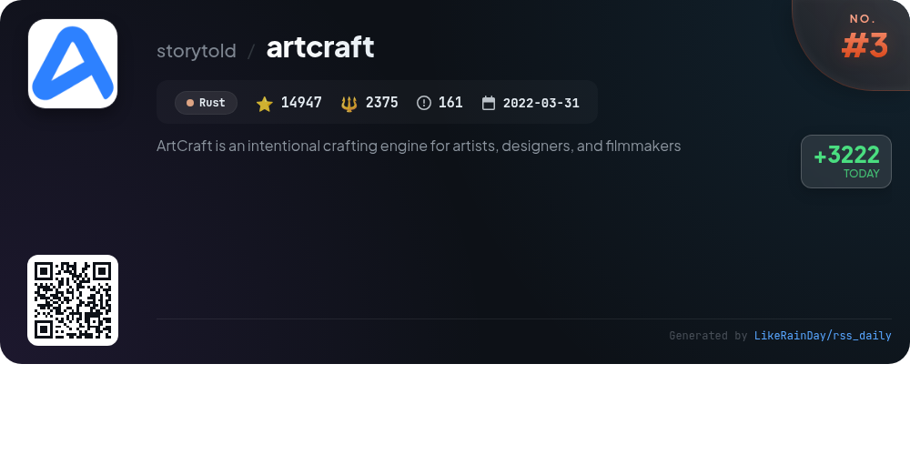
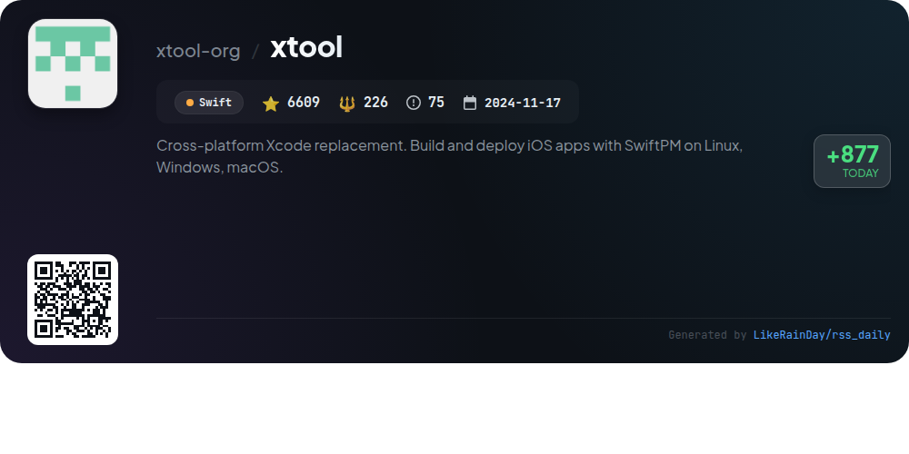
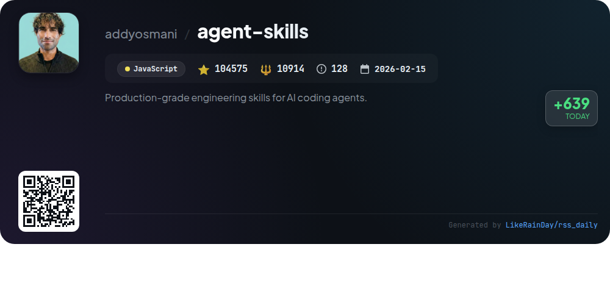
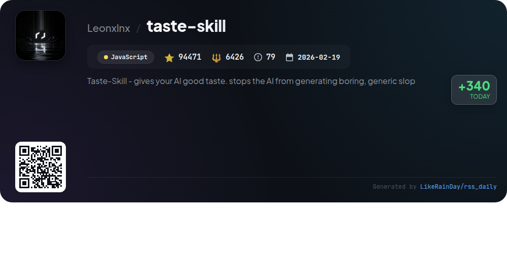

# 📊 🌟 GitHub Trending Daily - 2026-10-11

> > 📅 每日精选 GitHub 热门仓库 | 基于智能算法推荐

## 📋 Overview

**10** 个项目 | **561935** ⭐ | **57994** 🍴

**热门语言:** `JavaScript` (3) · `Swift` (2) · `Go` (1)

**更新时间:** 2026-10-11 05:15 UTC

**分类分布:**

- 🌟 每日 Top 10 精选 (10 项)

---

## 🌟 每日 Top 10 精选

### 1. [rea](https://github.com/morluto/rea)

> 🤖 **推荐理由**  
> *REA (Reverse Engineer Anything) is a powerful TypeScript tool designed for in-depth reverse engineering, enabling users to analyze application behavior and native binaries. With over 77,500 stars, REA allows agents to inspect JavaScript, Electron apps, .NET assemblies, and websites without source code. Key features include local analysis, evidence-based findings, integration with tools like Hopper and Ghidra, and a user-friendly setup via Node.js. The project supports a variety of agents and offers extensive documentation and community support, making it a valuable resource for reverse engineering enthusiasts.*

- ⭐ 77514 stars
- 💻 TypeScript
- 📅 Updated: 2026-10-11

### 2. [AnyPS5](https://github.com/boykopovar/AnyPS5)

> 🤖 **推荐理由**  
> *AnyPS5 is a powerful tool for automatically porting PS5 executables to Linux and Windows, featuring a relinker for converting executables and system PRX libraries for dynamic linking without emulation. With support for SDL-mapped controllers and customizable keyboard/mouse controls, it enhances gaming compatibility. The project includes a shader recompiler producing validated SPIR-V. It maintains a compatibility list for tested games and emphasizes research and preservation, adhering to GPL v2 licensing. With over 27,360 stars, it demonstrates significant community interest and ongoing development.*

- ⭐ 27360 stars
- 💻 C++
- 📅 Updated: 2026-10-11

### 3. [artcraft](https://github.com/storytold/artcraft)

> 🤖 **推荐理由**  
> *ArtCraft is an innovative crafting engine tailored for artists, designers, and filmmakers, enabling interactive AI image and video creation. Key features include 2D and 3D image compositing, character posing, and advanced scene blocking. Users can transform prompts into precise visual outputs, leveraging various models for text-to-image, image editing, and video generation. The platform supports a rich array of models from providers like Grok and Midjourney. With a user-friendly IDE, ArtCraft empowers creatives to refine ideas and craft stunning visuals effectively.*

- ⭐ 14947 stars
- 💻 Rust
- 📅 Updated: 2026-10-11

### 4. [xtool](https://github.com/xtool-org/xtool)

> 🤖 **推荐理由**  
> *xtool is a cross-platform replacement for Xcode, enabling developers to build and deploy iOS apps using Swift Package Manager on Linux, Windows, and macOS. With 6,609 stars, it offers extensive features including app building, signing, and installation, as well as programmatic interaction with Apple Developer Services. The command-line interface provides various subcommands for project management, device handling, and setup. Additionally, xtool includes a library, XKit, for seamless integration with Apple services in your own applications.*

- ⭐ 6609 stars
- 💻 Swift
- 📅 Updated: 2026-10-11

### 5. [open-code-review](https://github.com/alibaba/open-code-review)

> 🤖 **推荐理由**  
> *Open Code Review is an AI-powered code review tool designed for security, speed, and efficiency, validated at Alibaba's scale. It features a hybrid architecture combining deterministic pipelines with LLM agents to provide precise line-level comments and supports a multi-language ruleset for detecting common vulnerabilities (e.g., NPE, XSS). It excels in generating detailed reviews, utilizing a configurable agent for deep analysis of code changes. Open Code Review is open-source and integrates seamlessly with various coding agents, making it a robust choice for developers seeking high-quality code reviews.*

- ⭐ 45921 stars
- 💻 Go
- 📅 Updated: 2026-10-11

### 6. [agent-skills](https://github.com/addyosmani/agent-skills)

> 🤖 **推荐理由**  
> *Agent Skills is a comprehensive JavaScript library designed to equip AI coding agents with production-grade engineering workflows. With 25 structured skills, it guides agents through the entire development lifecycle—defining, planning, building, verifying, reviewing, and shipping code. Key features include automated skill activation based on tasks, a CLI for easy installation across various agents, and pre-configured personas for specialized reviews. By embedding best practices from Google's engineering culture, Agent Skills ensures agents maintain high-quality standards in software development.*

- ⭐ 104575 stars
- 💻 JavaScript
- 📅 Updated: 2026-10-11

### 7. [ghidra](https://github.com/NationalSecurityAgency/ghidra)

> 🤖 **推荐理由**  
> *Ghidra is a powerful open-source software reverse engineering (SRE) framework developed by the NSA. It offers a comprehensive suite of analysis tools for disassembly, decompilation, and graphing, supporting multiple platforms (Windows, macOS, Linux) and a variety of processor instruction sets. Users can create custom scripts and extensions in Java or Python, enhancing functionality. Ghidra helps analysts uncover vulnerabilities in code and tackle complex cybersecurity challenges. Its extensibility and automation capabilities make it an essential tool for SRE professionals.*

- ⭐ 82854 stars
- 💻 Java
- 📅 Updated: 2026-10-11

### 8. [archify](https://github.com/tt-a1i/archify)

> 🤖 **推荐理由**  
> *Archify is an open-source JavaScript project that transforms ideas, plans, or codebases into interactive diagrams, powered by AI agents like Claude Code and Codex. With over 81,000 stars, it allows users to generate HTML visualizations from simple descriptions, making it ideal for various applications, including system architecture and travel itineraries. Key features include customizable diagrams, community-driven extensions, and a standalone output HTML for easy sharing. Archify fosters collaboration and creativity, empowering users to visualize complex concepts effortlessly.*

- ⭐ 81739 stars
- 💻 JavaScript
- 📅 Updated: 2026-10-11

### 9. [vorssaint-utils](https://github.com/vorssaint/vorssaint-utils)

> 🤖 **推荐理由**  
> *Vorssaint is a free, open-source macOS menu bar toolkit that consolidates numerous utilities into a single application. With over 25,000 stars, it offers features like per-app volume control, system monitoring, advanced window management, clipboard history, and text snippets. Users can customize their experience by installing only the features they need, ensuring no unnecessary overhead. The app prioritizes privacy, requiring minimal permissions while providing local functionality. It’s designed for macOS 14 and Apple Silicon, making it a versatile tool for enhancing productivity.*

- ⭐ 25945 stars
- 💻 Swift
- 📅 Updated: 2026-10-11

### 10. [taste-skill](https://github.com/Leonxlnx/taste-skill)

> 🤖 **推荐理由**  
> *Taste Skill is a JavaScript framework designed to enhance AI-generated frontends, ensuring they are visually appealing and not generic. With over 94,000 stars on GitHub, it features a variety of portable Agent Skills for improved layout, typography, and motion. Key offerings include `design-taste-frontend` for UI design, `image-to-code-skill` for transforming images into code, and specialized skills for various design aesthetics. The framework is compatible with major coding agents like Codex and Claude, making it versatile for developers seeking enhanced design capabilities. Visit [tasteskill.dev](https://tasteskill.dev) for more details.*

- ⭐ 94471 stars
- 💻 JavaScript
- 📅 Updated: 2026-10-11

---

## 📡 RSS订阅

通过 RSS 订阅，第一时间获取每日精选项目：

- 🔔 [RSS 订阅源] (../../daily-top.xml)
- 🔔 [每日简报] (../../GITHUB_TODAY_CN.md)
- 🔔 [每日 Top 10 精选](../../daily-top.xml)

---

*⚡ Powered by Smart Trending Algorithm | Generated at 2026-10-11 05:15:10 UTC
