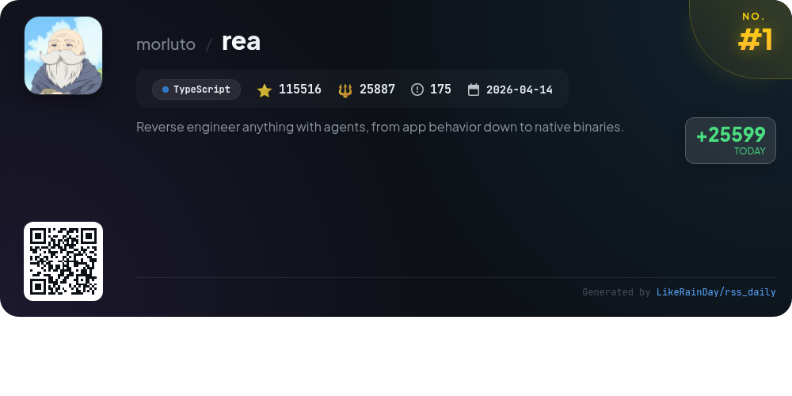
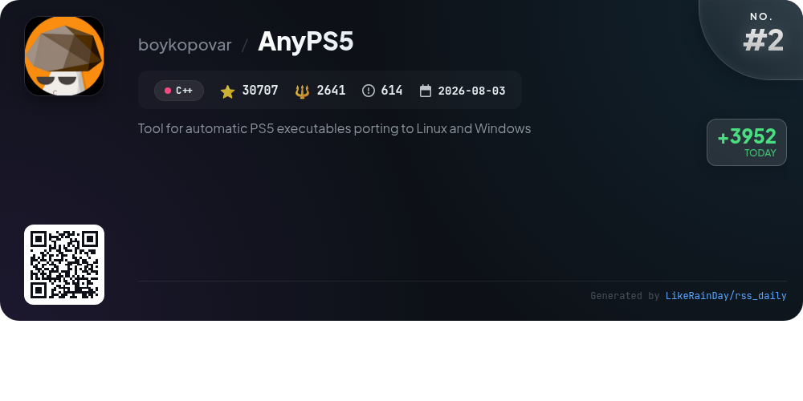
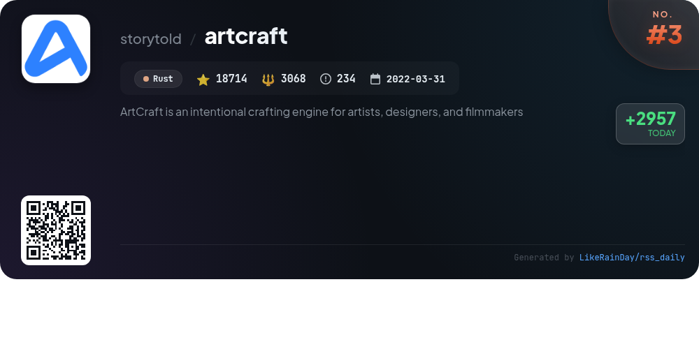
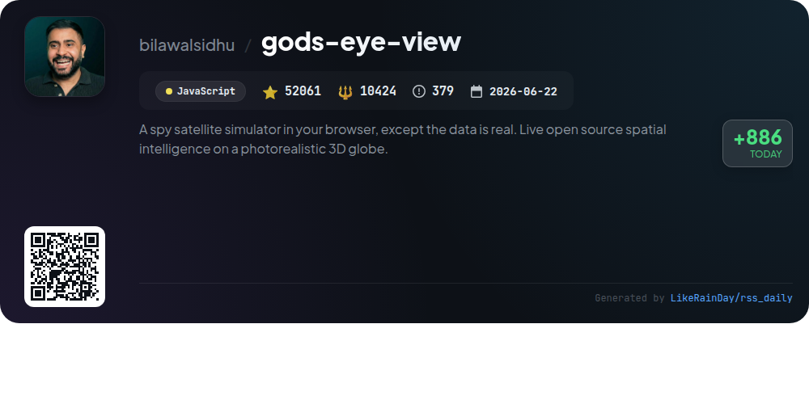
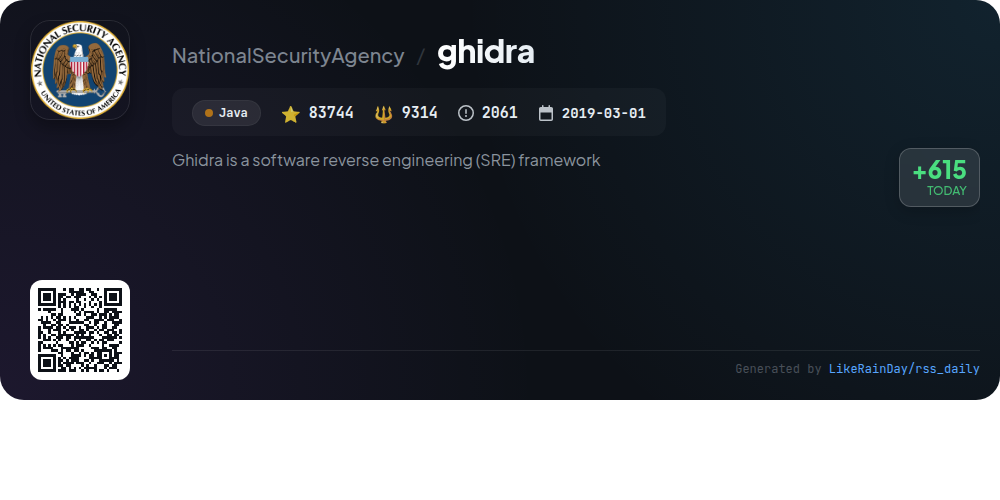
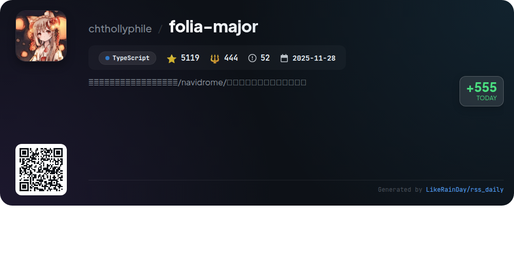
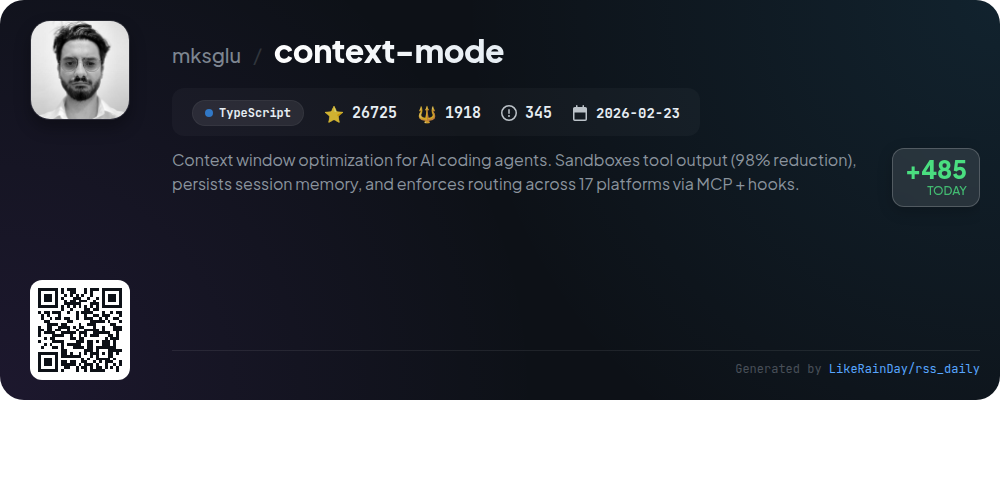
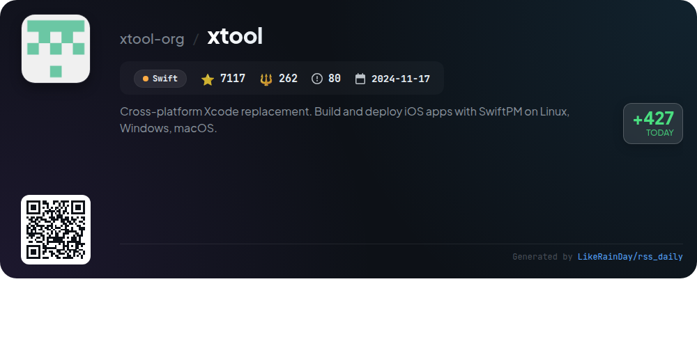
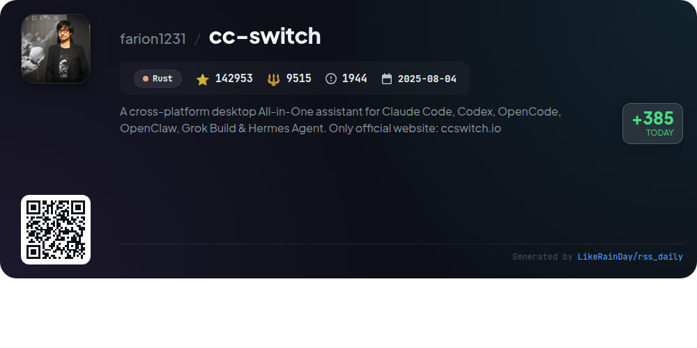
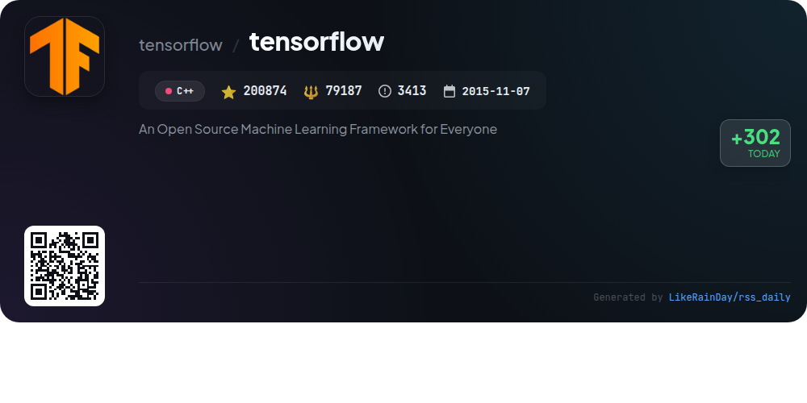

# 📊 🌟 GitHub Trending Daily - 2026-10-12

> > 📅 Daily Picks of GitHub Trending Repositories | Powered by Smart Algorithms

## 📋 Overview

**10** Projects | **683530** ⭐ | **142660** 🍴

**Top Languages:** `TypeScript` (3) · `C++` (2) · `Rust` (2)

**Updated:** 2026-10-12 05:28 UTC

**Categories:**

- 🌟 Daily Top 10 (10 items)

---

## 🌟 Daily Top 10

### 1. [rea](https://github.com/morluto/rea)

> 🤖 **Why Recommend**  
> *REA (Reverse Engineer Anything) is a powerful TypeScript-based tool designed for reverse engineering binaries, applications, and runtime behaviors. With over 115,000 stars on GitHub, it enables users to investigate app features without source code, providing insights and generating similar functionalities for their projects. Core features include support for native binaries, JavaScript/Electron apps, .NET assemblies, and websites. REA operates locally, offering evidence-based analysis with tools like Hopper, Ghidra, and IDA, while facilitating seamless integration with various agents. Comprehensive documentation and community support are available through its website.*

- ⭐ 115516 stars
- 💻 TypeScript
- 📅 Updated: 2026-10-12

### 2. [AnyPS5](https://github.com/boykopovar/AnyPS5)

> 🤖 **Why Recommend**  
> *AnyPS5 is a powerful tool for automatically porting PS5 executables to Linux and Windows, boasting over 30,700 stars on GitHub. Key features include a relinker for converting executables to native formats and implementations of system PRX libraries for dynamic linking, all without emulation. The project supports SDL-mapped game controllers and customizable input mapping. A shader recompiler produces validated SPIR-V. Designed for interoperability and research, AnyPS5 emphasizes compatibility while ensuring users adhere to legal requirements. Licensed under GPL v2.*

- ⭐ 30707 stars
- 💻 C++
- 📅 Updated: 2026-10-12

### 3. [artcraft](https://github.com/storytold/artcraft)

> 🤖 **Why Recommend**  
> *ArtCraft is a powerful crafting engine designed for artists, designers, and filmmakers, enabling interactive AI image and video creation. Key features include advanced 2D and 3D compositing, character posing, and scene blocking, allowing users to precisely control composition and camera placement. It supports a wide array of models for image, video, music, and 3D assets, making it versatile for creative projects. With a user-friendly interface, ArtCraft transforms prompting into crafting, offering tools for refined and repeatable results. Download it for Windows and macOS or build from source.*

- ⭐ 18714 stars
- 💻 Rust
- 📅 Updated: 2026-10-12

### 4. [gods-eye-view](https://github.com/bilawalsidhu/gods-eye-view)

> 🤖 **Why Recommend**  
> *God's Eye View is an open-source spy satellite simulator that operates in your browser, visualizing real-time spatial intelligence on a photorealistic 3D globe. Key features include live tracking of aircraft, ships, satellites, earthquakes, and public cameras, all accessible without API keys. Users can interact via voice commands, annotate the globe, and explore diverse data layers such as live traffic, weather, and military flights. With a focus on transparency and public data, it offers a unique platform for spatial exploration and analysis.*

- ⭐ 52061 stars
- 💻 JavaScript
- 📅 Updated: 2026-10-12

### 5. [ghidra](https://github.com/NationalSecurityAgency/ghidra)

> 🤖 **Why Recommend**  
> *Ghidra is a powerful software reverse engineering (SRE) framework developed by the NSA, designed for analyzing compiled code across various platforms like Windows, macOS, and Linux. Key features include disassembly, decompilation, graphing tools, and extensive scripting capabilities in Java and Python. Ghidra supports diverse processor instruction sets and executable formats, enabling both interactive and automated analysis. Users can create custom extensions, enhancing its functionality. The platform aims to aid cybersecurity efforts by providing deep insights into vulnerabilities in networks and systems.*

- ⭐ 83744 stars
- 💻 Java
- 📅 Updated: 2026-10-12

### 6. [folia-major](https://github.com/chthollyphile/folia-major)

> 🤖 **Why Recommend**  
> *Folia-major is an immersive lyrics animation-focused music player supporting local libraries, Navidrome, and major platforms like NetEase Cloud and Kugou. Key features include intelligent lyric matching, AI-generated themes, and customizable full-screen animations that enhance the listening experience. It offers a desktop version across Windows, macOS, and Linux, as well as a deployable web version via Node.js, with easy setup options on platforms like Vercel. The project also includes a modular system for extending functionality and a sync server for cross-device settings.*

- ⭐ 5119 stars
- 💻 TypeScript
- 📅 Updated: 2026-10-12

### 7. [context-mode](https://github.com/mksglu/context-mode)

> 🤖 **Why Recommend**  
> *Context Mode is a TypeScript-based tool for optimizing context windows in AI coding agents, achieving a 98% reduction in output size. It enables session memory persistence, tracking every user action and file edit in an SQLite database, and supports 17 platforms via an MCP server with automatic routing. Key features include sandboxing tool outputs, session continuity, and efficient code execution through `ctx_execute`. This ensures minimal context usage while maintaining relevant information, enhancing performance across teams at major organizations like Microsoft and Google.*

- ⭐ 26725 stars
- 💻 TypeScript
- 📅 Updated: 2026-10-12

### 8. [xtool](https://github.com/xtool-org/xtool)

> 🤖 **Why Recommend**  
> *xtool is a cross-platform replacement for Xcode, enabling the building and deployment of iOS apps using Swift Package Manager on Linux, Windows, and macOS. With features such as app signing, installation, and programmatic interaction with Apple Developer Services, xtool simplifies iOS development across multiple platforms. Its command-line interface supports project setup, device management, and SwiftPM project creation. Additionally, xtool provides a library for integrating Apple Developer Services and iOS devices into custom applications, making it a versatile tool for developers.*

- ⭐ 7117 stars
- 💻 Swift
- 📅 Updated: 2026-10-12

### 9. [cc-switch](https://github.com/farion1231/cc-switch)

> 🤖 **Why Recommend**  
> *CC Switch is a cross-platform desktop assistant designed for managing multiple AI coding tools, including Claude Code, Codex, Gemini CLI, and more. With over 90 provider presets, it allows users to switch API providers seamlessly without manual editing of configuration files. Key features include centralized management of MCP, Skills, and Prompts, local routing for diverse API formats, and aggregation of models from various providers. The app supports Windows, macOS, and Linux, offering an intuitive interface for tracking usage, quotas, and sessions, enhancing the efficiency of AI-driven development.*

- ⭐ 142953 stars
- 💻 Rust
- 📅 Updated: 2026-10-12

### 10. [tensorflow](https://github.com/tensorflow/tensorflow)

> 🤖 **Why Recommend**  
> *TensorFlow is an open-source machine learning framework, boasting over 200,000 stars on GitHub. Developed by Google Brain, it offers a comprehensive ecosystem of tools and libraries for building and deploying machine learning applications. Key features include stable APIs for Python and C++, extensive community resources, and support for GPU acceleration. TensorFlow supports various platforms, including Linux and Windows, and provides a wealth of tutorials, models, and optimization guides to facilitate learning and development.*

- ⭐ 200874 stars
- 💻 C++
- 📅 Updated: 2026-10-12

---

## 📡 RSS Subscription

Subscribe via RSS to get daily trending updates:

- 🔔 [RSS XML] (../../daily-top.xml)
- 🔔 [Daily Report] (../../GITHUB_TODAY.md)
- 🔔 [Daily Top 10](../../daily-top.xml)

---

*⚡ Powered by Smart Trending Algorithm | Generated at 2026-10-12 05:28:52 UTC
