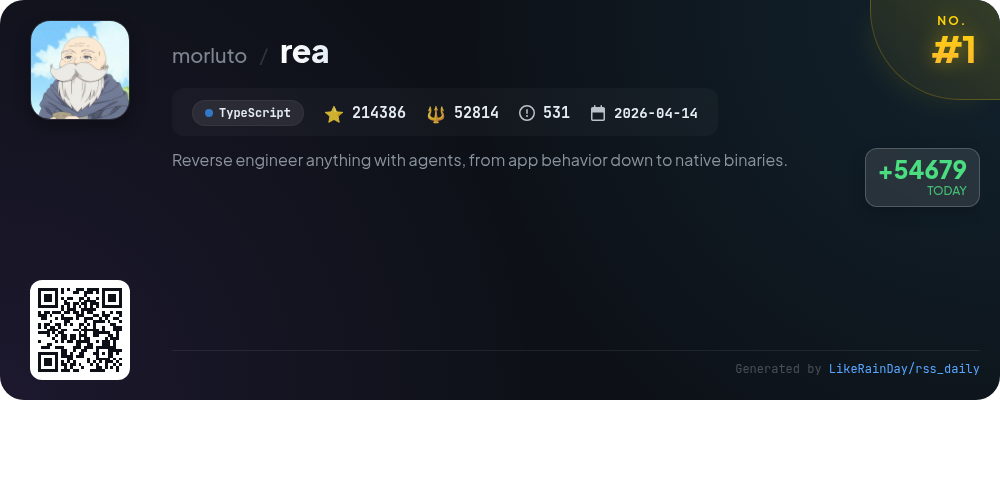
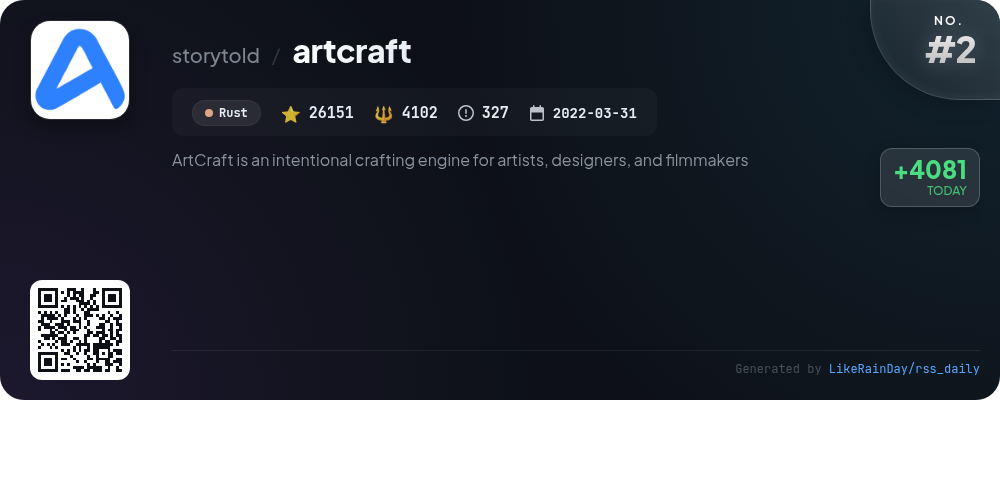
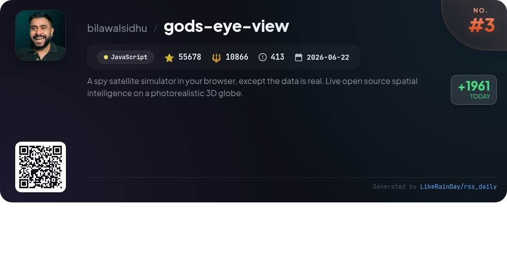
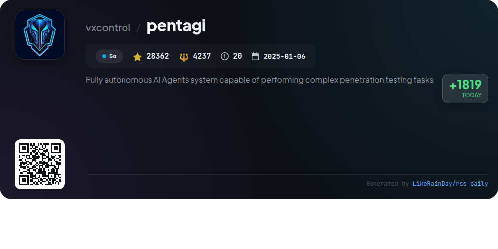
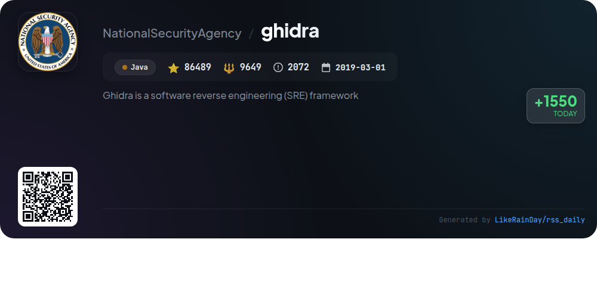
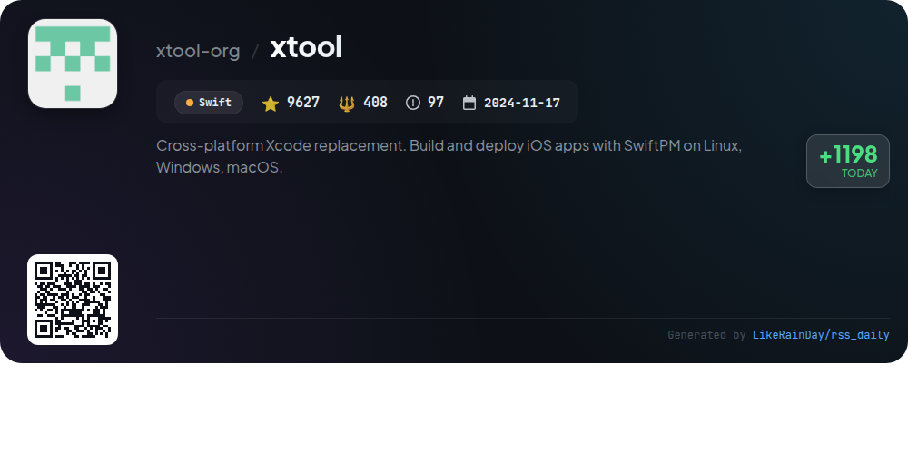
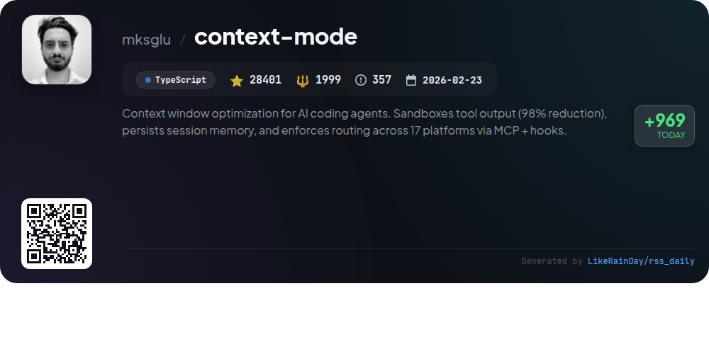
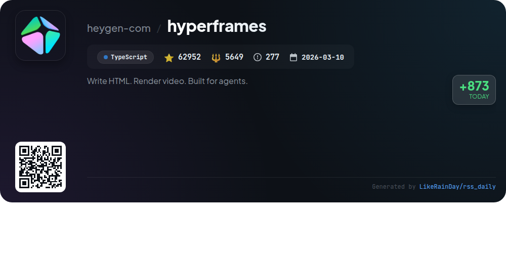
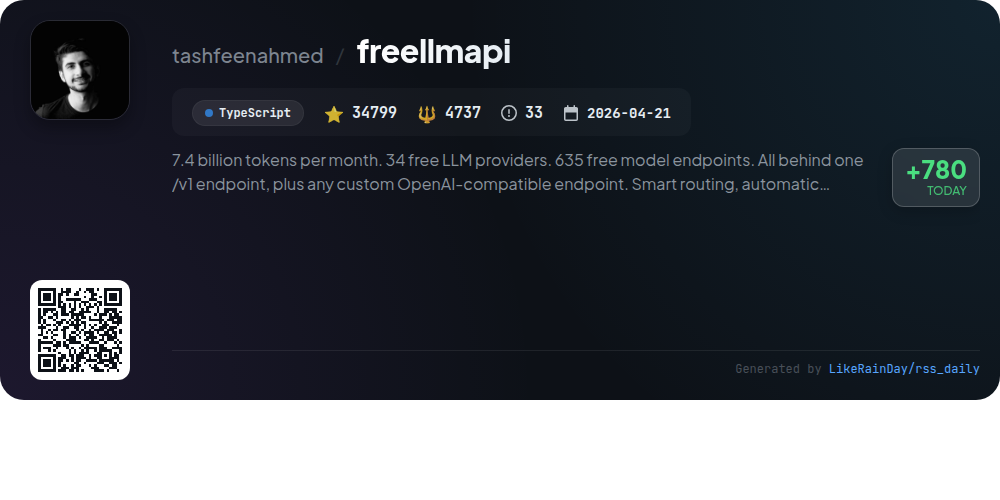
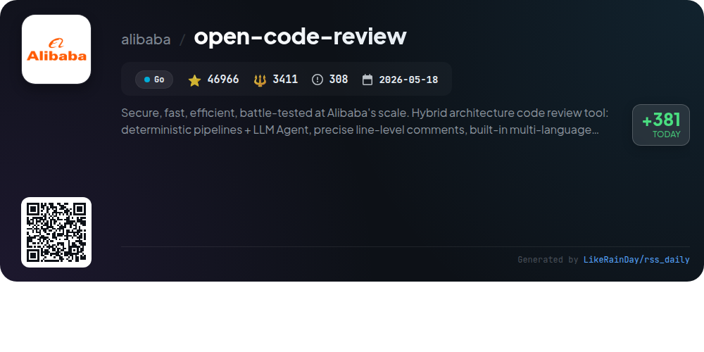

# 📊 🌟 GitHub Trending Daily - 2026-10-14

> > 📅 Daily Picks of GitHub Trending Repositories | Powered by Smart Algorithms

## 📋 Overview

**10** Projects | **593811** ⭐ | **97872** 🍴

**Top Languages:** `TypeScript` (4) · `Go` (2) · `JavaScript` (1)

**Updated:** 2026-10-14 04:29 UTC

**Categories:**

- 🌟 Daily Top 10 (10 items)

---

## 🌟 Daily Top 10

### 1. [rea](https://github.com/morluto/rea)

> 🤖 **Why Recommend**  
> *REA is an advanced reverse engineering tool that enables in-depth analysis of applications and native binaries using agents. It supports various targets, including JavaScript, Electron apps, .NET assemblies, and native binaries, providing insights such as pseudocode, assembly, and module relationships. Users can set up their agents to inspect features within apps, gather evidence, and create similar functionalities. With a focus on local analysis and a robust tool catalog, REA facilitates extensive investigations while maintaining user privacy. Join the community for support and collaboration.*

- ⭐ 214386 stars
- 💻 TypeScript
- 📅 Updated: 2026-10-14

### 2. [artcraft](https://github.com/storytold/artcraft)

> 🤖 **Why Recommend**  
> *ArtCraft is an innovative crafting engine designed for artists, designers, and filmmakers, facilitating interactive AI image and video creation. Key features include 2D and 3D image compositing, character posing, scene blocking with kitbashing, and advanced background removal. Users can explore ideas through text prompts, refine images with canvas editing, and animate creations into videos. Supporting various models and workflows, ArtCraft integrates with providers like Grok, Midjourney, and Sora, making it a versatile tool for creative projects. Downloadable for Windows and macOS, it boasts a vibrant community and extensive documentation.*

- ⭐ 26151 stars
- 💻 Rust
- 📅 Updated: 2026-10-14

### 3. [gods-eye-view](https://github.com/bilawalsidhu/gods-eye-view)

> 🤖 **Why Recommend**  
> *God's Eye View is a browser-based spy satellite simulator offering real-time spatial intelligence on a photorealistic 3D globe. Key features include live tracking of aircraft, ships, satellites, and earthquakes, hands-free voice control, and the ability to visualize data layers like traffic and public cameras. Users can toggle between sensor styles, capture cinematic tours, and analyze live data with an AI assistant. The project is open source, allowing customization and extension, making it a powerful tool for exploring public data without the need for API keys.*

- ⭐ 55678 stars
- 💻 JavaScript
- 📅 Updated: 2026-10-14

### 4. [pentagi](https://github.com/vxcontrol/pentagi)

> 🤖 **Why Recommend**  
> *PentAGI is a fully autonomous AI agent system designed for complex penetration testing tasks. It features a self-hosted multi-agent architecture that utilizes 20+ professional tools, operates in a secure Docker environment, and can connect to over 10 LLM providers, including OpenAI, Anthropic, and Google AI. Key highlights include a smart memory system for long-term learning, optional knowledge graph integration with Neo4j, REST and GraphQL APIs for automation, and detailed reporting capabilities. PentAGI is ideal for security engineers and ethical hackers seeking reliable and scalable solutions for authorized testing.*

- ⭐ 28362 stars
- 💻 Go
- 📅 Updated: 2026-10-14

### 5. [ghidra](https://github.com/NationalSecurityAgency/ghidra)

> 🤖 **Why Recommend**  
> *Ghidra is a powerful software reverse engineering (SRE) framework developed by the NSA, featuring a comprehensive suite of tools for analyzing compiled code across Windows, macOS, and Linux platforms. Key features include disassembly, decompilation, graphing, and extensive script support in Java and Python. Ghidra is designed for both interactive and automated use, allowing users to create custom extensions. It addresses complex SRE challenges, aiding cybersecurity efforts by enabling deep analysis of malicious code and system vulnerabilities.*

- ⭐ 86489 stars
- 💻 Java
- 📅 Updated: 2026-10-14

### 6. [xtool](https://github.com/xtool-org/xtool)

> 🤖 **Why Recommend**  
> *xtool is a cross-platform replacement for Xcode, enabling the build and deployment of iOS apps using SwiftPM on Linux, Windows, and macOS. With features like app signing, installation, and programmatic interaction with Apple Developer Services, it streamlines iOS development. The command-line interface supports project setup, authentication, and device management. Additionally, xtool offers a library (XKit) for seamless integration with Apple services in custom apps. With over 9,600 stars, it's a valuable tool for developers seeking versatility beyond Xcode.*

- ⭐ 9627 stars
- 💻 Swift
- 📅 Updated: 2026-10-14

### 7. [context-mode](https://github.com/mksglu/context-mode)

> 🤖 **Why Recommend**  
> *Context Mode is a TypeScript-based GitHub project designed for optimizing context windows in AI coding agents. It achieves a 98% reduction in output size by sandboxing tool data, maintaining session memory through SQLite, and enforcing routing across 17 platforms via hooks. Key features include advanced context saving, session continuity, and efficient code execution, allowing agents to generate scripts instead of processing raw data. With tools like `ctx_execute` and `ctx_search`, Context Mode enhances AI productivity while ensuring data privacy and security.*

- ⭐ 28401 stars
- 💻 TypeScript
- 📅 Updated: 2026-10-14

### 8. [hyperframes](https://github.com/heygen-com/hyperframes)

> 🤖 **Why Recommend**  
> *HyperFrames is an open-source framework that transforms HTML, CSS, and media into deterministic MP4 videos, designed for AI coding agents. It features a CLI for local rendering, a robust skills library for building videos through commands, and seamless integration with various animation libraries. Key services include AWS Lambda rendering, a community playground for collaboration, and tools for importing assets from Figma. HyperFrames emphasizes HTML-native authoring, determinism, and agent-friendly workflows, making it ideal for automated video production.*

- ⭐ 62952 stars
- 💻 TypeScript
- 📅 Updated: 2026-10-14

### 9. [freellmapi](https://github.com/tashfeenahmed/freellmapi)

> 🤖 **Why Recommend**  
> *FreeLLMAPI is a TypeScript-based API aggregator that provides access to 34 free LLM providers and 635 model endpoints, offering up to 7.4 billion tokens per month through a single OpenAI-compatible endpoint. Key features include smart routing for optimal model selection, automatic failover during rate limits, encrypted key storage, and comprehensive support for chat, embeddings, image, and audio tasks. Built for personal experimentation, it allows users to manage keys and monitor usage easily via a dashboard. The project boasts 34,799 stars on GitHub, emphasizing its popularity and utility.*

- ⭐ 34799 stars
- 💻 TypeScript
- 📅 Updated: 2026-10-14

### 10. [open-code-review](https://github.com/alibaba/open-code-review)

> 🤖 **Why Recommend**  
> *Open Code Review is an AI-powered code review CLI tool developed by Alibaba, designed for secure and efficient code analysis. Key features include deterministic pipelines for precise line-level comments, a built-in multi-language ruleset addressing common vulnerabilities (NPE, thread-safety, XSS, SQL injection), and compatibility with OpenAI & Anthropic models. It effectively reads Git diffs and can scan entire files for auditing. With over 46,000 stars, it promises high precision and speed, making it suitable for large-scale development environments.*

- ⭐ 46966 stars
- 💻 Go
- 📅 Updated: 2026-10-14

---

## 📡 RSS Subscription

Subscribe via RSS to get daily trending updates:

- 🔔 [RSS XML] (../../daily-top.xml)
- 🔔 [Daily Report] (../../GITHUB_TODAY.md)
- 🔔 [Daily Top 10](../../daily-top.xml)

---

*⚡ Powered by Smart Trending Algorithm | Generated at 2026-10-14 04:29:34 UTC
