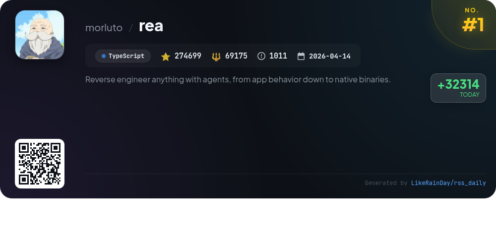
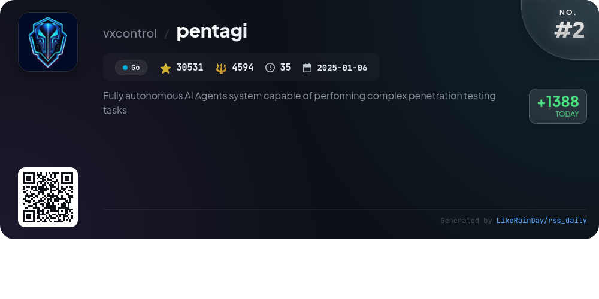
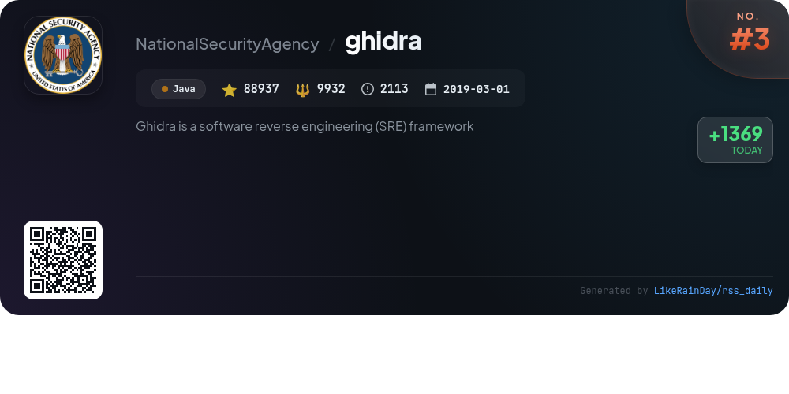
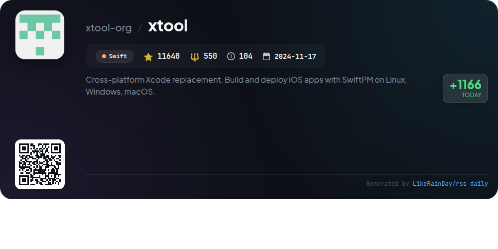
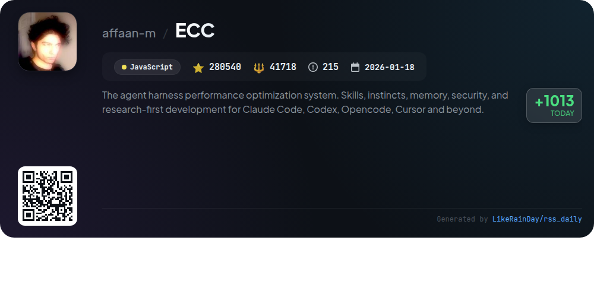
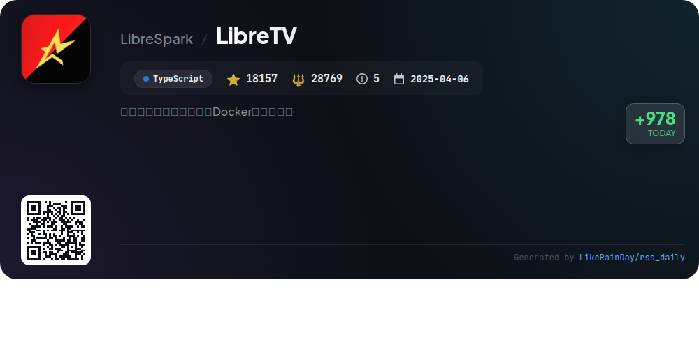
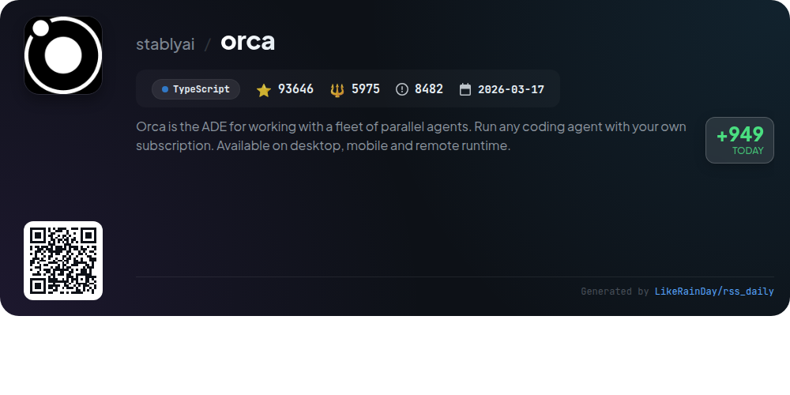
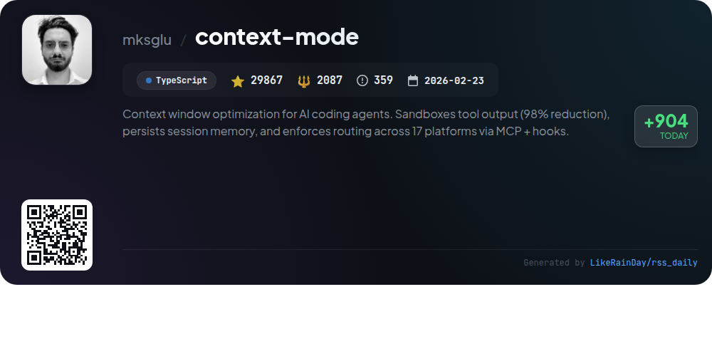
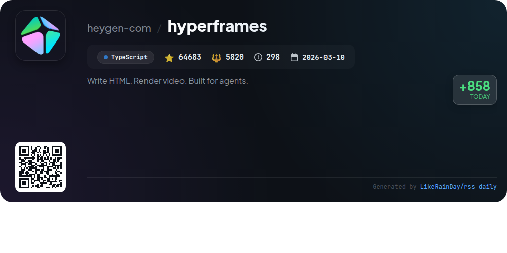
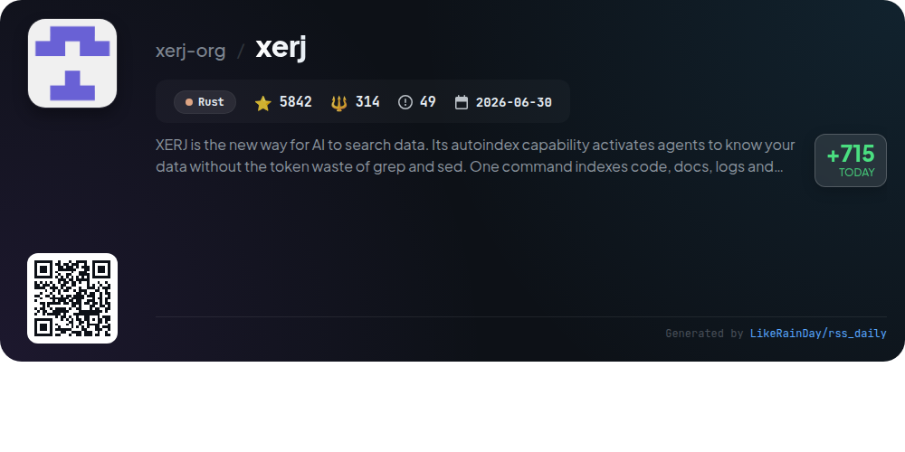

# 📊 🌟 GitHub Trending Daily - 2026-10-16

> > 📅 每日精选 GitHub 热门仓库 | 基于智能算法推荐

## 📋 Overview

**10** 个项目 | **898542** ⭐ | **168934** 🍴

**热门语言:** `TypeScript` (5) · `Java` (1) · `Swift` (1)

**更新时间:** 2026-10-16 04:07 UTC

**分类分布:**

- 🌟 每日 Top 10 精选 (10 项)

---

## 🌟 每日 Top 10 精选

### 1. [rea](https://github.com/morluto/rea)

> 🤖 **推荐理由**  
> *REA is a powerful reverse engineering tool designed to analyze applications and native binaries. It allows users to inspect app behavior without source code, providing insights down to the binary level. Key features include support for native binaries, JavaScript, Electron apps, .NET assemblies, and more. Users can interact with their agents to investigate functionalities and generate similar features. REA operates locally, ensuring data privacy, and offers comprehensive guides and showcases to facilitate learning and application. With a vibrant community and extensive documentation, REA is ideal for developers and researchers alike.*

- ⭐ 274699 stars
- 💻 TypeScript
- 📅 Updated: 2026-10-16

### 2. [pentagi](https://github.com/vxcontrol/pentagi)

> 🤖 **推荐理由**  
> *PentAGI is a powerful, open-source autonomous AI agent system designed for penetration testing, capable of executing complex tasks within a secure Docker environment. Key features include built-in access to over 20 professional security tools, advanced memory systems for persistent learning, and integration with multiple cloud LLM providers. The platform supports REST and GraphQL APIs for automation and provides detailed reporting and monitoring capabilities. Additionally, it features a community-driven approach, allowing users to collaborate and share insights within the cybersecurity domain.*

- ⭐ 30531 stars
- 💻 Go
- 📅 Updated: 2026-10-16

### 3. [ghidra](https://github.com/NationalSecurityAgency/ghidra)

> 🤖 **推荐理由**  
> *Ghidra is a powerful software reverse engineering (SRE) framework developed by the NSA, featuring an extensive suite of tools for analyzing compiled code across multiple platforms (Windows, macOS, Linux). Key functionalities include disassembly, decompilation, graphing, and scripting, supporting various processor instruction sets and executable formats. Ghidra enables both interactive and automated analysis, allowing users to create custom extensions and scripts in Java or Python. Its design addresses complex cybersecurity challenges, making it essential for vulnerability analysis and malicious code investigations.*

- ⭐ 88937 stars
- 💻 Java
- 📅 Updated: 2026-10-16

### 4. [xtool](https://github.com/xtool-org/xtool)

> 🤖 **推荐理由**  
> *xtool is a cross-platform replacement for Xcode, enabling the building and deployment of iOS apps using SwiftPM on Linux, Windows, and macOS. With over 11,640 stars, it offers essential features such as package building, iOS app signing and installation, and programmatic interaction with Apple Developer Services. Users can easily set up their development environment, create new projects, and manage devices through a comprehensive command line interface. The included library, XKit, allows for seamless integration with Apple services in custom applications.*

- ⭐ 11640 stars
- 💻 Swift
- 📅 Updated: 2026-10-16

### 5. [ECC](https://github.com/affaan-m/ECC)

> 🤖 **推荐理由**  
> *ECC is an advanced performance optimization system for coding agents like Claude Code, Codex, and others, boasting 71 specialized agents and 311 skills. Key features include a guided installation process, continuous learning capabilities, and security auditing with AgentShield. ECC streamlines workflows through structured planning, testing, and review processes, enhancing code quality and efficiency. It supports multiple platforms, offers extensive documentation, and integrates with community tools, making it a versatile choice for developers seeking to optimize their coding environments.*

- ⭐ 280540 stars
- 💻 JavaScript
- 📅 Updated: 2026-10-16

### 6. [LibreTV](https://github.com/LibreSpark/LibreTV)

> 🤖 **推荐理由**  
> *LibreTV is a free video aggregation and streaming platform built with Next.js, TypeScript, and Tailwind CSS. Key features include multi-source search, HLS playback with ArtPlayer, live IPTV support, and a dual-theme interface. Users benefit from progress synchronization, source health monitoring, and customizable recommendations. Deployment is straightforward via Docker, ensuring easy setup and scalability. The platform does not host content but consolidates third-party sources, providing a seamless viewing experience while ensuring compliance with content legality.*

- ⭐ 18157 stars
- 💻 TypeScript
- 📅 Updated: 2026-10-16

### 7. [orca](https://github.com/stablyai/orca)

> 🤖 **推荐理由**  
> *Orca is an advanced development environment (ADE) designed for managing a fleet of coding agents in parallel, accessible on desktop and mobile. With features like parallel worktrees for isolated agent prompts, a mobile companion app for remote monitoring, and SSH worktrees for remote operations, it enhances productivity. Users can compare agent outputs, annotate AI diffs, and utilize a robust CLI for automation. Orca supports various agents like Codex and ClaudeCode, making it versatile for developers. Join the community on Discord for support and updates.*

- ⭐ 93646 stars
- 💻 TypeScript
- 📅 Updated: 2026-10-16

### 8. [context-mode](https://github.com/mksglu/context-mode)

> 🤖 **推荐理由**  
> *Context Mode is an advanced context window optimization tool for AI coding agents, achieving a remarkable 98% reduction in output size. Key features include session memory persistence, sandboxing of tool outputs, and automatic routing across 17 platforms using hooks. It supports multiple programming languages, enabling efficient execution without flooding context. The tool also captures user decisions and session details, ensuring continuity even after conversation compaction. With over 29,000 stars, it's actively used by major tech companies like Microsoft and Google, emphasizing its reliability and effectiveness in enhancing AI coding workflows.*

- ⭐ 29867 stars
- 💻 TypeScript
- 📅 Updated: 2026-10-16

### 9. [hyperframes](https://github.com/heygen-com/hyperframes)

> 🤖 **推荐理由**  
> *HyperFrames is an open-source framework designed for creating deterministic MP4 videos using HTML, CSS, and animations. With 64,683 stars, it features a user-friendly CLI for local projects, a set of 21 agent skills for AI-driven coding, and robust rendering capabilities, including AWS Lambda support. Users can create diverse content, from product launches to data visualizations, using readily available blocks and components. Its deterministic nature ensures consistent output, making it ideal for CI and automated rendering workflows. Explore more at hyperframes.dev.*

- ⭐ 64683 stars
- 💻 TypeScript
- 📅 Updated: 2026-10-16

### 10. [xerj](https://github.com/xerj-org/xerj)

> 🤖 **推荐理由**  
> *XERJ is a powerful AI-driven data search tool that automatically indexes code, documents, logs, and PDFs with minimal token usage—up to 40x fewer than traditional methods like grep. Its key features include Elasticsearch compatibility, seamless integration for reference coding, and efficient agent memory storage. XERJ excels in tasks such as security audits, log analysis, and retrieval-augmented generation (RAG), enabling agents to quickly access relevant information. With a simple command to index any folder, XERJ enhances productivity while reducing costs in AI-driven development.*

- ⭐ 5842 stars
- 💻 Rust
- 📅 Updated: 2026-10-16

---

## 📡 RSS订阅

通过 RSS 订阅，第一时间获取每日精选项目：

- 🔔 [RSS 订阅源] (../../daily-top.xml)
- 🔔 [每日简报] (../../GITHUB_TODAY_CN.md)
- 🔔 [每日 Top 10 精选](../../daily-top.xml)

---

*⚡ Powered by Smart Trending Algorithm | Generated at 2026-10-16 04:07:21 UTC
