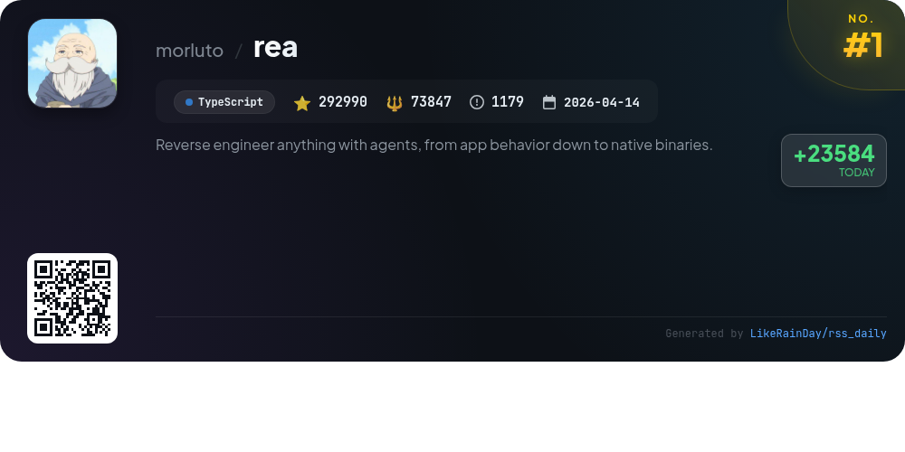
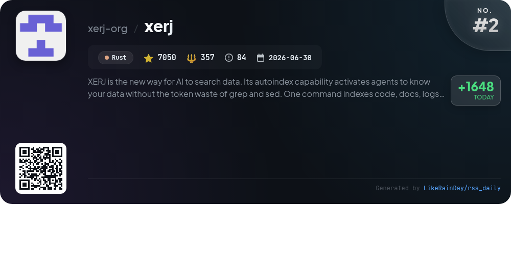
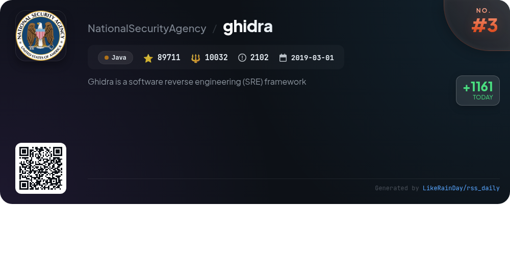
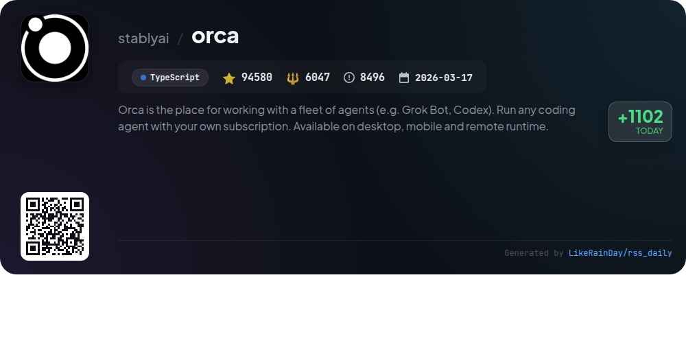
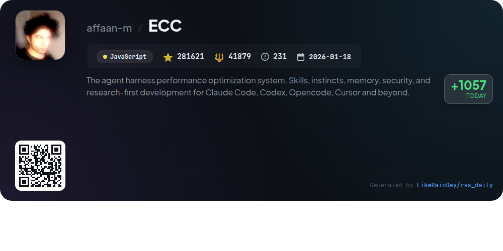
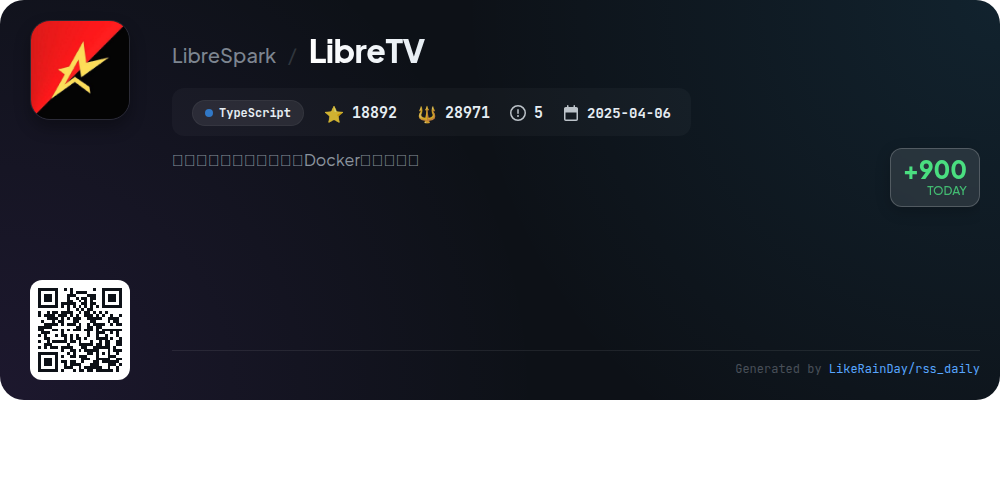
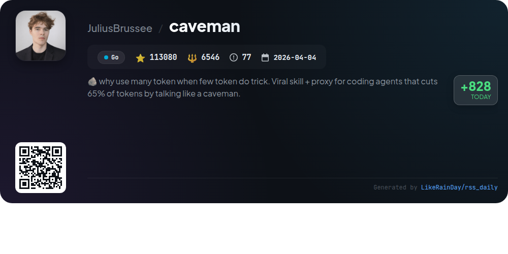
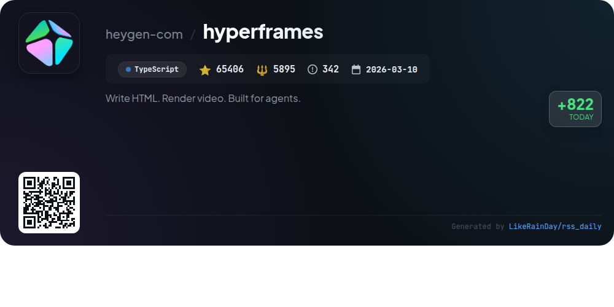
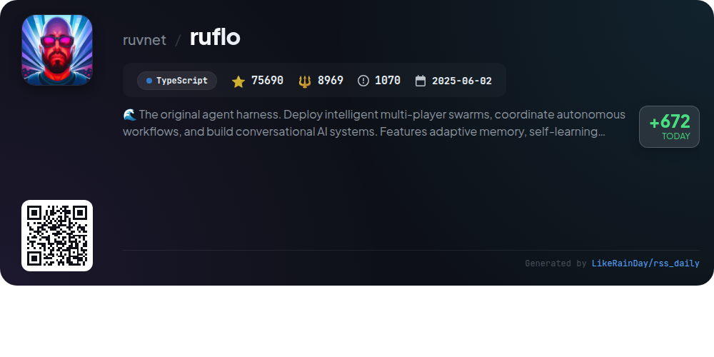
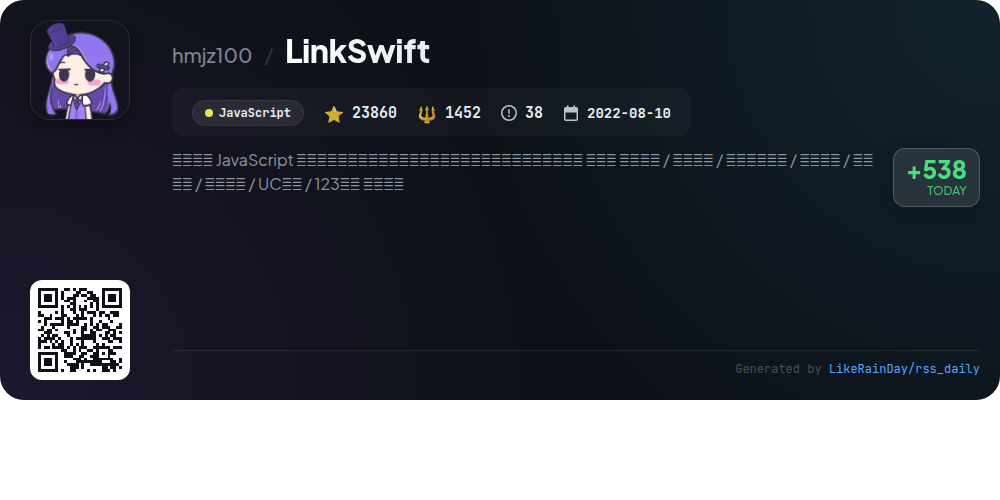

# 📊 🌟 GitHub Trending Daily - 2026-10-17

> > 📅 每日精选 GitHub 热门仓库 | 基于智能算法推荐

## 📋 Overview

**10** 个项目 | **1062880** ⭐ | **183995** 🍴

**热门语言:** `TypeScript` (5) · `JavaScript` (2) · `Go` (1)

**更新时间:** 2026-10-17 03:57 UTC

**分类分布:**

- 🌟 每日 Top 10 精选 (10 项)

---

## 🌟 每日 Top 10 精选

### 1. [rea](https://github.com/morluto/rea)

> 🤖 **推荐理由**  
> *REA is a powerful TypeScript-based tool designed for reverse engineering applications and binaries. With over 292,990 stars, it allows users to inspect app behaviors and native binaries without source code. Core features include support for native binaries, JavaScript, Electron apps, and .NET assemblies, utilizing tools like Hopper and Ghidra for deep analysis. Users can set up agents for automated investigations, obtain pseudocode, and gather evidence for feature replication. REA operates locally, ensuring user privacy while providing comprehensive analysis capabilities across various formats.*

- ⭐ 292990 stars
- 💻 TypeScript
- 📅 Updated: 2026-10-17

### 2. [xerj](https://github.com/xerj-org/xerj)

> 🤖 **推荐理由**  
> *XERJ is an innovative AI-driven data search tool that significantly reduces token usage by auto-indexing code, documents, logs, and PDFs with one command. It operates 40x more efficiently than traditional tools like grep, making it ideal for tasks such as reference coding, security audits, and agent memory management. XERJ is Elasticsearch compatible, ensuring seamless integration with existing systems. It supports features like hybrid search, agent memory storage, and real-time log analytics, empowering users to access precise information quickly and efficiently.*

- ⭐ 7050 stars
- 💻 Rust
- 📅 Updated: 2026-10-17

### 3. [ghidra](https://github.com/NationalSecurityAgency/ghidra)

> 🤖 **推荐理由**  
> *Ghidra is a powerful software reverse engineering (SRE) framework developed by the NSA, featuring advanced tools for analyzing compiled code across Windows, macOS, and Linux. Key capabilities include disassembly, decompilation, graphing, and scripting, supporting numerous processor instruction sets and executable formats. Ghidra allows for customization through user-developed extensions and scripts in Java or Python. Designed to address complex SRE challenges, it enhances cybersecurity efforts by providing deep insights into vulnerabilities in systems and networks.*

- ⭐ 89711 stars
- 💻 Java
- 📅 Updated: 2026-10-17

### 4. [orca](https://github.com/stablyai/orca)

> 🤖 **推荐理由**  
> *Orca is a versatile platform for managing a fleet of coding agents like Codex and Grok Bot, designed for desktop, mobile, and remote environments. Key features include parallel worktrees to run multiple agents simultaneously, a mobile companion app for remote monitoring, and advanced terminal splits. Users can drag files into agent prompts, utilize integrated GitHub and Linear task management, and leverage SSH for remote work. With support for various CLI agents and a robust CLI for automation, Orca streamlines the development process for modern builders.*

- ⭐ 94580 stars
- 💻 TypeScript
- 📅 Updated: 2026-10-17

### 5. [ECC](https://github.com/affaan-m/ECC)

> 🤖 **推荐理由**  
> *ECC is an advanced performance optimization system designed for AI agents like Claude Code, Codex, and others. It features 71 specialized agents, 311 reusable skills, and 97 command shims, enabling optimized workflows for coding tasks. Key highlights include automated planning, testing, implementation, and review processes, along with security auditing via AgentShield. ECC supports various platforms through guided setup, allowing seamless integration and continuous learning. Its open-source nature and community engagement foster innovation in AI-assisted development.*

- ⭐ 281621 stars
- 💻 JavaScript
- 📅 Updated: 2026-10-17

### 6. [LibreTV](https://github.com/LibreSpark/LibreTV)

> 🤖 **推荐理由**  
> *LibreTV is a free online video aggregation platform built with Next.js, TypeScript, and Tailwind CSS, featuring a dual theme option. Key features include multi-source search aggregation, HLS playback with ad filtering, live IPTV support, and playback history synchronization via IndexedDB. Users can easily manage video sources and subscriptions, while the PWA capability allows installation on desktops. Docker deployment is recommended, ensuring secure access via HTTPS. The platform does not host content but aggregates third-party sources, emphasizing user privacy and security.*

- ⭐ 18892 stars
- 💻 TypeScript
- 📅 Updated: 2026-10-17

### 7. [caveman](https://github.com/JuliusBrussee/caveman)

> 🤖 **推荐理由**  
> *Caveman is a Go-based GitHub project that optimizes AI interactions by reducing token usage by up to 65% without sacrificing output quality. Key features include a streamlined conversational style, input reduction, and a "blocks" mode that allows agents to reuse scripts. It also offers an "Auto" feature that automatically selects models for cost-efficient querying. With over 113,000 stars, Caveman has been validated by Adobe Research and JetBrains, making it a leading tool for developers looking to enhance AI efficiency and reduce operational costs.*

- ⭐ 113080 stars
- 💻 Go
- 📅 Updated: 2026-10-17

### 8. [hyperframes](https://github.com/heygen-com/hyperframes)

> 🤖 **推荐理由**  
> *HyperFrames is an open-source framework that transforms HTML into deterministic MP4 videos, built for AI coding agents. Key features include a CLI for local rendering, an extensive catalog of reusable blocks, and a robust set of 21 skills for video creation workflows. Users can create a range of videos, from product launches to data visualizations, using familiar HTML and CSS. HyperFrames supports various animation libraries and offers cloud rendering options. It's designed for seamless integration with coding agents, making video production accessible and efficient.*

- ⭐ 65406 stars
- 💻 TypeScript
- 📅 Updated: 2026-10-17

### 9. [ruflo](https://github.com/ruvnet/ruflo)

> 🤖 **推荐理由**  
> *Ruflo is an advanced agent meta-harness designed for deploying intelligent multi-player swarms and coordinating autonomous workflows using Claude Code and Codex. With features like adaptive memory, self-learning intelligence, and zero-trust federation, it enables agents to collaborate securely across machines. Ruflo integrates over 100 specialized agents, supports vector memory with fast retrieval, and offers a plugin marketplace for extensibility. Key functionalities include swarm coordination, intelligent task routing, and robust security measures, making it ideal for sophisticated AI system development.*

- ⭐ 75690 stars
- 💻 TypeScript
- 📅 Updated: 2026-10-17

### 10. [LinkSwift](https://github.com/hmjz100/LinkSwift)

> 🤖 **推荐理由**  
> *LinkSwift is a JavaScript-based tool for retrieving direct download links from various cloud storage services, including Baidu Netdisk, Alibaba Cloud, China Mobile Cloud, and more. With over 23,800 stars on GitHub, it enhances the original "Cloud Direct Link Downloader" by introducing features like UI beautification and support for multiple download managers. Users can easily install the script through various sources, ensuring compliance with service providers. LinkSwift prioritizes user needs while respecting service terms, facilitating efficient file downloads without breaching limits.*

- ⭐ 23860 stars
- 💻 JavaScript
- 📅 Updated: 2026-10-17

---

## 📡 RSS订阅

通过 RSS 订阅，第一时间获取每日精选项目：

- 🔔 [RSS 订阅源] (../../daily-top.xml)
- 🔔 [每日简报] (../../GITHUB_TODAY_CN.md)
- 🔔 [每日 Top 10 精选](../../daily-top.xml)

---

*⚡ Powered by Smart Trending Algorithm | Generated at 2026-10-17 03:57:57 UTC
