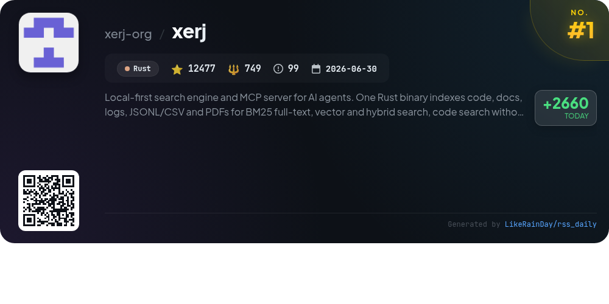
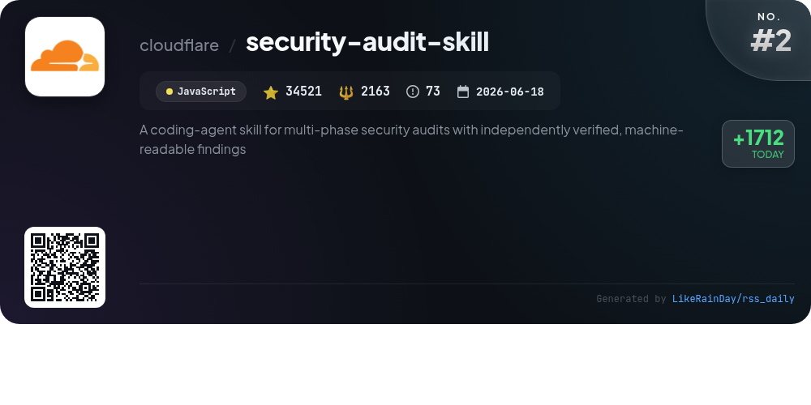
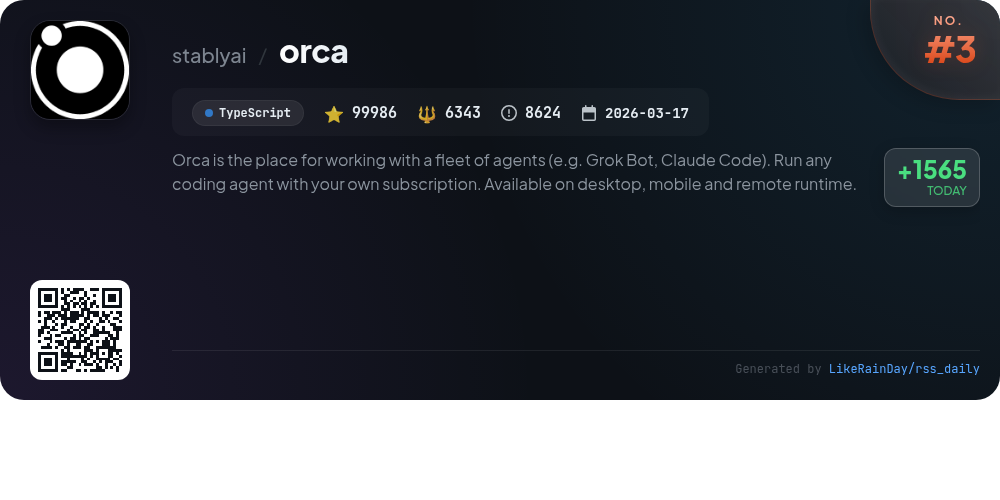
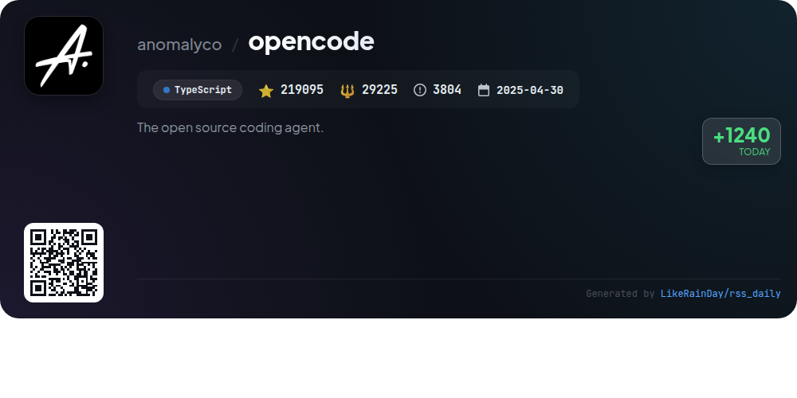
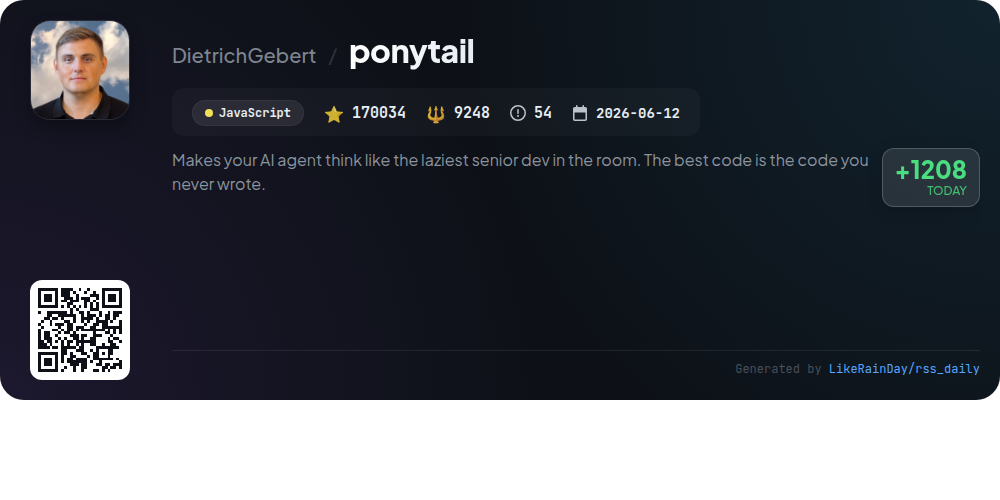
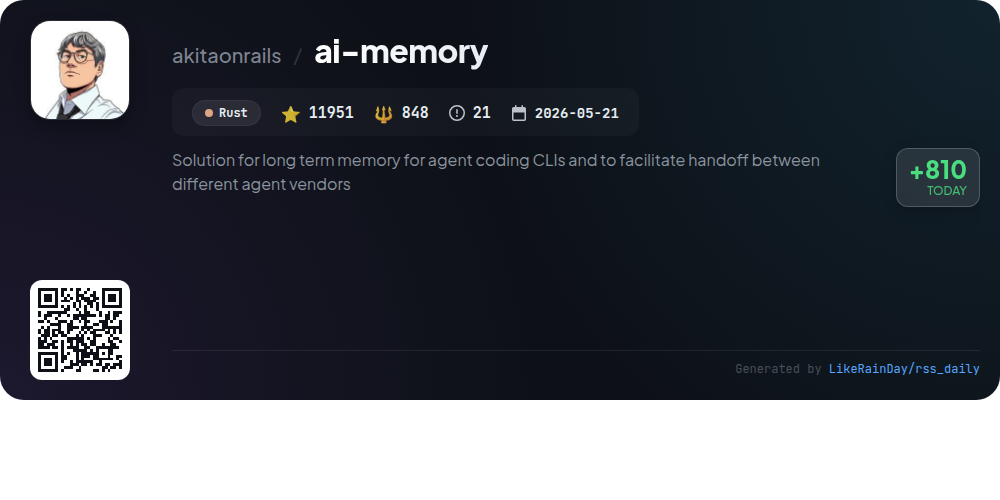
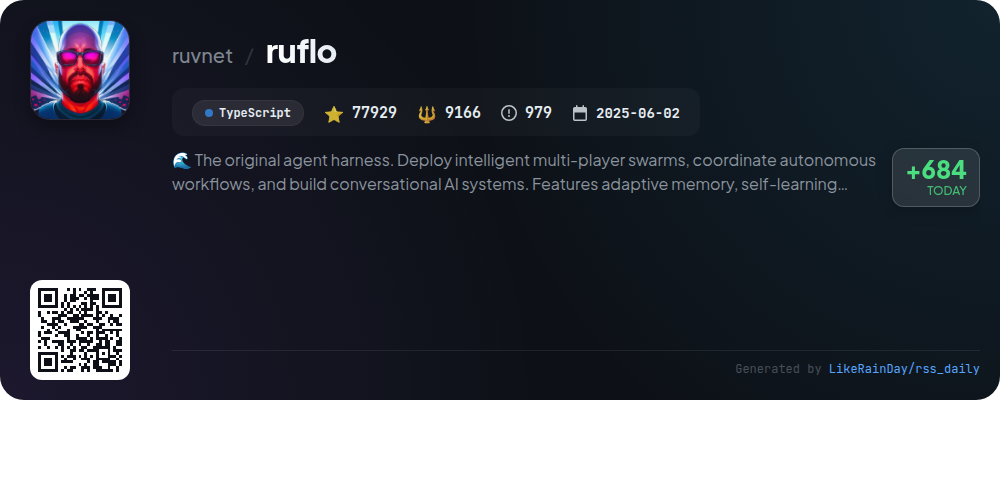
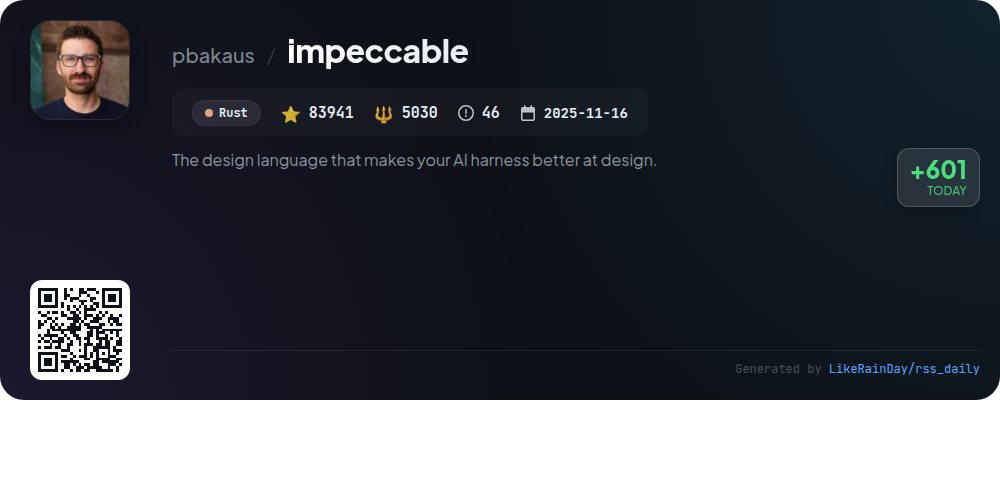
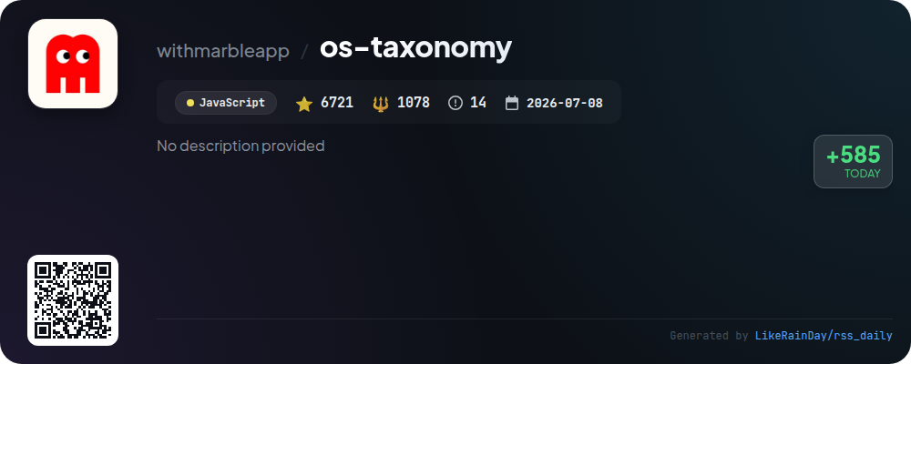
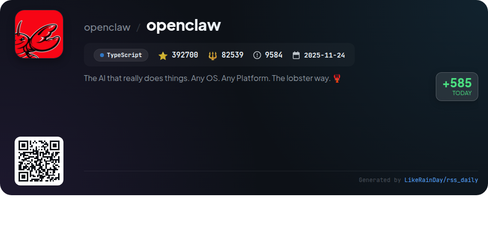

# 📊 🌟 GitHub Trending Daily - 2026-10-21

> > 📅 Daily Picks of GitHub Trending Repositories | Powered by Smart Algorithms

## 📋 Overview

**10** Projects | **1109355** ⭐ | **146389** 🍴

**Top Languages:** `TypeScript` (4) · `JavaScript` (3) · `Rust` (3)

**Updated:** 2026-10-21 04:15 UTC

**Categories:**

- 🌟 Daily Top 10 (10 items)

---

## 🌟 Daily Top 10

### 1. [xerj](https://github.com/xerj-org/xerj)

> 🤖 **Why Recommend**  
> *XERJ is a local-first search engine and MCP server for AI agents, built as a single Rust binary. It indexes various data types, including code, documentation, and PDFs, enabling BM25 full-text, vector, and hybrid search without relying on grep. Key features include an Elasticsearch-compatible API, automatic indexing, agent memory, and reference coding, which significantly reduces output tokens for coding tasks. XERJ serves as a robust solution for code search, security audits, and log analytics, making it a powerful tool for developers and AI agents alike.*

- ⭐ 12477 stars
- 💻 Rust
- 📅 Updated: 2026-10-21

### 2. [security-audit-skill](https://github.com/cloudflare/security-audit-skill)

> 🤖 **Why Recommend**  
> *A coding-agent skill for multi-phase security audits with independently verified, machine-readable findings. popular project, actively maintained, recently updated*

- ⭐ 34521 stars
- 🍴 2163 forks
- 💻 JavaScript
- 📅 Updated: 2026-10-21

### 3. [orca](https://github.com/stablyai/orca)

> 🤖 **Why Recommend**  
> *Orca is a powerful agent orchestration platform designed for developers, allowing seamless management of coding agents like Codex and Claude Code. Key features include parallel worktrees for concurrent agent operations, a mobile companion app for remote monitoring, and advanced terminal splits with WebGL rendering. Users can integrate GitHub and Linear workflows, annotate AI-generated diffs, and drag files directly into agent prompts. Available on macOS, Windows, and Linux, Orca supports any CLI agent and enhances productivity through robust scripting capabilities and real-time notifications.*

- ⭐ 99986 stars
- 💻 TypeScript
- 📅 Updated: 2026-10-21

### 4. [opencode](https://github.com/anomalyco/opencode)

> 🤖 **Why Recommend**  
> *OpenCode is an open-source AI coding agent designed to enhance development workflows. With over 219,000 stars on GitHub, it features two built-in agents: a full-access "build" agent for development and a "plan" agent for analysis and exploration, enhancing code navigation and safety. Users can install via various package managers and a desktop app is available for macOS, Windows, and Linux. OpenCode supports multiple languages and offers extensive documentation for configuration. Join the community on Discord for collaboration and support.*

- ⭐ 219095 stars
- 💻 TypeScript
- 📅 Updated: 2026-10-21

### 5. [ponytail](https://github.com/DietrichGebert/ponytail)

> 🤖 **Why Recommend**  
> *Ponytail is a JavaScript-based AI agent designed to optimize code efficiency by mimicking the approach of an experienced, lazy senior developer. It reduces code complexity, speed, cost, and token usage while maintaining high test coverage—98% for risky logic. Key features include `/ponytail-review` for diff analysis, `/ponytail-audit` for comprehensive repo checks, and a user-friendly band interface showing task costs and performance metrics. With over 170,000 stars, Ponytail streamlines coding tasks effectively, ensuring only essential code is written.*

- ⭐ 170034 stars
- 💻 JavaScript
- 📅 Updated: 2026-10-21

### 6. [ai-memory](https://github.com/akitaonrails/ai-memory)

> 🤖 **Why Recommend**  
> *ai-memory is a Rust-based solution designed to enhance long-term memory for agent coding CLIs, facilitating seamless handoff between various agent vendors. With a focus on improving agent collaboration and continuity, it enables efficient data retention and retrieval, ensuring agents can build on previous interactions. The project has gained significant traction, amassing over 11,951 stars on GitHub, underscoring its utility and community interest. Key features include robust memory management, interoperability between agents, and an emphasis on performance and reliability.*

- ⭐ 11951 stars
- 💻 Rust
- 📅 Updated: 2026-10-21

### 7. [ruflo](https://github.com/ruvnet/ruflo)

> 🤖 **Why Recommend**  
> *Ruflo is an advanced agent meta-harness designed for deploying intelligent multi-player swarms and coordinating autonomous workflows. It features adaptive memory, self-learning intelligence, and secure federation across machines. Key highlights include seamless integration with Claude Code, Codex, and Hermes, enabling over 100 specialized agents to collaborate and learn from tasks. Ruflo offers a rich plugin ecosystem for memory, security, and orchestration, enhancing productivity while ensuring compliance. With a user-friendly console and powerful CLI tools, it streamlines AI development and management.*

- ⭐ 77929 stars
- 💻 TypeScript
- 📅 Updated: 2026-10-21

### 8. [impeccable](https://github.com/pbakaus/impeccable)

> 🤖 **Why Recommend**  
> *Impeccable is a Rust-based design language tool for AI coding agents, boasting 83,941 stars on GitHub. It offers a streamlined design workflow with one setup command, 24 unique commands, and 61 deterministic detector rules for frontend design. Key features include live browser iteration, comprehensive design audits, and actionable critiques. It integrates seamlessly with popular tools like Claude Code, GitHub Copilot, and Codex. With a focus on avoiding design anti-patterns, Impeccable enhances the quality and consistency of AI-generated designs, making it essential for modern development projects.*

- ⭐ 83941 stars
- 💻 Rust
- 📅 Updated: 2026-10-21

### 9. [os-taxonomy](https://github.com/withmarbleapp/os-taxonomy)

> 🤖 **Why Recommend**  
> *The os-taxonomy project offers an open, structured taxonomy detailing children's learning across primary years, featuring 1,616 micro-topics and 3,317 prerequisite dependencies. It aligns with national curriculum standards, including NGSS and Common Core, and provides teaching research for Science and Mathematics topics. Users can explore an interactive 3D graph visualizing the curriculum. The dataset is published under ODbL 1.0 and CC BY-SA 4.0, enabling both research and commercial applications while requiring attribution. Visit the interactive site at withmarble.com/curriculum.*

- ⭐ 6721 stars
- 💻 JavaScript
- 📅 Updated: 2026-10-21

### 10. [openclaw](https://github.com/openclaw/openclaw)

> 🤖 **Why Recommend**  
> *OpenClaw is an open-source AI assistant designed to run on various platforms, including macOS, Windows, Linux, iOS, and Android. It seamlessly integrates with popular messaging services like Discord, Slack, and WhatsApp. Users retain full control over their data, with configurations stored locally. Key features include customizable AI models, plugin support for tools and skills, and a local control plane for managing sessions and channels. OpenClaw emphasizes security, offering sandboxing and message verification. Governed by the independent OpenClaw Foundation, it operates without paid tiers or hosted services.*

- ⭐ 392700 stars
- 💻 TypeScript
- 📅 Updated: 2026-10-21

---

## 📡 RSS Subscription

Subscribe via RSS to get daily trending updates:

- 🔔 [RSS XML] (../../daily-top.xml)
- 🔔 [Daily Report] (../../GITHUB_TODAY.md)
- 🔔 [Daily Top 10](../../daily-top.xml)

---

*⚡ Powered by Smart Trending Algorithm | Generated at 2026-10-21 04:15:41 UTC
