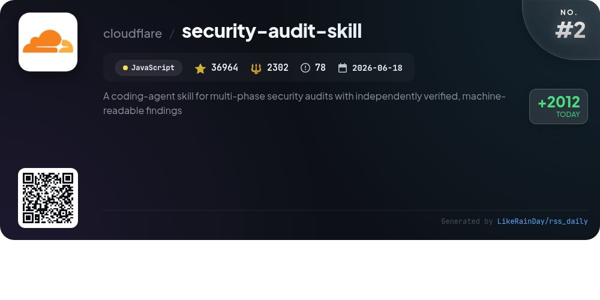
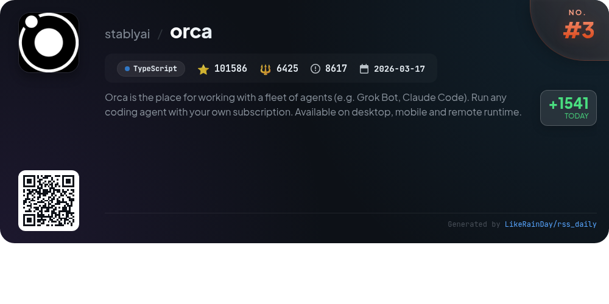
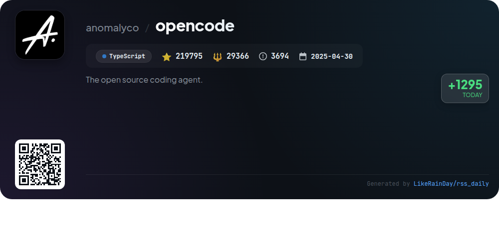
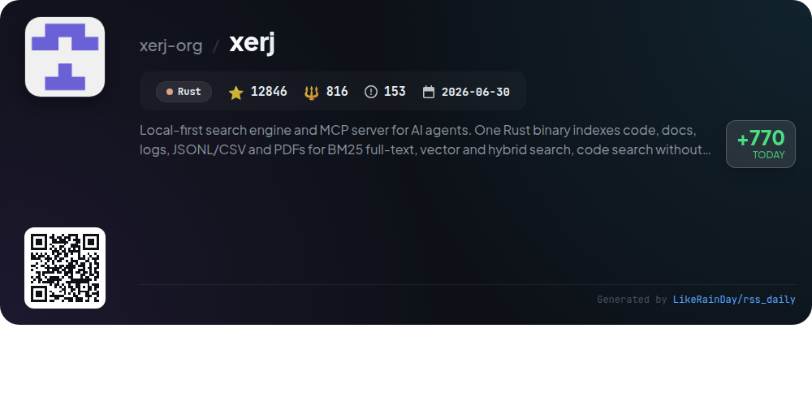
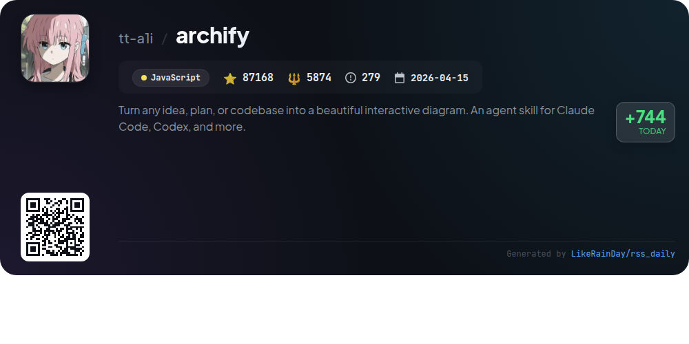
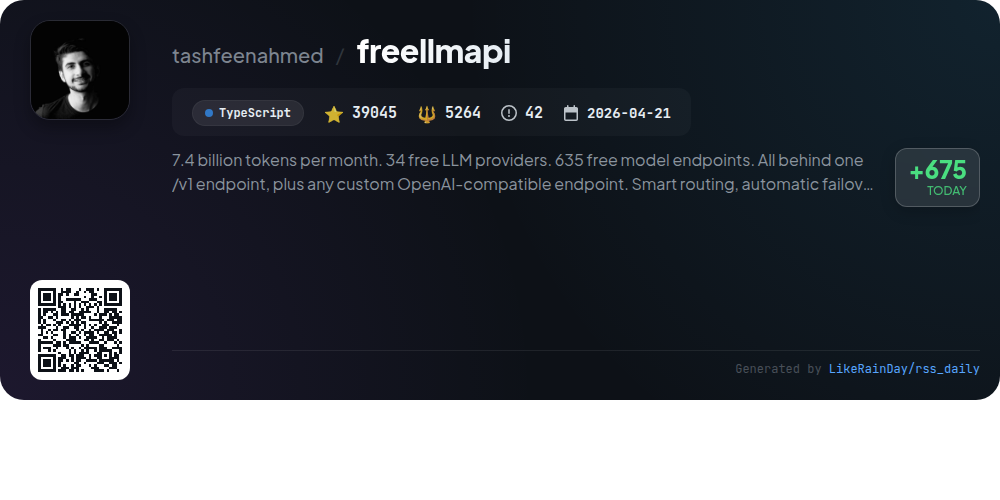
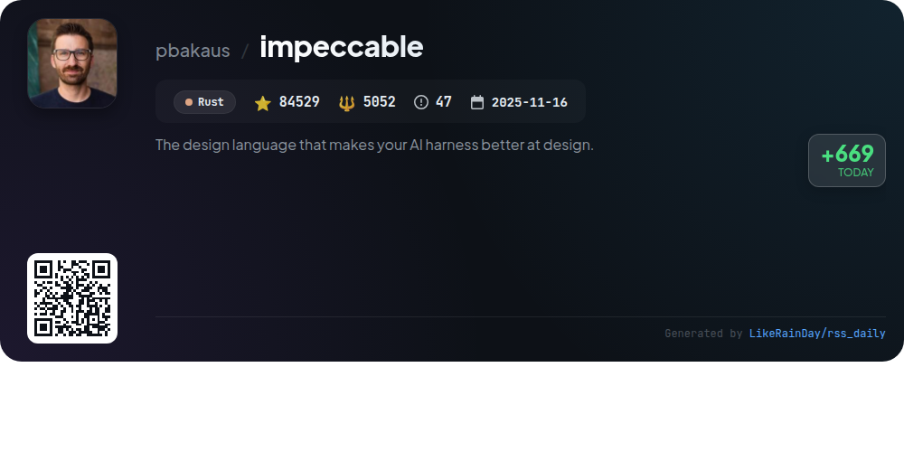
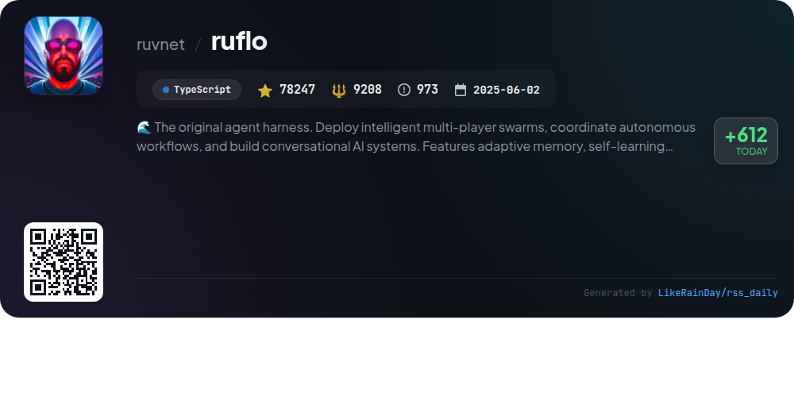
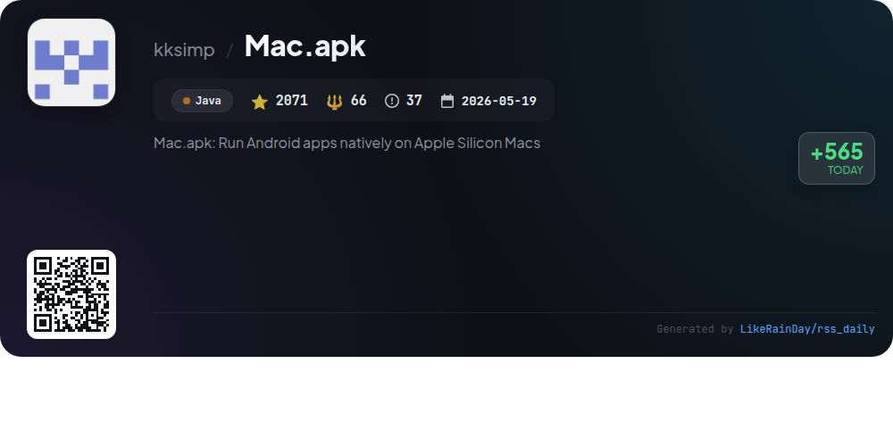

# 📊 🌟 GitHub Trending Daily - 2026-10-22

> > 📅 每日精选 GitHub 热门仓库 | 基于智能算法推荐

## 📋 Overview

**10** 个项目 | **834196** ⭐ | **73729** 🍴

**热门语言:** `TypeScript` (4) · `JavaScript` (3) · `Rust` (2)

**更新时间:** 2026-10-22 04:15 UTC

**分类分布:**

- 🌟 每日 Top 10 精选 (10 项)

---

## 🌟 每日 Top 10 精选

### 1. [ponytail](https://github.com/DietrichGebert/ponytail)

> 🤖 **推荐理由**  
> *Ponytail is an innovative AI agent designed to optimize coding efficiency by emulating a "lazy senior developer" approach, reducing unnecessary code. Key features include streamlined code generation, comprehensive reviews, and audits that prioritize essential tasks while ensuring security and performance. With Ponytail 5, users experience a significant reduction in code size, cost, and time while maintaining high test coverage. The tool integrates easily with various coding environments, offering commands for code review, auditing, and performance tracking, making it an invaluable asset for developers.*

- ⭐ 171945 stars
- 💻 JavaScript
- 📅 Updated: 2026-10-22

### 2. [security-audit-skill](https://github.com/cloudflare/security-audit-skill)

> 🤖 **推荐理由**  
> *A coding-agent skill for multi-phase security audits with independently verified, machine-readable findings. popular project, actively maintained, recently updated*

- ⭐ 36964 stars
- 🍴 2302 forks
- 💻 JavaScript
- 📅 Updated: 2026-10-22

### 3. [orca](https://github.com/stablyai/orca)

> 🤖 **推荐理由**  
> *Orca is an advanced platform for managing a fleet of coding agents like Codex and Claude Code, designed for high-efficiency workflows on desktop and mobile. Key features include parallel worktrees for running multiple agents simultaneously, a mobile companion app for remote monitoring, and powerful terminal splits for enhanced productivity. It supports seamless integration with GitHub and Linear for task management, offers SSH worktrees for remote operations, and allows rich interactions with agents through drag-and-drop file capabilities. With a focus on user experience, Orca is ideal for developers looking to optimize their coding processes.*

- ⭐ 101586 stars
- 💻 TypeScript
- 📅 Updated: 2026-10-22

### 4. [opencode](https://github.com/anomalyco/opencode)

> 🤖 **推荐理由**  
> *OpenCode is an open-source AI coding agent built in TypeScript, boasting over 219,000 stars on GitHub. It features two built-in agents: a full-access "build" agent for development tasks and a "plan" agent for code exploration with read-only access. Users can easily install it across multiple platforms, including macOS, Windows, and Linux. OpenCode also offers a desktop application and detailed documentation for configuration. Join the community on Discord for support and collaboration.*

- ⭐ 219795 stars
- 💻 TypeScript
- 📅 Updated: 2026-10-22

### 5. [xerj](https://github.com/xerj-org/xerj)

> 🤖 **推荐理由**  
> *XERJ is a local-first search engine and MCP server designed for AI agents, built in Rust. It indexes various file types—including code, documentation, logs, and PDFs—using BM25 full-text, vector, and hybrid search methods. Key features include an Elasticsearch-compatible API, automatic indexing, and agent memory support, enabling efficient code search and retrieval. XERJ enhances reference coding by allowing agents to access relevant open-source projects, significantly reducing output token costs. It serves a wide range of applications, from code audits to AI-driven search.*

- ⭐ 12846 stars
- 💻 Rust
- 📅 Updated: 2026-10-22

### 6. [archify](https://github.com/tt-a1i/archify)

> 🤖 **推荐理由**  
> *Archify is an open-source JavaScript project that transforms ideas, plans, or codebases into interactive diagrams, enhancing understanding and communication. With over 87,000 stars on GitHub, it integrates seamlessly with AI agents like Claude Code and Codex. Key features include customizable HTML diagrams, explainer pages with structured answers, and support for various diagram types such as architecture and workflows. Users can refine diagrams through chat, share self-contained HTML outputs, and explore community-created content, making it a versatile tool for professionals across different domains.*

- ⭐ 87168 stars
- 💻 JavaScript
- 📅 Updated: 2026-10-22

### 7. [freellmapi](https://github.com/tashfeenahmed/freellmapi)

> 🤖 **推荐理由**  
> *FreeLLMAPI unifies access to 34 free LLM providers and 635 model endpoints via a single OpenAI-compatible API. It intelligently routes requests, handles automatic failover, and tracks usage to stay within free-tier limits. Key features include multi-model synthesis, support for chat, embeddings, image, and audio generation, and an encrypted key management system. With a user-friendly dashboard and analytics, it supports personal experimentation with over 7.4 billion tokens available monthly. Ideal for developers seeking diverse AI capabilities without cost.*

- ⭐ 39045 stars
- 💻 TypeScript
- 📅 Updated: 2026-10-22

### 8. [impeccable](https://github.com/pbakaus/impeccable)

> 🤖 **推荐理由**  
> *Impeccable is a Rust-based design language tool for AI coding agents, with over 84,500 stars on GitHub. It offers a streamlined setup with a single command and provides 24 powerful commands such as `/impeccable audit`, `/impeccable critique`, and `/impeccable polish` for enhancing AI-generated frontend designs. With 61 deterministic detection rules, it ensures high-quality outputs by addressing common design pitfalls. Impeccable integrates seamlessly with various AI tools, making it an essential resource for improving AI-assisted design workflows. Visit [impeccable.style](https://impeccable.style) for more.*

- ⭐ 84529 stars
- 💻 Rust
- 📅 Updated: 2026-10-22

### 9. [ruflo](https://github.com/ruvnet/ruflo)

> 🤖 **推荐理由**  
> *Ruflo is an advanced agent meta-harness designed for deploying intelligent multi-player swarms and coordinating autonomous workflows. Key features include adaptive memory, self-learning intelligence, and federated communication across machines. It integrates seamlessly with Claude Code, Codex, and other models, offering over 100 specialized agents for coding, testing, and security. Ruflo supports background workers, zero-trust federation, and advanced memory management, enabling efficient collaboration and task execution. With robust security and compliance features, Ruflo provides an essential toolkit for building sophisticated conversational AI systems.*

- ⭐ 78247 stars
- 💻 TypeScript
- 📅 Updated: 2026-10-22

### 10. [Mac.apk](https://github.com/kksimp/Mac.apk)

> 🤖 **推荐理由**  
> *Mac.apk enables the native execution of Android apps on Apple Silicon Macs without the need for emulators or virtual machines. It allows apps to run as standard macOS processes, utilizing the Mac's GPU for graphics and CPU for performance. Currently in alpha, it supports 71 tested apps, with 58 fully playable. The application features seamless installation of APKs, app management, and compatibility with Android TV apps. Mac.apk is open-source under AGPL-3.0, with a commercial license available. It prioritizes user security, encouraging the installation of trusted APKs only.*

- ⭐ 2071 stars
- 💻 Java
- 📅 Updated: 2026-10-22

---

## 📡 RSS订阅

通过 RSS 订阅，第一时间获取每日精选项目：

- 🔔 [RSS 订阅源] (../../daily-top.xml)
- 🔔 [每日简报] (../../GITHUB_TODAY_CN.md)
- 🔔 [每日 Top 10 精选](../../daily-top.xml)

---

*⚡ Powered by Smart Trending Algorithm | Generated at 2026-10-22 04:15:28 UTC
