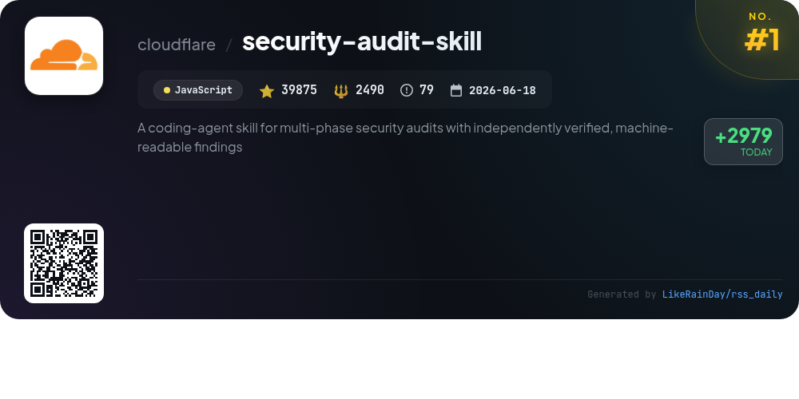
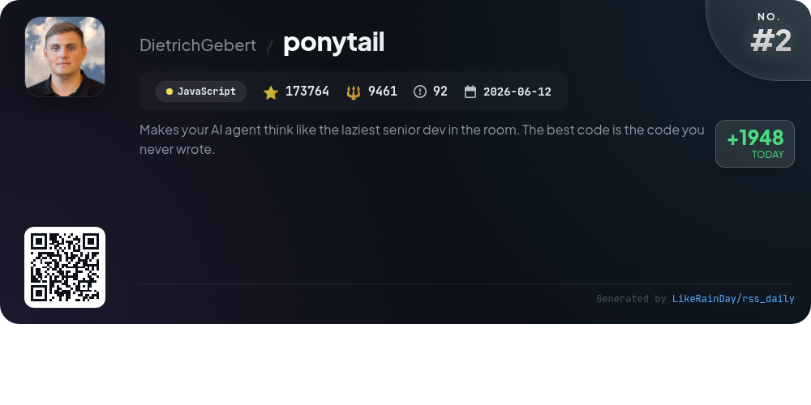
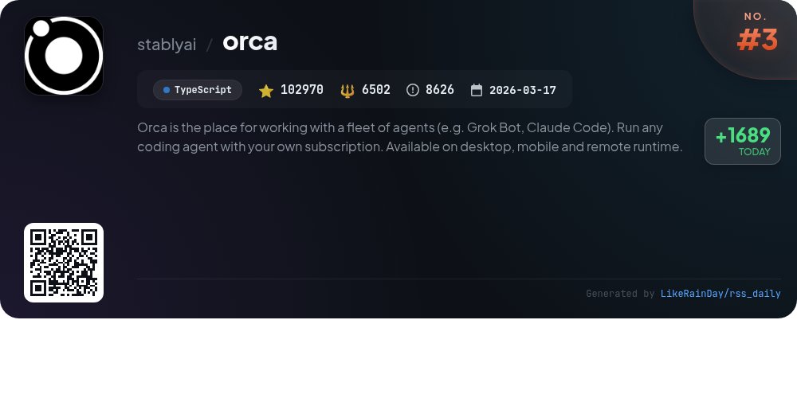
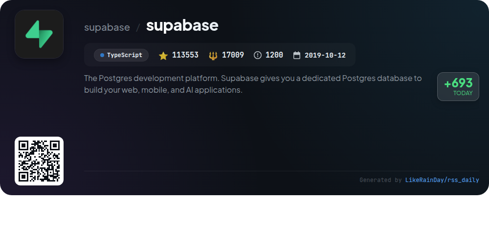
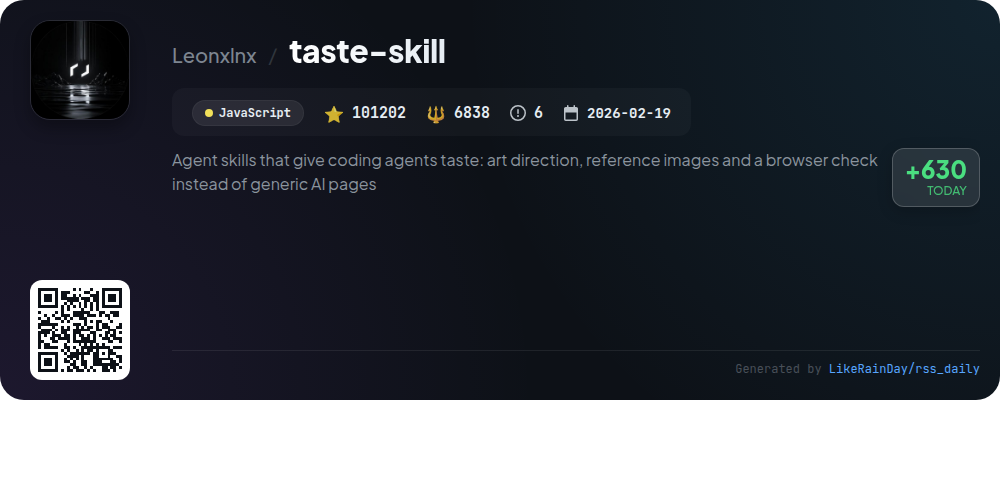
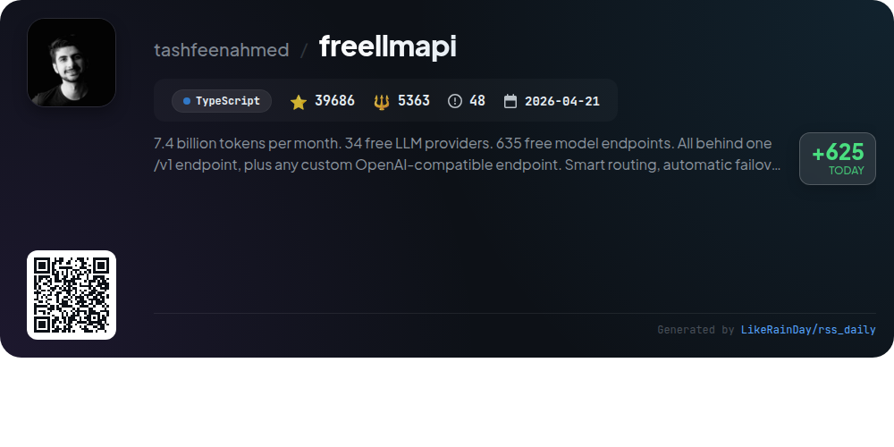
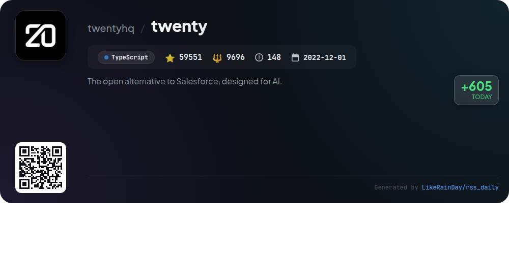
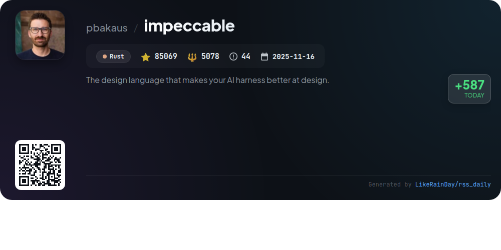
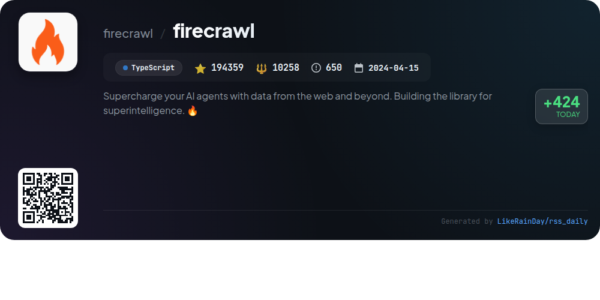
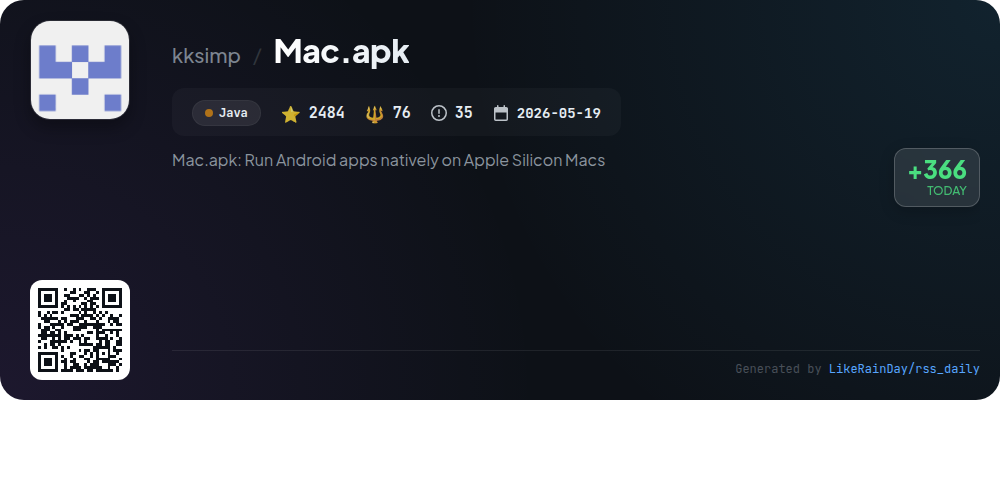

# 📊 🌟 GitHub Trending Daily - 2026-10-23

> > 📅 每日精选 GitHub 热门仓库 | 基于智能算法推荐

## 📋 Overview

**10** 个项目 | **912513** ⭐ | **72771** 🍴

**热门语言:** `TypeScript` (5) · `JavaScript` (3) · `Java` (1)

**更新时间:** 2026-10-23 04:19 UTC

**分类分布:**

- 🌟 每日 Top 10 精选 (10 项)

---

## 🌟 每日 Top 10 精选

### 1. [security-audit-skill](https://github.com/cloudflare/security-audit-skill)

> 🤖 **推荐理由**  
> *A coding-agent skill for multi-phase security audits with independently verified, machine-readable findings. popular project, actively maintained, recently updated*

- ⭐ 39875 stars
- 🍴 2490 forks
- 💻 JavaScript
- 📅 Updated: 2026-10-23

### 2. [ponytail](https://github.com/DietrichGebert/ponytail)

> 🤖 **推荐理由**  
> *Ponytail is a JavaScript project designed to optimize AI agent coding by emulating a seasoned developer's lazy approach. With over 173,000 stars, it reduces code complexity, time, and costs by up to 53%, while ensuring 98% of risky logic is tested. Key features include the `/ponytail-review` for comprehensive code audits, the `/ponytail-audit` for repository-wide checks, and a new "band" display for task cost tracking. Ponytail emphasizes writing only essential code, enhancing efficiency and security without compromising quality.*

- ⭐ 173764 stars
- 💻 JavaScript
- 📅 Updated: 2026-10-23

### 3. [orca](https://github.com/stablyai/orca)

> 🤖 **推荐理由**  
> *Orca is a powerful platform for managing a fleet of coding agents, including Codex and Claude Code, across desktop and mobile devices. Key features include parallel worktrees for simultaneous agent prompts, a mobile companion app for remote monitoring, and advanced terminal splits with WebGL rendering. Users can seamlessly integrate GitHub and Linear, annotate AI-generated diffs, and utilize SSH for remote operations. With extensive support for various CLI agents and a robust CLI for scripting workflows, Orca enhances productivity for developers and builders.*

- ⭐ 102970 stars
- 💻 TypeScript
- 📅 Updated: 2026-10-23

### 4. [supabase](https://github.com/supabase/supabase)

> 🤖 **推荐理由**  
> *Supabase is an open-source Postgres development platform that provides developers with a powerful and scalable backend for web, mobile, and AI applications. Key features include a hosted Postgres database, authentication and authorization, auto-generated REST and GraphQL APIs, real-time subscriptions, and file storage. It also offers functions for both database and edge computing. With a user-friendly dashboard and extensive documentation, Supabase aims to replicate the functionality of Firebase using enterprise-grade tools. Join the community for support and collaboration.*

- ⭐ 113553 stars
- 💻 TypeScript
- 📅 Updated: 2026-10-23

### 5. [taste-skill](https://github.com/Leonxlnx/taste-skill)

> 🤖 **推荐理由**  
> *Taste Skill is a JavaScript-based GitHub project designed to enhance coding agents with artistic capabilities for web and app design. It enables agents to create visually appealing pages by providing art direction, sourcing real images from public collections, and verifying designs in real browsers. The skill operates without installations or API keys, requiring only Node 22+ and a modern browser. Key features include a six-step design process, support for dashboards and app screens, and a focus on high-quality, user-centered design. Visit [tasteskill.dev](https://tasteskill.dev) for more information.*

- ⭐ 101202 stars
- 💻 JavaScript
- 📅 Updated: 2026-10-23

### 6. [freellmapi](https://github.com/tashfeenahmed/freellmapi)

> 🤖 **推荐理由**  
> *FreeLLMAPI is a TypeScript-based project that aggregates 34 free LLM providers and 635 model endpoints into a single OpenAI-compatible API endpoint. It offers up to 7.4 billion tokens per month for personal experimentation, featuring smart routing, automatic failover, and encrypted API keys. Key functionalities include support for chat, embeddings, image, and audio models, along with a self-updating model catalog. The admin dashboard provides analytics and management tools, while the system ensures compliance with provider rate limits and capabilities.*

- ⭐ 39686 stars
- 💻 TypeScript
- 📅 Updated: 2026-10-23

### 7. [twenty](https://github.com/twentyhq/twenty)

> 🤖 **推荐理由**  
> *Twenty is an open-source CRM designed for AI, offering customizable solutions that evolve with business needs. With over 59,000 stars on GitHub, it allows technical teams to build, ship, and version their CRM applications seamlessly using TypeScript. Core features include object and field definition as code, AI agents, and version control. Users can quickly set up a cloud workspace or self-host with Docker. Comprehensive documentation, a supportive community on Discord, and robust tools for CRM management make Twenty a versatile alternative to Salesforce.*

- ⭐ 59551 stars
- 💻 TypeScript
- 📅 Updated: 2026-10-23

### 8. [impeccable](https://github.com/pbakaus/impeccable)

> 🤖 **推荐理由**  
> *Impeccable is a Rust-based design language tool for AI coding agents, featuring 24 commands and 62 deterministic detector rules to enhance AI-generated frontend design. Key functionalities include project initialization, UX/UI planning, design critiques, and live browser iteration. It promotes a unified design vocabulary and addresses common design pitfalls. With a straightforward installation via `npx`, Impeccable seamlessly integrates with various AI tools like Claude Code, GitHub Copilot, and Codex. Visit [impeccable.style](https://impeccable.style) for more details.*

- ⭐ 85069 stars
- 💻 Rust
- 📅 Updated: 2026-10-23

### 9. [firecrawl](https://github.com/firecrawl/firecrawl)

> 🤖 **推荐理由**  
> *Firecrawl is an open-source web API designed to enhance AI agents with extensive web data access. Key features include reliable scraping of 96% of the web, real-time data retrieval with a P95 latency of 3.4 seconds, and support for LLM-ready output formats like Markdown and JSON. Users can search, scrape, and interact with web content easily, automate data gathering, and convert documents into structured formats. Firecrawl integrates seamlessly with various AI tools and offers a hosted service at firecrawl.dev for added convenience.*

- ⭐ 194359 stars
- 💻 TypeScript
- 📅 Updated: 2026-10-23

### 10. [Mac.apk](https://github.com/kksimp/Mac.apk)

> 🤖 **推荐理由**  
> *Mac.apk enables users to run Android apps natively on Apple Silicon Macs without the need for emulators or virtual machines. It integrates Android app functionality directly into macOS, allowing apps to operate like native Mac applications with full access to system resources. Currently in active development, it boasts compatibility with 71 tested apps, of which 58 are fully playable. The project is open-source under the AGPL license, with a commercial license available. Mac.apk is designed for macOS 26.4 or newer and is signed and notarized by Apple for security.*

- ⭐ 2484 stars
- 💻 Java
- 📅 Updated: 2026-10-23

---

## 📡 RSS订阅

通过 RSS 订阅，第一时间获取每日精选项目：

- 🔔 [RSS 订阅源] (../../daily-top.xml)
- 🔔 [每日简报] (../../GITHUB_TODAY_CN.md)
- 🔔 [每日 Top 10 精选](../../daily-top.xml)

---

*⚡ Powered by Smart Trending Algorithm | Generated at 2026-10-23 04:19:20 UTC
