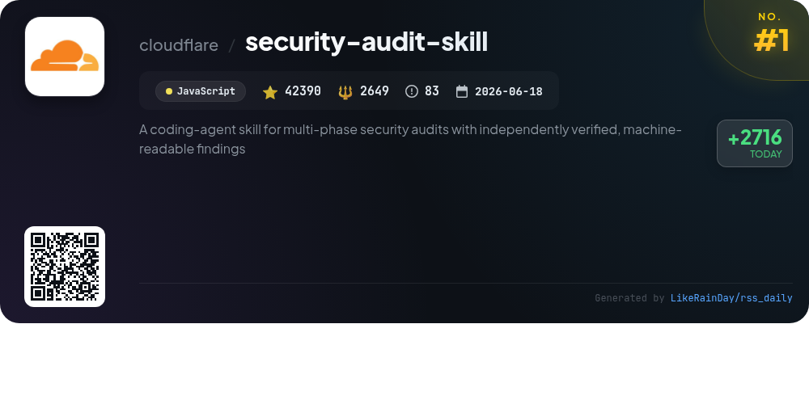
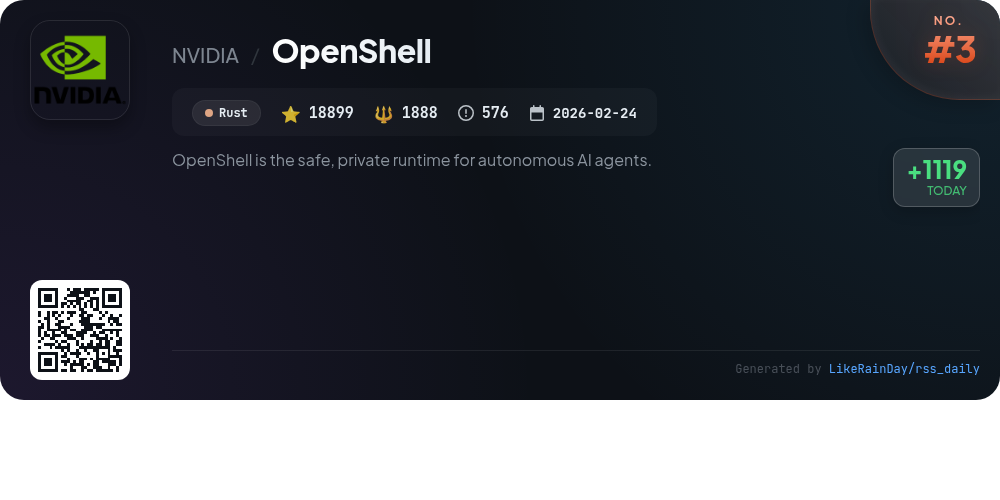
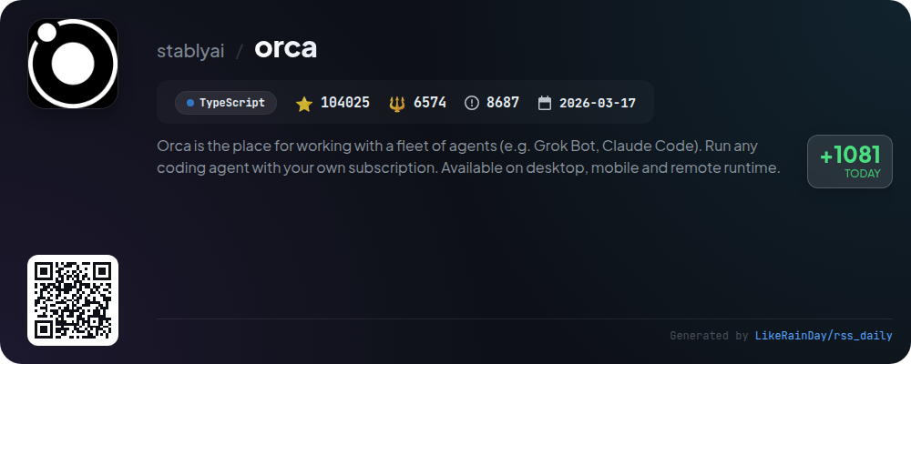
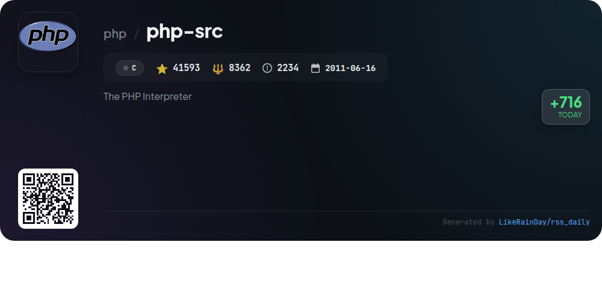
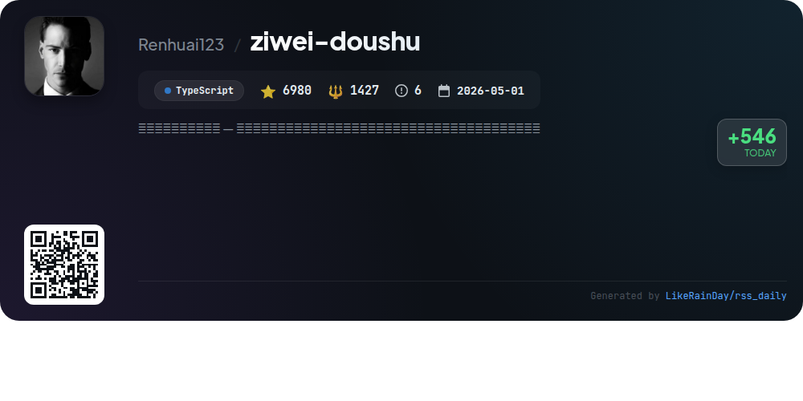
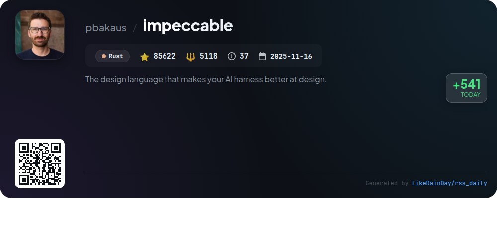
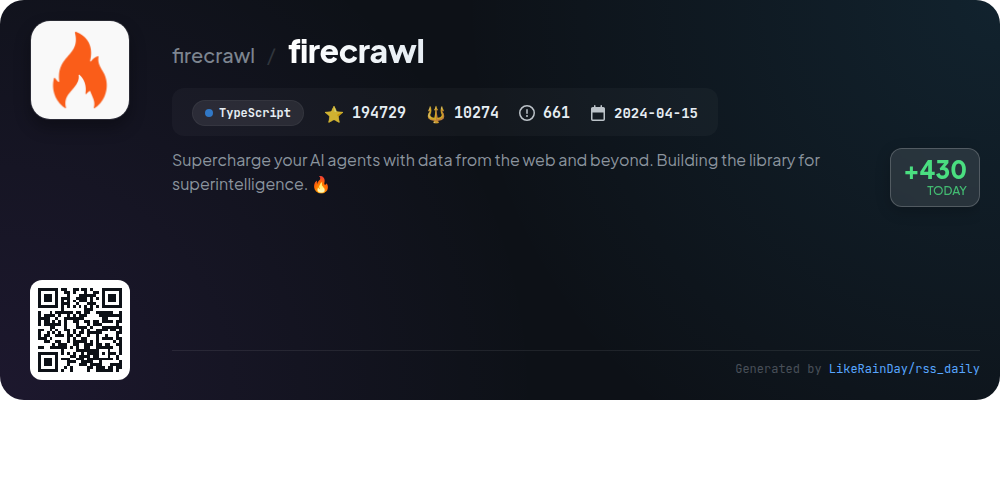
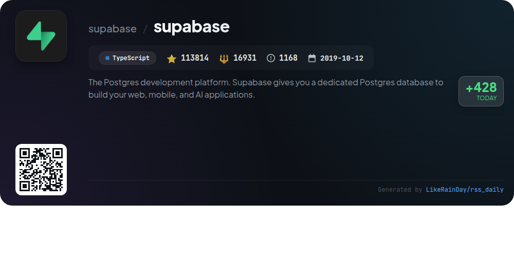
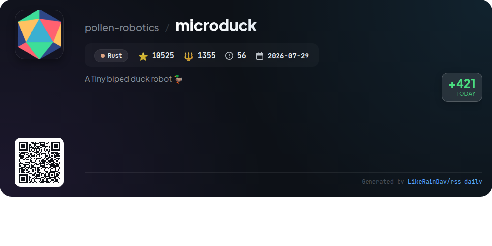

# 📊 🌟 GitHub Trending Daily - 2026-10-24

> > 📅 Daily Picks of GitHub Trending Repositories | Powered by Smart Algorithms

## 📋 Overview

**10** Projects | **793463** ⭐ | **64106** 🍴

**Top Languages:** `TypeScript` (4) · `Rust` (3) · `JavaScript` (2)

**Updated:** 2026-10-24 04:10 UTC

**Categories:**

- 🌟 Daily Top 10 (10 items)

---

## 🌟 Daily Top 10

### 1. [security-audit-skill](https://github.com/cloudflare/security-audit-skill)

> 🤖 **Why Recommend**  
> *A coding-agent skill for multi-phase security audits with independently verified, machine-readable findings. popular project, actively maintained, recently updated*

- ⭐ 42390 stars
- 🍴 2649 forks
- 💻 JavaScript
- 📅 Updated: 2026-10-24

### 2. [ponytail](https://github.com/DietrichGebert/ponytail)

> 🤖 **Why Recommend**  
> *Ponytail is a JavaScript project designed to optimize AI agents by emulating a lazy senior developer, focusing on writing minimal yet effective code. With over 174,000 stars, it emphasizes efficiency—reducing code by 53%, time by 41%, and costs by 26% while maintaining high-quality output. Key features include a comprehensive review and audit system that identifies bugs and security risks, along with a command interface for setting intensity levels and tracking performance metrics. It integrates seamlessly with various AI platforms, making it a powerful tool for developers seeking efficiency without sacrificing quality.*

- ⭐ 174886 stars
- 💻 JavaScript
- 📅 Updated: 2026-10-24

### 3. [OpenShell](https://github.com/NVIDIA/OpenShell)

> 🤖 **Why Recommend**  
> *OpenShell is a secure runtime for autonomous AI agents, designed to provide controlled access to files, APIs, and credentials while ensuring privacy. Key features include kernel-level enforcement of access policies, formal verification for safe policy changes, and isolated sandboxes for each agent. OpenShell facilitates agent-driven workflows, with support for multiple platforms and SDKs in Python, TypeScript, Go, and Rust. Its design prioritizes safety and extensibility, making it ideal for managing AI agent fleets securely.*

- ⭐ 18899 stars
- 💻 Rust
- 📅 Updated: 2026-10-24

### 4. [orca](https://github.com/stablyai/orca)

> 🤖 **Why Recommend**  
> *Orca is an advanced platform for managing a fleet of coding agents, such as Grok Bot and Claude Code, offering seamless integration across desktop, mobile, and remote environments. Key features include parallel worktrees for running multiple agents simultaneously, a mobile companion app for remote monitoring, and robust terminal splits with WebGL rendering. Users can also annotate AI-generated diffs, manage GitHub tasks natively, and utilize SSH worktrees for remote execution. Orca supports various CLI agents, making it a versatile tool for developers seeking efficiency and collaboration.*

- ⭐ 104025 stars
- 💻 TypeScript
- 📅 Updated: 2026-10-24

### 5. [php-src](https://github.com/php/php-src)

> 🤖 **Why Recommend**  
> *php-src is the official repository for the PHP Interpreter, a widely-used scripting language optimized for web development. With over 41,000 stars on GitHub, it offers a robust installation process, extensive documentation, and a comprehensive test suite. Key features include support for numerous extensions, a flexible build system, and a collaborative contribution model. Users can install prebuilt binaries or compile from source, while the project encourages community engagement through RFCs and pull requests. PHP is licensed under the Modified BSD License.*

- ⭐ 41593 stars
- 💻 C
- 📅 Updated: 2026-10-24

### 6. [ziwei-doushu](https://github.com/Renhuai123/ziwei-doushu)

> 🤖 **Why Recommend**  
> *Ziwei Doushu is an open-source astrology charting engine based on the traditional Zi Wei Dou Shu system from Ni Haixia's "Tian Ji." Key features include a complete charting algorithm, a four transformation system, a comprehensive knowledge base, and original texts from classical literature. The latest version (v4.0) offers 674,976 charts and 8.77 million interpretations, totaling 56.6 GB. Users can experience online chart generation and AI interpretations at metisziwei.com. The project promotes accessibility to traditional wisdom, emphasizing open-source principles for continued learning and improvement.*

- ⭐ 6980 stars
- 💻 TypeScript
- 📅 Updated: 2026-10-24

### 7. [impeccable](https://github.com/pbakaus/impeccable)

> 🤖 **Why Recommend**  
> *Impeccable is a Rust-based design language tool enhancing AI-assisted frontend design. With over 85,622 stars, it offers a streamlined setup via `/impeccable init`, 24 commands for various design tasks (e.g., `polish`, `audit`, `critique`), and 62 deterministic rules for detecting design issues. Key features include live browser iteration, a shared design vocabulary, and a focus on avoiding common anti-patterns. It integrates seamlessly with tools like Claude Code, GitHub Copilot, and Codex, making it essential for optimizing AI-generated designs. Full documentation is available at impeccable.style.*

- ⭐ 85622 stars
- 💻 Rust
- 📅 Updated: 2026-10-24

### 8. [firecrawl](https://github.com/firecrawl/firecrawl)

> 🤖 **Why Recommend**  
> *Firecrawl is an open-source API designed to enhance AI agents by enabling seamless web interaction and data retrieval. Key features include comprehensive web scraping, real-time searches, document parsing, and automated data gathering with minimal configuration. It supports LLM-ready outputs like markdown and structured JSON, ensuring fast and reliable performance across diverse web environments. With capabilities for crawling entire websites, batch scraping, and intelligent agent interactions, Firecrawl empowers developers to build advanced AI applications efficiently. Visit firecrawl.dev for more information.*

- ⭐ 194729 stars
- 💻 TypeScript
- 📅 Updated: 2026-10-24

### 9. [supabase](https://github.com/supabase/supabase)

> 🤖 **Why Recommend**  
> *Supabase is an open-source Postgres development platform designed to replicate Firebase features while leveraging enterprise-grade tools. Key features include a hosted Postgres database, authentication and authorization, auto-generated REST and GraphQL APIs, real-time subscriptions, database and edge functions, and file storage. Supabase also offers an AI and vector embeddings toolkit, a user-friendly dashboard, and extensive documentation. With modular client libraries for various programming languages, it provides a flexible and robust solution for web, mobile, and AI applications.*

- ⭐ 113814 stars
- 💻 TypeScript
- 📅 Updated: 2026-10-24

### 10. [microduck](https://github.com/pollen-robotics/microduck)

> 🤖 **Why Recommend**  
> *Microduck is a compact bipedal robot, approximately 25 cm tall and weighing 800 g, powered by Rust and reinforcement learning policies. It features a 50 Hz control loop managing fifteen servos, enabling actions like walking, rolling, picking up objects, and self-righting. Users can operate it via gamepad or Bluetooth, while software updates are securely managed. The project includes extensive documentation for users and developers, detailing commands, configuration, and policy training via the linked repository microduck_rl. Ideal for robotics enthusiasts and researchers.*

- ⭐ 10525 stars
- 💻 Rust
- 📅 Updated: 2026-10-24

---

## 📡 RSS Subscription

Subscribe via RSS to get daily trending updates:

- 🔔 [RSS XML] (../../daily-top.xml)
- 🔔 [Daily Report] (../../GITHUB_TODAY.md)
- 🔔 [Daily Top 10](../../daily-top.xml)

---

*⚡ Powered by Smart Trending Algorithm | Generated at 2026-10-24 04:10:58 UTC
