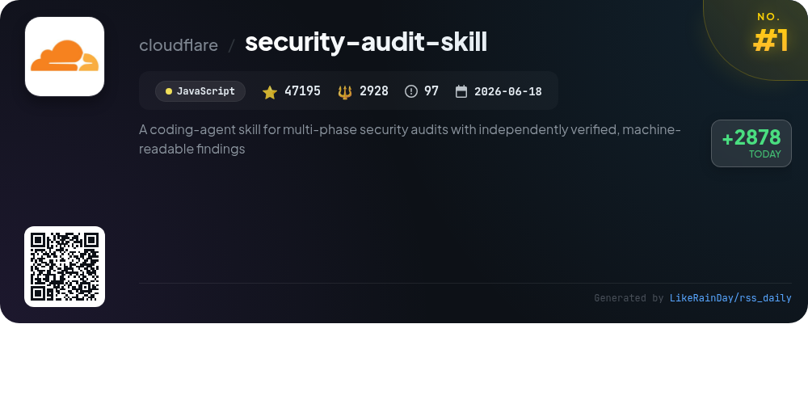
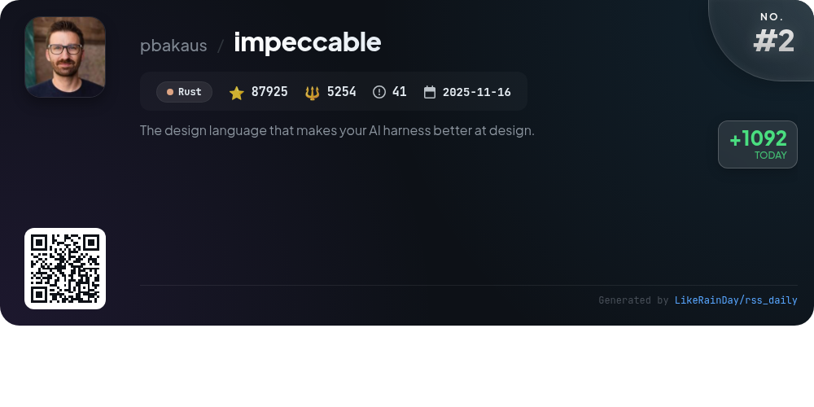
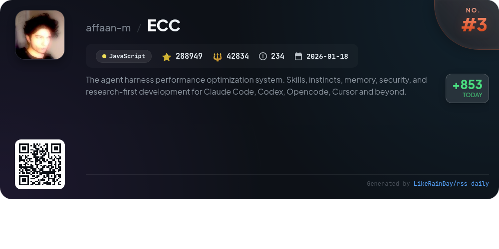
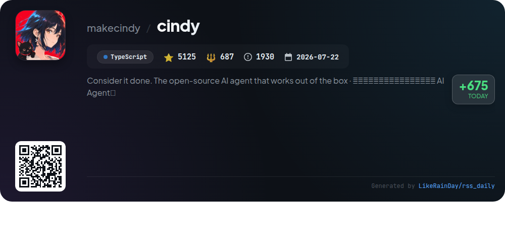
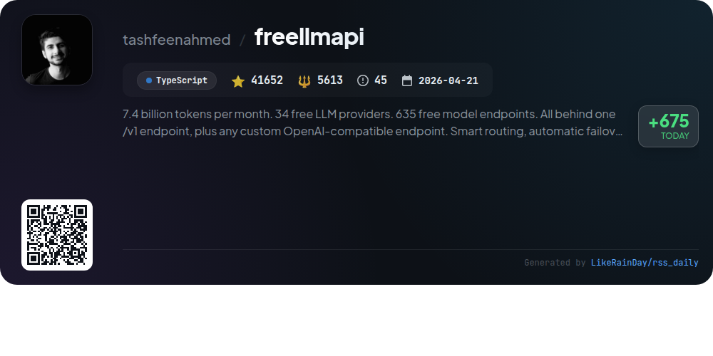
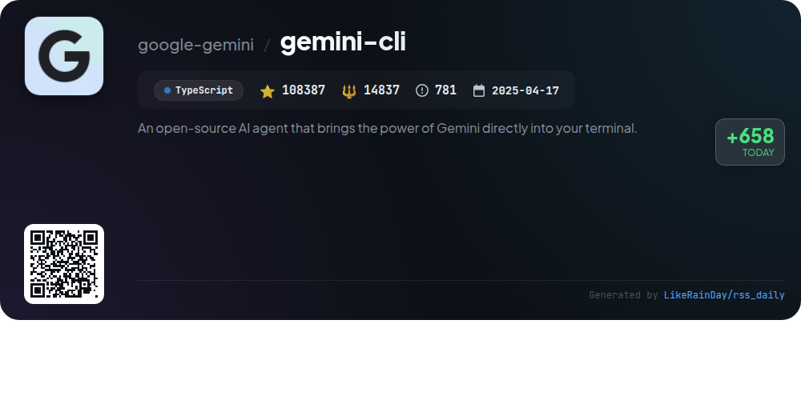
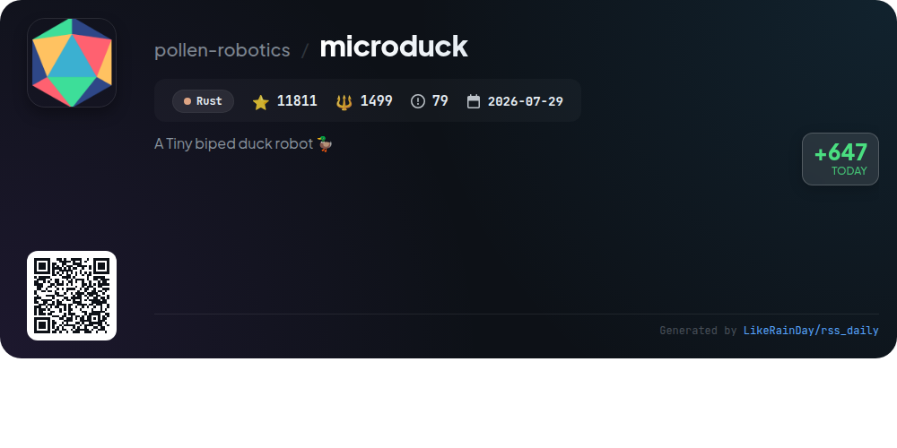
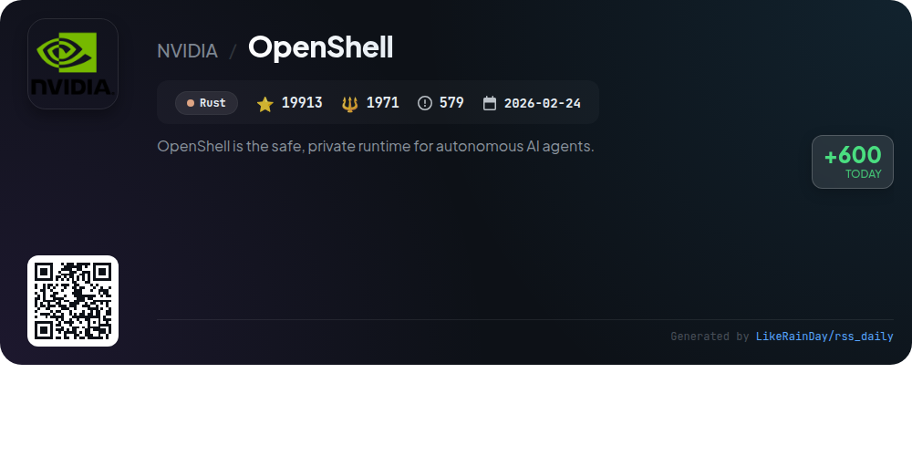
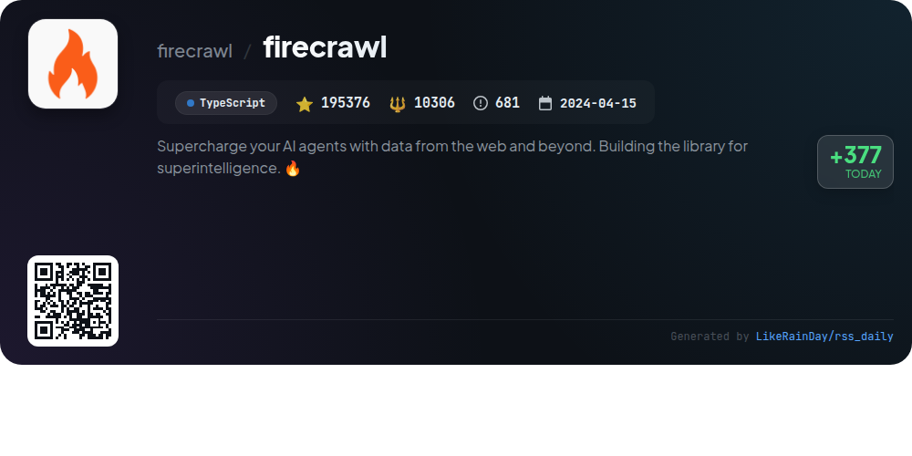
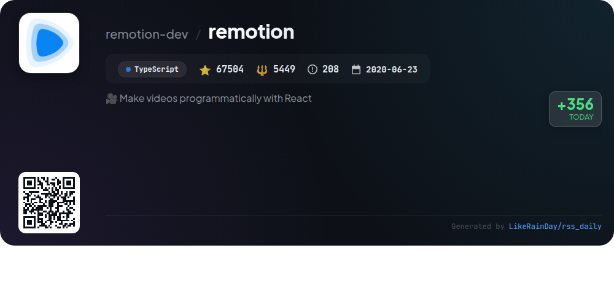

# 📊 🌟 GitHub Trending Daily - 2026-10-26

> > 📅 Daily Picks of GitHub Trending Repositories | Powered by Smart Algorithms

## 📋 Overview

**10** Projects | **873837** ⭐ | **91378** 🍴

**Top Languages:** `TypeScript` (5) · `Rust` (3) · `JavaScript` (2)

**Updated:** 2026-10-26 04:16 UTC

**Categories:**

- 🌟 Daily Top 10 (10 items)

---

## 🌟 Daily Top 10

### 1. [security-audit-skill](https://github.com/cloudflare/security-audit-skill)

> 🤖 **Why Recommend**  
> *A coding-agent skill for multi-phase security audits with independently verified, machine-readable findings. popular project, actively maintained, recently updated*

- ⭐ 47195 stars
- 🍴 2928 forks
- 💻 JavaScript
- 📅 Updated: 2026-10-26

### 2. [impeccable](https://github.com/pbakaus/impeccable)

> 🤖 **Why Recommend**  
> *Impeccable is a Rust-based design language toolkit for AI coding agents, boasting 87,925 stars on GitHub. It provides design guidance through a single command interface, featuring 24 commands like `audit`, `critique`, and `polish`, alongside 62 deterministic rules for AI-generated frontend design. Users can initiate projects with `/impeccable init`, ensuring durable product truth in `PRODUCT.md`. Impeccable supports multiple AI tools, enabling comprehensive design quality checks and live-browser iteration for seamless design refinement. Full documentation is available at impeccable.style.*

- ⭐ 87925 stars
- 💻 Rust
- 📅 Updated: 2026-10-26

### 3. [ECC](https://github.com/affaan-m/ECC)

> 🤖 **Why Recommend**  
> *ECC is an agent harness performance optimization system designed for enhanced coding efficiency. Key features include 71 specialized agents, 311 skills for various workflows, and 97 command shims. It supports integration with Claude Code, Codex, and other platforms, offering tools for planning, code review, and security scanning through AgentShield. ECC facilitates a continuous learning environment, optimizing memory and context management. The project is open-source under the MIT license and has garnered significant community support, boasting 288,949 stars on GitHub.*

- ⭐ 288949 stars
- 💻 JavaScript
- 📅 Updated: 2026-10-26

### 4. [cindy](https://github.com/makecindy/cindy)

> 🤖 **Why Recommend**  
> *Cindy is an open-source AI agent that operates seamlessly on your local machine, integrating multiple tools and models to accomplish real tasks efficiently. With support for Claude Code and Codex, Cindy can manage your browser, computer, and phone, while facilitating task planning and execution in parallel. Key features include customizable memory, skills, automation, and plugin capabilities, all available in a friendly client structure. Users can connect existing models and APIs easily, ensuring a versatile and cost-effective solution. Explore more at cindy.app.*

- ⭐ 5125 stars
- 💻 TypeScript
- 📅 Updated: 2026-10-26

### 5. [freellmapi](https://github.com/tashfeenahmed/freellmapi)

> 🤖 **Why Recommend**  
> *FreeLLMAPI is a TypeScript-based project that provides access to 34 free LLM providers and 635 model endpoints through a unified OpenAI-compatible API. Key features include smart routing to select the best model per request, automatic failover, and encrypted API keys, allowing for up to 7.4 billion tokens per month for personal experimentation. The system maintains a self-updating model catalog, supports multiple media formats, and offers detailed analytics and a user-friendly dashboard. It is ideal for developers seeking a flexible, cost-effective way to leverage various AI models.*

- ⭐ 41652 stars
- 💻 TypeScript
- 📅 Updated: 2026-10-26

### 6. [gemini-cli](https://github.com/google-gemini/gemini-cli)

> 🤖 **Why Recommend**  
> *Gemini CLI is an open-source AI agent that integrates Gemini's capabilities directly into your terminal, enabling efficient code understanding, generation, and automation. Key features include querying and editing codebases, generating applications from various inputs, and debugging with natural language. It supports multiple authentication methods, including Google OAuth and API keys, and offers extensive documentation for setup and usage. Note that Gemini CLI has been replaced by Antigravity CLI for optimized performance with the latest models.*

- ⭐ 108387 stars
- 💻 TypeScript
- 📅 Updated: 2026-10-26

### 7. [microduck](https://github.com/pollen-robotics/microduck)

> 🤖 **Why Recommend**  
> *Microduck is a tiny biped robot (25 cm, 800 g) powered by Rust that utilizes reinforcement learning to navigate and interact with its environment. It features a versatile control system managing fifteen servos, allowing it to walk, roll, pick up objects, and self-right after falling. Users can control the robot via gamepad or Bluetooth, with comprehensive commands outlined in a cheat sheet. The project includes a simulation environment and supports policy training through its companion repository, microduck_rl. Ideal for robotics enthusiasts, Microduck combines advanced technology with playful functionality.*

- ⭐ 11811 stars
- 💻 Rust
- 📅 Updated: 2026-10-26

### 8. [OpenShell](https://github.com/NVIDIA/OpenShell)

> 🤖 **Why Recommend**  
> *OpenShell is a secure runtime environment designed for autonomous AI agents, offering controlled access to files, APIs, and network resources. Key features include kernel-level enforcement of policies for file access and system calls, and formal verification of policy changes to ensure safety. With a stable release cadence and expanded APIs, OpenShell facilitates the creation and management of isolated sandboxes while protecting sensitive data. It supports various platforms, integrates with SDKs in multiple languages, and provides extensive documentation for developers.*

- ⭐ 19913 stars
- 💻 Rust
- 📅 Updated: 2026-10-26

### 9. [firecrawl](https://github.com/firecrawl/firecrawl)

> 🤖 **Why Recommend**  
> *Firecrawl is an open-source API designed to enhance AI agents by enabling them to search, scrape, and interact with web data at scale. Key features include industry-leading reliability, fast data retrieval, and LLM-ready output formats like Markdown and JSON. It supports tasks like automated data gathering, document parsing, and crawling entire websites. With a user-friendly interface and SDKs for various languages, Firecrawl simplifies the integration of real-time web data into AI applications, making it a powerful tool for developers seeking to supercharge their AI capabilities.*

- ⭐ 195376 stars
- 💻 TypeScript
- 📅 Updated: 2026-10-26

### 10. [remotion](https://github.com/remotion-dev/remotion)

> 🤖 **Why Recommend**  
> *Remotion is a powerful tool for programmatically creating videos using React, boasting over 67,000 stars on GitHub. Key features include agent-based video creation, interactive editing, and programmatic connections to data. Users can leverage design systems, batch rendering, and develop applications ranging from simple tools to complex video editors. With extensive documentation and a vibrant community, Remotion supports various rendering options and offers tools for asset management and video automation. A special license is required for commercial use.*

- ⭐ 67504 stars
- 💻 TypeScript
- 📅 Updated: 2026-10-26

---

## 📡 RSS Subscription

Subscribe via RSS to get daily trending updates:

- 🔔 [RSS XML] (../../daily-top.xml)
- 🔔 [Daily Report] (../../GITHUB_TODAY.md)
- 🔔 [Daily Top 10](../../daily-top.xml)

---

*⚡ Powered by Smart Trending Algorithm | Generated at 2026-10-26 04:16:35 UTC
