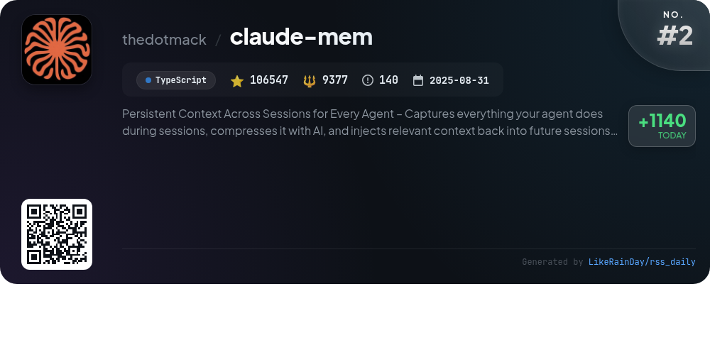
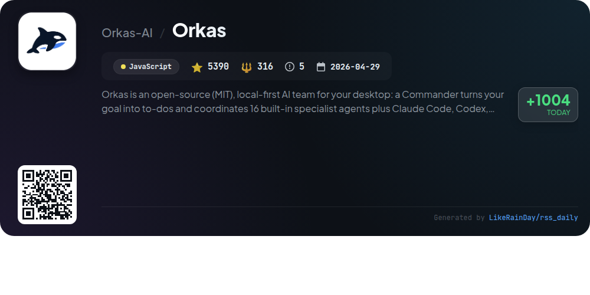
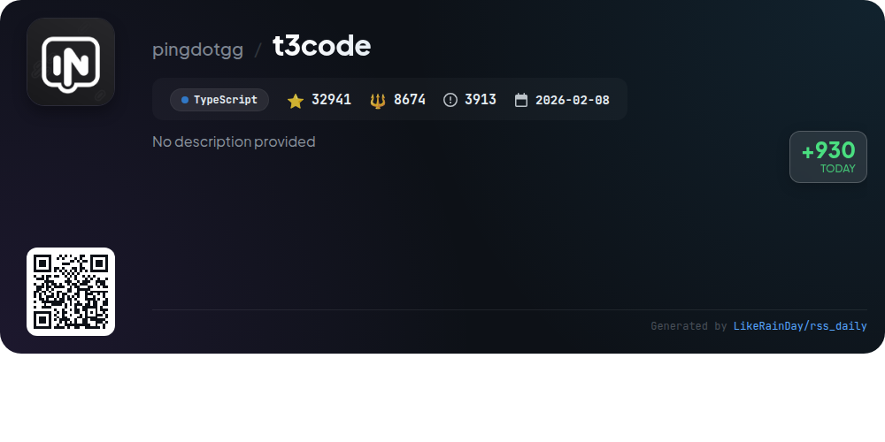
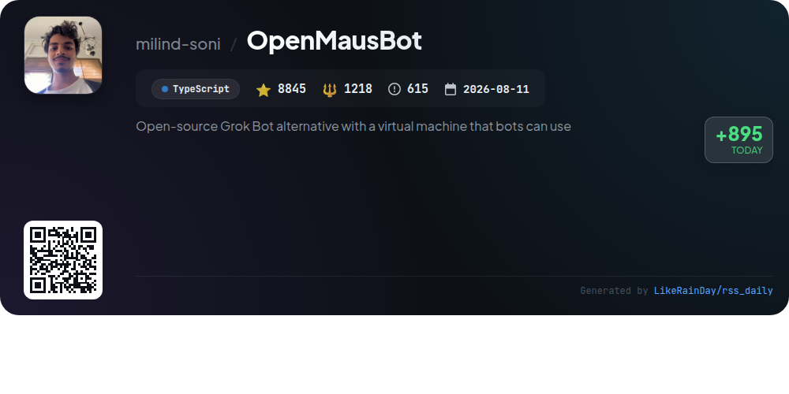
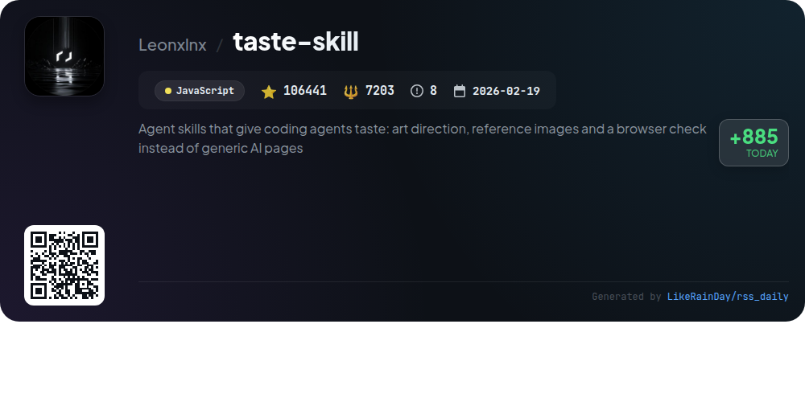
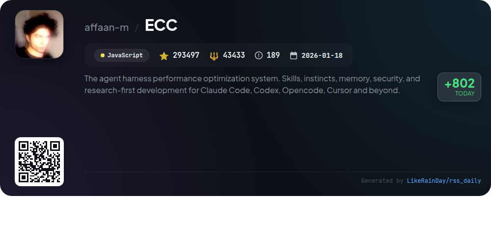
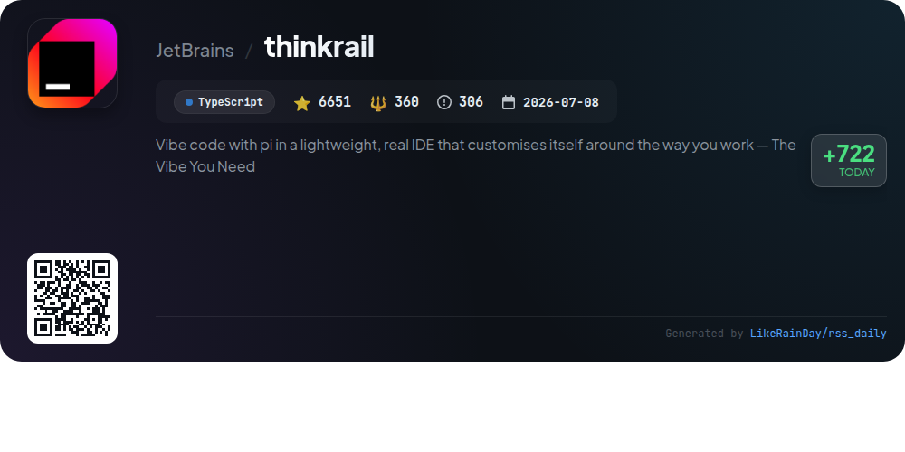
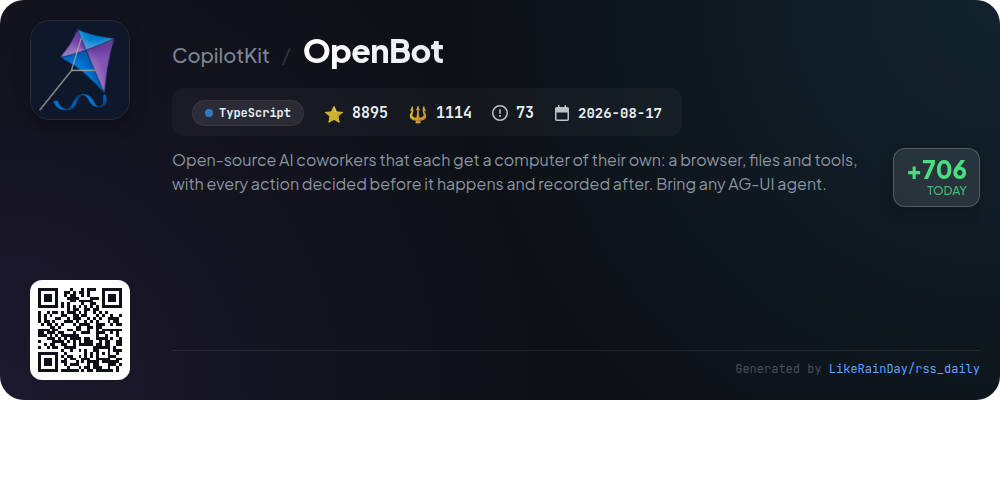

# 📊 🌟 GitHub Trending Daily - 2026-10-31

> > 📅 每日精选 GitHub 热门仓库 | 基于智能算法推荐

## 📋 Overview

**10** 个项目 | **677934** ⭐ | **79695** 🍴

**热门语言:** `TypeScript` (6) · `JavaScript` (3) · `Rust` (1)

**更新时间:** 2026-10-31 05:03 UTC

**分类分布:**

- 🌟 每日 Top 10 精选 (10 项)

---

## 🌟 每日 Top 10 精选

### 1. [impeccable](https://github.com/pbakaus/impeccable)

> 🤖 **推荐理由**  
> *Impeccable is a Rust-based design vocabulary tool for coding agents, enabling users to enhance and audit UI designs effectively. With commands like `polish`, `bolder`, `critique`, and `audit`, it streamlines the design process, ensuring usability and accessibility. Key features include a slop detector with 62 rules, live mode for real-time iteration, and compatibility with various coding environments like Codex, Copilot, and more. Impeccable helps teams maintain consistent design standards and improve project outcomes by facilitating clear communication of design intent. Full documentation is available at impeccable.style/docs.*

- ⭐ 97279 stars
- 💻 Rust
- 📅 Updated: 2026-10-31

### 2. [claude-mem](https://github.com/thedotmack/claude-mem)

> 🤖 **推荐理由**  
> *Claude-Mem is a persistent memory system designed for AI agents, enabling context retention across sessions. It captures user interactions, compresses them with AI, and provides relevant context for future use. Key features include persistent memory, smart search capabilities, privacy controls, and team collaboration tools. Compatible with platforms like Claude Code, OpenClaw, and Codex, it offers easy installation and configuration. With over 106,000 stars on GitHub, Claude-Mem enhances project continuity and knowledge management in AI-driven environments.*

- ⭐ 106547 stars
- 💻 TypeScript
- 📅 Updated: 2026-10-31

### 3. [ziwei-doushu](https://github.com/Renhuai123/ziwei-doushu)

> 🤖 **推荐理由**  
> *The "ziwei-doushu" project is an open-source Zi Wei Dou Shu astrology engine based on Ni Hai Xia's "Tian Ji" system. It features a comprehensive calculation algorithm, a four transformation system, a knowledge base of astrological patterns, and original ancient text data. The project offers a vast dataset of 674,976 astrological charts with over 8.7 million interpretive segments, emphasizing accessibility to traditional wisdom. Users can experience online charting and AI interpretation at ouranic.cn. The engine supports true solar time correction and various astrological nuances, making it a valuable tool for learners and practitioners alike.*

- ⭐ 11448 stars
- 💻 TypeScript
- 📅 Updated: 2026-10-31

### 4. [Orkas](https://github.com/Orkas-AI/Orkas)

> 🤖 **推荐理由**  
> *Orkas is an open-source, local-first AI desktop app that transforms goals into actionable to-dos, coordinating 16 built-in specialist agents alongside external coding tools like Claude Code and Codex. Key features include project management, scheduled automations, and connectors for various platforms. It supports free usage on macOS and Windows, offering 500 credits for built-in models. Orkas excels in delivering complex tasks through a collaborative agent team, ensuring ongoing project momentum while keeping data secure on your device.*

- ⭐ 5390 stars
- 💻 JavaScript
- 📅 Updated: 2026-10-31

### 5. [t3code](https://github.com/pingdotgg/t3code)

> 🤖 **推荐理由**  
> *T3 Code is an agent harness control surface designed for seamless interaction with various AI agents, including Claude, Codex, and Cursor, through mobile, web, and desktop applications. It emphasizes a performant, remote-ready experience and is built with open-source principles, allowing users to fork and customize the tool. Key features include command-line support, background service operation, and integrations with popular coding tools. Installation is straightforward across multiple platforms, and comprehensive documentation is available for users. With over 32,000 stars, T3 Code aims to enhance the development workflow.*

- ⭐ 32941 stars
- 💻 TypeScript
- 📅 Updated: 2026-10-31

### 6. [OpenMausBot](https://github.com/milind-soni/OpenMausBot)

> 🤖 **推荐理由**  
> *OpenMausBot is an open-source alternative to Grok Bot, designed for creating and managing AI agents within a chat app. Key features include the ability to run multiple agents like Claude and Codex locally, a permission broker for safe operations, and integration with over 500 apps through Composio. Users can manage bots as contacts, utilize a marketplace for seamless app connections, and activate voice responses. Built with TypeScript and Electron, it supports macOS, Windows, and Ubuntu, making AI interactions secure, localized, and customizable.*

- ⭐ 8845 stars
- 💻 TypeScript
- 📅 Updated: 2026-10-31

### 7. [taste-skill](https://github.com/Leonxlnx/taste-skill)

> 🤖 **推荐理由**  
> *Taste Skill is an innovative agent skill designed to enhance coding agents with artistic direction, enabling them to create visually appealing websites and app screens. It leverages real images from open archives, ensuring high-quality design over generic outputs. Key features include a structured six-step process for page creation, real-time browser checks, and a focus on both web and app interfaces. With its seamless installation via Node.js and no API keys required, Taste Skill streamlines the design process while maintaining artistic integrity. Visit tasteskill.dev for more information.*

- ⭐ 106441 stars
- 💻 JavaScript
- 📅 Updated: 2026-10-31

### 8. [ECC](https://github.com/affaan-m/ECC)

> 🤖 **推荐理由**  
> *ECC is an advanced performance optimization system for coding agents like Claude Code, Codex, and Cursor. It provides a structured environment with 71 specialized agents and 314 reusable skills for planning, testing, and reviewing code. Key features include continuous learning, memory persistence, and security scanning via AgentShield. The system supports multiple harnesses and offers integration with GitHub for enhanced project management. With a guided setup, ECC streamlines workflows and improves code quality through systematic checks and balances. An open-source project, ECC is licensed under MIT.*

- ⭐ 293497 stars
- 💻 JavaScript
- 📅 Updated: 2026-10-31

### 9. [thinkrail](https://github.com/JetBrains/thinkrail)

> 🤖 **推荐理由**  
> *ThinkRail is an innovative IDE designed to enhance your coding experience by adapting to your workflow. Key features include isolated workspaces using Git worktrees, a rich interface with Monaco editor support, and live collaboration through multiple `pi` sessions. It integrates project specifications as a connected graph, enabling the agent to learn and improve continuously. With extension support, customizable themes, and language options, ThinkRail offers a tailored environment for developers. Join the community on Discord and explore more at thinkrail.ai.*

- ⭐ 6651 stars
- 💻 TypeScript
- 📅 Updated: 2026-10-31

### 10. [OpenBot](https://github.com/CopilotKit/OpenBot)

> 🤖 **推荐理由**  
> *OpenBot is an open-source AI coworker platform that allows users to run customizable AI agents on their own infrastructure. Each agent has its own browser, files, and tools, with actions pre-approved and logged for security. Key features include support for any AG-UI agent, robust governance policies, an audit trail, and the ability to create personalized skills. The platform ensures data privacy by keeping everything local, while also offering Docker-based deployment and integration with existing identity providers. OpenBot is designed for flexibility, allowing users to adapt it to their needs.*

- ⭐ 8895 stars
- 💻 TypeScript
- 📅 Updated: 2026-10-31

---

## 📡 RSS订阅

通过 RSS 订阅，第一时间获取每日精选项目：

- 🔔 [RSS 订阅源] (../../daily-top.xml)
- 🔔 [每日简报] (../../GITHUB_TODAY_CN.md)
- 🔔 [每日 Top 10 精选](../../daily-top.xml)

---

*⚡ Powered by Smart Trending Algorithm | Generated at 2026-10-31 05:03:35 UTC
