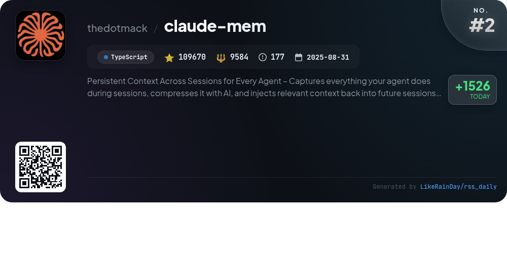
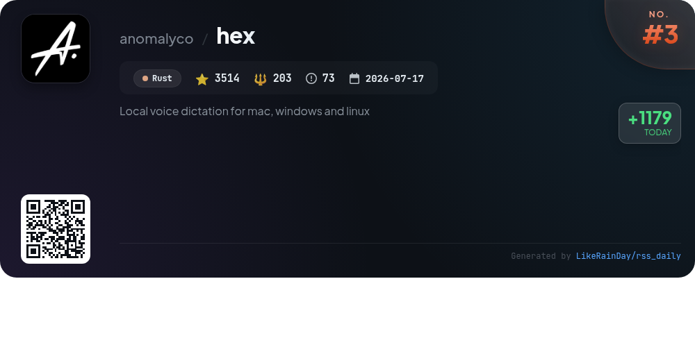
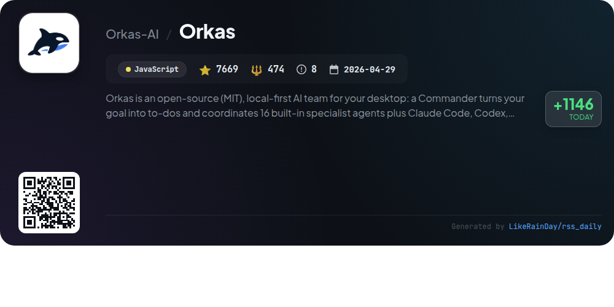
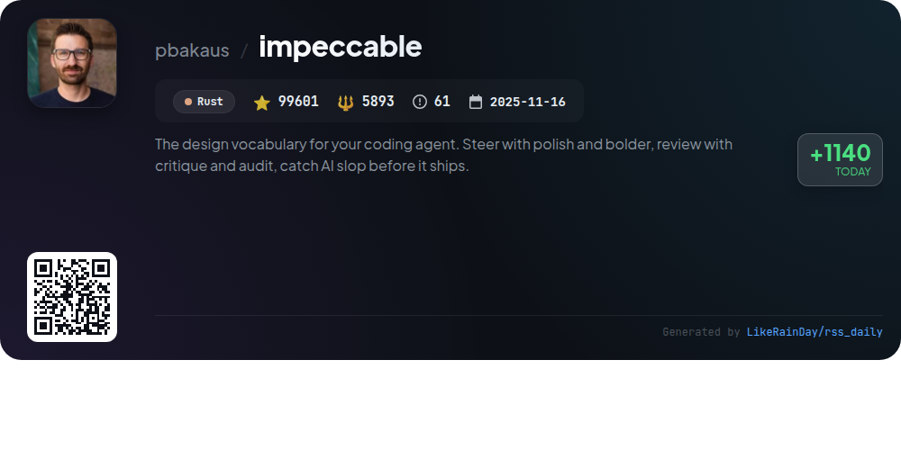
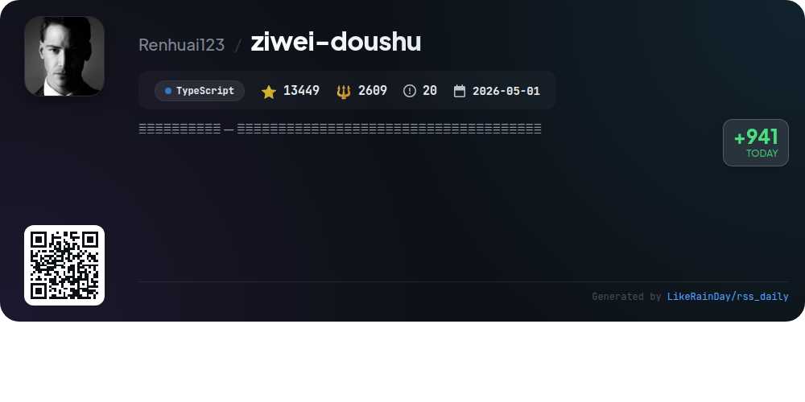
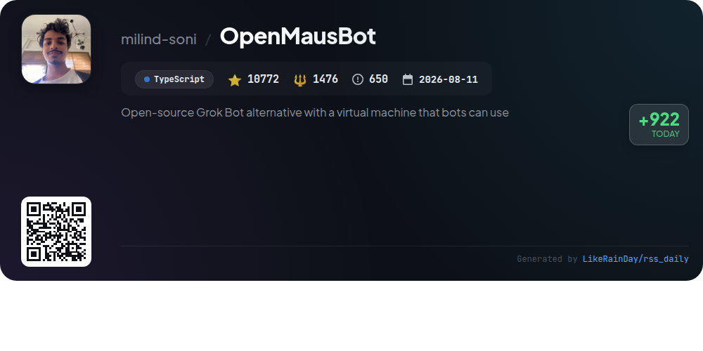
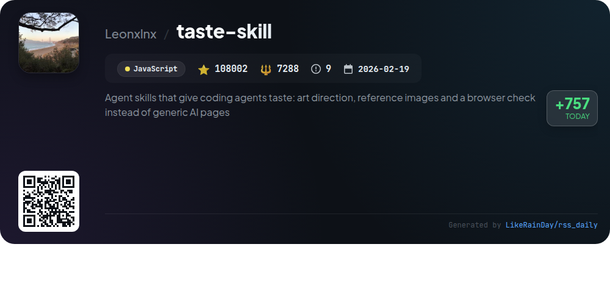
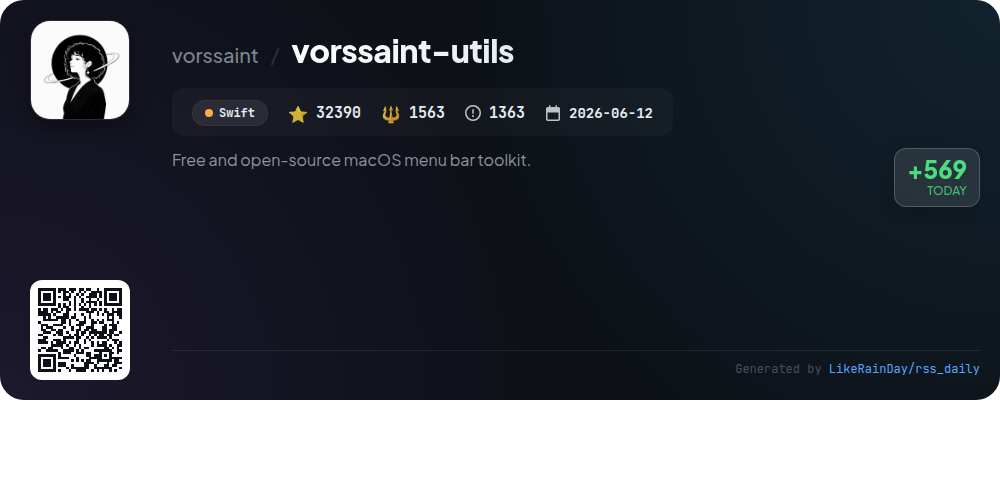
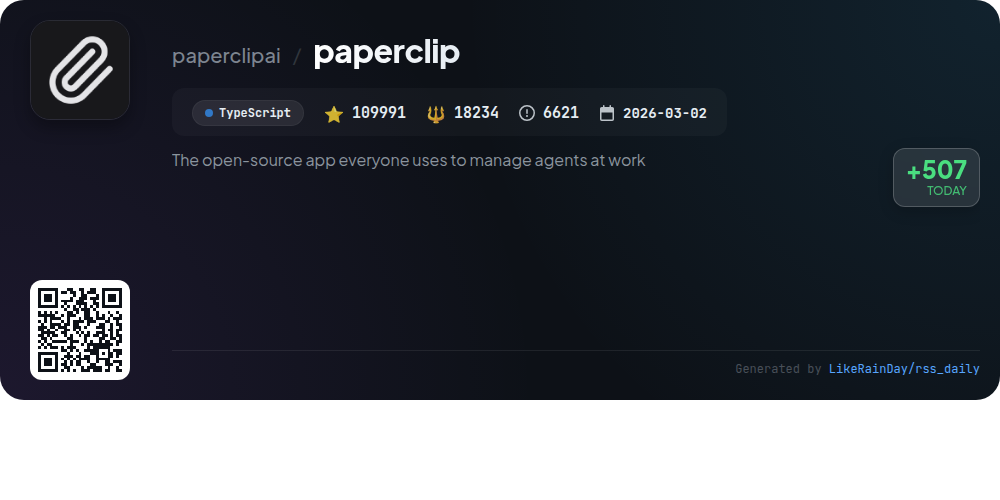

# 📊 🌟 GitHub Trending Daily - 2026-11-02

> > 📅 Daily Picks of GitHub Trending Repositories | Powered by Smart Algorithms

## 📋 Overview

**10** Projects | **533660** ⭐ | **56271** 🍴

**Top Languages:** `TypeScript` (5) · `Rust` (2) · `JavaScript` (2)

**Updated:** 2026-11-02 05:32 UTC

**Categories:**

- 🌟 Daily Top 10 (10 items)

---

## 🌟 Daily Top 10

### 1. [t3code](https://github.com/pingdotgg/t3code)

> 🤖 **Why Recommend**  
> *T3 Code is an agent harness control surface built in TypeScript, enabling users to manage various AI agents on their machines via a mobile app (iOS and Android), a web app, and an Electron-based desktop app. It supports integrations with Claude Code, Codex, Cursor, Grok Build, OpenCode, Google Antigravity, and fx. Designed for optimal performance and remote accessibility, T3 Code empowers developers with a customizable environment. The project is open-source, allowing users to fork and modify as needed, with installation options across multiple platforms.*

- ⭐ 38602 stars
- 💻 TypeScript
- 📅 Updated: 2026-11-02

### 2. [claude-mem](https://github.com/thedotmack/claude-mem)

> 🤖 **Why Recommend**  
> *Claude-Mem is a powerful TypeScript-based tool designed to maintain persistent context across sessions for AI agents like Claude Code, OpenClaw, and more. With over 109,670 stars, it captures agent activities, compresses them using AI, and reinjects relevant context into future interactions. Key features include smart search capabilities, progressive memory retrieval, and privacy controls. The system allows for seamless teamwork through shared workspaces and supports various installation options for multiple IDEs. Claude-Mem enhances productivity by ensuring continuity and context awareness in AI-driven projects.*

- ⭐ 109670 stars
- 💻 TypeScript
- 📅 Updated: 2026-11-02

### 3. [hex](https://github.com/anomalyco/hex)

> 🤖 **Why Recommend**  
> *Hex is a local voice dictation tool compatible with Mac, Windows, and Linux, enabling users to transcribe speech directly into applications by holding a key and speaking. The software ensures privacy by processing all data locally after an initial speech model download. Key features include easy installation across platforms, experimental features in Labs, and a streamlined user interface. With over 3,500 stars on GitHub, Hex provides a robust, efficient solution for voice dictation without reliance on internet connectivity. Contributing is encouraged through issue reports.*

- ⭐ 3514 stars
- 💻 Rust
- 📅 Updated: 2026-11-02

### 4. [Orkas](https://github.com/Orkas-AI/Orkas)

> 🤖 **Why Recommend**  
> *Orkas is an open-source, local-first AI desktop app that transforms goals into actionable tasks, managed by a central Commander coordinating 16 built-in specialist agents and external coding tools like Claude Code and Codex. Key features include project management, automated task handling, and connectors for popular apps like Gmail and Slack. Users benefit from a collaborative workspace, scheduled automations, and robust data privacy. Available for macOS and Windows, Orkas offers 500 free credits for its built-in model, making it easy to start without an API key.*

- ⭐ 7669 stars
- 💻 JavaScript
- 📅 Updated: 2026-11-02

### 5. [impeccable](https://github.com/pbakaus/impeccable)

> 🤖 **Why Recommend**  
> *Impeccable is a Rust-based design vocabulary for coding agents, aimed at enhancing UI/UX quality. With features like `polish`, `bolder`, `critique`, and `audit`, it helps users refine designs, conduct usability reviews, and catch issues before deployment. The tool integrates seamlessly with various coding environments and supports 24 commands for steering, reviewing, and finishing projects. Its slop detection capabilities flag design flaws and performance issues, ensuring a polished final product. Full documentation is available at impeccable.style/docs.*

- ⭐ 99601 stars
- 💻 Rust
- 📅 Updated: 2026-11-02

### 6. [ziwei-doushu](https://github.com/Renhuai123/ziwei-doushu)

> 🤖 **Why Recommend**  
> *The "ziwei-doushu" project is an open-source engine for Zi Wei Dou Shu, a traditional Chinese astrology system based on Ni Haixia's "Tianji" framework. It offers a comprehensive calculation algorithm, a Four Transformations system, a knowledge base of patterns, and original classic texts. Key features include a dataset of 674,976 birth charts with 8.77 million interpretive segments, online tools for charting and AI interpretations, and a commitment to making traditional wisdom accessible. The project promotes transparency in astrological algorithms and supports educational use.*

- ⭐ 13449 stars
- 💻 TypeScript
- 📅 Updated: 2026-11-02

### 7. [OpenMausBot](https://github.com/milind-soni/OpenMausBot)

> 🤖 **Why Recommend**  
> *OpenMausBot is an open-source alternative to Grok Bot, enabling users to manage a team of AI bots in a chat app environment. Key features include local-first operation with custom agent models (Claude, Codex), real-time bot interaction, cloud desktop capabilities, and connected app integration (Gmail, Slack, GitHub). Users can customize bot behavior with a permission broker for actions, manage workflows through channels, and utilize voice interaction. OpenMausBot supports macOS, Windows, and Ubuntu, promoting privacy and user control over data.*

- ⭐ 10772 stars
- 💻 TypeScript
- 📅 Updated: 2026-11-02

### 8. [taste-skill](https://github.com/Leonxlnx/taste-skill)

> 🤖 **Why Recommend**  
> *Taste Skill is a powerful agent skill designed to enhance coding agents with artistic capabilities, allowing them to create visually appealing websites and app screens. It offers art direction, utilizes real reference images from open archives, and includes a browser check to ensure quality. With a focus on design, it generates pages based on client briefs, employing curated styles from extensive research. The skill is easily installable via CLI, runs on Node.js, and doesn't require API keys. It now supports dashboard and app screen creation, making it versatile for various projects.*

- ⭐ 108002 stars
- 💻 JavaScript
- 📅 Updated: 2026-11-02

### 9. [vorssaint-utils](https://github.com/vorssaint/vorssaint-utils)

> 🤖 **Why Recommend**  
> *Vorssaint-utils is a free, open-source macOS menu bar toolkit designed to replace multiple paid apps with one streamlined solution. With over 32,000 stars on GitHub, it features a customizable volume mixer, system monitoring, advanced app switching, and clipboard management. Users can install only the features they need, ensuring minimal resource usage. Privacy is prioritized, with no tracking or accounts required. Additional tools include screen capture, app management, and dynamic controls. Compatible with macOS 14 and Apple Silicon, Vorssaint enhances user efficiency without subscriptions.*

- ⭐ 32390 stars
- 💻 Swift
- 📅 Updated: 2026-11-02

### 10. [paperclip](https://github.com/paperclipai/paperclip)

> 🤖 **Why Recommend**  
> *Paperclip is an open-source app designed to manage AI agents for business orchestration. With over 109,000 stars on GitHub, it provides a seamless interface for defining goals, assigning tasks, and tracking performance across various agent types. Key features include goal alignment, cost control, an organizational chart, and a robust task management system. Paperclip supports integration with multiple agents, offers persistent work context, and allows for governance and auditing of agent activities. It's ideal for teams looking to streamline AI operations and enhance productivity.*

- ⭐ 109991 stars
- 💻 TypeScript
- 📅 Updated: 2026-11-02

---

## 📡 RSS Subscription

Subscribe via RSS to get daily trending updates:

- 🔔 [RSS XML] (../../daily-top.xml)
- 🔔 [Daily Report] (../../GITHUB_TODAY.md)
- 🔔 [Daily Top 10](../../daily-top.xml)

---

*⚡ Powered by Smart Trending Algorithm | Generated at 2026-11-02 05:32:18 UTC
