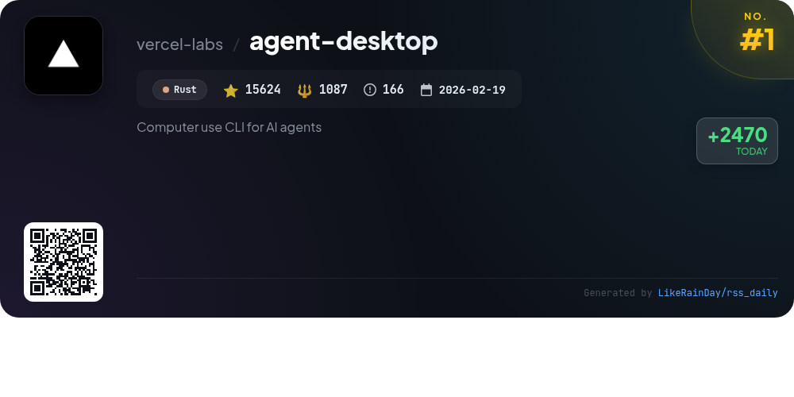
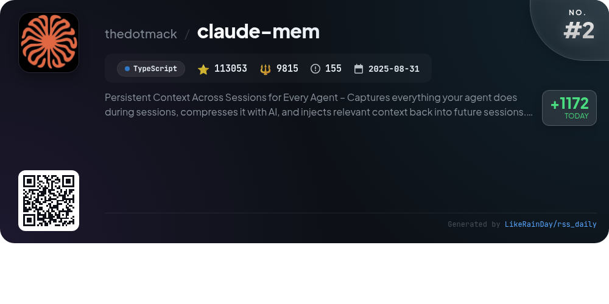
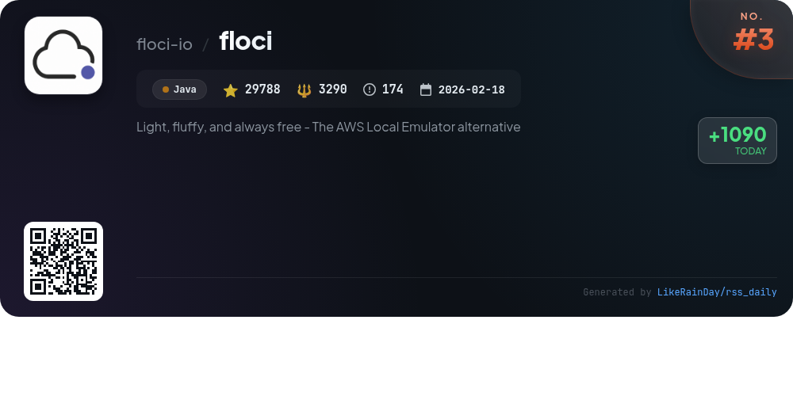
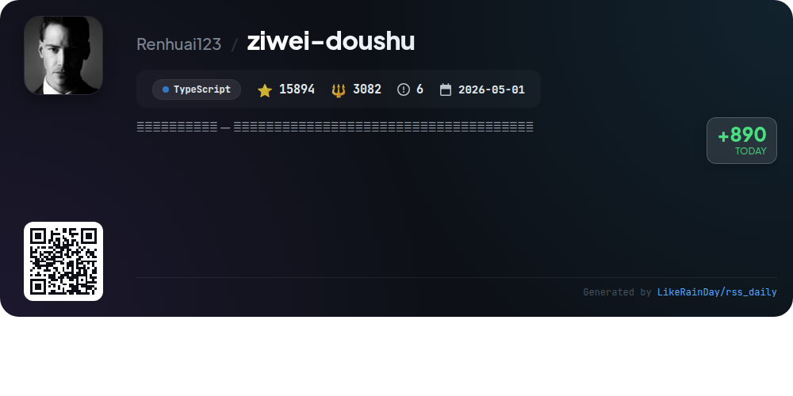
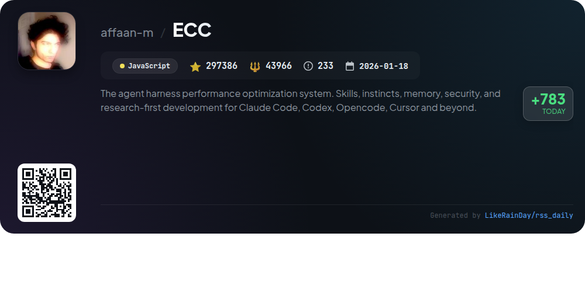
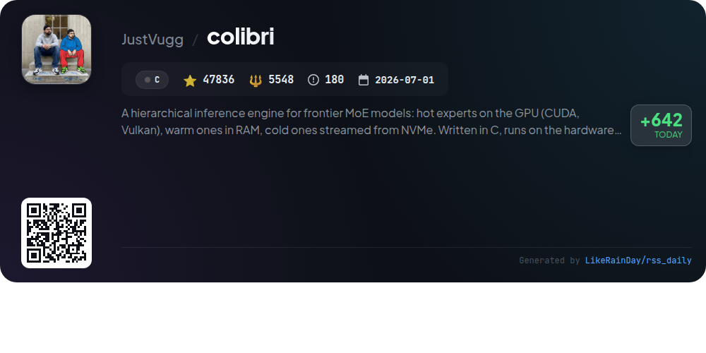
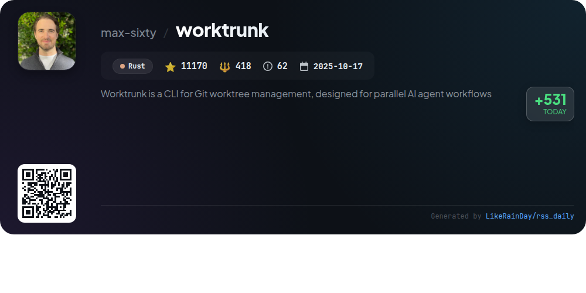
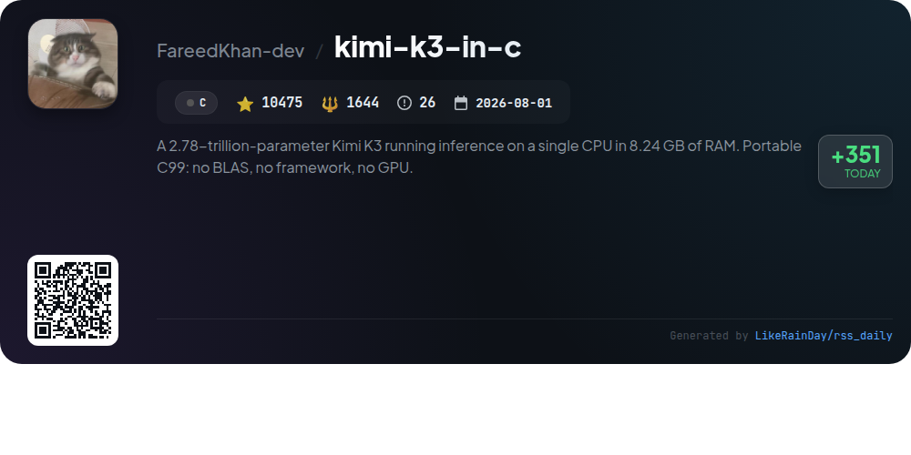
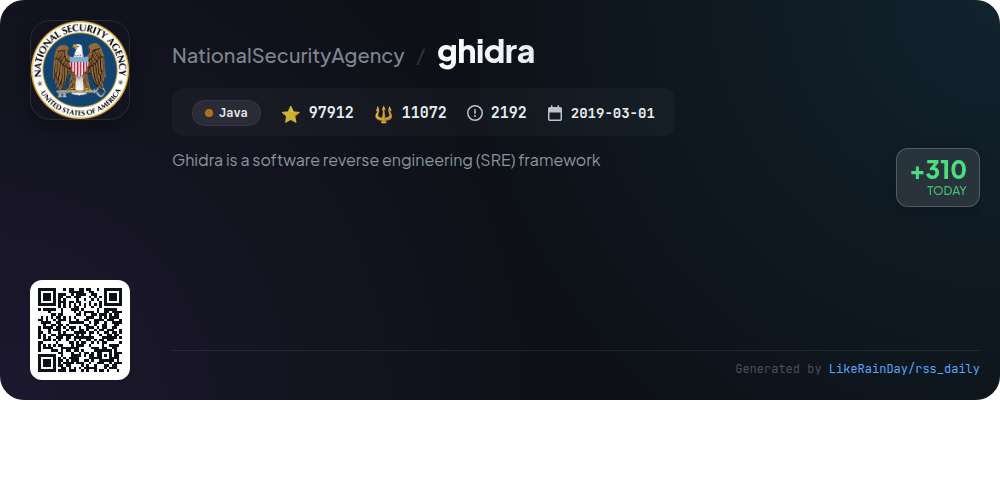
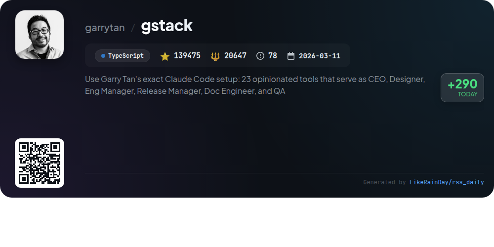

# 📊 🌟 GitHub Trending Daily - 2026-11-05

> > 📅 每日精选 GitHub 热门仓库 | 基于智能算法推荐

## 📋 Overview

**10** 个项目 | **778613** ⭐ | **100569** 🍴

**热门语言:** `TypeScript` (3) · `Java` (2) · `C` (2)

**更新时间:** 2026-11-05 06:06 UTC

**分类分布:**

- 🌟 每日 Top 10 精选 (10 项)

---

## 🌟 每日 Top 10 精选

### 1. [agent-desktop](https://github.com/vercel-labs/agent-desktop)

> 🤖 **推荐理由**  
> *agent-desktop is a CLI tool for AI agents, enabling interaction with desktop applications on macOS, Windows, and Linux via the OS accessibility tree. It reads UI elements and allows agents to perform actions without relying on screenshots or pixel matching. Key features include generating JSON snapshots of app states, executing commands like clicks and text input, and supporting headless operation. The project is built in Rust, offers a C library for integration, and has extensive documentation, making it a versatile solution for automated desktop interactions.*

- ⭐ 15624 stars
- 💻 Rust
- 📅 Updated: 2026-11-05

### 2. [claude-mem](https://github.com/thedotmack/claude-mem)

> 🤖 **推荐理由**  
> *Claude-Mem is a TypeScript-based project designed to enhance agent productivity by providing persistent memory across sessions. It captures tool usage and generates semantic summaries, ensuring continuity in projects even after sessions end. Key features include smart search, team collaboration with TeamBrain, privacy controls, and context configuration. Compatible with various AI tools like Claude Code and OpenClaw, it enables efficient memory management and retrieval. With over 113k stars, Claude-Mem is a robust solution for developers seeking to optimize their workflow and project continuity.*

- ⭐ 113053 stars
- 💻 TypeScript
- 📅 Updated: 2026-11-05

### 3. [floci](https://github.com/floci-io/floci)

> 🤖 **推荐理由**  
> *Floci is a free, open-source local AWS emulator designed for development, testing, and CI, allowing seamless integration with existing AWS workflows without the need for cloud accounts or tokens. Key features include real Docker-backed services for Lambda, RDS, DynamoDB, and more, along with support for AWS SDKs, CLI, Terraform, and CDK. Floci offers configurable storage modes and a web console for resource inspection. With 29,788 stars on GitHub, it serves as a robust alternative to LocalStack, ensuring compatibility and ease of migration.*

- ⭐ 29788 stars
- 💻 Java
- 📅 Updated: 2026-11-05

### 4. [ziwei-doushu](https://github.com/Renhuai123/ziwei-doushu)

> 🤖 **推荐理由**  
> *The "ziwei-doushu" project is an open-source Zi Wei Dou Shu (Purple Star Astrology) charting engine based on Ni Hai Xia's "Tian Ji" system. It features a comprehensive charting algorithm, a Four Transformations system, a knowledge base of astrological patterns, and ancient text data. With over 674,000 charts and 8.77 million interpretations, the project emphasizes open access to traditional wisdom. Key services include an online platform for charting and AI interpretations, and extensive datasets available for commercial use with proper attribution.*

- ⭐ 15894 stars
- 💻 TypeScript
- 📅 Updated: 2026-11-05

### 5. [ECC](https://github.com/affaan-m/ECC)

> 🤖 **推荐理由**  
> *ECC is a performance optimization system designed for AI agents like Claude Code and Codex. It offers 71 specialized agents, 314 reusable skills, and 98 command shims, facilitating tasks such as planning, code review, and security audits. Key features include automated context management, continuous learning, and the AgentShield security scanner. ECC supports multi-harness integration with platforms like Cursor and OpenCode, providing a unified toolbox for seamless engineering workflows. It is open-source and MIT-licensed, ensuring accessibility for all developers.*

- ⭐ 297386 stars
- 💻 JavaScript
- 📅 Updated: 2026-11-05

### 6. [colibri](https://github.com/JustVugg/colibri)

> 🤖 **推荐理由**  
> *Colibri is a hierarchical inference engine designed for large mixture-of-experts (MoE) models, enabling efficient model usage on existing hardware. It leverages CUDA and Vulkan for GPU acceleration, while managing memory through a tiered approach—storing hot experts in GPU memory, warm experts in RAM, and cold experts streamed from NVMe. Supporting multiple engines for language and decision tasks, Colibri provides a user-friendly dashboard and APIs compatible with OpenAI and Anthropic standards, facilitating seamless integration into various applications. Its open-source nature fosters community-driven enhancements.*

- ⭐ 47836 stars
- 💻 C
- 📅 Updated: 2026-11-05

### 7. [worktrunk](https://github.com/max-sixty/worktrunk)

> 🤖 **推荐理由**  
> *Worktrunk is a popular CLI tool (11,170 stars) for managing Git worktrees, specifically designed for parallel AI agent workflows. Built in Rust, it simplifies the complex UX of Git worktrees with commands that make creating, switching, and managing worktrees as easy as handling branches. Key features include automation hooks, LLM-generated commit messages, and the ability to share build caches across worktrees. With a focus on enhancing productivity in multi-agent environments, Worktrunk streamlines workflows and improves efficiency. For detailed documentation, visit worktrunk.dev.*

- ⭐ 11170 stars
- 💻 Rust
- 📅 Updated: 2026-11-05

### 8. [kimi-k3-in-c](https://github.com/FareedKhan-dev/kimi-k3-in-c)

> 🤖 **推荐理由**  
> *Kimi-K3-in-C is a lightweight inference engine for the 2.78-trillion-parameter Kimi K3 model, designed to run on a single CPU with just 8 GB of RAM. It is implemented in portable C99 without dependencies on BLAS or GPU. Key features include efficient memory management through streaming, producing identical output across various memory budgets, and a deterministic hit rate for cache utilization. The project demonstrates the ability to generate text fluently and accurately while maintaining low latency, making advanced AI models accessible on consumer-grade hardware.*

- ⭐ 10475 stars
- 💻 C
- 📅 Updated: 2026-11-05

### 9. [ghidra](https://github.com/NationalSecurityAgency/ghidra)

> 🤖 **推荐理由**  
> *Ghidra is a powerful software reverse engineering (SRE) framework developed by the NSA, featuring a comprehensive suite of tools for analyzing compiled code across multiple platforms (Windows, macOS, Linux). Key capabilities include disassembly, decompilation, graphing, and scripting, supporting various processor instruction sets and executable formats. Ghidra allows user customization through Java and Python extensions, enhancing its extensibility. Its design addresses complex SRE challenges, making it ideal for cybersecurity research and vulnerability analysis.*

- ⭐ 97912 stars
- 💻 Java
- 📅 Updated: 2026-11-05

### 10. [gstack](https://github.com/garrytan/gstack)

> 🤖 **推荐理由**  
> *gstack transforms Claude Code into a virtual engineering team, featuring 23 specialized tools for roles such as CEO, Designer, and QA Lead. Key features include structured commands for planning, reviewing, testing, and shipping code, all within a streamlined workflow. Users can initiate commands like `/office-hours` for project framing, `/review` for bug detection, and `/qa` for real-browser testing. Designed for founders, tech leads, and first-time users, gstack enhances productivity through automation and rigorous review processes, ensuring nothing falls through the cracks. Open-source and MIT licensed, gstack is accessible to everyone.*

- ⭐ 139475 stars
- 💻 TypeScript
- 📅 Updated: 2026-11-05

---

## 📡 RSS订阅

通过 RSS 订阅，第一时间获取每日精选项目：

- 🔔 [RSS 订阅源] (../../daily-top.xml)
- 🔔 [每日简报] (../../GITHUB_TODAY_CN.md)
- 🔔 [每日 Top 10 精选](../../daily-top.xml)

---

*⚡ Powered by Smart Trending Algorithm | Generated at 2026-11-05 06:06:50 UTC
