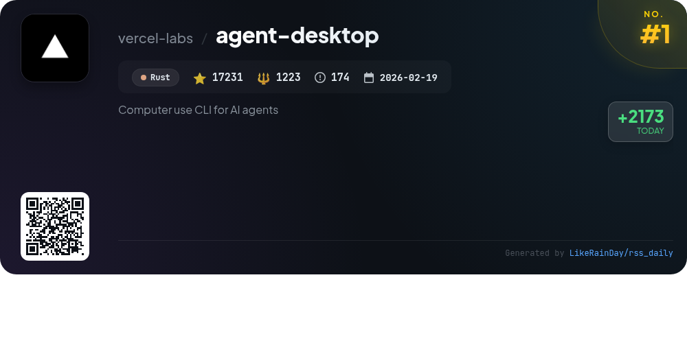
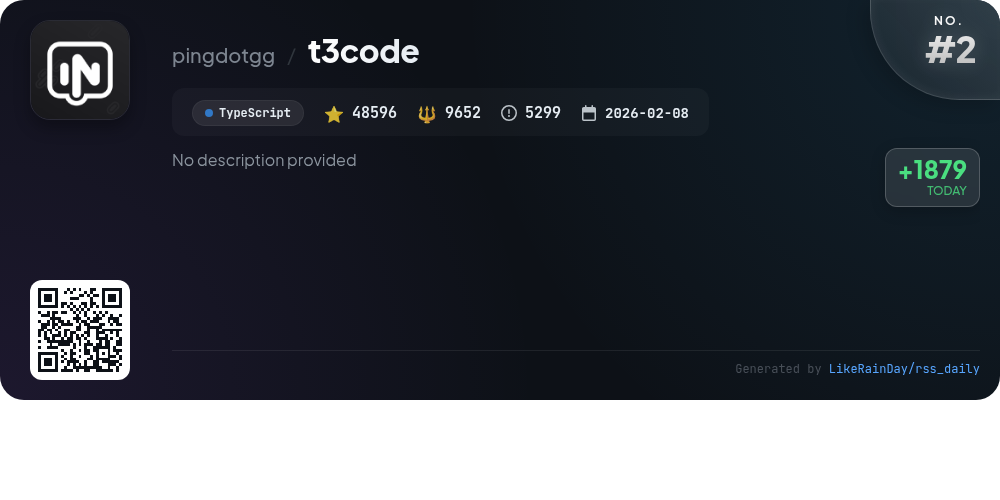
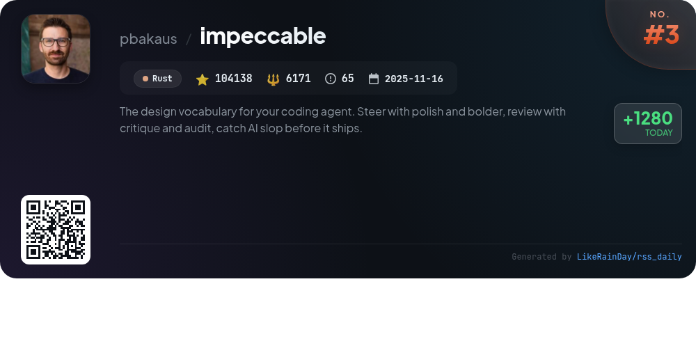
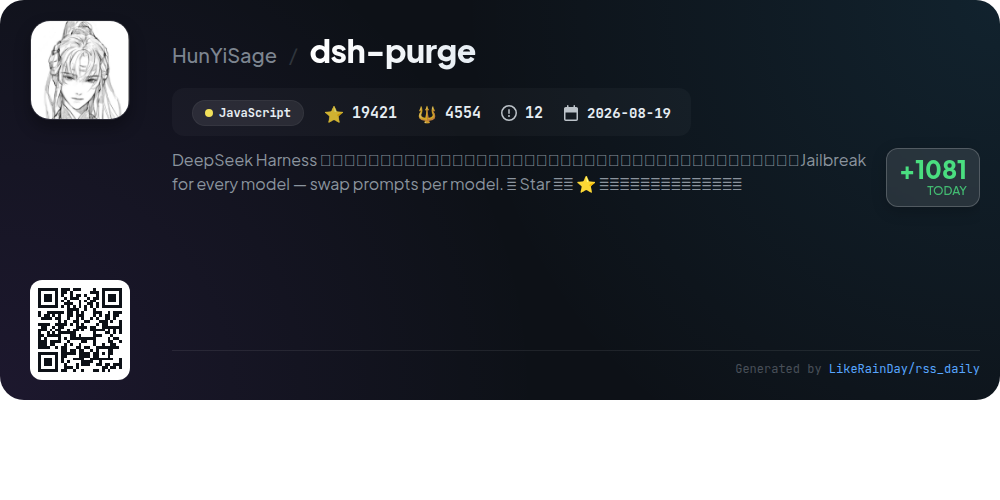
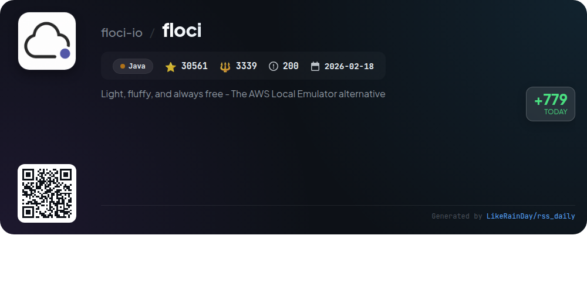
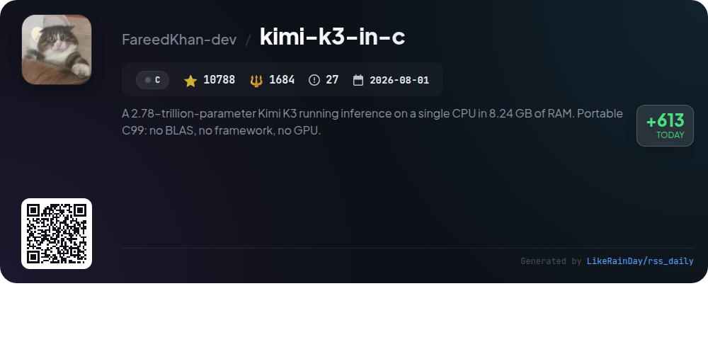
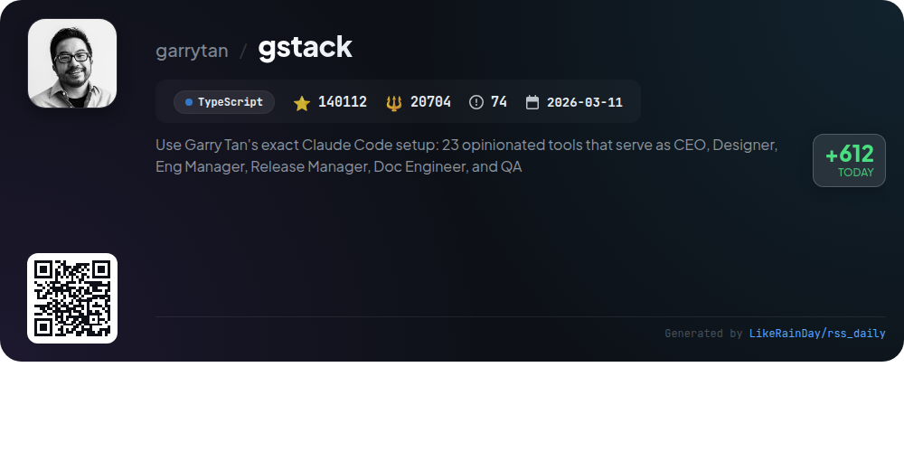
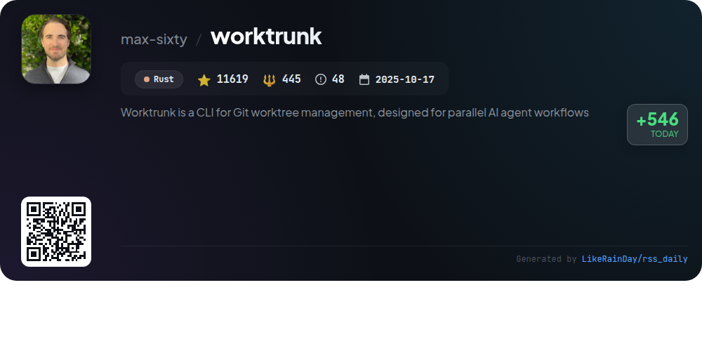
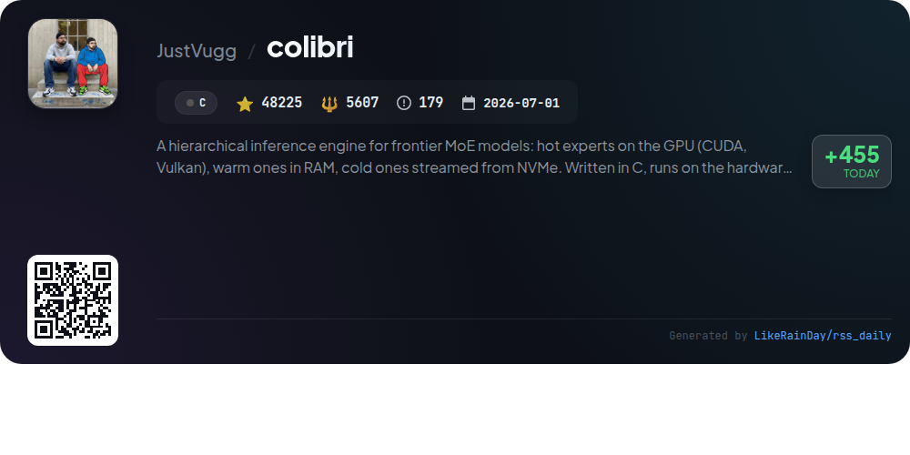
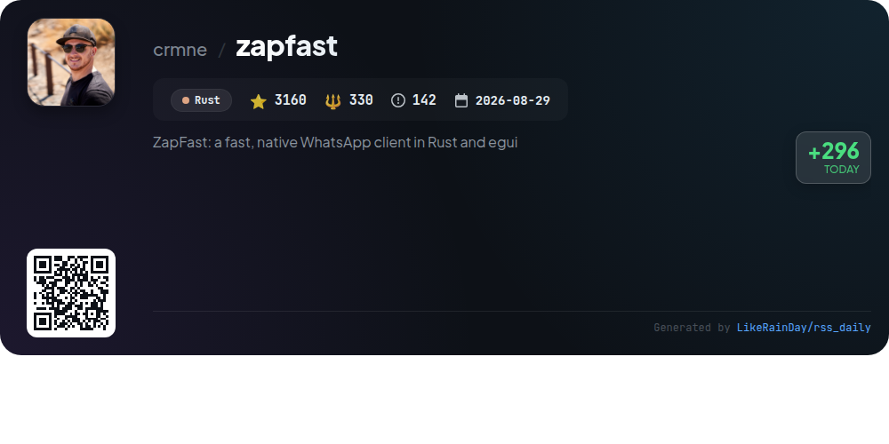

# 📊 🌟 GitHub Trending Daily - 2026-11-06

> > 📅 Daily Picks of GitHub Trending Repositories | Powered by Smart Algorithms

## 📋 Overview

**10** Projects | **433851** ⭐ | **53709** 🍴

**Top Languages:** `Rust` (4) · `TypeScript` (2) · `C` (2)

**Updated:** 2026-11-06 06:03 UTC

**Categories:**

- 🌟 Daily Top 10 (10 items)

---

## 🌟 Daily Top 10

### 1. [agent-desktop](https://github.com/vercel-labs/agent-desktop)

> 🤖 **Why Recommend**  
> *agent-desktop is a Rust-based CLI tool that enables AI agents to interact with desktop applications on macOS, Windows, and Linux by utilizing the OS accessibility tree. It provides a JSON interface for capturing snapshots of UI elements, allowing agents to perform actions like clicking and typing without relying on screenshots or pixel matching. Key features include headless operation, extensive command support (over 60 commands), and a C library for in-process integration. It ensures privacy by handling sensitive data carefully, making it suitable for automation tasks in various environments.*

- ⭐ 17231 stars
- 💻 Rust
- 📅 Updated: 2026-11-06

### 2. [t3code](https://github.com/pingdotgg/t3code)

> 🤖 **Why Recommend**  
> *T3 Code is an advanced "agent harness control surface" that allows seamless management of AI agents on your machine via a mobile app (iOS and Android), web app, and Electron-based desktop app. It integrates with popular services like Claude Code, Codex, Cursor, Grok Build, OpenCode, Google Antigravity, and fx. Designed for performance and openness, T3 Code offers a customizable development experience without selling any products. Installation is straightforward, with support for multiple platforms and comprehensive documentation available.*

- ⭐ 48596 stars
- 💻 TypeScript
- 📅 Updated: 2026-11-06

### 3. [impeccable](https://github.com/pbakaus/impeccable)

> 🤖 **Why Recommend**  
> *Impeccable is a Rust-based design vocabulary tool for coding agents, enabling developers to enhance UI quality with commands like `polish`, `bolder`, `critique`, and `audit`. It integrates seamlessly with various coding environments, including Codex, GitHub Copilot, and more. Key features include a slop detector that identifies design flaws, a comprehensive review system for usability and accessibility, and live iteration capabilities for real-time design adjustments. With 24 commands for steering, reviewing, and finalizing designs, Impeccable ensures polished and user-friendly interfaces before deployment.*

- ⭐ 104138 stars
- 💻 Rust
- 📅 Updated: 2026-11-06

### 4. [dsh-purge](https://github.com/HunYiSage/dsh-purge)

> 🤖 **Why Recommend**  
> *dsh-purge is a powerful cybersecurity red-team plugin for the DeepSeek Harness, enabling prompt swapping for different models and enhancing security evaluations. Key features include a user-friendly interface with Clean and Drill pages for managing patches and rules, support for multiple rule sets, and a built-in skill library. The plugin operates locally without malicious intent, ensuring that no unauthorized attacks are conducted. With over 19,421 stars on GitHub, dsh-purge is an open-source tool designed for ethical use in cybersecurity research.*

- ⭐ 19421 stars
- 💻 JavaScript
- 📅 Updated: 2026-11-06

### 5. [floci](https://github.com/floci-io/floci)

> 🤖 **Why Recommend**  
> *Floci is a free, open-source local emulator for AWS, allowing developers to run AWS services without needing a cloud account or authentication tokens. With a simple `docker compose up`, it supports a wide range of services, including S3, DynamoDB, Lambda, and more, using real Docker containers for high fidelity. Floci offers quick startup times, configurable persistence options, and seamless integration with existing AWS SDKs and CLI tools. It is a drop-in replacement for LocalStack, making migration straightforward for current users.*

- ⭐ 30561 stars
- 💻 Java
- 📅 Updated: 2026-11-06

### 6. [kimi-k3-in-c](https://github.com/FareedKhan-dev/kimi-k3-in-c)

> 🤖 **Why Recommend**  
> *Kimi K3 in C is a highly efficient inference engine for a 2.78-trillion-parameter model that operates on a single CPU with just 8.24 GB of RAM, utilizing portable C99 without any frameworks or GPUs. Its key features include on-demand streaming of parameters, deterministic output across varying memory budgets, and a novel mixture of experts architecture that activates only a subset of parameters for each token. The project also supports incremental decoding, making it suitable for various environments while ensuring high accuracy and performance metrics.*

- ⭐ 10788 stars
- 💻 C
- 📅 Updated: 2026-11-06

### 7. [gstack](https://github.com/garrytan/gstack)

> 🤖 **Why Recommend**  
> *gstack is an open-source software factory that transforms Claude Code and other coding agents into a virtual engineering team. It features 23 specialized tools, including roles for CEO, designer, engineer manager, and QA lead, all operating through intuitive slash commands. Key highlights include automated design documentation, rigorous code reviews, real browser QA, and seamless deployment processes. Designed for founders, tech leads, and first-time users, gstack streamlines the entire development lifecycle, from ideation to shipping, ensuring nothing falls through the cracks.*

- ⭐ 140112 stars
- 💻 TypeScript
- 📅 Updated: 2026-11-06

### 8. [worktrunk](https://github.com/max-sixty/worktrunk)

> 🤖 **Why Recommend**  
> *Worktrunk is a powerful CLI tool for Git worktree management, optimized for parallel AI agent workflows. With over 11,600 stars, it simplifies tasks like switching worktrees, creating branches, and managing multiple changes with commands that mimic Git's functionality. Key features include workflow automation through hooks, LLM-generated commit messages, interactive branch selection, and the ability to share build caches. Worktrunk enhances productivity by allowing seamless management of multiple agents, making it an essential tool for developers working with AI. Full documentation is available at worktrunk.dev.*

- ⭐ 11619 stars
- 💻 Rust
- 📅 Updated: 2026-11-06

### 9. [colibri](https://github.com/JustVugg/colibri)

> 🤖 **Why Recommend**  
> *Colibri is a hierarchical inference engine for large mixture-of-experts (MoE) models, designed to efficiently utilize existing hardware. It dynamically manages model components, keeping hot experts on the GPU, warm ones in RAM, and cold ones streamed from NVMe storage. Written in C, it runs various language models (e.g., GLM-5.2/5.3, Qwen3.8) and image models (Qwen-Image-2.1) without requiring high-end GPUs. The engine features a user-friendly setup process, a comprehensive dashboard, and APIs compatible with OpenAI and Anthropic, making it a powerful tool for AI applications.*

- ⭐ 48225 stars
- 💻 C
- 📅 Updated: 2026-11-06

### 10. [zapfast](https://github.com/crmne/zapfast)

> 🤖 **Why Recommend**  
> *ZapFast is a fast, native WhatsApp client built in Rust, optimized for Linux, macOS, and Windows. With over 3,160 stars on GitHub, it offers a lightweight alternative to WhatsApp Web, using about 200 MB of RAM. Key features include sending messages, media playback, chat history management, support for multiple accounts, and customizable themes. It prioritizes privacy, storing chats locally without server reliance. The app supports multiple languages and offers detailed user guides for setup and usage.*

- ⭐ 3160 stars
- 💻 Rust
- 📅 Updated: 2026-11-06

---

## 📡 RSS Subscription

Subscribe via RSS to get daily trending updates:

- 🔔 [RSS XML] (../../daily-top.xml)
- 🔔 [Daily Report] (../../GITHUB_TODAY.md)
- 🔔 [Daily Top 10](../../daily-top.xml)

---

*⚡ Powered by Smart Trending Algorithm | Generated at 2026-11-06 06:03:53 UTC
