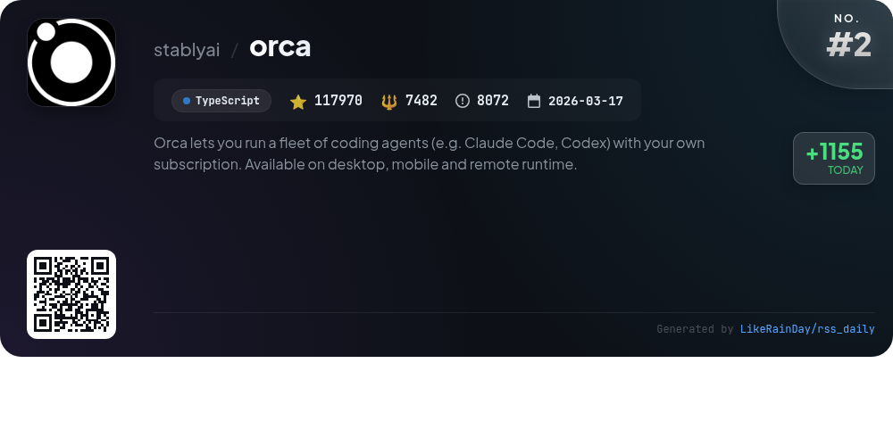
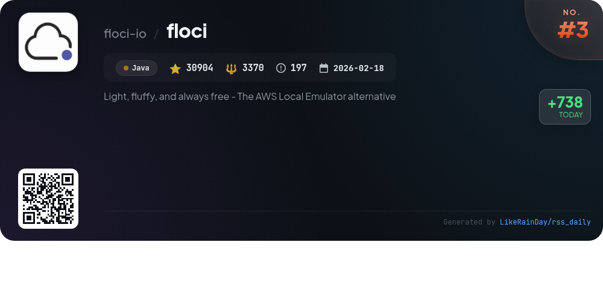
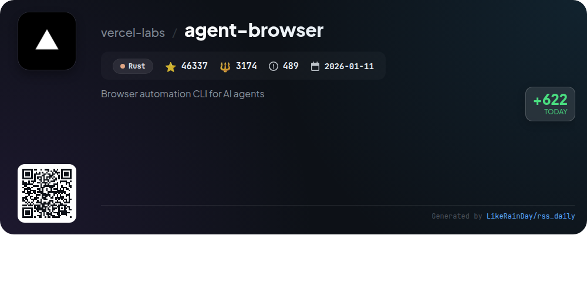
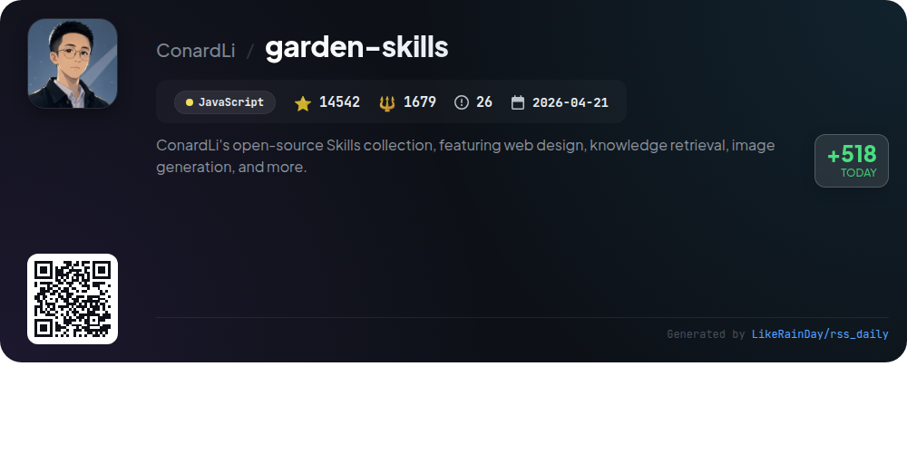
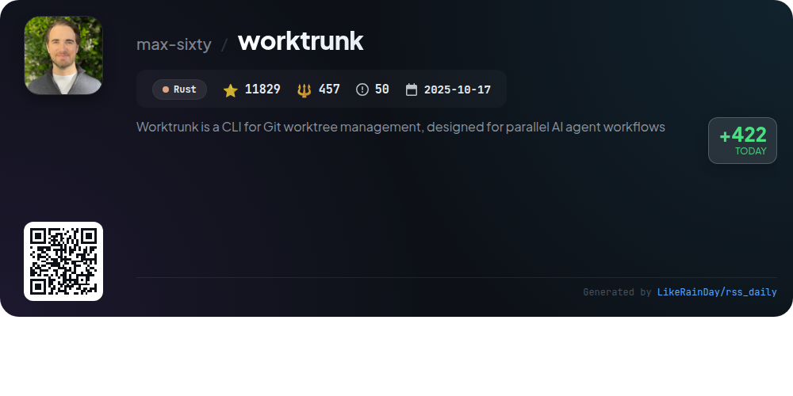
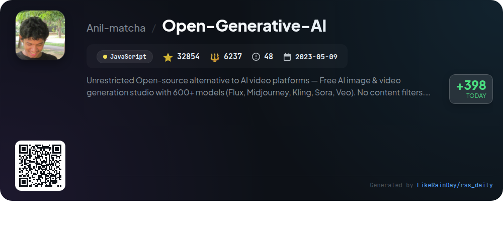
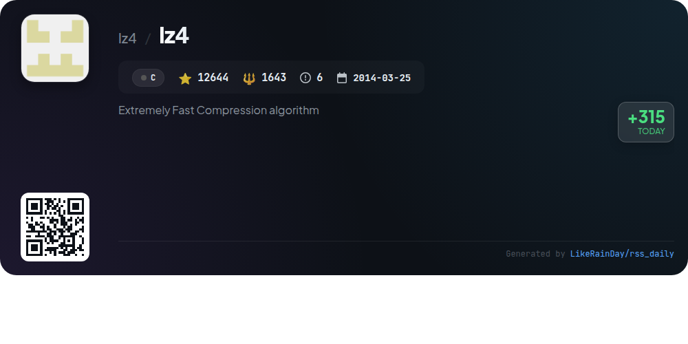
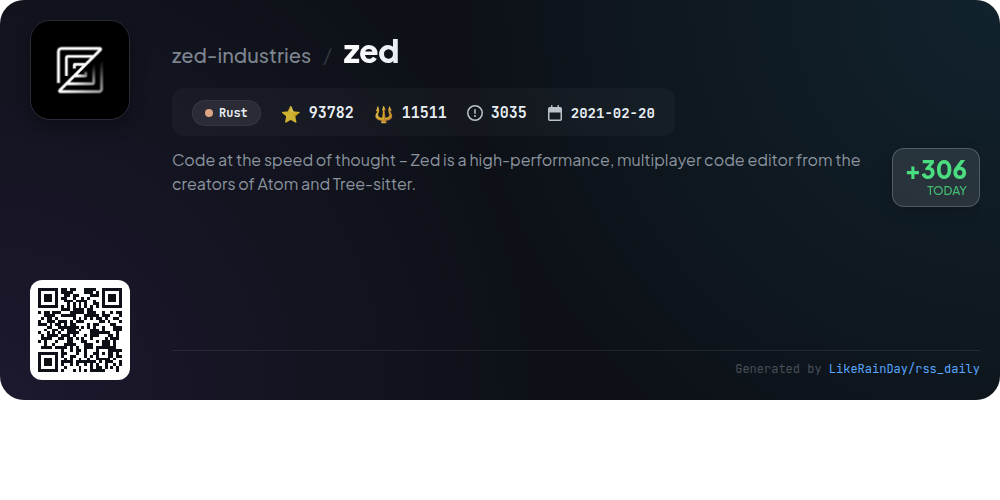
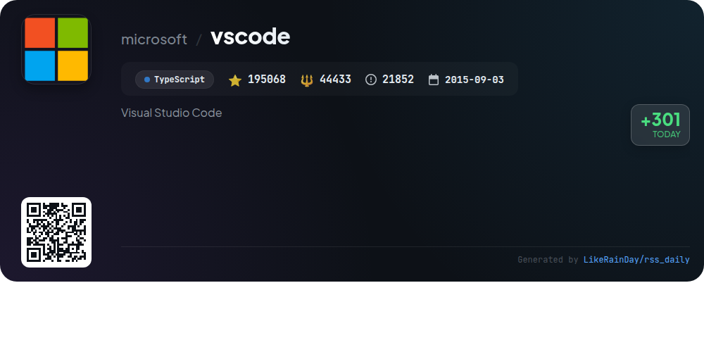

# 📊 🌟 GitHub Trending Daily - 2026-11-07

> > 📅 Daily Picks of GitHub Trending Repositories | Powered by Smart Algorithms

## 📋 Overview

**10** Projects | **620290** ⭐ | **84157** 🍴

**Top Languages:** `JavaScript` (3) · `Rust` (3) · `TypeScript` (2)

**Updated:** 2026-11-07 05:35 UTC

**Categories:**

- 🌟 Daily Top 10 (10 items)

---

## 🌟 Daily Top 10

### 1. [security-audit-skill](https://github.com/cloudflare/security-audit-skill)

> 🤖 **Why Recommend**  
> *A coding-agent skill for multi-phase security audits with independently verified, machine-readable findings. popular project, actively maintained, recently updated*

- ⭐ 64360 stars
- 🍴 4171 forks
- 💻 JavaScript
- 📅 Updated: 2026-11-07

### 2. [orca](https://github.com/stablyai/orca)

> 🤖 **Why Recommend**  
> *Orca is an AI orchestrator enabling users to run multiple coding agents, such as Claude Code and Codex, in parallel across desktop, mobile, and cloud environments. Key features include task orchestration with parallel worktrees, chat or terminal interfaces, remote server capabilities, and mobile app integration for real-time collaboration. Users can review AI outputs, manage Git operations, and leverage community-driven plugins. With support for any CLI agent, Orca streamlines coding workflows and automates tasks, enhancing productivity for developers.*

- ⭐ 117970 stars
- 💻 TypeScript
- 📅 Updated: 2026-11-07

### 3. [floci](https://github.com/floci-io/floci)

> 🤖 **Why Recommend**  
> *Floci is a free, open-source local AWS emulator designed for development, testing, and CI, allowing users to run AWS-compatible services without an account or authentication. Key features include real Docker support for services like Lambda and RDS, quick startup times, low memory usage, and configurable persistence modes. Floci supports a wide array of AWS services, including S3, DynamoDB, and API Gateway. Its drop-in compatibility with LocalStack makes it easy for existing users to transition. Floci is lightweight, efficient, and community-driven, ensuring continuous updates and support.*

- ⭐ 30904 stars
- 💻 Java
- 📅 Updated: 2026-11-07

### 4. [agent-browser](https://github.com/vercel-labs/agent-browser)

> 🤖 **Why Recommend**  
> *Browser automation CLI for AI agents. popular project, actively maintained, recently updated*

- ⭐ 46337 stars
- 🍴 3174 forks
- 💻 Rust
- 📅 Updated: 2026-11-07

### 5. [garden-skills](https://github.com/ConardLi/garden-skills)

> 🤖 **Why Recommend**  
> *Garden Skills is an open-source collection of production-ready Agent Skills for AI coding agents like Claude Code and Codex. It features diverse capabilities such as web design, knowledge retrieval, image generation, and editorial tools. Key highlights include the `web-design-engineer` for creating polished web pages, `gpt-image-2` for versatile image generation, and `beautiful-article` for transforming various formats into share-ready articles. With over 14,500 stars on GitHub, this project emphasizes collaboration and user control, making it a valuable resource for developers and designers.*

- ⭐ 14542 stars
- 💻 JavaScript
- 📅 Updated: 2026-11-07

### 6. [worktrunk](https://github.com/max-sixty/worktrunk)

> 🤖 **Why Recommend**  
> *Worktrunk is a Rust-based CLI tool for efficient Git worktree management, tailored for running parallel AI agent workflows. With over 11,800 stars, it simplifies the creation, switching, and cleanup of worktrees using intuitive commands. Key features include automation hooks, LLM-generated commit messages, and a streamlined merge workflow. Worktrunk supports sharing build caches across worktrees and offers a comprehensive interactive picker for managing branches. For detailed documentation, visit worktrunk.dev.*

- ⭐ 11829 stars
- 💻 Rust
- 📅 Updated: 2026-11-07

### 7. [Open-Generative-AI](https://github.com/Anil-matcha/Open-Generative-AI)

> 🤖 **Why Recommend**  
> *Open Generative AI is an open-source, self-hosted platform for AI image and video generation, offering over 600 models without content filters. Key features include text-to-image, image-to-image, text-to-video, and lip sync capabilities across various studios. Users can generate media without subscriptions, ensuring full creative freedom and data privacy. The platform supports multi-image inputs, local inference, and customizable workflows, making it suitable for both personal and commercial use. It's powered by MuAPI, providing a robust API for seamless integrations.*

- ⭐ 32854 stars
- 💻 JavaScript
- 📅 Updated: 2026-11-07

### 8. [lz4](https://github.com/lz4/lz4)

> 🤖 **Why Recommend**  
> *LZ4 is an open-source lossless compression algorithm known for its exceptional speed, achieving over 500 MB/s compression and multiple GB/s decompression per core. It offers dynamic compression tuning via an "acceleration" factor and includes a high-compression variant, LZ4_HC, for better ratios. LZ4 supports dictionary compression, enhancing performance for small files, and is compatible with various build systems. The library is BSD 2-Clause licensed, while the command line utility is GPL-2.0-or-later. Its versatility and speed make it a valuable tool for efficient data handling.*

- ⭐ 12644 stars
- 💻 C
- 📅 Updated: 2026-11-07

### 9. [zed](https://github.com/zed-industries/zed)

> 🤖 **Why Recommend**  
> *Zed is a high-performance, multiplayer code editor developed by the creators of Atom and Tree-sitter, designed for efficiency and collaboration. With support for macOS, Linux, and Windows, Zed allows users to code at the speed of thought. Key features include seamless installation via package managers, robust development documentation, and an open-source contribution model under GPL-3.0-or-later. The project is actively maintained, with opportunities for sponsorship and hiring available through Zed Industries, Inc. Explore more at zed.dev.*

- ⭐ 93782 stars
- 💻 Rust
- 📅 Updated: 2026-11-07

### 10. [vscode](https://github.com/microsoft/vscode)

> 🤖 **Why Recommend**  
> *Visual Studio Code (VS Code) is an open-source code editor developed by Microsoft, featuring a powerful blend of simplicity and functionality for the edit-build-debug cycle. Key highlights include comprehensive code editing, navigation, lightweight debugging, and a rich extensibility model through built-in and community extensions. Regular monthly updates ensure continuous improvements. The project welcomes community contributions, offering resources for bug reporting, feature requests, and code reviews. VS Code supports Windows, macOS, and Linux, with a dedicated development container for enhanced productivity.*

- ⭐ 195068 stars
- 💻 TypeScript
- 📅 Updated: 2026-11-07

---

## 📡 RSS Subscription

Subscribe via RSS to get daily trending updates:

- 🔔 [RSS XML] (../../daily-top.xml)
- 🔔 [Daily Report] (../../GITHUB_TODAY.md)
- 🔔 [Daily Top 10](../../daily-top.xml)

---

*⚡ Powered by Smart Trending Algorithm | Generated at 2026-11-07 05:35:26 UTC
