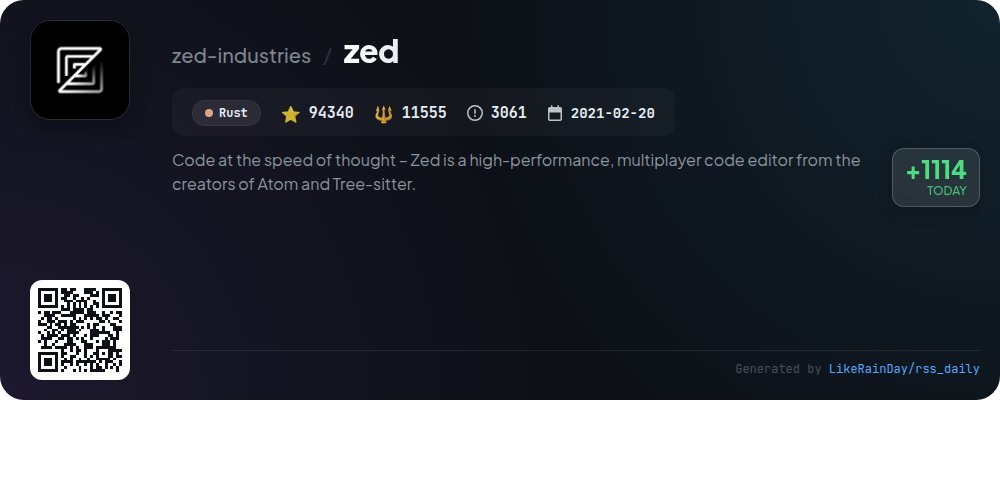
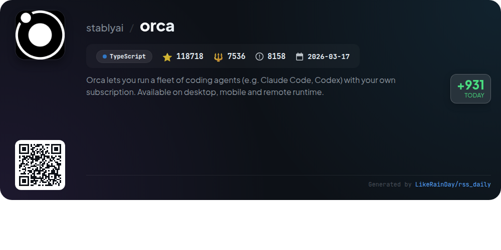
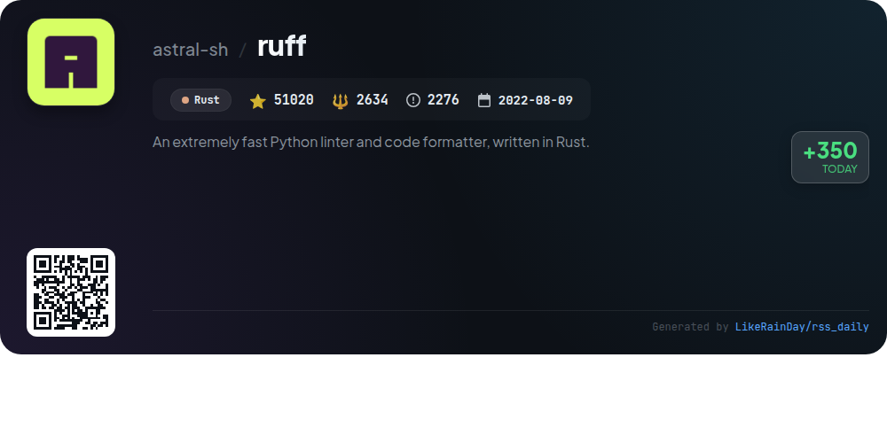
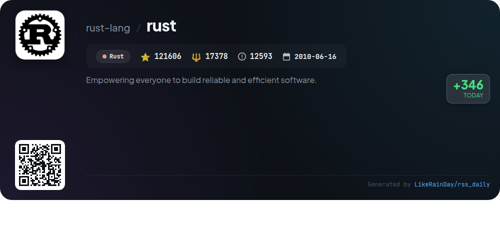
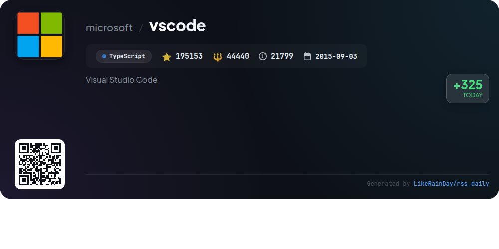
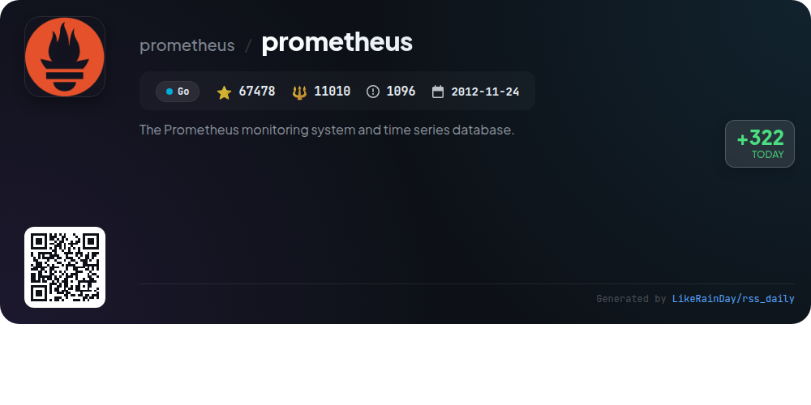
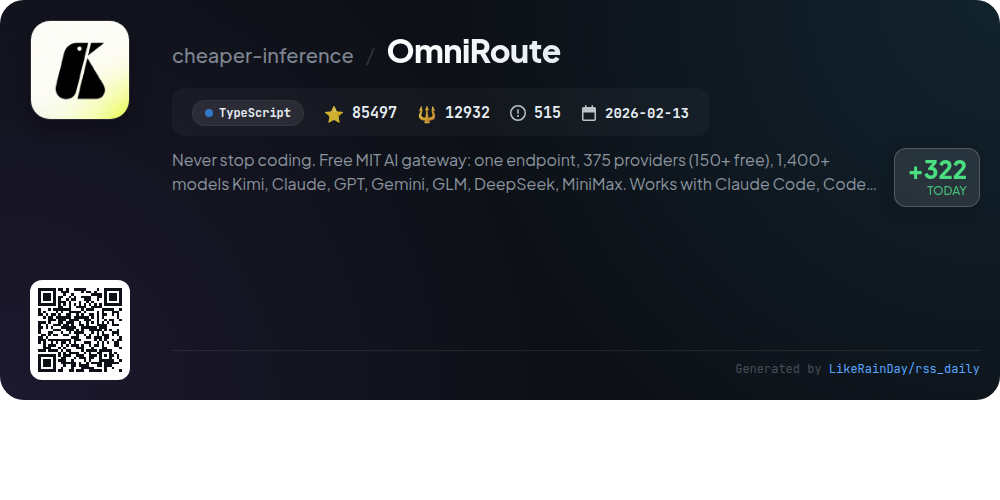

# 📊 🌟 GitHub Trending Daily - 2026-11-08

> > 📅 每日精选 GitHub 热门仓库 | 基于智能算法推荐

## 📋 Overview

**10** 个项目 | **1258566** ⭐ | **223441** 🍴

**热门语言:** `TypeScript` (5) · `Rust` (3) · `JavaScript` (1)

**更新时间:** 2026-11-08 05:35 UTC

**分类分布:**

- 🌟 每日 Top 10 精选 (10 项)

---

## 🌟 每日 Top 10 精选

### 1. [rea](https://github.com/morluto/rea)

> 🤖 **推荐理由**  
> *REA is a powerful TypeScript-based tool for reverse engineering applications and binaries, boasting over 441,000 stars on GitHub. It enables users to analyze app behavior, native binaries, .NET assemblies, JavaScript, and Electron applications without source code. Key features include a multi-client protocol (MCP) for seamless agent integration, static and dynamic analysis capabilities, and local execution of analyses using tools like Hopper and Ghidra. REA also facilitates the creation of reinforcement learning environments, making it a versatile solution for developers and researchers in software analysis and AI.*

- ⭐ 441523 stars
- 💻 TypeScript
- 📅 Updated: 2026-11-08

### 2. [security-audit-skill](https://github.com/cloudflare/security-audit-skill)

> 🤖 **推荐理由**  
> *A coding-agent skill for multi-phase security audits with independently verified, machine-readable findings. popular project, actively maintained, recently updated*

- ⭐ 65991 stars
- 🍴 4295 forks
- 💻 JavaScript
- 📅 Updated: 2026-11-08

### 3. [OpenMausBot](https://github.com/milind-soni/OpenMausBot)

> 🤖 **推荐理由**  
> *OpenMausBot is an open-source alternative to Grok Bot, enabling users to create and manage AI bots in a chat app environment. Key features include support for multiple AI models (Claude, Codex, Grok), local-first architecture, and a unique permission system for bot actions. Users can connect various apps like Gmail and Slack, manage bots through a chat-like interface, and utilize a built-in cloud computer. With a focus on privacy and flexibility, OpenMausBot allows for custom configurations and integration, making it a versatile tool for personal and team productivity.*

- ⭐ 17240 stars
- 💻 TypeScript
- 📅 Updated: 2026-11-08

### 4. [zed](https://github.com/zed-industries/zed)

> 🤖 **推荐理由**  
> *Zed is a high-performance, multiplayer code editor developed by the creators of Atom and Tree-sitter, designed for seamless coding at the speed of thought. With support for macOS, Linux, and Windows, Zed offers an intuitive installation process, extensive development documentation, and community-driven contributions. Key features include real-time collaboration, a focus on performance, and robust licensing compliance. Zed Industries, Inc. actively seeks sponsorship to support the project's growth, fostering innovation in collaborative coding environments.*

- ⭐ 94340 stars
- 💻 Rust
- 📅 Updated: 2026-11-08

### 5. [orca](https://github.com/stablyai/orca)

> 🤖 **推荐理由**  
> *Orca is an innovative AI orchestrator that allows users to efficiently manage a fleet of coding agents, such as Claude Code and Codex, across multiple platforms (desktop, mobile, remote). Key features include parallel worktree management, seamless chat and terminal integration, and the ability to run tasks on cloud VMs or SSH hosts. Users can review AI outputs, utilize Git integration for streamlined commits, and leverage a mobile app for remote work. With extensive plugin support and a powerful CLI, Orca enhances productivity for developers, making it a versatile tool for coding workflows.*

- ⭐ 118718 stars
- 💻 TypeScript
- 📅 Updated: 2026-11-08

### 6. [ruff](https://github.com/astral-sh/ruff)

> 🤖 **推荐理由**  
> *Ruff is a high-performance Python linter and code formatter, crafted in Rust, achieving speeds 10-100x faster than traditional tools like Flake8 and Black. It supports over 900 built-in rules, automatic error correction, and caching to enhance efficiency. Ruff is compatible with Python 3.15, integrates seamlessly with editors like VS Code, and allows configuration through `pyproject.toml`. It serves as a one-stop solution, replacing multiple tools while maintaining a unified interface, making it ideal for modern Python development.*

- ⭐ 51020 stars
- 💻 Rust
- 📅 Updated: 2026-11-08

### 7. [rust](https://github.com/rust-lang/rust)

> 🤖 **推荐理由**  
> *Rust is a powerful programming language designed to enable the creation of reliable and efficient software. With over 121,000 stars on GitHub, it features a rich type system and ownership model that enhance memory and thread safety, reducing runtime bugs. Key services include Cargo (package manager), rustfmt (auto-formatter), and Clippy (linter), all aimed at increasing developer productivity. The project emphasizes performance, reliability, and comprehensive documentation, making it suitable for critical services and embedded systems. Join the community and start building with Rust today!*

- ⭐ 121606 stars
- 💻 Rust
- 📅 Updated: 2026-11-08

### 8. [vscode](https://github.com/microsoft/vscode)

> 🤖 **推荐理由**  
> *Visual Studio Code (VS Code) is a powerful open-source code editor developed by Microsoft, combining simplicity with essential features for the edit-build-debug cycle. It offers comprehensive code editing, navigation, lightweight debugging, and a rich extensibility model, with monthly updates for bug fixes and new features. The project encourages community contributions through bug reports, feature requests, and code reviews. VS Code supports extensions for various languages and provides development containers for streamlined coding environments. Available on Windows, macOS, and Linux, it caters to developers' diverse needs.*

- ⭐ 195153 stars
- 💻 TypeScript
- 📅 Updated: 2026-11-08

### 9. [prometheus](https://github.com/prometheus/prometheus)

> 🤖 **推荐理由**  
> *Prometheus is a powerful monitoring system and time series database, part of the Cloud Native Computing Foundation. It features a multi-dimensional data model, a flexible query language (PromQL), and an autonomous single-server architecture. Key capabilities include an HTTP pull model for metric collection, support for pushing metrics via a gateway, service discovery, and diverse graphing options. Prometheus enables efficient monitoring and alerting for applications, with extensive documentation and community support available at prometheus.io.*

- ⭐ 67478 stars
- 💻 Go
- 📅 Updated: 2026-11-08

### 10. [OmniRoute](https://github.com/cheaper-inference/OmniRoute)

> 🤖 **推荐理由**  
> *OmniRoute is an open-source AI gateway that offers a single endpoint to access 375 providers, including over 150 free options, and supports more than 1,400 models like Claude, GPT, and Gemini. Key features include quota-aware auto-fallback, real-time token compression (15-95% savings), and compatibility with various coding tools (Claude Code, Codex, Copilot). The platform is designed to streamline the integration of AI services, allowing users to maximize free tier usage and manage multiple providers efficiently. Built by over 900 contributors, it emphasizes community involvement and transparency.*

- ⭐ 85497 stars
- 💻 TypeScript
- 📅 Updated: 2026-11-08

---

## 📡 RSS订阅

通过 RSS 订阅，第一时间获取每日精选项目：

- 🔔 [RSS 订阅源] (../../daily-top.xml)
- 🔔 [每日简报] (../../GITHUB_TODAY_CN.md)
- 🔔 [每日 Top 10 精选](../../daily-top.xml)

---

*⚡ Powered by Smart Trending Algorithm | Generated at 2026-11-08 05:35:35 UTC
