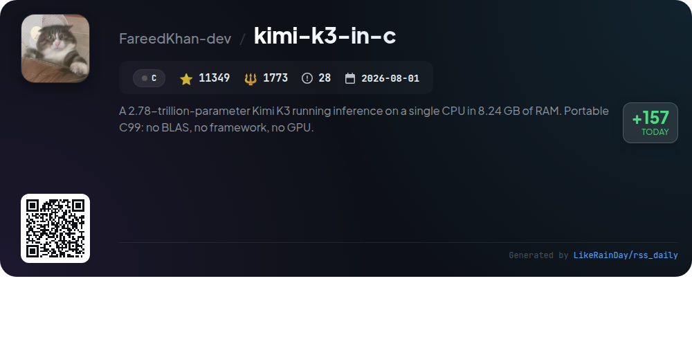
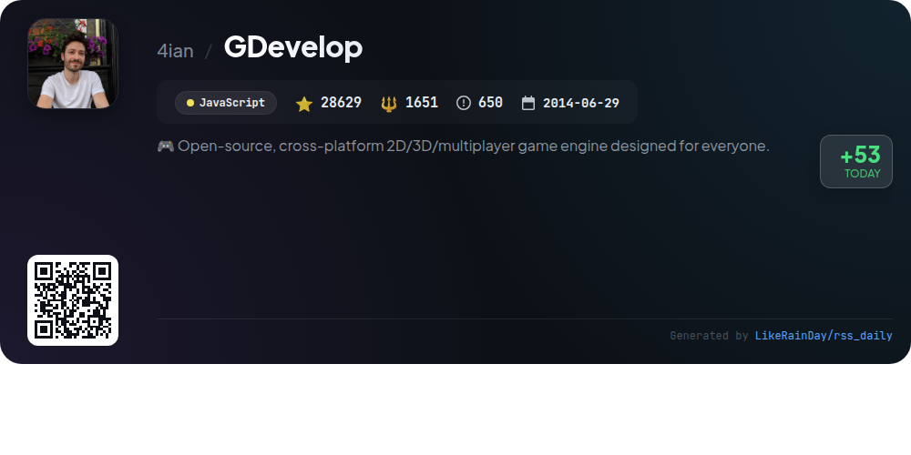
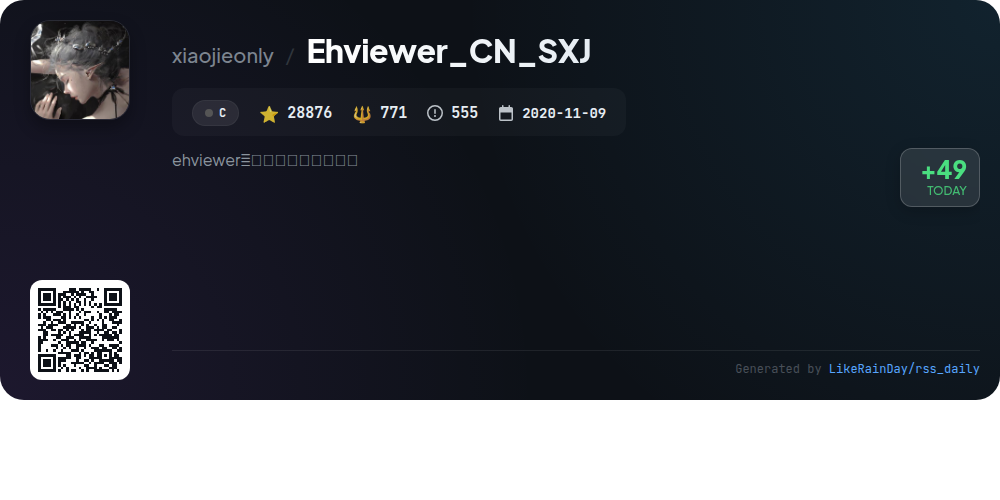
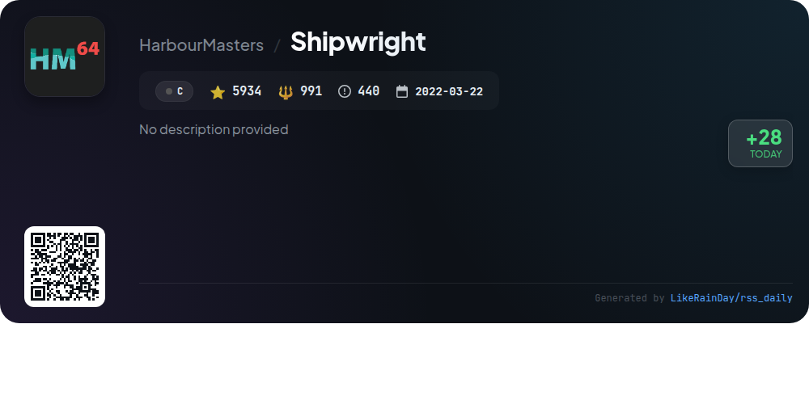
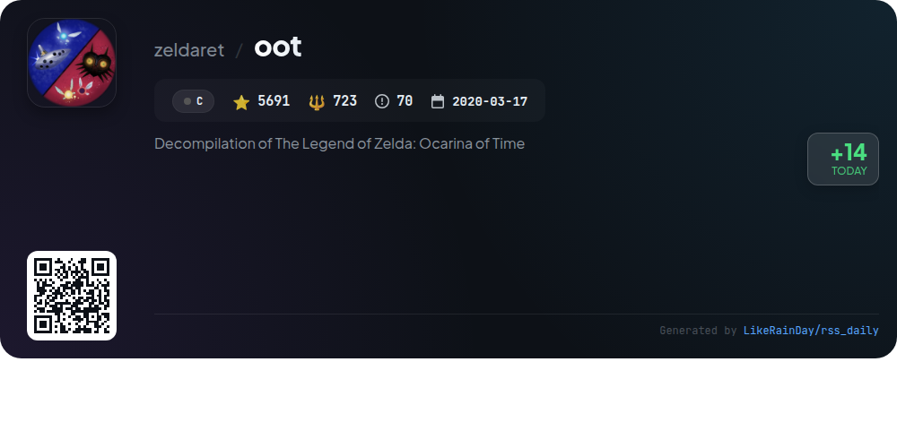
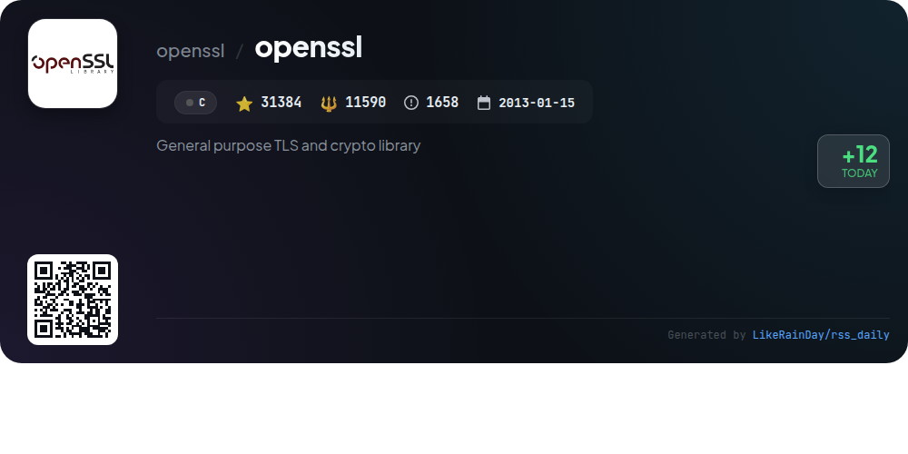
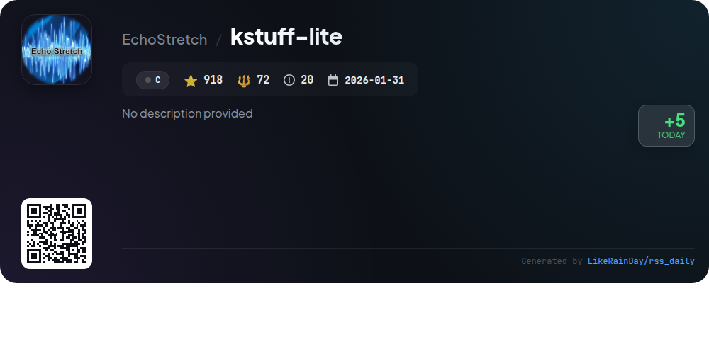

# 📊 🌟 GitHub Trending Daily - 2026-11-09

> > 📅 Daily Picks of GitHub Trending Repositories | Powered by Smart Algorithms

## 📋 Overview

**10** Projects | **252265** ⭐ | **31094** 🍴

**Top Languages:** `C` (6) · `JavaScript` (4)

**Updated:** 2026-11-09 05:47 UTC

**Categories:**

- 🌟 Daily Top 10 (10 items)

---

## 🌟 Daily Top 10

### 1. [security-audit-skill](https://github.com/cloudflare/security-audit-skill)

> 🤖 **Why Recommend**  
> *A coding-agent skill for multi-phase security audits with independently verified, machine-readable findings. popular project, actively maintained, recently updated*

- ⭐ 67110 stars
- 🍴 4385 forks
- 💻 JavaScript
- 📅 Updated: 2026-11-09

### 2. [Open-Generative-AI](https://github.com/Anil-matcha/Open-Generative-AI)

> 🤖 **Why Recommend**  
> *Open-Generative-AI is a powerful, uncensored, open-source platform for generating AI images and videos, featuring over 600 models across 14 studios like Flux, Midjourney, and Kling. Key features include text-to-image, image-to-video, lip sync capabilities, and audio generation—all without content filters or subscription fees. Users can self-host the software, ensuring data privacy and full creative control. The platform supports multi-image input and offers extensive customization options, making it ideal for developers and creatives alike. The project is MIT licensed and boasts a vibrant community for support.*

- ⭐ 33466 stars
- 💻 JavaScript
- 📅 Updated: 2026-11-09

### 3. [LinkSwift](https://github.com/hmjz100/LinkSwift)

> 🤖 **Why Recommend**  
> *LinkSwift is a JavaScript-based tool designed to obtain direct download links from eight major cloud storage services in China, including Baidu Netdisk and Alibaba Cloud. With over 38,000 stars on GitHub, it enhances the original “Netdisk Direct Link Download Assistant” by adding features like a UI beautification, support for multiple download managers, and improved functionality for various cloud services. Users can easily install the script from multiple sources and benefit from ongoing updates to optimize their file downloading experience.*

- ⭐ 38908 stars
- 💻 JavaScript
- 📅 Updated: 2026-11-09

### 4. [kimi-k3-in-c](https://github.com/FareedKhan-dev/kimi-k3-in-c)

> 🤖 **Why Recommend**  
> *Kimi K3 in C is a portable inference engine for the 2.78-trillion-parameter Kimi K3 model, designed to run on a single CPU with only 8.24 GB of RAM. This C99 implementation requires no external libraries, making it lightweight and efficient. Key features include memory-efficient streaming of the model's trunk, support for incremental decoding, and an expert cache that optimally handles expert routing. The engine delivers consistent outputs across varying memory budgets, making it accessible for diverse hardware configurations while maintaining high performance.*

- ⭐ 11349 stars
- 💻 C
- 📅 Updated: 2026-11-09

### 5. [GDevelop](https://github.com/4ian/GDevelop)

> 🤖 **Why Recommend**  
> *GDevelop is an open-source, cross-platform game engine that allows users to create 2D, 3D, and multiplayer games without coding. It features an intuitive event-based system, AI assistance, and supports exports to mobile, desktop, and web platforms. The project offers a modular architecture, including a game editor, engine, and a variety of extensions. Users can contribute by creating templates, assets, or participating in community discussions. With over 28,000 stars on GitHub, GDevelop is designed for both beginners and professionals looking to develop and publish games effortlessly.*

- ⭐ 28629 stars
- 💻 JavaScript
- 📅 Updated: 2026-11-09

### 6. [Ehviewer_CN_SXJ](https://github.com/xiaojieonly/Ehviewer_CN_SXJ)

> 🤖 **Why Recommend**  
> *Ehviewer_CN_SXJ is an Android application designed for browsing E-Hentai, boasting over 28,000 stars on GitHub. Key features include local gallery imports, enhanced download management, multi-language support, and continuous updates for improved user experience. Recent updates have added local import filtering, crash fixes, and refined download functionalities. The app prioritizes user feedback and community support, with resources available for troubleshooting and engagement via Telegram and official channels. Download options include GitHub releases, cloud services, and torrent links.*

- ⭐ 28876 stars
- 💻 C
- 📅 Updated: 2026-11-09

### 7. [Shipwright](https://github.com/HarbourMasters/Shipwright)

> 🤖 **Why Recommend**  
> *Shipwright is a project designed for playing the game "Ocarina of Time" using a legally acquired ROM. It utilizes a custom library, libultraship, to mimic the original N64 SDK functionality on modern hardware. Key features include support for multiple rendering APIs (DirectX11, OpenGL, Metal), custom asset integration through .otr files, and extensive configuration options. Users can verify their ROM compatibility via an online checker and access a vibrant community on Discord for support. For development, detailed building instructions and playtesting builds are available.*

- ⭐ 5934 stars
- 💻 C
- 📅 Updated: 2026-11-09

### 8. [oot](https://github.com/zeldaret/oot)

> 🤖 **Why Recommend**  
> *The "oot" project is an ongoing decompilation of *The Legend of Zelda: Ocarina of Time*, aiming to recreate its source code from the original ROM through static and dynamic analysis. With over 5,600 stars on GitHub, it supports multiple game versions, including NTSC and PAL formats. The project emphasizes modding potential and encourages community contributions through its Discord channel. Notably, the repository requires users to provide their own ROM assets for building. It is designed for use on Linux, WSL, and macOS, with detailed installation instructions available.*

- ⭐ 5691 stars
- 💻 C
- 📅 Updated: 2026-11-09

### 9. [openssl](https://github.com/openssl/openssl)

> 🤖 **Why Recommend**  
> *OpenSSL is a widely-used open-source toolkit for Transport Layer Security (TLS), Datagram TLS (DTLS), and QUIC protocols, featuring robust cryptographic capabilities. Its core components include **libssl**, supporting all TLS versions up to TLSv1.3, and **libcrypto**, a comprehensive cryptographic library. The command-line tool facilitates tasks such as key generation, certificate creation, and secure communication tests. OpenSSL is FIPS-compliant and actively maintained with a strong community presence, making it essential for secure web communication. Visit [www.openssl.org](https://www.openssl.org) for more details.*

- ⭐ 31384 stars
- 💻 C
- 📅 Updated: 2026-11-09

### 10. [kstuff-lite](https://github.com/EchoStretch/kstuff-lite)

> 🤖 **Why Recommend**  
> *kstuff-lite is an advanced C-based project focused on optimizing kernel and user-space interactions, particularly for UELF and KELF transitions. Key features include cached translations for per-CPU kernel objects, efficient trap-frame handling, and streamlined debug-register transitions. It enhances performance with runtime selection between `XSAVEC` and `XSAVE`, providing detailed observability metrics through the `KSTUFF_OBS` flag. The project supports improved FPU and CR0 handling, ensuring faster operations and safer state management. With 918 stars, it stands out for its robust diagnostics and performance metrics.*

- ⭐ 918 stars
- 💻 C
- 📅 Updated: 2026-11-09

---

## 📡 RSS Subscription

Subscribe via RSS to get daily trending updates:

- 🔔 [RSS XML] (../../daily-top.xml)
- 🔔 [Daily Report] (../../GITHUB_TODAY.md)
- 🔔 [Daily Top 10](../../daily-top.xml)

---

*⚡ Powered by Smart Trending Algorithm | Generated at 2026-11-09 05:47:45 UTC
