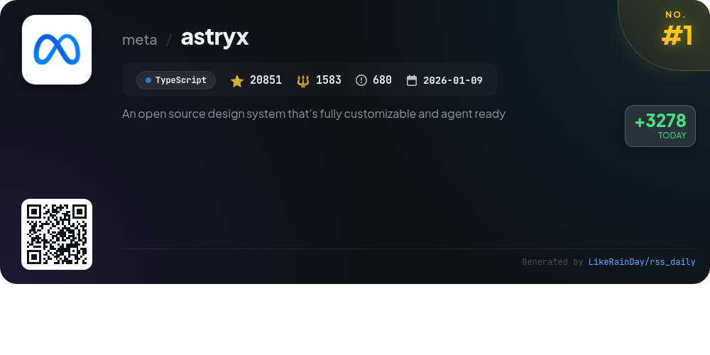
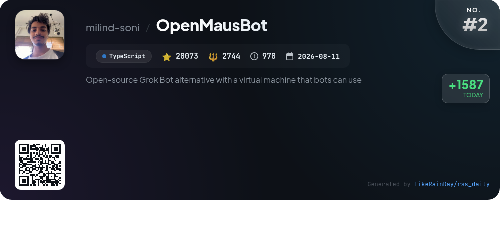
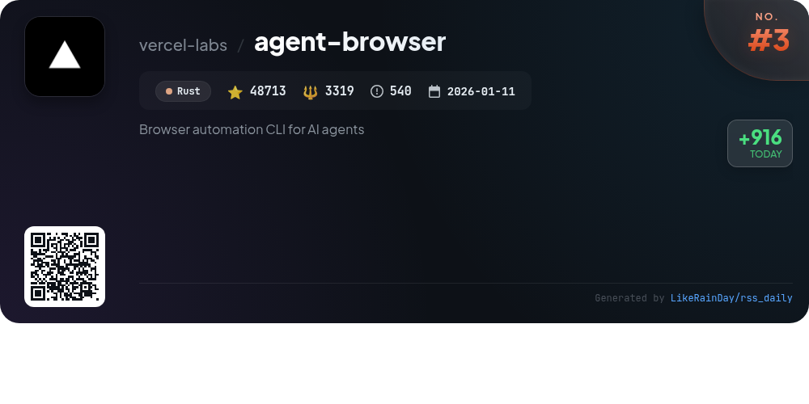
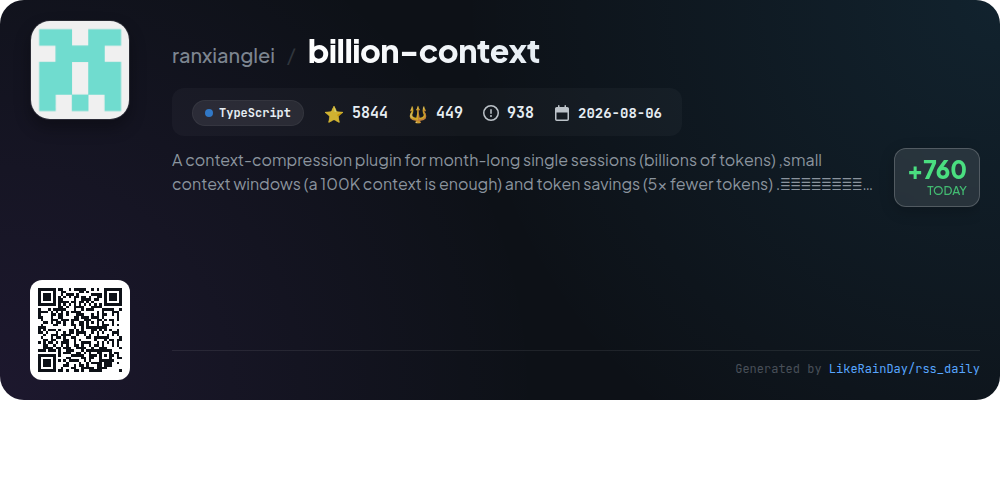
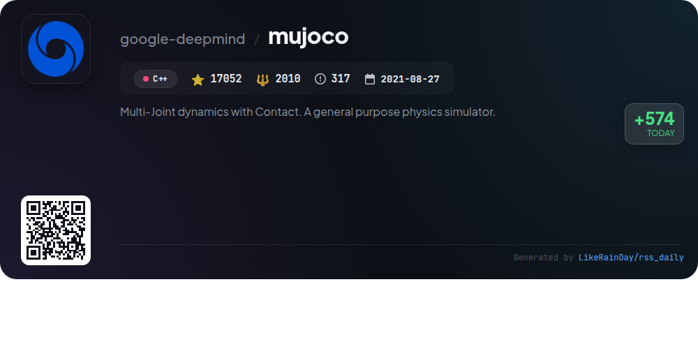
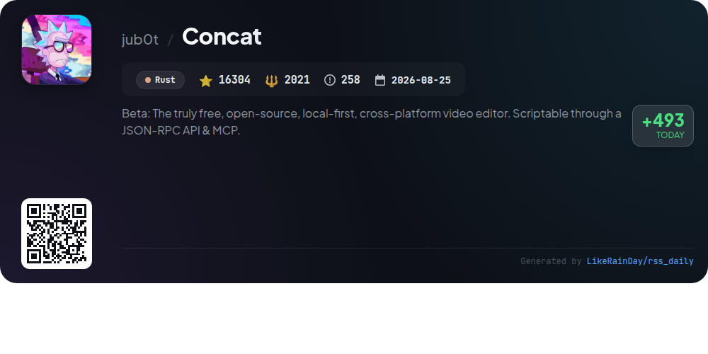
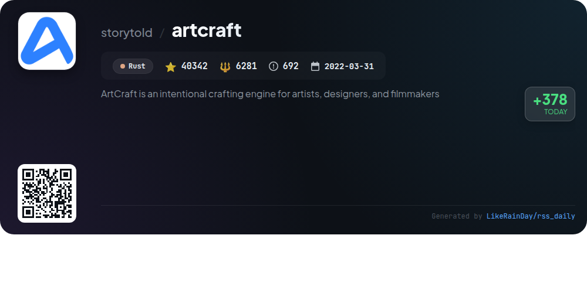
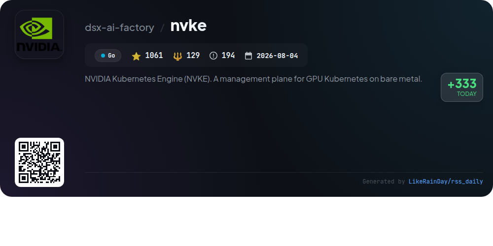
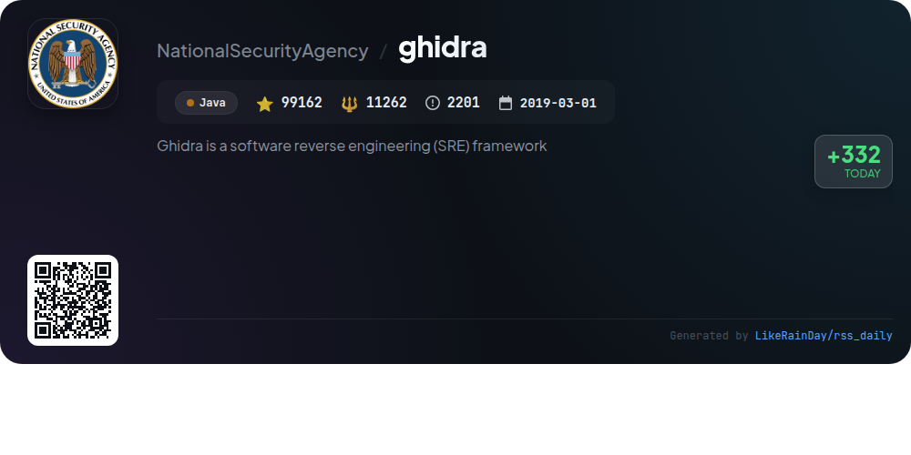
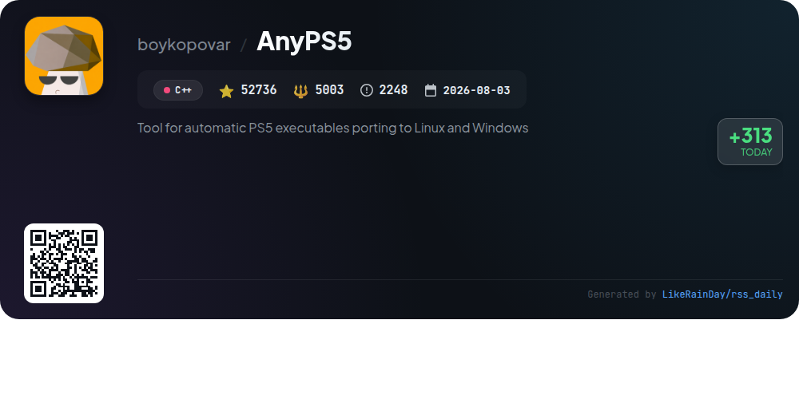

# 📊 🌟 GitHub Trending Daily - 2026-11-10

> > 📅 Daily Picks of GitHub Trending Repositories | Powered by Smart Algorithms

## 📋 Overview

**10** Projects | **322138** ⭐ | **34801** 🍴

**Top Languages:** `TypeScript` (3) · `Rust` (3) · `C++` (2)

**Updated:** 2026-11-10 06:56 UTC

**Categories:**

- 🌟 Daily Top 10 (10 items)

---

## 🌟 Daily Top 10

### 1. [astryx](https://github.com/meta/astryx)

> 🤖 **Why Recommend**  
> *Astryx is an open-source, customizable design system built for React 19+, designed for both developers and AI assistants. With over 15,000 stars, it features 150+ accessible components, brand-level theming, and a user-friendly CLI. Key highlights include open internals for easy composition, no styling lock-in, and themes that can be customized without forking. Astryx promotes strong conventions, thorough documentation, and seamless collaboration between people and AI. Access comprehensive resources through its docs, Storybook, and sandbox environments.*

- ⭐ 20851 stars
- 💻 TypeScript
- 📅 Updated: 2026-11-10

### 2. [OpenMausBot](https://github.com/milind-soni/OpenMausBot)

> 🤖 **Why Recommend**  
> *OpenMausBot is an open-source alternative to Grok Bot, enabling users to manage a team of AI bots in a chat app. Key features include local-first operation, support for multiple AI models (Claude, Codex), and seamless integration with over 500 apps via Composio. Each bot operates independently with its own personality and model, and actions are subject to user approval for enhanced security. The project allows for custom CLI integration, multi-channel management, and voice capabilities, making it a versatile solution for personal and team productivity.*

- ⭐ 20073 stars
- 💻 TypeScript
- 📅 Updated: 2026-11-10

### 3. [agent-browser](https://github.com/vercel-labs/agent-browser)

> 🤖 **Why Recommend**  
> *Browser automation CLI for AI agents. popular project, actively maintained, recently updated*

- ⭐ 48713 stars
- 🍴 3319 forks
- 💻 Rust
- 📅 Updated: 2026-11-10

### 4. [billion-context](https://github.com/ranxianglei/billion-context)

> 🤖 **Why Recommend**  
> *billion-context is a TypeScript plugin designed for efficient context compression during long sessions, allowing for month-long interactions with billions of tokens. Key features include support for small context windows (100K tokens sufficient), achieving up to 5x token savings, and maintaining a high compression quality. It integrates seamlessly with various clients, providing tools for compressing messages, searching through context, and managing session health. With over 5,800 stars, it effectively reduces token costs while enabling sustained conversations without degradation.*

- ⭐ 5844 stars
- 💻 TypeScript
- 📅 Updated: 2026-11-10

### 5. [mujoco](https://github.com/google-deepmind/mujoco)

> 🤖 **Why Recommend**  
> *MuJoCo (Multi-Joint dynamics with Contact) is a high-performance physics simulator designed for efficient simulation of articulated structures in robotics, biomechanics, graphics, and machine learning. Maintained by Google DeepMind, it features a C API, interactive visualization in desktop and browser environments, and extensive utility functions. Key offerings include Python bindings, Unity integration, and tutorials available on Google Colab. MuJoCo supports prebuilt binaries for multiple platforms and encourages community contributions for enhanced functionality.*

- ⭐ 17052 stars
- 💻 C++
- 📅 Updated: 2026-11-10

### 6. [Concat](https://github.com/jub0t/Concat)

> 🤖 **Why Recommend**  
> *Concat is a free, open-source, local-first video editor available for macOS, Windows, Linux, and Android. Key features include auto-captions, text-to-speech, background removal, keyframe animation, and multi-track editing, with support for 4K exports. It operates entirely offline, ensuring user privacy, and requires no account or subscriptions. Concat is also scriptable via a JSON-RPC API and has a built-in MCP server for AI integration. Ideal for creating content for platforms like TikTok and YouTube, it offers 100 effects and a user-friendly interface.*

- ⭐ 16304 stars
- 💻 Rust
- 📅 Updated: 2026-11-10

### 7. [artcraft](https://github.com/storytold/artcraft)

> 🤖 **Why Recommend**  
> *ArtCraft is a powerful crafting engine designed for artists, designers, and filmmakers, enabling interactive AI image and video creation. Key features include 2D and 3D compositing, character posing, and scene blocking with kitbashing. Users can explore ideas through text prompts, refine visuals with canvas editing, and animate images into videos. The platform supports various models and providers, including Grok and Midjourney, and offers a user-friendly IDE for precise crafting. Available for Windows, macOS, and Linux, ArtCraft is dual-licensed under MIT and Apache-2.0.*

- ⭐ 40342 stars
- 💻 Rust
- 📅 Updated: 2026-11-10

### 8. [nvke](https://github.com/dsx-ai-factory/nvke)

> 🤖 **Why Recommend**  
> *NVIDIA Kubernetes Engine (NVKE) is a management plane enabling the creation and operation of Kubernetes clusters on NVIDIA GPU infrastructure. Key features include independent workload clusters with dedicated control planes, lifecycle management for scaling and upgrading, and secure node identity through SPIFFE/SPIRE. NVKE supports evaluation without GPU hardware and requires explicit operator configuration. It integrates with NVIDIA Infra Controller for provisioning and utilizes companion project NVKR for building images. The project is currently in preview, designed for non-production workloads.*

- ⭐ 1061 stars
- 💻 Go
- 📅 Updated: 2026-11-10

### 9. [ghidra](https://github.com/NationalSecurityAgency/ghidra)

> 🤖 **Why Recommend**  
> *Ghidra is an open-source software reverse engineering (SRE) framework developed by the NSA, designed for analyzing compiled code across platforms like Windows, macOS, and Linux. Key features include disassembly, assembly, decompilation, graphing, and extensive scripting support in Java and Python. Ghidra allows users to create custom extensions and automate tasks, making it a powerful tool for cybersecurity professionals. With over 99,000 stars on GitHub, Ghidra addresses complex SRE challenges while enhancing insights into malicious code and system vulnerabilities.*

- ⭐ 99162 stars
- 💻 Java
- 📅 Updated: 2026-11-10

### 10. [AnyPS5](https://github.com/boykopovar/AnyPS5)

> 🤖 **Why Recommend**  
> *AnyPS5 is a powerful tool for automatically porting PS5 executables to Linux and Windows, boasting over 52,700 stars on GitHub. It features a relinker that converts executables to native formats without emulation, and includes implementations of system PRX libraries for dynamic linking. The project supports SDL-mapped game controllers and offers a web converter for local file handling. Dedicated to interoperability and preservation, AnyPS5 is independent of Sony and adheres to GPL v2 licensing. Comprehensive documentation and community support are available.*

- ⭐ 52736 stars
- 💻 C++
- 📅 Updated: 2026-11-10

---

## 📡 RSS Subscription

Subscribe via RSS to get daily trending updates:

- 🔔 [RSS XML] (../../daily-top.xml)
- 🔔 [Daily Report] (../../GITHUB_TODAY.md)
- 🔔 [Daily Top 10](../../daily-top.xml)

---

*⚡ Powered by Smart Trending Algorithm | Generated at 2026-11-10 06:56:14 UTC
