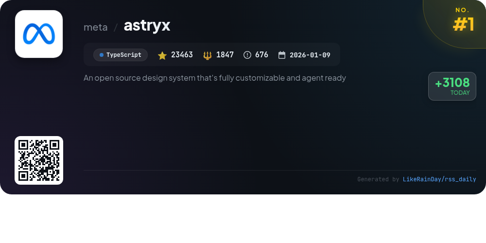
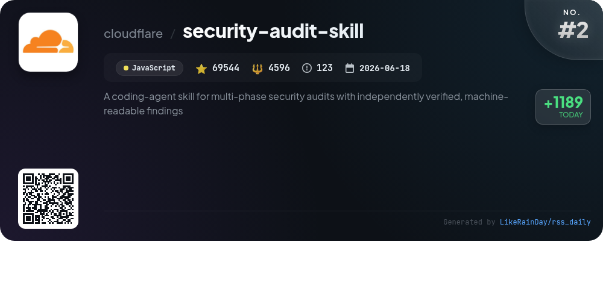
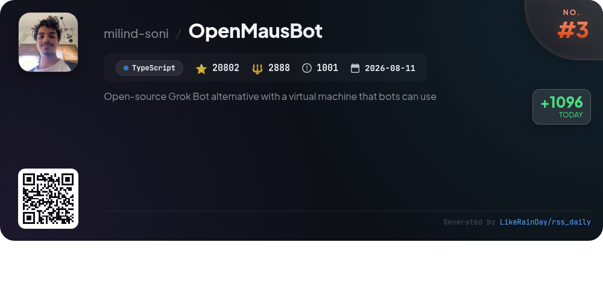
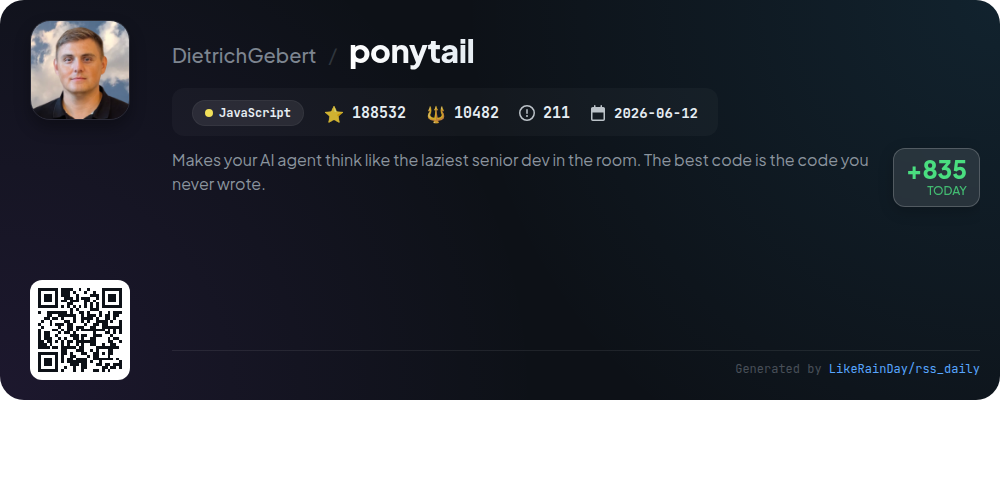
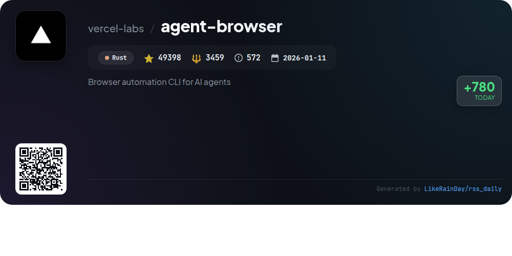
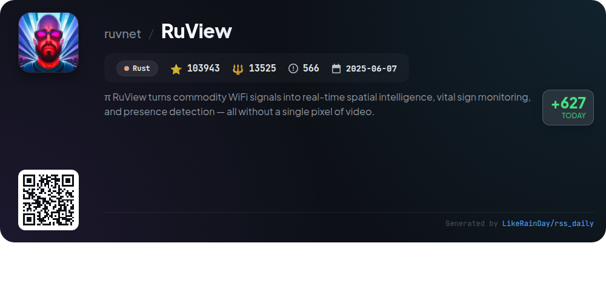
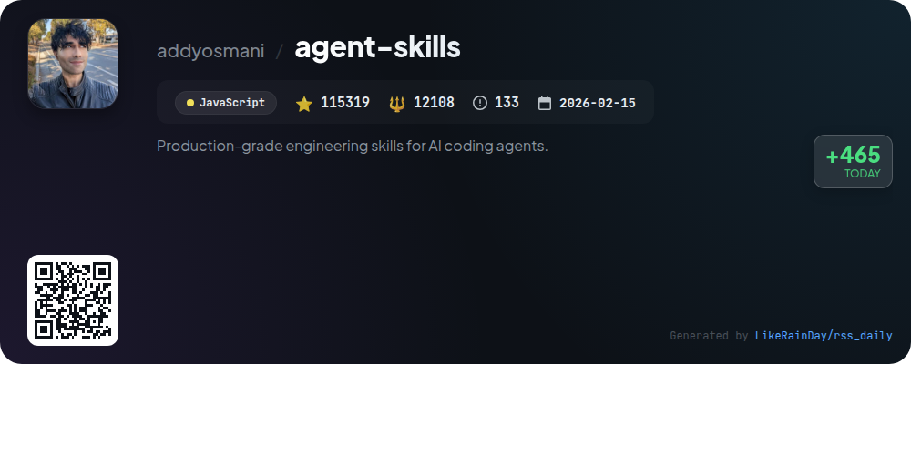
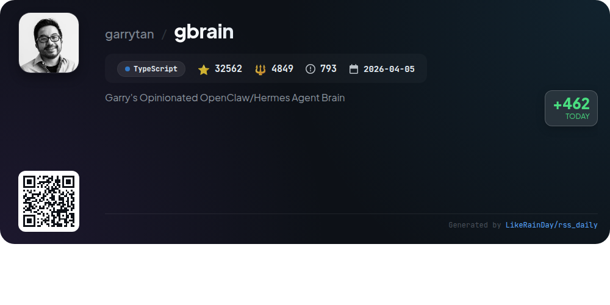
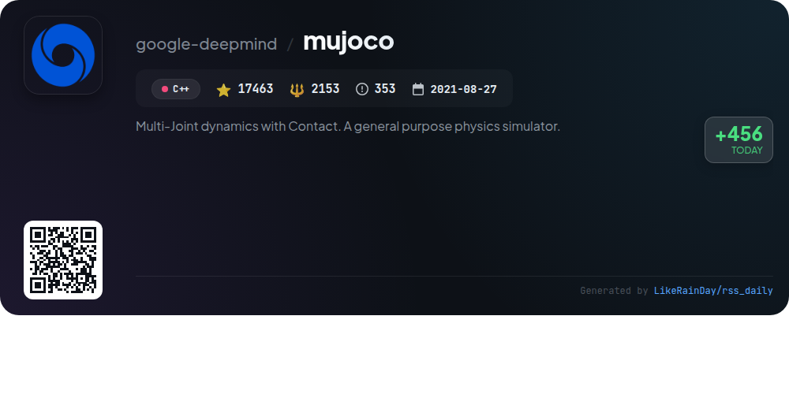
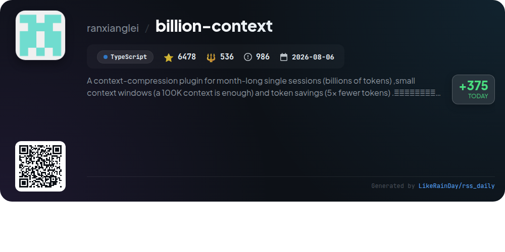

# 📊 🌟 GitHub Trending Daily - 2026-11-11

> > 📅 每日精选 GitHub 热门仓库 | 基于智能算法推荐

## 📋 Overview

**10** 个项目 | **627504** ⭐ | **56443** 🍴

**热门语言:** `TypeScript` (4) · `JavaScript` (3) · `Rust` (2)

**更新时间:** 2026-11-11 05:43 UTC

**分类分布:**

- 🌟 每日 Top 10 精选 (10 项)

---

## 🌟 每日 Top 10 精选

### 1. [astryx](https://github.com/meta/astryx)

> 🤖 **推荐理由**  
> *Astryx is an open-source design system built for customization and collaboration between humans and AI, currently in beta. It features over 150 accessible components, brand-level theming, dark mode, and ready-to-use templates, all built on React 19+ and StyleX. Key highlights include open internals for flexible composition, no styling lock-in, and easy theme customization using CSS variables. With a focus on strong conventions and comprehensive documentation, Astryx aims to streamline development for both developers and AI assistants, making it a powerful tool for modern applications.*

- ⭐ 23463 stars
- 💻 TypeScript
- 📅 Updated: 2026-11-11

### 2. [security-audit-skill](https://github.com/cloudflare/security-audit-skill)

> 🤖 **推荐理由**  
> *A coding-agent skill for multi-phase security audits with independently verified, machine-readable findings. popular project, actively maintained, recently updated*

- ⭐ 69544 stars
- 🍴 4596 forks
- 💻 JavaScript
- 📅 Updated: 2026-11-11

### 3. [OpenMausBot](https://github.com/milind-soni/OpenMausBot)

> 🤖 **推荐理由**  
> *OpenMausBot is an open-source alternative to Grok Bot, enabling users to manage multiple AI bots in a chat app. Core features include local-first operation, bringing your own agents like Claude and Codex, and a permission-based action approval system. Each bot operates independently with its own model and connected apps, enhancing customization. Users can manage bots like contacts, utilize a marketplace for app integrations, and receive spoken replies. OpenMausBot supports Windows, macOS, and Ubuntu, making it versatile for various environments.*

- ⭐ 20802 stars
- 💻 TypeScript
- 📅 Updated: 2026-11-11

### 4. [ponytail](https://github.com/DietrichGebert/ponytail)

> 🤖 **推荐理由**  
> *Ponytail is a JavaScript project designed to optimize AI agents by emulating a lazy senior developer's approach—writing minimal code that effectively solves problems. With over 188,000 stars, it focuses on reducing code complexity and runtime costs, achieving significant benchmarks like 53% less code and 41% faster execution. Key features include `/ponytail-review` for thorough code audits, `/ponytail-audit` for comprehensive repository assessments, and a "band" feature that tracks resource usage in real-time. Ponytail integrates seamlessly with various AI platforms, promoting efficient and secure coding practices.*

- ⭐ 188532 stars
- 💻 JavaScript
- 📅 Updated: 2026-11-11

### 5. [agent-browser](https://github.com/vercel-labs/agent-browser)

> 🤖 **推荐理由**  
> *Browser automation CLI for AI agents. popular project, actively maintained, recently updated*

- ⭐ 49398 stars
- 🍴 3459 forks
- 💻 Rust
- 📅 Updated: 2026-11-11

### 6. [RuView](https://github.com/ruvnet/RuView)

> 🤖 **推荐理由**  
> *RuView is a cutting-edge platform that transforms commodity WiFi signals into real-time spatial intelligence and vital sign monitoring, all without cameras or wearables. It detects presence, tracks movement, measures breathing and heart rates, and recognizes activities through walls, utilizing low-cost ESP32 sensors. Key features include integration with major smart home ecosystems (Home Assistant, Google Home, Apple Home), a guided AI operator for setup, and a rich catalog of edge modules for diverse applications. RuView ensures privacy and operates entirely on edge hardware, making it a versatile solution for smart environments.*

- ⭐ 103943 stars
- 💻 Rust
- 📅 Updated: 2026-11-11

### 7. [agent-skills](https://github.com/addyosmani/agent-skills)

> 🤖 **推荐理由**  
> *Agent Skills is a production-grade toolkit designed to equip AI coding agents with structured engineering workflows that mirror best practices from senior developers. With 25 skills encompassing the entire development lifecycle—from defining and planning to building, verifying, reviewing, and shipping—this project encourages discipline in software development. Key features include automated command activation based on tasks, a CLI for easy skill installation across various agents, and a focus on verifiable, actionable steps that enforce quality and reliability. Ideal for enhancing software development processes, it integrates seamlessly with tools like Claude Code, GitHub Copilot, and more.*

- ⭐ 115319 stars
- 💻 JavaScript
- 📅 Updated: 2026-11-11

### 8. [gbrain](https://github.com/garrytan/gbrain)

> 🤖 **推荐理由**  
> *Garry's Opinionated OpenClaw/Hermes Agent Brain. popular project, actively maintained, recently updated*

- ⭐ 32562 stars
- 🍴 4849 forks
- 💻 TypeScript
- 📅 Updated: 2026-11-11

### 9. [mujoco](https://github.com/google-deepmind/mujoco)

> 🤖 **推荐理由**  
> *MuJoCo (Multi-Joint dynamics with Contact) is a versatile physics simulator designed for rapid and accurate modeling of articulated structures in robotics, biomechanics, and machine learning. Developed by Google DeepMind, it features a high-performance C API, interactive visualization, and extensive utility functions. Key highlights include Python bindings, a Unity plug-in, and support for WebAssembly. Users can access prebuilt binaries, explore tutorials in IPython notebooks, and engage with the community for support. Comprehensive documentation is available at mujoco.readthedocs.io.*

- ⭐ 17463 stars
- 💻 C++
- 📅 Updated: 2026-11-11

### 10. [billion-context](https://github.com/ranxianglei/billion-context)

> 🤖 **推荐理由**  
> *billion-context is a powerful context-compression plugin designed for managing extensive single sessions of billions of tokens while maintaining efficiency. Key features include support for small context windows (100K tokens), achieving up to 5x token savings, and high-quality compression that allows month-long conversations without degradation. The plugin integrates seamlessly with various clients, offering tools like message compression, decompression, and context search. Its incremental and reversible approach ensures that essential details can be restored on demand, optimizing both performance and cost. With 6,478 stars on GitHub, it's a trusted solution for developers needing robust context management.*

- ⭐ 6478 stars
- 💻 TypeScript
- 📅 Updated: 2026-11-11

---

## 📡 RSS订阅

通过 RSS 订阅，第一时间获取每日精选项目：

- 🔔 [RSS 订阅源] (../../daily-top.xml)
- 🔔 [每日简报] (../../GITHUB_TODAY_CN.md)
- 🔔 [每日 Top 10 精选](../../daily-top.xml)

---

*⚡ Powered by Smart Trending Algorithm | Generated at 2026-11-11 05:43:59 UTC
