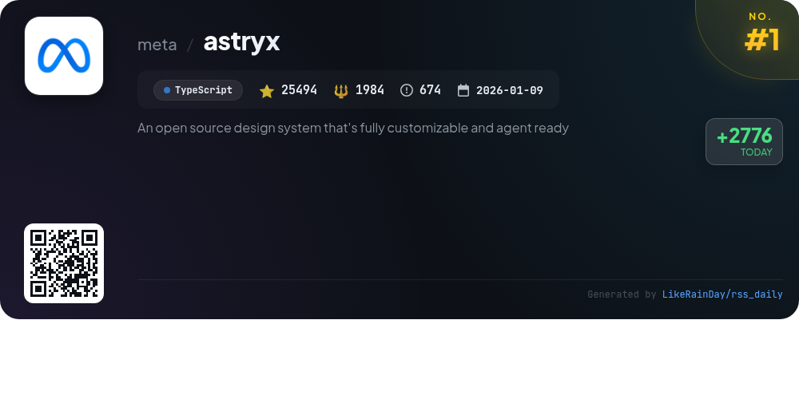
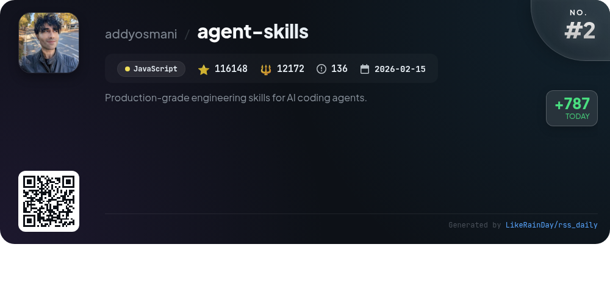
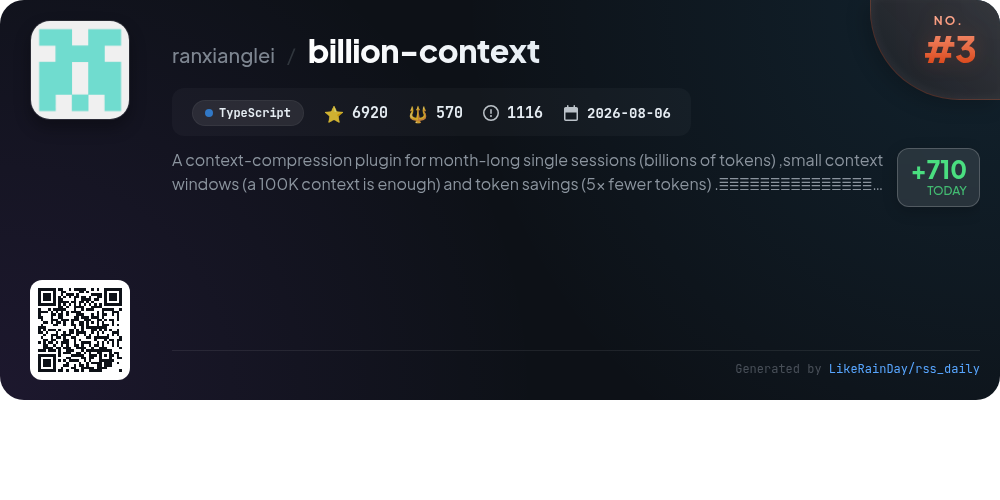
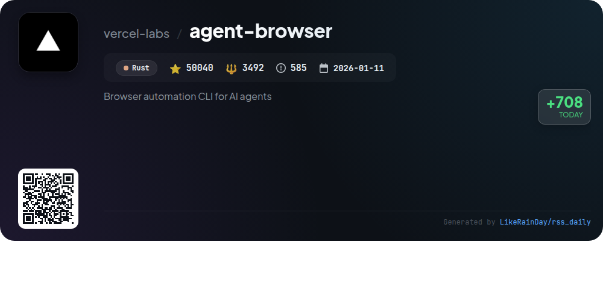
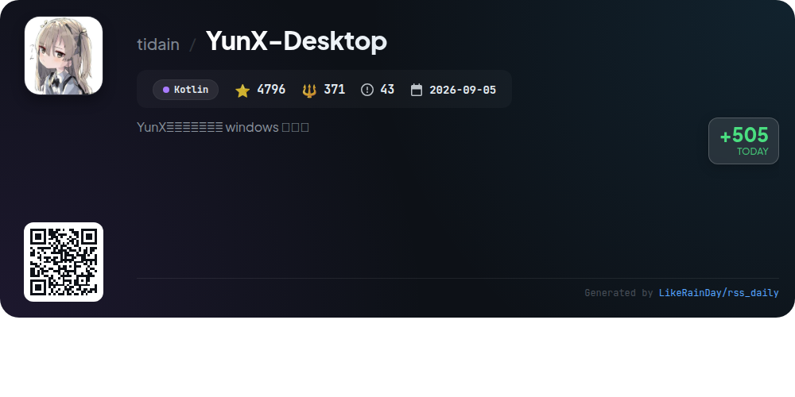
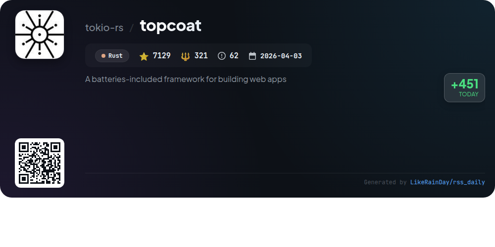
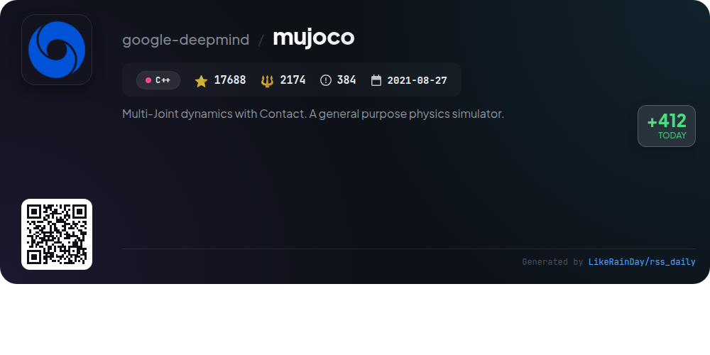
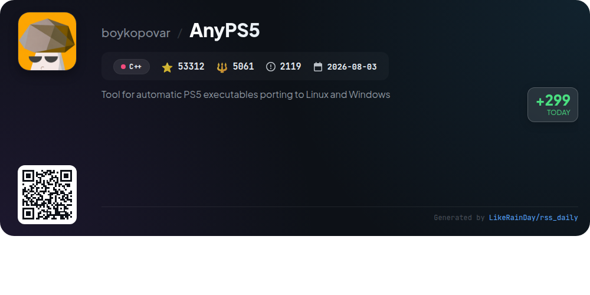
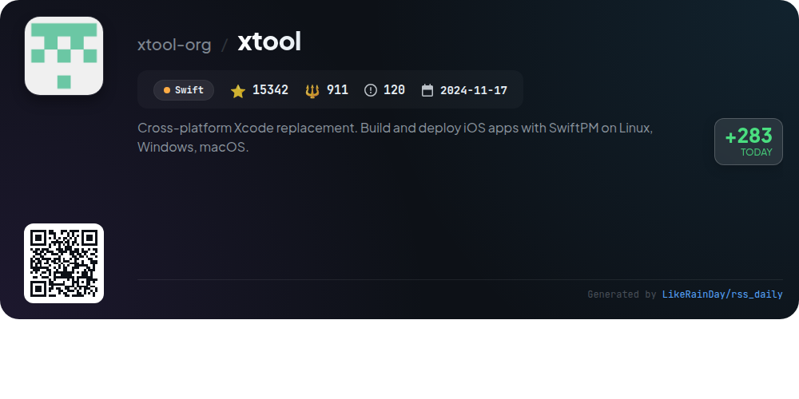
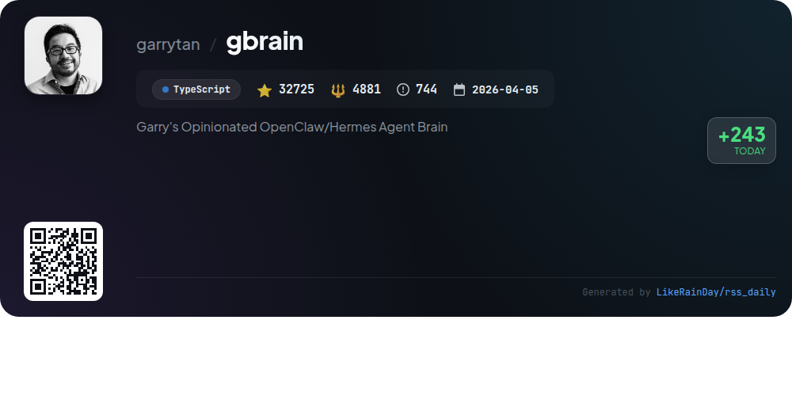

# 📊 🌟 GitHub Trending Daily - 2026-11-12

> > 📅 每日精选 GitHub 热门仓库 | 基于智能算法推荐

## 📋 Overview

**10** 个项目 | **329594** ⭐ | **31937** 🍴

**热门语言:** `TypeScript` (3) · `C++` (2) · `Rust` (2)

**更新时间:** 2026-11-12 06:49 UTC

**分类分布:**

- 🌟 每日 Top 10 精选 (10 项)

---

## 🌟 每日 Top 10 精选

### 1. [astryx](https://github.com/meta/astryx)

> 🤖 **推荐理由**  
> *Astryx is an open-source design system built on React 19+ that emphasizes customizability and accessibility. It features over 150 reusable components, brand-level theming, dark mode, and a CLI for seamless integration. Key highlights include open internals allowing for deep customization without styling lock-in, and an API designed for both humans and AI assistants. Astryx supports various theming options and encourages contributions. Documentation, Storybook, and a sandbox environment are readily available, making it easy to get started and explore its capabilities.*

- ⭐ 25494 stars
- 💻 TypeScript
- 📅 Updated: 2026-11-12

### 2. [agent-skills](https://github.com/addyosmani/agent-skills)

> 🤖 **推荐理由**  
> *Agent Skills is a production-grade toolkit designed to enhance AI coding agents with structured engineering workflows, ensuring adherence to best practices throughout the software development lifecycle. With 25 skills, it covers defining, planning, building, verifying, reviewing, and shipping code. Key features include 9 slash commands for automation and integration with various coding environments such as Claude Code and GitHub Copilot. Emphasizing quality gates, test-driven development, and comprehensive reviews, Agent Skills helps maintain production-quality outputs, reflecting insights from Google's engineering culture.*

- ⭐ 116148 stars
- 💻 JavaScript
- 📅 Updated: 2026-11-12

### 3. [billion-context](https://github.com/ranxianglei/billion-context)

> 🤖 **推荐理由**  
> *billion-context is a powerful context-compression plugin designed for managing extensive single sessions of billions of tokens while utilizing small context windows (100K tokens). Key features include achieving a 5x reduction in token usage, high compression quality, and maintaining a 95-97% cache hit rate. It allows for month-long sessions without degradation, enabling efficient and economical use of conversational context. The plugin supports various clients and offers context management tools such as compression, decompression, and keyword search, ensuring seamless integration and performance.*

- ⭐ 6920 stars
- 💻 TypeScript
- 📅 Updated: 2026-11-12

### 4. [agent-browser](https://github.com/vercel-labs/agent-browser)

> 🤖 **推荐理由**  
> *Browser automation CLI for AI agents. popular project, actively maintained, recently updated*

- ⭐ 50040 stars
- 🍴 3492 forks
- 💻 Rust
- 📅 Updated: 2026-11-12

### 5. [YunX-Desktop](https://github.com/tidain/YunX-Desktop)

> 🤖 **推荐理由**  
> *YunX-Desktop is the official Windows desktop client for YunX, enabling users to paste sharing links for high-speed downloads from various cloud storage and video platforms, including Quark, UC, Baidu, and Bilibili. Key features include multi-account support, encrypted credential storage, P2P download capabilities (magnet, BT, ed2k), and seamless video parsing and previewing. The app supports concurrent downloads with resumption, offers a portable version, and integrates with Windows for notifications and tray access. Open-source under AGPL-3.0, it aims to provide a user-friendly experience for efficient file management.*

- ⭐ 4796 stars
- 💻 Kotlin
- 📅 Updated: 2026-11-12

### 6. [topcoat](https://github.com/tokio-rs/topcoat)

> 🤖 **推荐理由**  
> *Topcoat is a robust, batteries-included framework for building web applications using Rust, designed to streamline development with pre-integrated tools and libraries. It offers a modular architecture, allowing developers to easily customize and extend functionalities. Key features include efficient performance, strong type safety, and seamless integration with popular web technologies. With over 7,129 stars on GitHub, Topcoat is gaining traction for its developer-friendly approach, making it an ideal choice for efficient and scalable web app development.*

- ⭐ 7129 stars
- 💻 Rust
- 📅 Updated: 2026-11-12

### 7. [mujoco](https://github.com/google-deepmind/mujoco)

> 🤖 **推荐理由**  
> *MuJoCo (Multi-Joint dynamics with Contact) is a versatile physics simulator designed for accurate and efficient simulation of articulated structures in robotics, biomechanics, and machine learning. Key features include a high-performance C API, interactive visualization in desktop and browser environments, and Python bindings for easy integration. Users can explore models via the MuJoCo Studio app or access tutorials on Google Colab. The project is maintained by Google DeepMind and offers extensive documentation, support for Unity, and various language bindings, making it ideal for researchers and developers alike.*

- ⭐ 17688 stars
- 💻 C++
- 📅 Updated: 2026-11-12

### 8. [AnyPS5](https://github.com/boykopovar/AnyPS5)

> 🤖 **推荐理由**  
> *AnyPS5 is a powerful tool for automatically porting PS5 executables to Linux and Windows, boasting over 53,000 stars on GitHub. It features a relinker that converts executables to the native format of the target OS without requiring emulation. The project includes system PRX libraries for dynamic linking, supports SDL-mapped controllers, and allows customizable input mapping. A web converter keeps files on the user's device, enhancing privacy. It is designed for interoperability and preservation, with no inclusion of copyrighted software. Licensed under GPL v2.*

- ⭐ 53312 stars
- 💻 C++
- 📅 Updated: 2026-11-12

### 9. [xtool](https://github.com/xtool-org/xtool)

> 🤖 **推荐理由**  
> *xtool is a cross-platform replacement for Xcode, enabling users to build and deploy iOS apps using SwiftPM on Linux, Windows, and macOS. With over 15,000 stars, it offers essential features like building SwiftPM packages, signing and installing iOS apps, and programmatic interaction with Apple Developer Services. The tool includes a command-line interface for setup, project management, and device interaction. Additionally, xtool can be integrated as a Swift Package for custom app development, enhancing compatibility with Apple services.*

- ⭐ 15342 stars
- 💻 Swift
- 📅 Updated: 2026-11-12

### 10. [gbrain](https://github.com/garrytan/gbrain)

> 🤖 **推荐理由**  
> *Garry's Opinionated OpenClaw/Hermes Agent Brain. popular project, actively maintained, recently updated*

- ⭐ 32725 stars
- 🍴 4881 forks
- 💻 TypeScript
- 📅 Updated: 2026-11-12

---

## 📡 RSS订阅

通过 RSS 订阅，第一时间获取每日精选项目：

- 🔔 [RSS 订阅源] (../../daily-top.xml)
- 🔔 [每日简报] (../../GITHUB_TODAY_CN.md)
- 🔔 [每日 Top 10 精选](../../daily-top.xml)

---

*⚡ Powered by Smart Trending Algorithm | Generated at 2026-11-12 06:49:40 UTC
