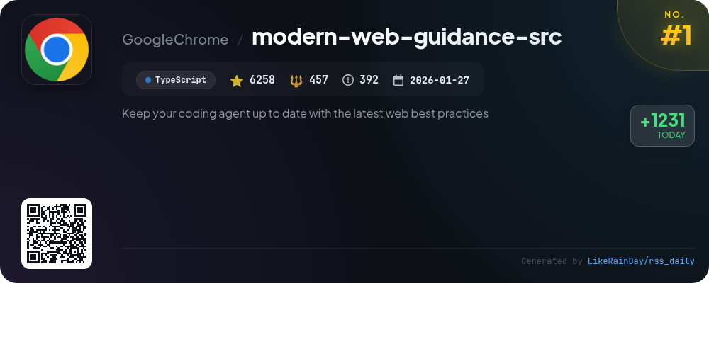
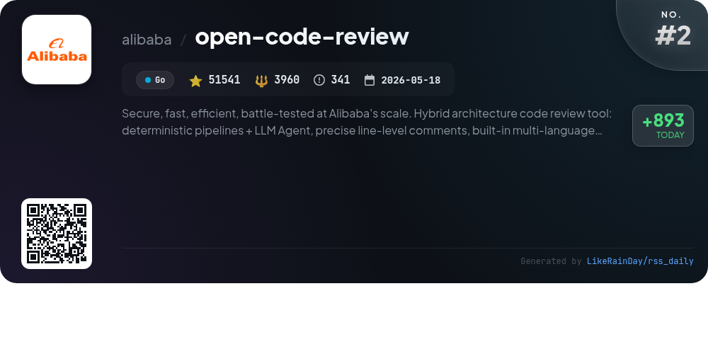
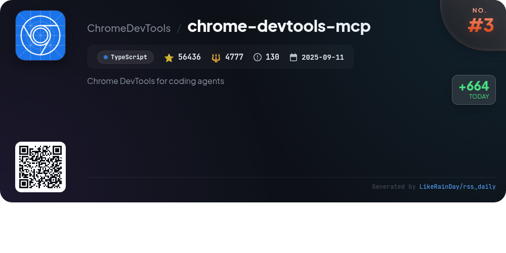
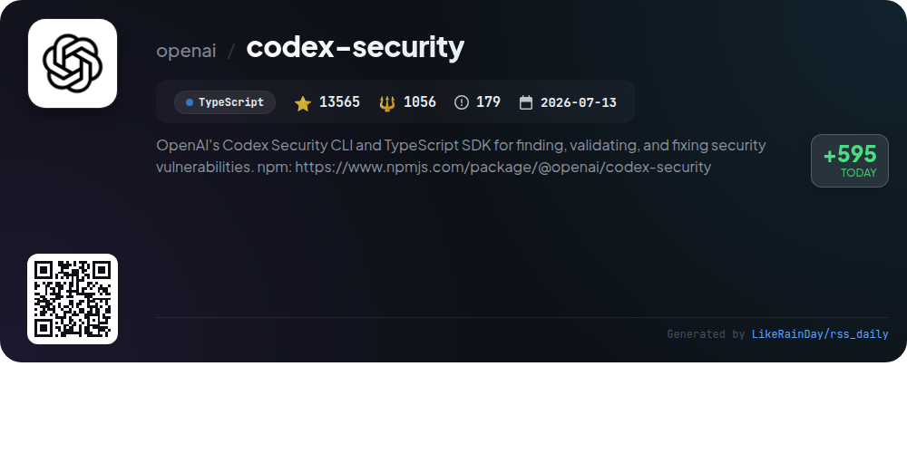
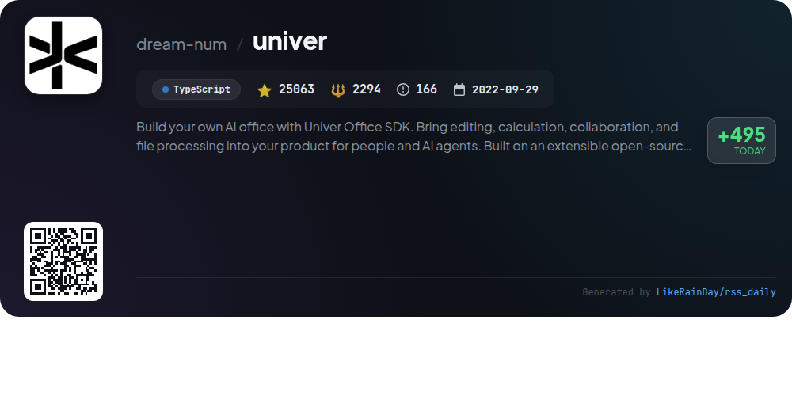
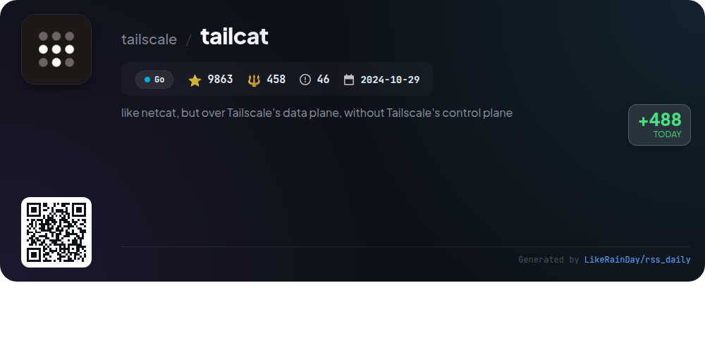
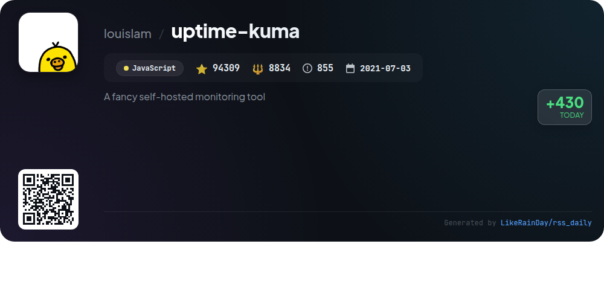
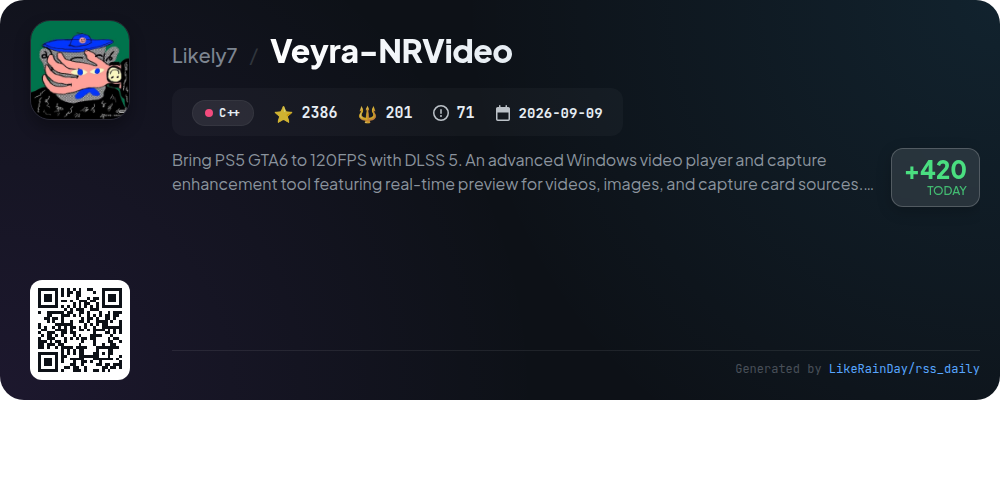
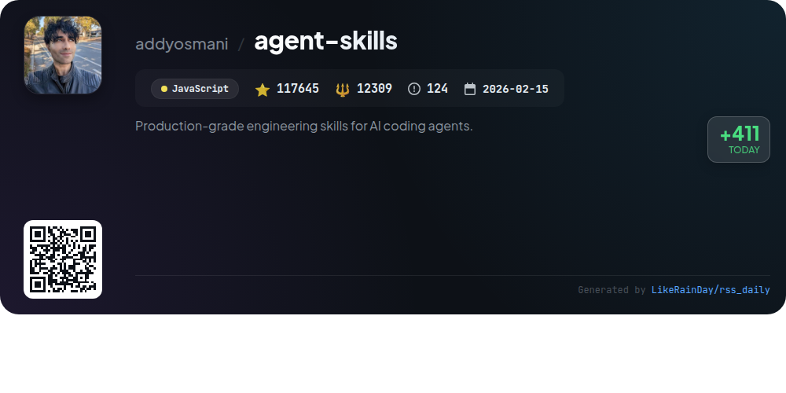
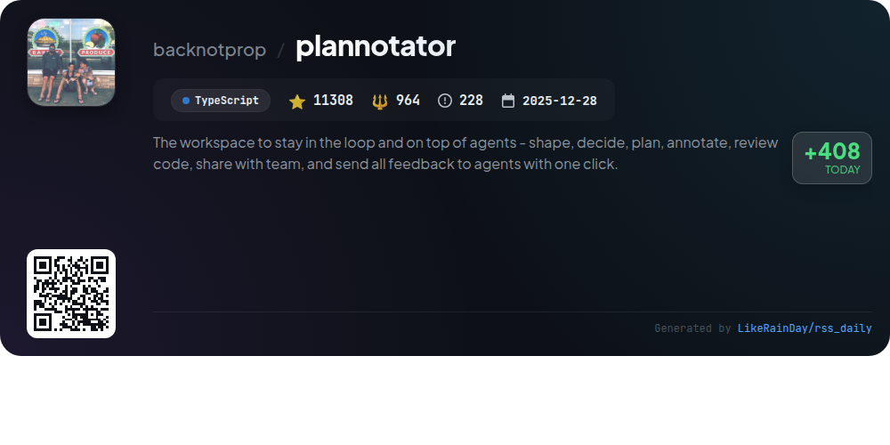

# 📊 🌟 GitHub Trending Daily - 2026-11-15

> > 📅 Daily Picks of GitHub Trending Repositories | Powered by Smart Algorithms

## 📋 Overview

**10** Projects | **388374** ⭐ | **35310** 🍴

**Top Languages:** `TypeScript` (5) · `Go` (2) · `JavaScript` (2)

**Updated:** 2026-11-15 05:55 UTC

**Categories:**

- 🌟 Daily Top 10 (10 items)

---

## 🌟 Daily Top 10

### 1. [modern-web-guidance-src](https://github.com/GoogleChrome/modern-web-guidance-src)

> 🤖 **Why Recommend**  
> *The Modern Web Guidance (Source) project provides a comprehensive set of tools and documentation to help coding agents adopt modern web best practices. It offers an interactive CLI for searching, retrieving, and scanning codebases for legacy patterns. Key features include targeted guidelines on modern browser APIs, performance optimization, accessibility, and responsible fallbacks. The project is supported by major browser teams and emphasizes continuous calibration and empirical evaluations to enhance coding accuracy. With over 250 modern web features covered, it aims to streamline the development of high-quality web applications.*

- ⭐ 6258 stars
- 💻 TypeScript
- 📅 Updated: 2026-11-15

### 2. [open-code-review](https://github.com/alibaba/open-code-review)

> 🤖 **Why Recommend**  
> *Open Code Review is an AI-powered code review tool developed by Alibaba, designed for speed and security at scale. It features a hybrid architecture combining deterministic pipelines with an LLM agent, generating precise line-level comments. The tool supports multi-language rulesets for issues like NPE, thread-safety, and XSS. With capabilities to read Git diffs and inspect codebases, it provides both diff and full-file reviews. Open Code Review is compatible with OpenAI and Anthropic models, making it a robust solution for developers seeking efficient code auditing and defect detection.*

- ⭐ 51541 stars
- 💻 Go
- 📅 Updated: 2026-11-15

### 3. [chrome-devtools-mcp](https://github.com/ChromeDevTools/chrome-devtools-mcp)

> 🤖 **Why Recommend**  
> *chrome-devtools-mcp is a TypeScript library enabling coding agents like Antigravity and Copilot to control and inspect live Chrome browsers via a Model-Context-Protocol (MCP) server or CLI. Key features include advanced debugging, performance insights through Chrome DevTools, and reliable browser automation using Puppeteer. The tool allows for detailed analysis of network requests, screen captures, and performance tracing. It supports Google Chrome and Chrome for Testing, emphasizing security by cautioning against sharing sensitive data. With over 56,000 stars, it is a valuable resource for enhancing AI coding assistants.*

- ⭐ 56436 stars
- 💻 TypeScript
- 📅 Updated: 2026-11-15

### 4. [codex-security](https://github.com/openai/codex-security)

> 🤖 **Why Recommend**  
> *OpenAI's Codex Security CLI and TypeScript SDK for finding, validating, and fixing security vulnerabilities. npm: https://www.npmjs.com/package/@opena. popular project, actively maintained, recently updated*

- ⭐ 13565 stars
- 🍴 1056 forks
- 💻 TypeScript
- 📅 Updated: 2026-11-15

### 5. [univer](https://github.com/dream-num/univer)

> 🤖 **Why Recommend**  
> *Univer is an open-source Office SDK designed for building AI-enhanced productivity applications. It enables seamless integration of editing, calculation, collaboration, and file processing capabilities across spreadsheets, documents, and presentations. Key features include a modular architecture with Web, Server, and AI SDKs, facilitating real-time collaboration and headless content processing. With over 25,000 stars on GitHub, Univer supports extensive customization through plugins and presets, making it a versatile foundation for developers aiming to create sophisticated office applications.*

- ⭐ 25063 stars
- 💻 TypeScript
- 📅 Updated: 2026-11-15

### 6. [tailcat](https://github.com/tailscale/tailcat)

> 🤖 **Why Recommend**  
> *Tailcat is an open-source tool that acts like netcat but uses Tailscale's data plane without its control plane. It enables secure, point-to-point WireGuard®-encrypted connections, allowing users to easily exchange data between machines without requiring a Tailscale account or root access. Key features include file transfer, port forwarding, SSH server capabilities, and a built-in performance measurement tool. Tailcat supports both a CLI and a Go library, making it versatile for various networking tasks. Users can run their own DERP relays or utilize free rate-limited ones provided by Tailcat.*

- ⭐ 9863 stars
- 💻 Go
- 📅 Updated: 2026-11-15

### 7. [uptime-kuma](https://github.com/louislam/uptime-kuma)

> 🤖 **Why Recommend**  
> *Uptime Kuma is a self-hosted monitoring tool designed for easy uptime tracking of various services, including HTTP(s), TCP, and Docker containers. With an intuitive UI, it offers notifications through platforms like Telegram, Discord, and Slack. Key features include multi-language support, customizable status pages, and the ability to monitor ping and certificate info. Installation is straightforward, supporting both Docker and non-Docker environments. The project boasts over 94,000 stars on GitHub, reflecting its popularity and community support.*

- ⭐ 94309 stars
- 💻 JavaScript
- 📅 Updated: 2026-11-15

### 8. [Veyra-NRVideo](https://github.com/Likely7/Veyra-NRVideo)

> 🤖 **Why Recommend**  
> *Veyra-NRVideo is an advanced Windows video player and capture enhancement tool that delivers next-gen visuals, enabling PS5 GTA6 gameplay at 120FPS using DLSS 5. Key features include real-time video enhancement with AI-powered Super Resolution, frame generation, and noise reduction. It supports local video, game streaming, capture cards, and offers a rebuilt interface for easy navigation. With over 79K downloads, Veyra integrates extensive audio handling, customizable export options, and compatibility with NVIDIA & AMD GPUs, making it a powerful asset for gamers and streamers.*

- ⭐ 2386 stars
- 💻 C++
- 📅 Updated: 2026-11-15

### 9. [agent-skills](https://github.com/addyosmani/agent-skills)

> 🤖 **Why Recommend**  
> *Agent Skills is a production-grade toolkit for AI coding agents, designed to enforce engineering best practices throughout the software development lifecycle. With 25 structured workflows including commands for defining, planning, building, verifying, reviewing, and shipping code, it guides agents through tasks like test-driven development and code reviews. The project emphasizes quality gates, automation, and accountability, ensuring agents adhere to high standards. Easily installable via various CLI tools, Agent Skills empowers developers to maintain production-quality output consistently.*

- ⭐ 117645 stars
- 💻 JavaScript
- 📅 Updated: 2026-11-15

### 10. [plannotator](https://github.com/backnotprop/plannotator)

> 🤖 **Why Recommend**  
> *Plannotator is a powerful workspace for managing interactions with AI coding agents. It allows users to annotate plans, specs, and HTML artifacts, perform code reviews, and send feedback directly to agents like Claude Code, Codex, and Copilot CLI. Key features include the Plannotator Inbox for real-time communication, seamless integration with GitHub and GitLab for code reviews, and a terminal-based review option with Herdr Annotate. With a focus on privacy, Plannotator keeps all data local by default while supporting collaborative sharing through encrypted links.*

- ⭐ 11308 stars
- 💻 TypeScript
- 📅 Updated: 2026-11-15

---

## 📡 RSS Subscription

Subscribe via RSS to get daily trending updates:

- 🔔 [RSS XML] (../../daily-top.xml)
- 🔔 [Daily Report] (../../GITHUB_TODAY.md)
- 🔔 [Daily Top 10](../../daily-top.xml)

---

*⚡ Powered by Smart Trending Algorithm | Generated at 2026-11-15 05:55:47 UTC
