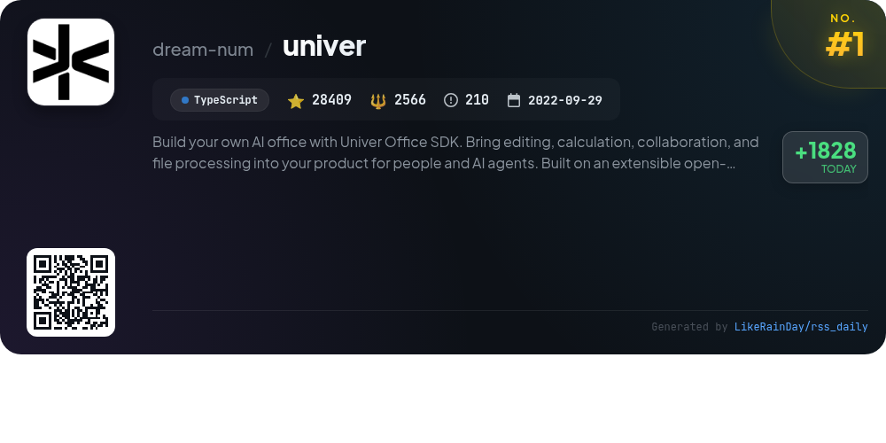
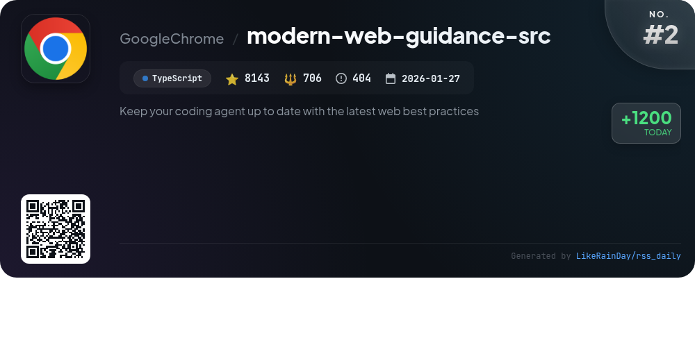
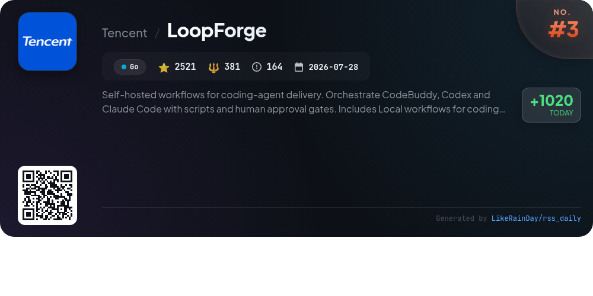
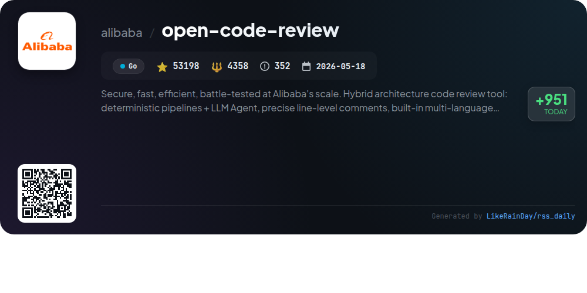
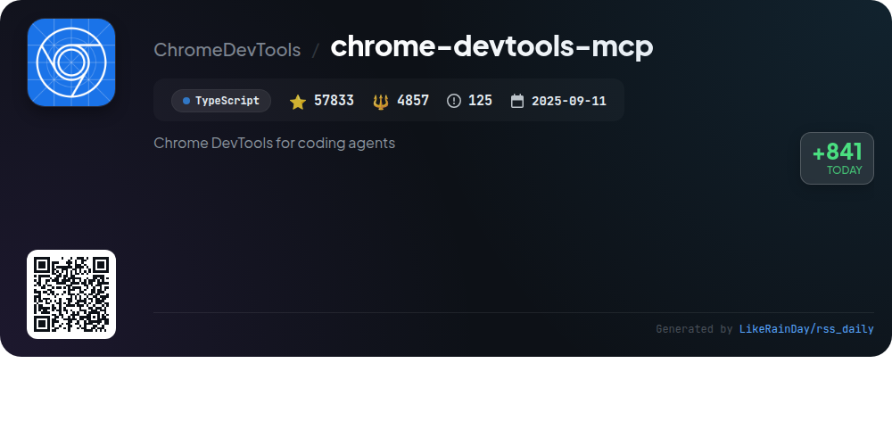
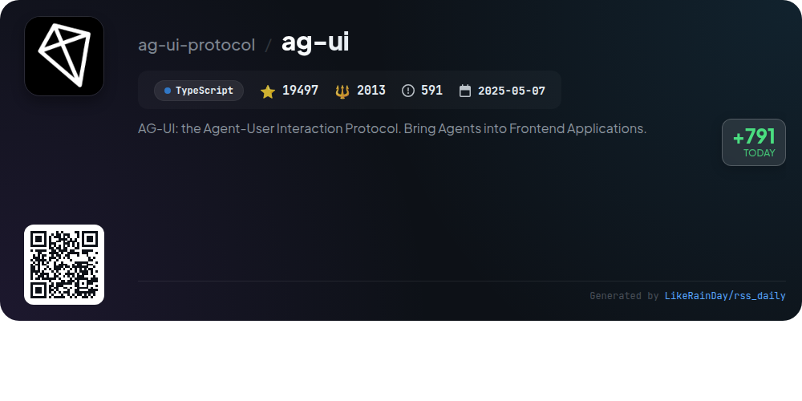
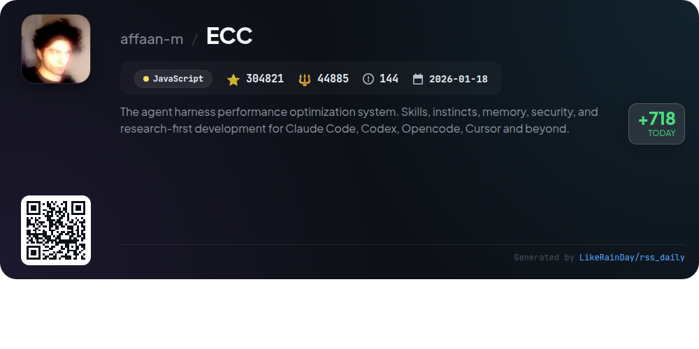
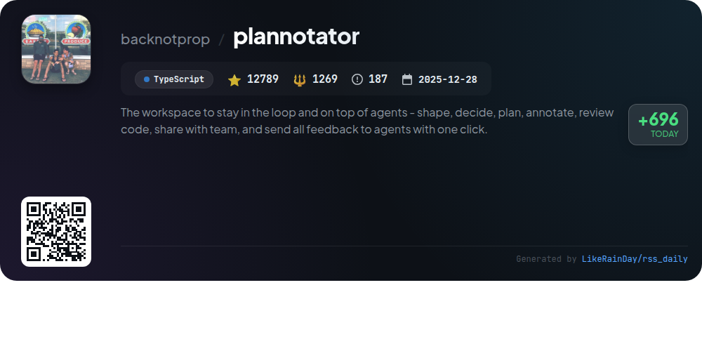
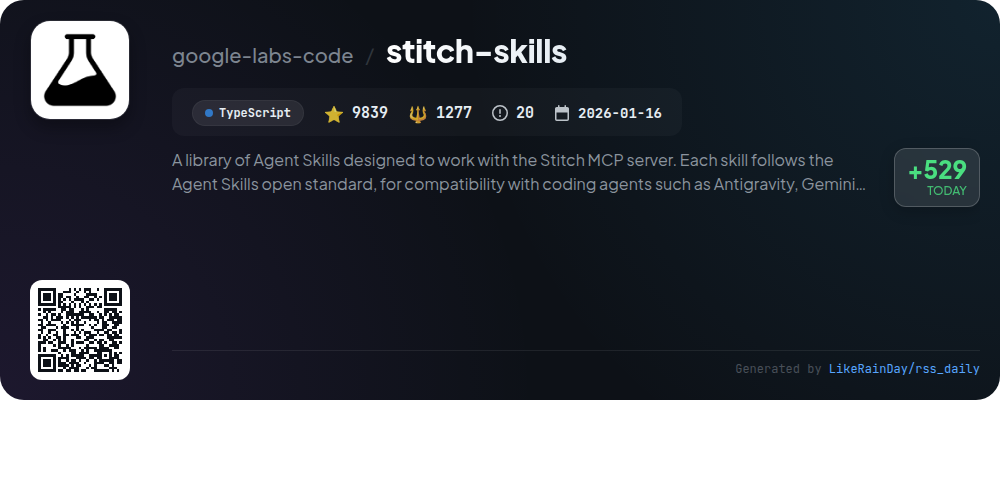
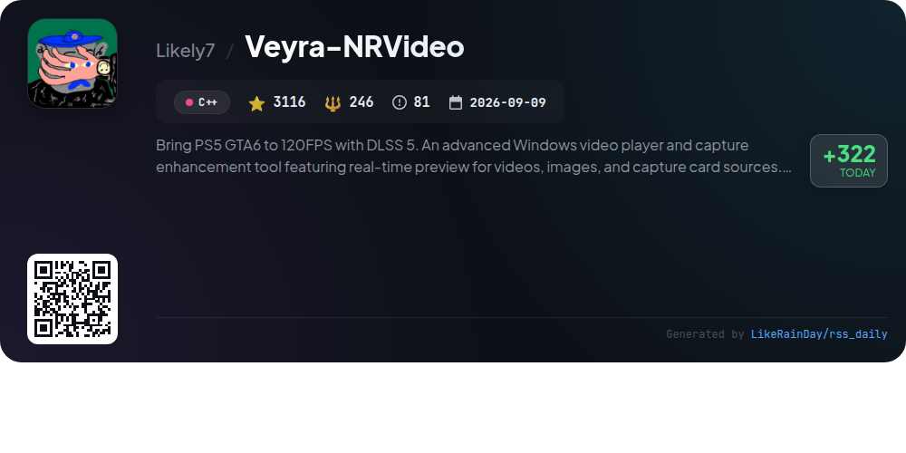

# 📊 🌟 GitHub Trending Daily - 2026-11-17

> > 📅 Daily Picks of GitHub Trending Repositories | Powered by Smart Algorithms

## 📋 Overview

**10** Projects | **500166** ⭐ | **62558** 🍴

**Top Languages:** `TypeScript` (6) · `Go` (2) · `JavaScript` (1)

**Updated:** 2026-11-17 07:33 UTC

**Categories:**

- 🌟 Daily Top 10 (10 items)

---

## 🌟 Daily Top 10

### 1. [univer](https://github.com/dream-num/univer)

> 🤖 **Why Recommend**  
> *Univer is an open-source Office SDK designed to create customizable AI office applications. It offers a robust Web SDK for embedding spreadsheet and document editing, real-time collaboration, and AI integration capabilities. Key features include rich-text editing, formula calculations, and a plugin architecture for extending functionalities such as charts and file processing. The SDK supports both frontend and backend operations, enabling seamless integration with existing applications. With over 28,000 stars on GitHub, Univer provides a comprehensive platform for developing office solutions tailored to user needs.*

- ⭐ 28409 stars
- 💻 TypeScript
- 📅 Updated: 2026-11-17

### 2. [modern-web-guidance-src](https://github.com/GoogleChrome/modern-web-guidance-src)

> 🤖 **Why Recommend**  
> *Modern Web Guidance (Source) is a TypeScript project aimed at enhancing coding agents with up-to-date web best practices, boasting over 8,000 stars. It provides expert-curated guidelines on modern browser APIs, performance optimizations, and accessibility, steering developers away from legacy code patterns. Key features include an interactive CLI for searching and retrieving guides, a comprehensive evaluation dashboard for testing effectiveness, and a focus on responsible fallbacks. The project is supported by major browser teams, ensuring alignment with the latest web standards.*

- ⭐ 8143 stars
- 💻 TypeScript
- 📅 Updated: 2026-11-17

### 3. [LoopForge](https://github.com/Tencent/LoopForge)

> 🤖 **Why Recommend**  
> *LoopForge is a self-hosted platform designed for orchestrating software delivery using coding agents like CodeBuddy, Codex, and Claude Code. Key features include chat-based interactions with a Main Bot for on-demand workflows, a visual SOP designer for creating repeatable delivery processes, and integrated human approval gates to ensure quality control. It supports local workflows, Docker sandboxing, and provides metrics for project insights. LoopForge enhances team collaboration while maintaining complete control over the software delivery environment, all under the MIT license.*

- ⭐ 2521 stars
- 💻 Go
- 📅 Updated: 2026-11-17

### 4. [open-code-review](https://github.com/alibaba/open-code-review)

> 🤖 **Why Recommend**  
> *Open Code Review is a powerful AI-driven code review tool developed by Alibaba, now available as open-source. It features a hybrid architecture combining deterministic pipelines with LLM agents, ensuring precise line-level comments and robust multi-language rule sets for issues like NPE, thread safety, and SQL injection. With extensive validation at scale, it provides structured feedback on Git diffs and entire files, enhancing review accuracy and reducing noise. Compatible with OpenAI and Anthropic models, it supports multiple platforms and agents. Visit open-codereview.ai for more details.*

- ⭐ 53198 stars
- 💻 Go
- 📅 Updated: 2026-11-17

### 5. [chrome-devtools-mcp](https://github.com/ChromeDevTools/chrome-devtools-mcp)

> 🤖 **Why Recommend**  
> *chrome-devtools-mcp is a powerful TypeScript library enabling coding agents like Antigravity and Copilot to control and inspect live Chrome browsers. It functions as a Model-Context-Protocol (MCP) server and CLI, offering features such as performance insights, advanced debugging, and reliable automation through Puppeteer. Key highlights include network request analysis, screenshot capabilities, and customizable skills for various debugging tasks. It supports only Google Chrome and requires Node.js and npm for setup. Ideal for enhancing AI-assisted web development workflows.*

- ⭐ 57833 stars
- 💻 TypeScript
- 📅 Updated: 2026-11-17

### 6. [ag-ui](https://github.com/ag-ui-protocol/ag-ui)

> 🤖 **Why Recommend**  
> *AG-UI is an open, event-based protocol facilitating seamless integration between AI agents and user-facing applications. With over 19,000 stars on GitHub, it standardizes interactions through a bi-directional event stream, enabling real-time features such as streaming chat, shared state, and human-in-the-loop functionalities. Compatible with frameworks like LangChain and Microsoft Agent Framework, AG-UI supports diverse environments including web, mobile, and terminal applications. The protocol's stable 1.0 specification ensures backward compatibility, making it a versatile choice for developers.*

- ⭐ 19497 stars
- 💻 TypeScript
- 📅 Updated: 2026-11-17

### 7. [ECC](https://github.com/affaan-m/ECC)

> 🤖 **Why Recommend**  
> *ECC is a powerful performance optimization system designed for coding agents, integrating skills, instincts, memory, security, and research-driven development. It supports various platforms including Claude Code, Codex, and Kimi Code. Key features include 72 specialized agents, 327 reusable skills, 98 command shims, and AgentShield security scanning. ECC facilitates structured workflows such as Test-Driven Development (TDD), code reviews, and build fixes, while enhancing context management and continuous learning. Its open-source nature allows for extensive customization and community contributions.*

- ⭐ 304821 stars
- 💻 JavaScript
- 📅 Updated: 2026-11-17

### 8. [plannotator](https://github.com/backnotprop/plannotator)

> 🤖 **Why Recommend**  
> *Plannotator is a powerful workspace designed for seamless collaboration and code review with AI coding agents. Key features include Plannotator Inbox for managing agent messages, intuitive annotation of plans, specs, and HTML artifacts, and comprehensive code review capabilities for local changes and GitHub/GitLab PRs. Users can provide feedback directly to agents, facilitating efficient communication. The platform supports multiple coding agents and includes integrations with VS Code, Obsidian, and Notion. With a focus on enhancing team workflows, Plannotator simplifies the review process while ensuring teams stay connected.*

- ⭐ 12789 stars
- 💻 TypeScript
- 📅 Updated: 2026-11-17

### 9. [stitch-skills](https://github.com/google-labs-code/stitch-skills)

> 🤖 **Why Recommend**  
> *The "stitch-skills" project is a TypeScript library designed for the Stitch MCP server, offering a suite of agent skills compliant with the Agent Skills open standard. With over 9,800 stars, it enables compatibility with various coding agents like Codex and Claude Code. Key features include design-focused skills for optimizing workflows, build skills for code generation and integration, and utility skills for enhancing prompts and enforcing design standards. Users can easily install plugins and skills, making it a versatile tool for developers aiming to streamline their design and development processes.*

- ⭐ 9839 stars
- 💻 TypeScript
- 📅 Updated: 2026-11-17

### 10. [Veyra-NRVideo](https://github.com/Likely7/Veyra-NRVideo)

> 🤖 **Why Recommend**  
> *Veyra-NRVideo is an advanced Windows video player and capture enhancement tool designed to elevate PS5 GTA6 gameplay to 120FPS using DLSS 5. Key features include real-time GPU video enhancement, AI-powered Super Resolution, noise reduction, HDR, and frame generation. It supports various sources like capture cards and game streaming, and offers a user-friendly interface with customizable settings. The latest version (2.1.9) introduces improved export workflows and enhanced compatibility for NVIDIA and AMD hardware, making it a powerful tool for gamers and content creators alike.*

- ⭐ 3116 stars
- 💻 C++
- 📅 Updated: 2026-11-17

---

## 📡 RSS Subscription

Subscribe via RSS to get daily trending updates:

- 🔔 [RSS XML] (../../daily-top.xml)
- 🔔 [Daily Report] (../../GITHUB_TODAY.md)
- 🔔 [Daily Top 10](../../daily-top.xml)

---

*⚡ Powered by Smart Trending Algorithm | Generated at 2026-11-17 07:33:16 UTC
