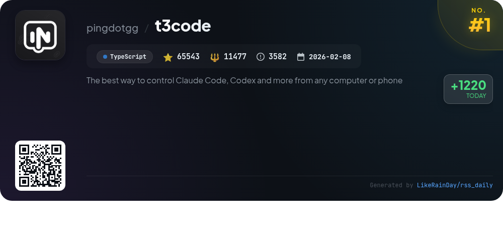
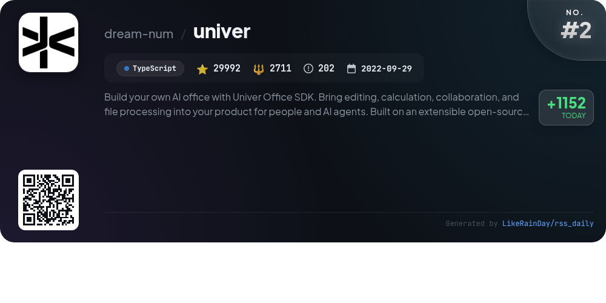
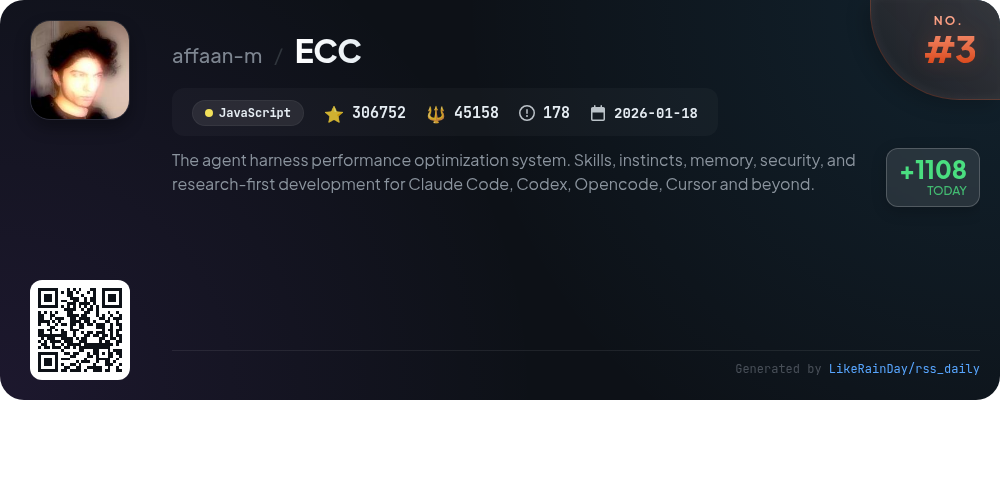
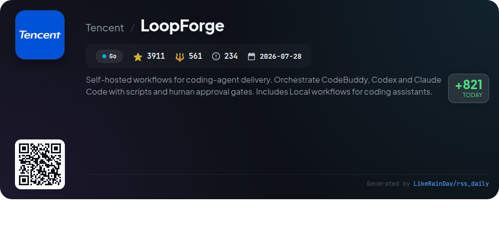
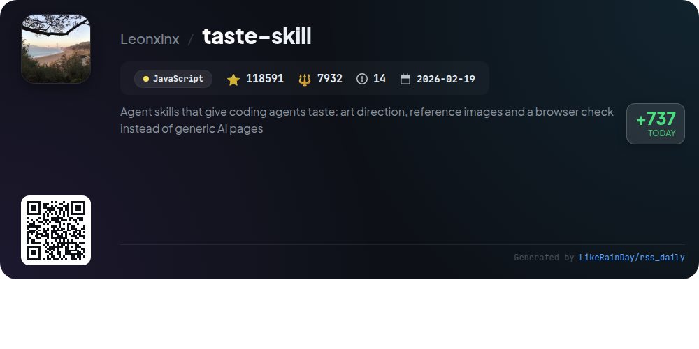
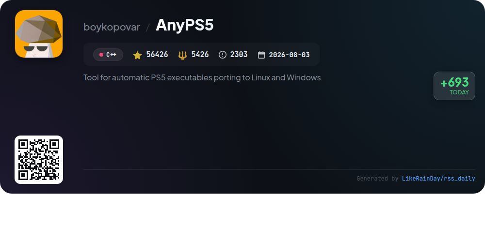
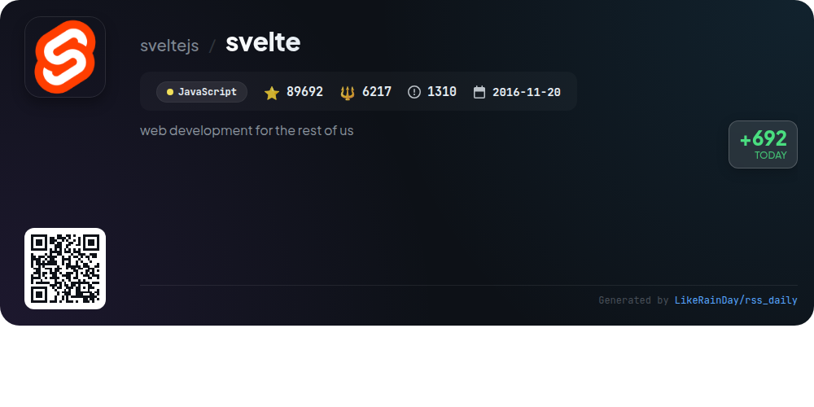
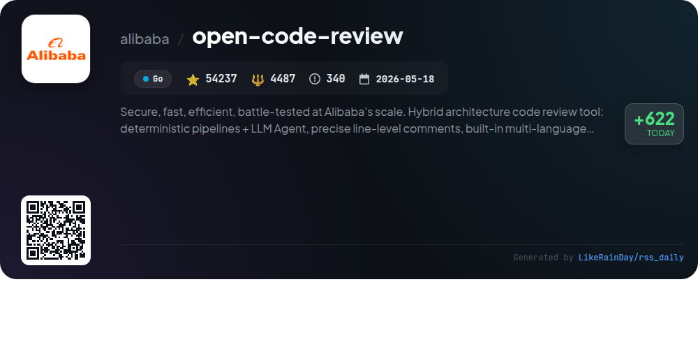
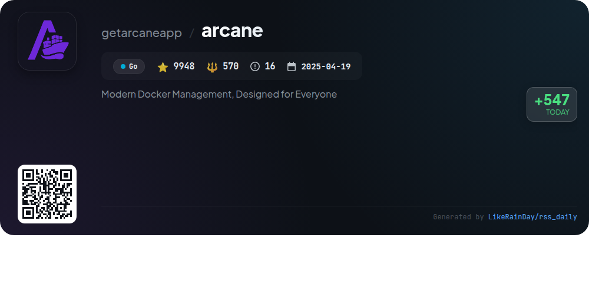
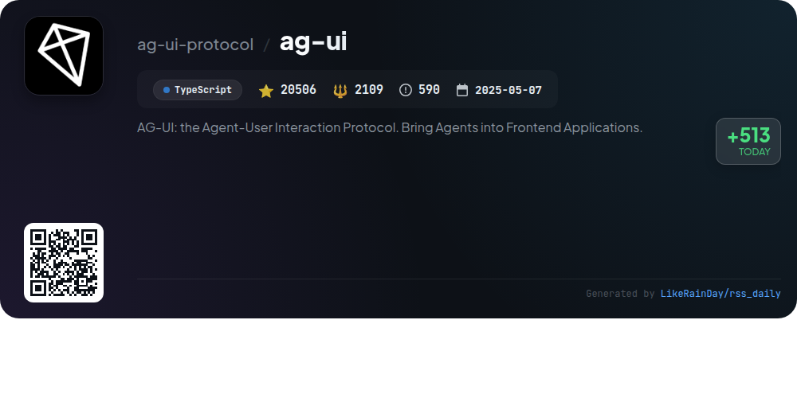

# 📊 🌟 GitHub Trending Daily - 2026-11-19

> > 📅 每日精选 GitHub 热门仓库 | 基于智能算法推荐

## 📋 Overview

**10** 个项目 | **755598** ⭐ | **86648** 🍴

**热门语言:** `TypeScript` (3) · `JavaScript` (3) · `Go` (3)

**更新时间:** 2026-11-19 06:59 UTC

**分类分布:**

- 🌟 每日 Top 10 精选 (10 项)

---

## 🌟 每日 Top 10 精选

### 1. [t3code](https://github.com/pingdotgg/t3code)

> 🤖 **推荐理由**  
> *T3 Code is an open-source control plane for coding agents, enabling seamless interaction with AI models like Claude Code and Codex from any device. Key features include a unified interface for managing various agents, remote access via local networks or T3 Connect, and built-in Git support for version control. Available on desktop, iOS, and Android, T3 Code prioritizes performance and user experience. It requires no resold tokens, utilizing existing agent subscriptions, and is licensed under MIT, encouraging community contributions and modifications.*

- ⭐ 65543 stars
- 💻 TypeScript
- 📅 Updated: 2026-11-19

### 2. [univer](https://github.com/dream-num/univer)

> 🤖 **推荐理由**  
> *Univer is an open-source Office SDK designed for building AI-driven office applications. It offers features for editing, calculation, collaboration, and file processing across various content types like spreadsheets, documents, and presentations. Key highlights include a Web SDK for front-end integration, a Server SDK for real-time collaboration, and an AI SDK for connecting with agents. With extensive plugin architecture, Univer allows seamless customization and extensibility, empowering developers to create tailored office solutions while leveraging built-in functionalities.*

- ⭐ 29992 stars
- 💻 TypeScript
- 📅 Updated: 2026-11-19

### 3. [ECC](https://github.com/affaan-m/ECC)

> 🤖 **推荐理由**  
> *ECC is an advanced performance optimization system designed for coding agents, including Claude Code, Codex, and Cursor. With 72 specialized agents and 327 skills, ECC enhances productivity through features like test-driven development (TDD), continuous learning, and security audits via AgentShield. It offers tools for planning, reviewing, and verifying code changes while maintaining contextual memory. ECC's installation is streamlined with guided setups for various platforms, ensuring efficient integration and collaboration in software development.*

- ⭐ 306752 stars
- 💻 JavaScript
- 📅 Updated: 2026-11-19

### 4. [LoopForge](https://github.com/Tencent/LoopForge)

> 🤖 **推荐理由**  
> *LoopForge is a self-hosted platform for orchestrating coding-agent workflows, enabling teams to deliver software efficiently. Key features include the Main Bot for chat-based interactions, SOP (Standard Operating Procedure) management for repeatable delivery, and support for multiple coding agents like CodeBuddy and Codex. It offers Docker sandbox environments, human approval gates, and comprehensive tracking of requirements to delivery. With built-in roles, customizable workflows, and insights for cost accounting, LoopForge enhances collaboration and control in software development.*

- ⭐ 3911 stars
- 💻 Go
- 📅 Updated: 2026-11-19

### 5. [taste-skill](https://github.com/Leonxlnx/taste-skill)

> 🤖 **推荐理由**  
> *Taste Skill is a JavaScript-based agent skill designed to enhance coding agents by creating high-quality, professional websites akin to those on Figma and X.ai. With features like art direction, real photographs, and browser checks, it ensures visually appealing and functional pages built from a single brief. The framework emphasizes design consistency, utilizing a single design system and real brand assets. It operates offline and requires only Node.js and a web browser for execution. The project has garnered significant attention, achieving 118,591 stars on GitHub. Visit [tasteskill.dev](https://tasteskill.dev) for more information.*

- ⭐ 118591 stars
- 💻 JavaScript
- 📅 Updated: 2026-11-19

### 6. [AnyPS5](https://github.com/boykopovar/AnyPS5)

> 🤖 **推荐理由**  
> *AnyPS5 is a powerful tool designed for automatic porting of PS5 executables to Linux and Windows, boasting over 56,000 stars on GitHub. Key features include a relinker that converts executables to native formats without emulation, a shader recompiler that produces validated SPIR-V, and support for SDL-mapped game controllers. The project emphasizes interoperability and preservation, offering a web converter and extensive documentation. It promotes user contributions and is licensed under the GNU General Public License v2. Not affiliated with Sony Interactive Entertainment.*

- ⭐ 56426 stars
- 💻 C++
- 📅 Updated: 2026-11-19

### 7. [svelte](https://github.com/sveltejs/svelte)

> 🤖 **推荐理由**  
> *Svelte is a revolutionary web development framework that compiles declarative components into efficient JavaScript, enabling seamless DOM updates. With over 89,000 stars on GitHub, it prioritizes developer experience by simplifying the creation of interactive web applications. Key features include a robust component model, a focus on performance, and an active community for support via Discord. Svelte is an MIT-licensed open-source project, inviting contributions and support through platforms like Open Collective. Explore more at the [Svelte website](https://svelte.dev).*

- ⭐ 89692 stars
- 💻 JavaScript
- 📅 Updated: 2026-11-19

### 8. [open-code-review](https://github.com/alibaba/open-code-review)

> 🤖 **推荐理由**  
> *Open Code Review is a robust AI-powered code review tool developed by Alibaba, designed for efficiency and security at scale. It features deterministic pipelines combined with a LLM agent for precise, line-level feedback across multiple languages, addressing vulnerabilities like NPE, thread-safety, XSS, and SQL injection. The tool excels in identifying code defects through configurable LLM endpoints, offering a hybrid architecture that enhances review quality. With over 54,000 stars, it supports integration with popular coding agents and provides a comprehensive CLI for seamless usage.*

- ⭐ 54237 stars
- 💻 Go
- 📅 Updated: 2026-11-19

### 9. [arcane](https://github.com/getarcaneapp/arcane)

> 🤖 **推荐理由**  
> *Arcane is a modern Docker management tool designed for everyone, boasting nearly 10,000 stars on GitHub. The project is currently in its v3 version, with a dedicated branch for the last 2.x release. Key features include an intuitive dashboard, comprehensive documentation, and a focus on user feedback through Discussions for feature requests. Arcane emphasizes security with an accessible Software Bill of Materials (SBOM) and supports community contributions through translation on Crowdin. Visit the official site for setup and configuration details.*

- ⭐ 9948 stars
- 💻 Go
- 📅 Updated: 2026-11-19

### 10. [ag-ui](https://github.com/ag-ui-protocol/ag-ui)

> 🤖 **推荐理由**  
> *AG-UI (Agent-User Interaction Protocol) is an open, lightweight protocol designed to seamlessly integrate AI agents with user-facing applications across various platforms, including web, mobile, and messaging services. With over 20,500 stars on GitHub, it enables bi-directional event streaming, allowing agents to manage complex interactions like real-time chat, shared state, and human-in-the-loop processes. AG-UI supports multiple frameworks, including LangChain and Microsoft Agent Framework, and provides SDKs in TypeScript, Python, and .NET, making it versatile for developers aiming to enhance user experiences with AI-driven functionalities.*

- ⭐ 20506 stars
- 💻 TypeScript
- 📅 Updated: 2026-11-19

---

## 📡 RSS订阅

通过 RSS 订阅，第一时间获取每日精选项目：

- 🔔 [RSS 订阅源] (../../daily-top.xml)
- 🔔 [每日简报] (../../GITHUB_TODAY_CN.md)
- 🔔 [每日 Top 10 精选](../../daily-top.xml)

---

*⚡ Powered by Smart Trending Algorithm | Generated at 2026-11-19 06:59:29 UTC
