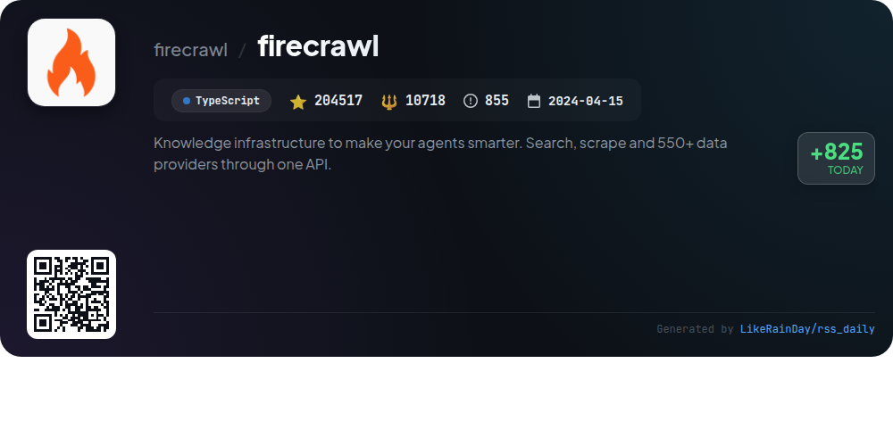
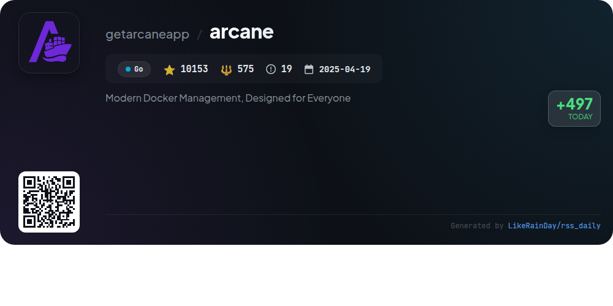
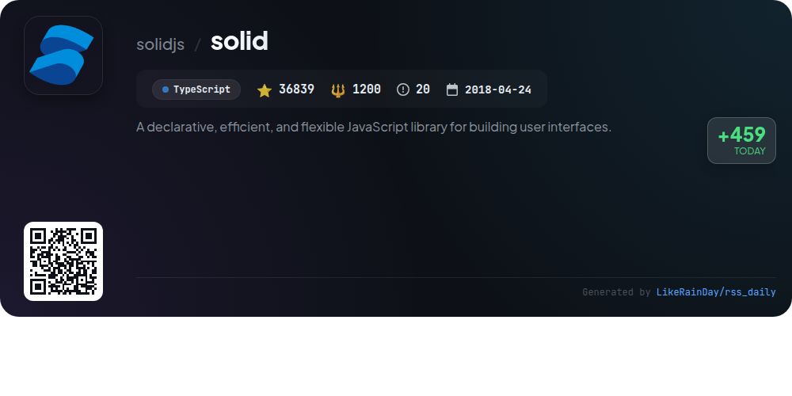
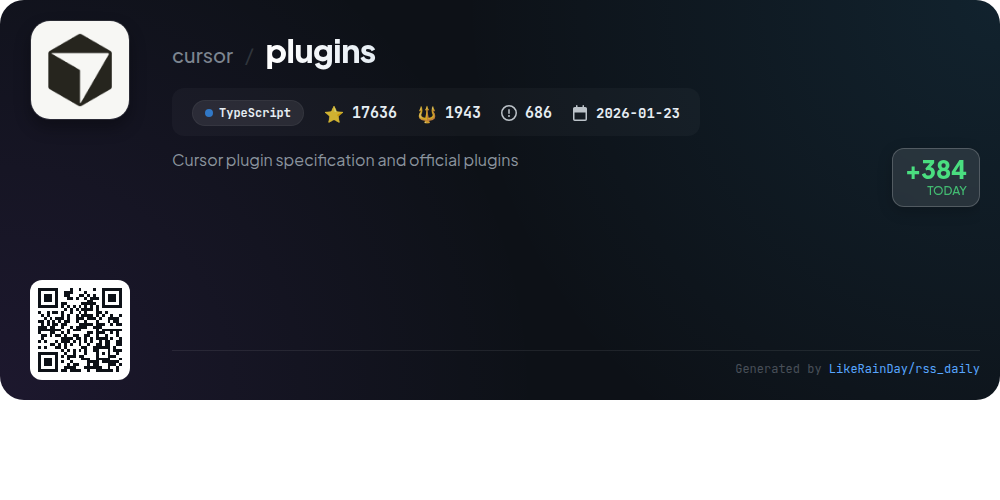
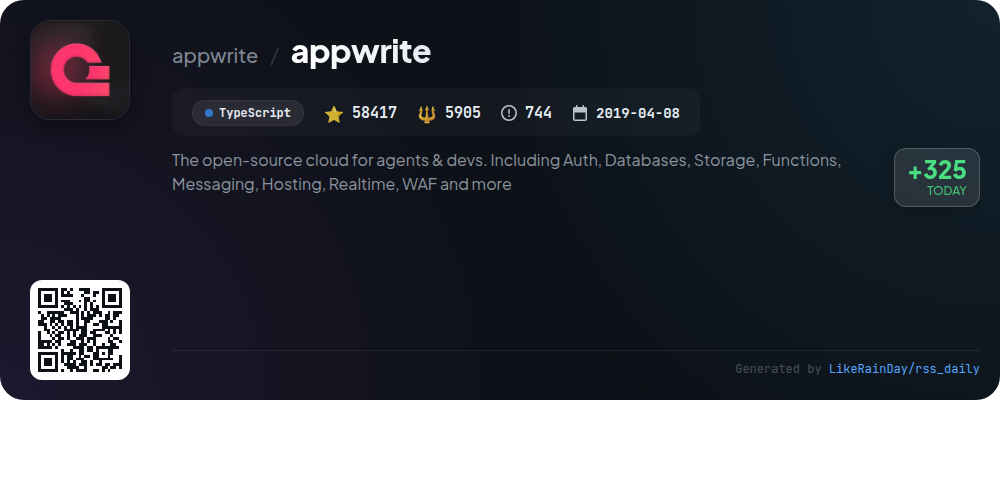
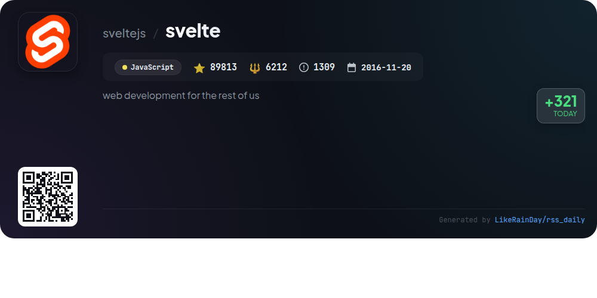
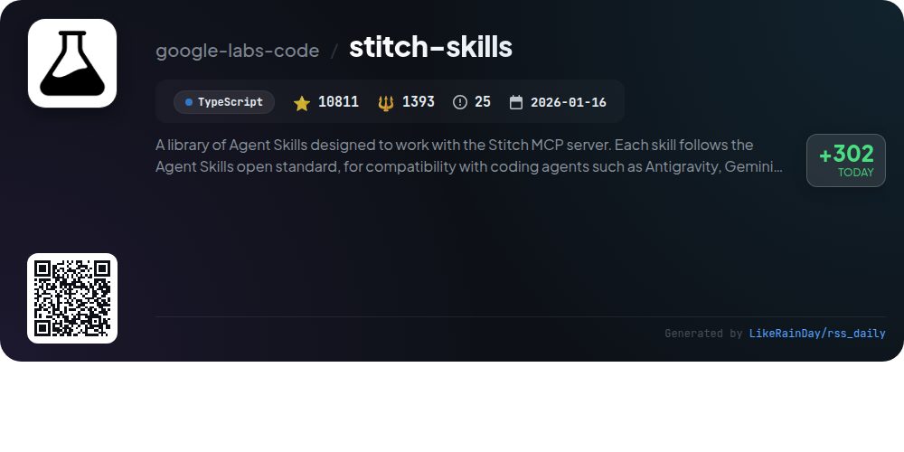

# 📊 🌟 GitHub Trending Daily - 2026-11-20

> > 📅 Daily Picks of GitHub Trending Repositories | Powered by Smart Algorithms

## 📋 Overview

**10** Projects | **988727** ⭐ | **89778** 🍴

**Top Languages:** `TypeScript` (5) · `JavaScript` (3) · `C++` (1)

**Updated:** 2026-11-20 06:47 UTC

**Categories:**

- 🌟 Daily Top 10 (10 items)

---

## 🌟 Daily Top 10

### 1. [AnyPS5](https://github.com/boykopovar/AnyPS5)

> 🤖 **Why Recommend**  
> *AnyPS5 is a powerful tool for automatically porting PS5 executables to Linux and Windows, boasting over 58,000 stars on GitHub. It features a relinker that converts executables to native formats without emulation and supports dynamic linking with system PRX libraries. The project includes a web converter and supports SDL-mapped game controllers, along with customizable input mapping. With a focus on interoperability and preservation, AnyPS5 is a community-driven initiative that emphasizes compatibility and research, while ensuring compliance with legal standards.*

- ⭐ 58085 stars
- 💻 C++
- 📅 Updated: 2026-11-20

### 2. [ECC](https://github.com/affaan-m/ECC)

> 🤖 **Why Recommend**  
> *ECC is an advanced agent harness performance optimization system designed for seamless integration with AI coding tools like Claude Code, Codex, and Cursor. Key features include 72 specialized agents, 328 reusable skills for various programming tasks, and 99 command shims for enhanced workflow. ECC supports memory persistence, continuous learning, and security auditing through AgentShield. It offers a guided setup for multiple platforms and ensures optimized context management. With robust documentation and community support, ECC enhances coding efficiency and promotes best practices in software development.*

- ⭐ 307403 stars
- 💻 JavaScript
- 📅 Updated: 2026-11-20

### 3. [ponytail](https://github.com/DietrichGebert/ponytail)

> 🤖 **Why Recommend**  
> *Ponytail is an innovative AI tool designed to optimize code generation by adopting the mindset of a seasoned developer who values efficiency. With over 195,000 stars on GitHub, it emphasizes writing less code—achieving up to 53% reduction while maintaining quality. Core features include `/ponytail-review` for code audits, `/ponytail-audit` for repository checks, and a unique "band" feature that tracks project metrics. Ponytail seamlessly integrates with various AI agents, promoting secure, efficient coding practices while reducing development costs and time significantly.*

- ⭐ 195053 stars
- 💻 JavaScript
- 📅 Updated: 2026-11-20

### 4. [firecrawl](https://github.com/firecrawl/firecrawl)

> 🤖 **Why Recommend**  
> *Firecrawl is a powerful knowledge infrastructure designed to enhance AI agents by enabling web search, scraping, and access to over 550 data providers through a single API. Key features include Firecrawl Local for local scraping without a database, Firecrawl Cloud for scalable hosted services, and self-hosting options. Users can scrape content in various formats, interact with pages, and utilize an autonomous agent for data retrieval. With a focus on LLM-ready outputs and real-time performance, Firecrawl simplifies web data integration for AI applications.*

- ⭐ 204517 stars
- 💻 TypeScript
- 📅 Updated: 2026-11-20

### 5. [arcane](https://github.com/getarcaneapp/arcane)

> 🤖 **Why Recommend**  
> *Arcane is a modern Docker management tool designed for everyone, with over 10,153 stars on GitHub. The project is built in Go and focuses on simplicity and efficiency in Docker management. Key features include an intuitive dashboard, comprehensive documentation, and a commitment to security and transparency, including a Software Bill of Materials (SBOM). Users can engage in feature discussions on GitHub and contribute to translations via Crowdin. For setup and configuration, visit the official documentation site at getarcane.app.*

- ⭐ 10153 stars
- 💻 Go
- 📅 Updated: 2026-11-20

### 6. [solid](https://github.com/solidjs/solid)

> 🤖 **Why Recommend**  
> *Solid is a powerful and efficient JavaScript library for building user interfaces, using TypeScript. It features fine-grained updates to the real DOM without a virtual DOM, enabling optimal performance. Key capabilities include declarative reactive primitives, render-once components, automatic dependency tracking, and robust state management. Solid supports streaming SSR, progressive hydration, and asynchronous operations. The library is designed for productivity with JSX and TypeScript integration, making it ideal for modern web development. Visit the [documentation](https://docs.solidjs.com) for more.*

- ⭐ 36839 stars
- 💻 TypeScript
- 📅 Updated: 2026-11-20

### 7. [plugins](https://github.com/cursor/plugins)

> 🤖 **Why Recommend**  
> *The "plugins" repository hosts official Cursor plugins for popular developer tools and SaaS products, featuring over 60 plugins that enhance productivity, integrations, and developer workflows. Key offerings include tools for teaching, continual learning, and CI automation, as well as integrations with major platforms like Google Workspace, Salesforce, and GitHub. Each plugin is structured with its own manifest, allowing for easy management and deployment. The project, built in TypeScript, has garnered significant attention with over 17,600 stars, showcasing its utility in modern development environments.*

- ⭐ 17636 stars
- 💻 TypeScript
- 📅 Updated: 2026-11-20

### 8. [appwrite](https://github.com/appwrite/appwrite)

> 🤖 **Why Recommend**  
> *Appwrite is an open-source cloud platform designed for developers and agents, offering essential services like Authentication, Databases, Storage, Functions, Messaging, Hosting, and Realtime capabilities. With over 58,000 stars on GitHub, it supports self-hosting or managed cloud options, making it versatile for various projects. Key features include secure user authentication, scalable databases, serverless functions, and a unified messaging service. Appwrite also facilitates integration with AI agents, streamlining app development from prototype to production. Explore more at appwrite.io.*

- ⭐ 58417 stars
- 💻 TypeScript
- 📅 Updated: 2026-11-20

### 9. [svelte](https://github.com/sveltejs/svelte)

> 🤖 **Why Recommend**  
> *Svelte is an innovative web development framework that simplifies building web applications by compiling declarative components into highly efficient JavaScript, enabling fast DOM updates. With over 89,000 stars on GitHub, it emphasizes ease of use for developers. Key features include a robust roadmap, an open-source MIT license, and a vibrant community on Discord for support. Svelte's ongoing development is driven by volunteers, with opportunities for community backing through Open Collective. For more information, visit the official Svelte website at svelte.dev.*

- ⭐ 89813 stars
- 💻 JavaScript
- 📅 Updated: 2026-11-20

### 10. [stitch-skills](https://github.com/google-labs-code/stitch-skills)

> 🤖 **Why Recommend**  
> *Stitch Skills is a TypeScript library of agent skills designed for integration with the Stitch MCP server, adhering to the Agent Skills open standard. With over 10,800 stars, it offers a suite of plugins including `stitch-design` for managing design workflows, `stitch-build` for code generation and framework integration, and `stitch-utilities` for enhancing prompts and generating design specifications. Key features include converting code to designs, generating React components, and creating comprehensive DESIGN.md files, making it a powerful tool for developers and designers alike.*

- ⭐ 10811 stars
- 💻 TypeScript
- 📅 Updated: 2026-11-20

---

## 📡 RSS Subscription

Subscribe via RSS to get daily trending updates:

- 🔔 [RSS XML] (../../daily-top.xml)
- 🔔 [Daily Report] (../../GITHUB_TODAY.md)
- 🔔 [Daily Top 10](../../daily-top.xml)

---

*⚡ Powered by Smart Trending Algorithm | Generated at 2026-11-20 06:47:46 UTC
