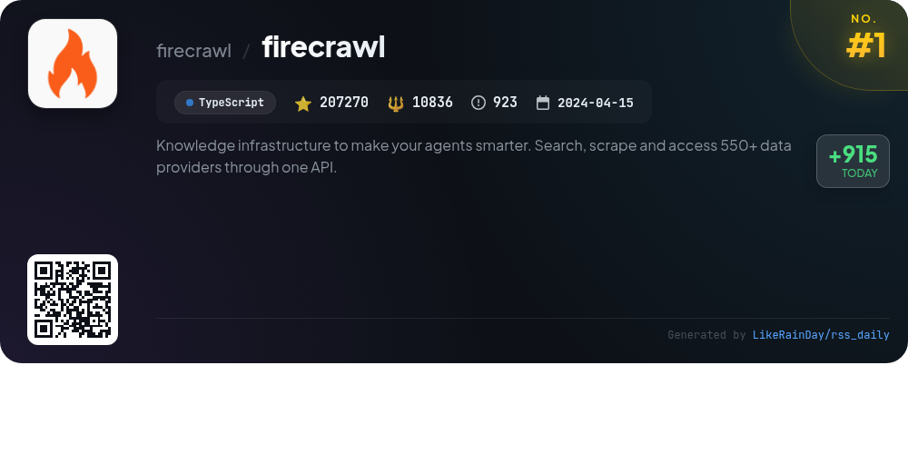
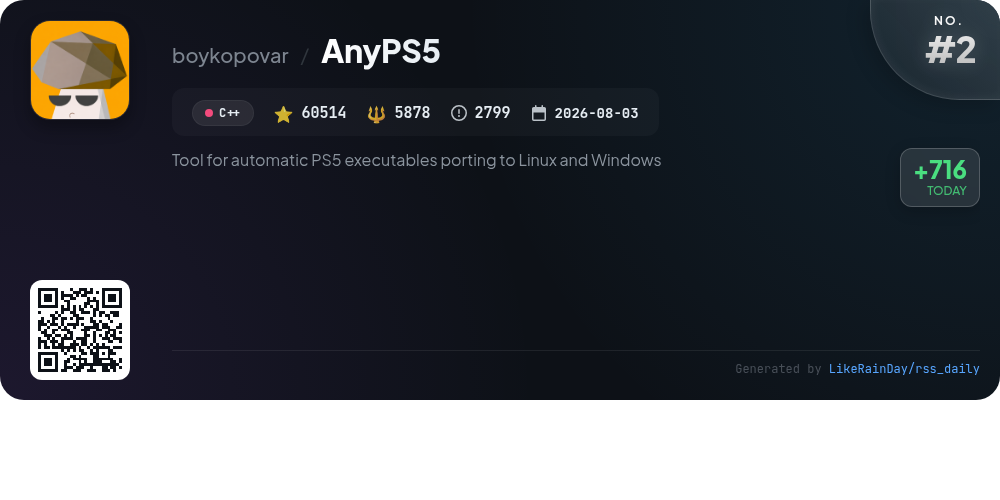
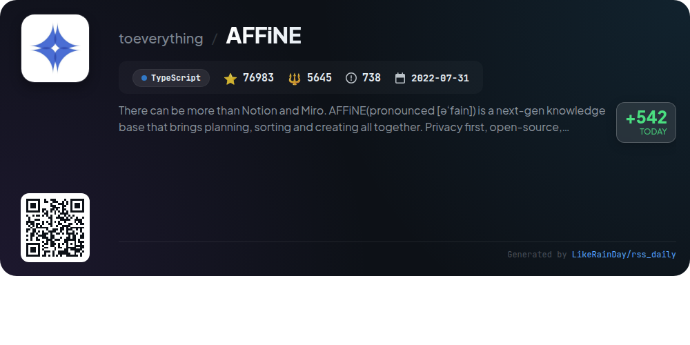
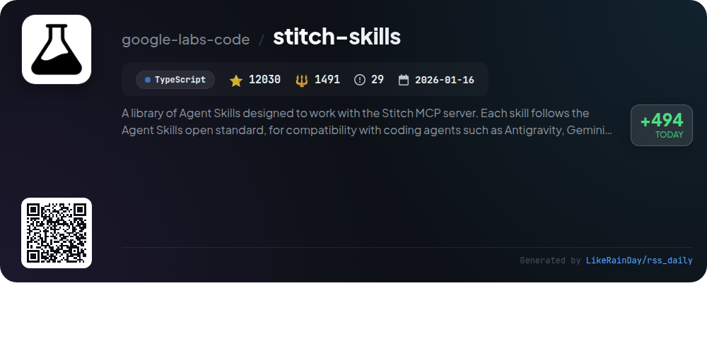
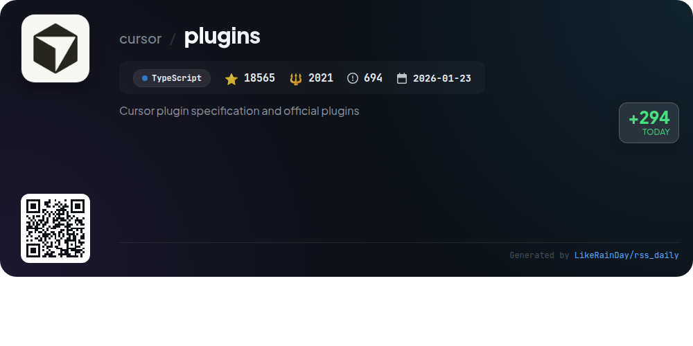
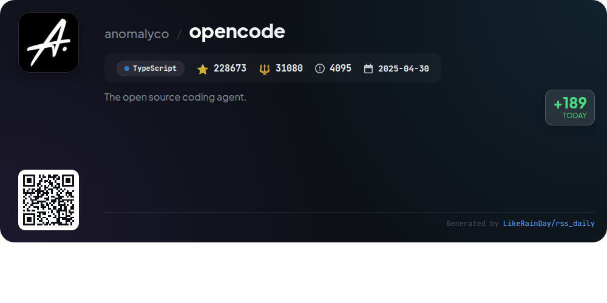
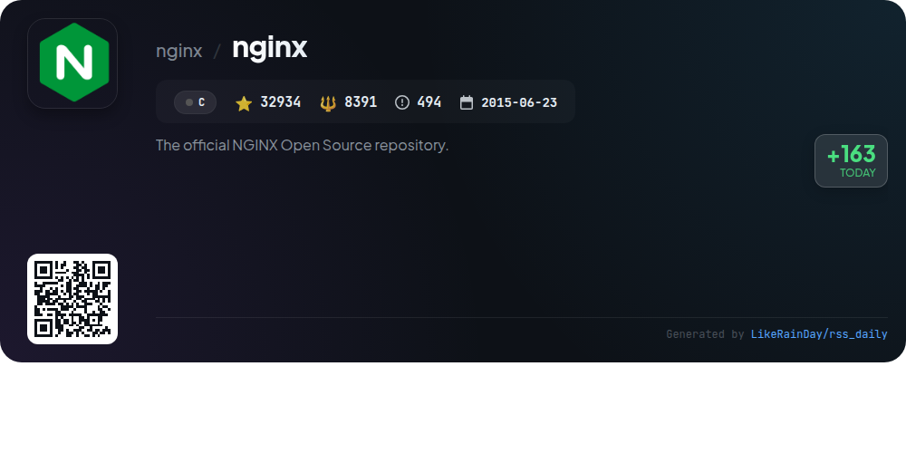
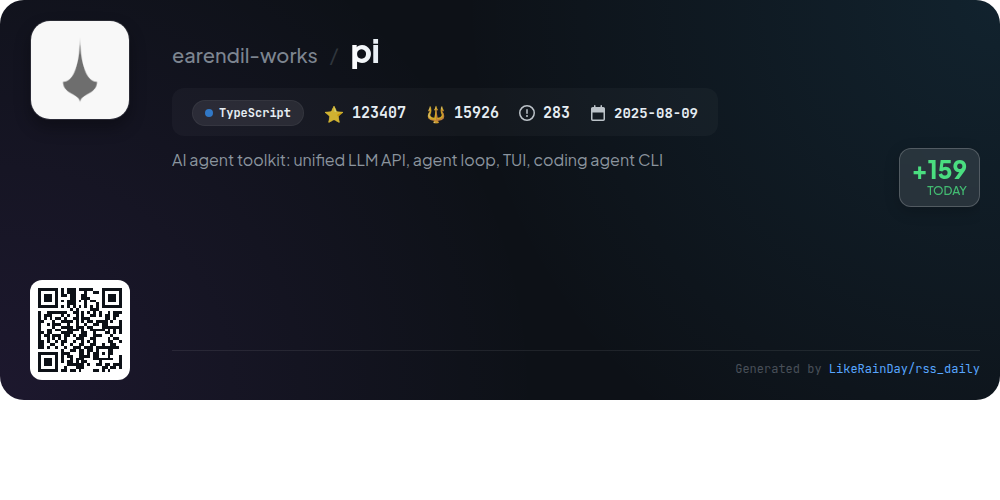

# 📊 🌟 GitHub Trending Daily - 2026-11-23

> > 📅 每日精选 GitHub 热门仓库 | 基于智能算法推荐

## 📋 Overview

**10** 个项目 | **1266592** ⭐ | **137877** 🍴

**热门语言:** `TypeScript` (6) · `JavaScript` (2) · `C` (1)

**更新时间:** 2026-11-23 07:01 UTC

**分类分布:**

- 🌟 每日 Top 10 精选 (10 项)

---

## 🌟 每日 Top 10 精选

### 1. [firecrawl](https://github.com/firecrawl/firecrawl)

> 🤖 **推荐理由**  
> *Firecrawl is a powerful knowledge infrastructure designed to enhance AI agents by enabling seamless web interaction. With over 550 data providers accessible via a single API, it offers three primary services: Firecrawl Local for local scraping and mapping, Firecrawl Cloud for scalable solutions without setup, and self-hosting options for complete control. Key features include web search, data scraping into clean formats, page interaction, and autonomous data gathering through the Agent. Firecrawl also provides integrations with various AI tools, ensuring a versatile platform for developers.*

- ⭐ 207270 stars
- 💻 TypeScript
- 📅 Updated: 2026-11-23

### 2. [AnyPS5](https://github.com/boykopovar/AnyPS5)

> 🤖 **推荐理由**  
> *AnyPS5 is a powerful tool designed for the automatic porting of PS5 executables to Linux and Windows, boasting over 60,500 stars on GitHub. It features a relinker that converts executables to native formats without emulation and includes implementations of system prx libraries for dynamic linking. The project supports SDL-mapped game controllers and customizable input mapping. A web converter allows local file processing, and progress tracking for compatibility is available. AnyPS5 emphasizes interoperability and research while adhering to legal standards, and it is licensed under the GNU GPL v2.*

- ⭐ 60514 stars
- 💻 C++
- 📅 Updated: 2026-11-23

### 3. [ECC](https://github.com/affaan-m/ECC)

> 🤖 **推荐理由**  
> *ECC is an advanced performance optimization system designed for coding agents like Claude Code and Codex. With 72 specialized agents and 328 skills, it facilitates workflows such as Test-Driven Development (TDD), code review, and security auditing. Key features include memory persistence, continuous learning, and AgentShield for security scanning. ECC supports multi-model environments, providing seamless integration across various platforms. It offers a guided setup process, ensuring efficient installation and operation. Its open-source nature fosters community contributions and ongoing enhancements.*

- ⭐ 309162 stars
- 💻 JavaScript
- 📅 Updated: 2026-11-23

### 4. [ponytail](https://github.com/DietrichGebert/ponytail)

> 🤖 **推荐理由**  
> *Ponytail is a JavaScript project designed to optimize AI agents for code efficiency, emulating a seasoned developer's approach by minimizing unnecessary code. With 197,054 stars, it excels in reducing code length, time, and costs while maintaining high-quality outputs, evidenced by 98% of risky logic shipping with tests. Key features include `/ponytail-review` for intelligent diff analysis, `/ponytail-audit` for comprehensive repo checks, and a user-friendly band interface for tracking performance metrics. The project emphasizes security and efficiency, ensuring that the code produced is both effective and maintainable.*

- ⭐ 197054 stars
- 💻 JavaScript
- 📅 Updated: 2026-11-23

### 5. [AFFiNE](https://github.com/toeverything/AFFiNE)

> 🤖 **推荐理由**  
> *AFFiNE is an open-source, privacy-focused knowledge base that combines planning, documentation, and creativity in one platform. With over 76,000 stars on GitHub, it offers a unique edgeless canvas for various building blocks like rich text, sticky notes, and databases. Key features include real-time collaboration, local-first data ownership, and a multimodal AI partner for enhanced productivity. AFFiNE supports self-hosting and customization, making it an ideal alternative to Notion and Miro for creative minds. Visit [AFFiNE.Pro](https://affine.pro) for more information.*

- ⭐ 76983 stars
- 💻 TypeScript
- 📅 Updated: 2026-11-23

### 6. [stitch-skills](https://github.com/google-labs-code/stitch-skills)

> 🤖 **推荐理由**  
> *Stitch Skills is a comprehensive library of Agent Skills for the Stitch MCP server, adhering to the Agent Skills open standard. With over 12,000 stars, it supports various coding agents, including Codex and Claude Code. Key features include plugins for design (`stitch-design`), build processes (`stitch-build`), and utilities (`stitch-utilities`). Users can easily install plugins, manage design systems, convert designs to code, and generate comprehensive documents like DESIGN.md. The project empowers developers to streamline design workflows and enhance productivity in coding environments.*

- ⭐ 12030 stars
- 💻 TypeScript
- 📅 Updated: 2026-11-23

### 7. [plugins](https://github.com/cursor/plugins)

> 🤖 **推荐理由**  
> *The "plugins" project hosts official Cursor plugins tailored for various developer tools, frameworks, and SaaS products, boasting over 18,500 stars on GitHub. Each plugin features its own manifest and includes capabilities for incremental learning, team workflows, and productivity enhancements. Key plugins span categories such as teaching, code review, document management, and integrations with major platforms like Google, Salesforce, and Zoom. The repository's structure supports easy plugin management and development, making it a comprehensive resource for enhancing productivity in software development and business processes.*

- ⭐ 18565 stars
- 💻 TypeScript
- 📅 Updated: 2026-11-23

### 8. [opencode](https://github.com/anomalyco/opencode)

> 🤖 **推荐理由**  
> *OpenCode is an open-source AI coding agent designed to enhance developer productivity. Built with TypeScript, it features two main agents: a full-access "build" agent for development and a "plan" agent for analysis and exploration, ensuring safe code interactions. The platform offers a user-friendly CLI and a desktop application available for multiple operating systems. With extensive documentation and a supportive community on Discord, OpenCode enables users to efficiently navigate and manipulate codebases. Join over 228,000 stars on GitHub and contribute to the project.*

- ⭐ 228673 stars
- 💻 TypeScript
- 📅 Updated: 2026-11-23

### 9. [nginx](https://github.com/nginx/nginx)

> 🤖 **推荐理由**  
> *NGINX is the world's leading open-source web server and high-performance load balancer, reverse proxy, API gateway, and content cache, known for its efficiency and scalability. Key features include flexible configuration via text-based directives, support for dynamic and static modules, and robust capabilities for load balancing, rate limiting, and content caching. NGINX is actively developed, with comprehensive documentation available for installation and configuration. Enterprise support is provided by F5, Inc. The project boasts over 32,000 stars on GitHub, reflecting its popularity and community engagement.*

- ⭐ 32934 stars
- 💻 C
- 📅 Updated: 2026-11-23

### 10. [pi](https://github.com/earendil-works/pi)

> 🤖 **推荐理由**  
> *Pi is an extensible AI agent toolkit designed for customizable workflows. It features a unified LLM API supporting multiple providers, an interactive coding agent CLI, and a terminal UI for streamlined user experience. Key highlights include the ability to adapt through extensions, skills, and prompt templates, as well as automation in print or JSON mode. Pi supports various installation methods, including npm and Nix, and offers a monorepo with multiple packages for enhanced functionality. Ideal for developers looking to integrate AI capabilities into their projects.*

- ⭐ 123407 stars
- 💻 TypeScript
- 📅 Updated: 2026-11-23

---

## 📡 RSS订阅

通过 RSS 订阅，第一时间获取每日精选项目：

- 🔔 [RSS 订阅源] (../../daily-top.xml)
- 🔔 [每日简报] (../../GITHUB_TODAY_CN.md)
- 🔔 [每日 Top 10 精选](../../daily-top.xml)

---

*⚡ Powered by Smart Trending Algorithm | Generated at 2026-11-23 07:01:26 UTC
