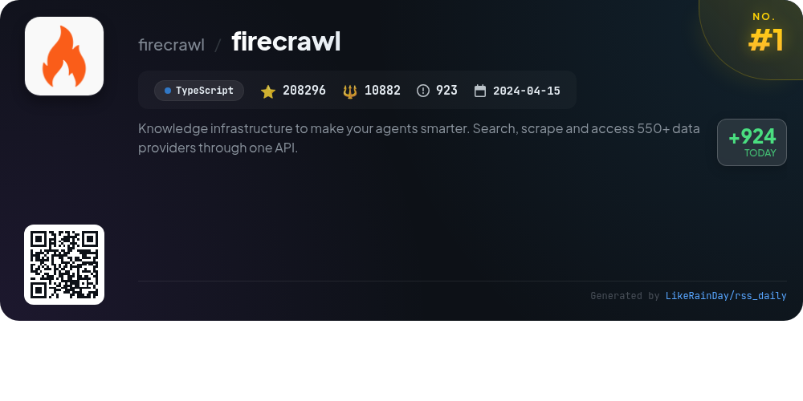
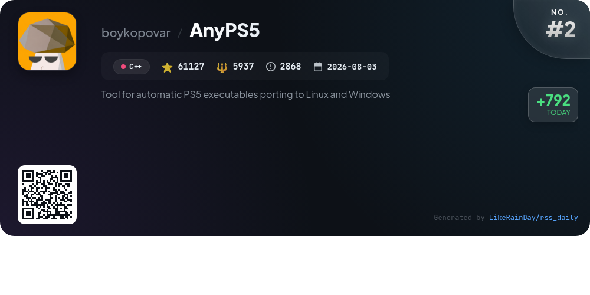
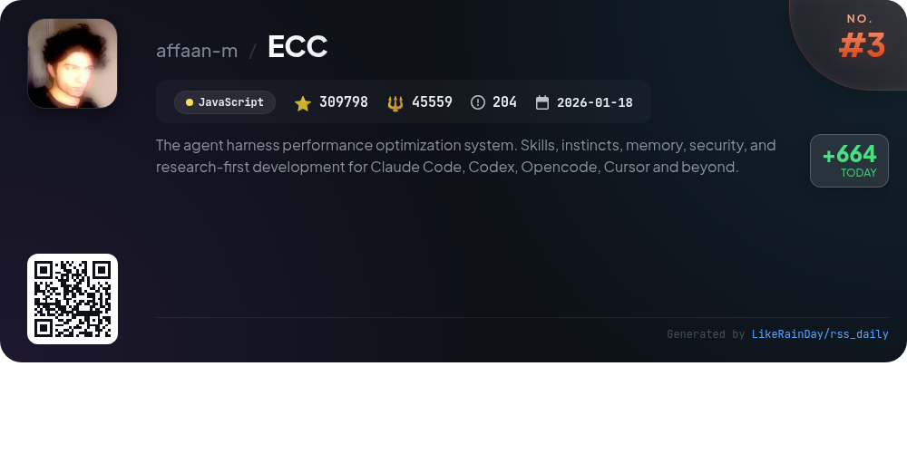
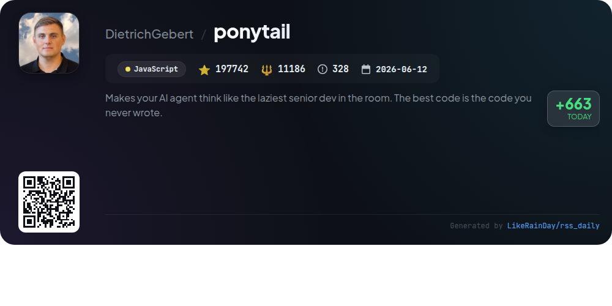
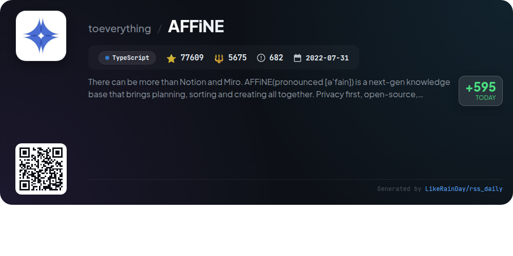
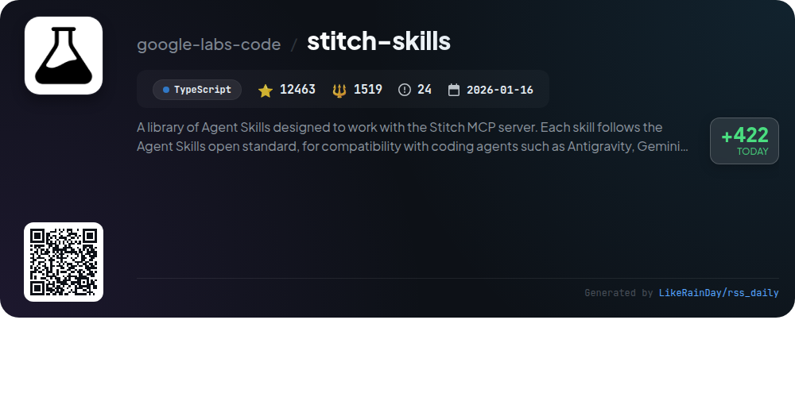
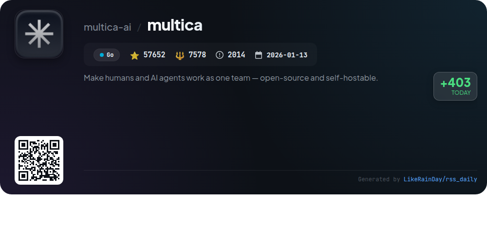
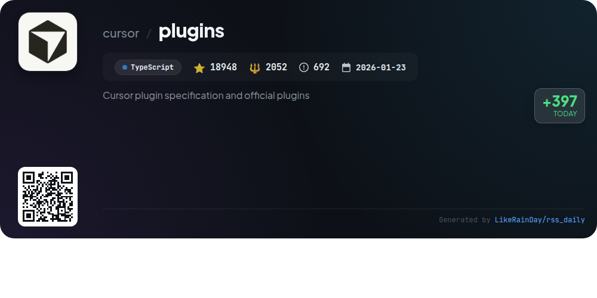
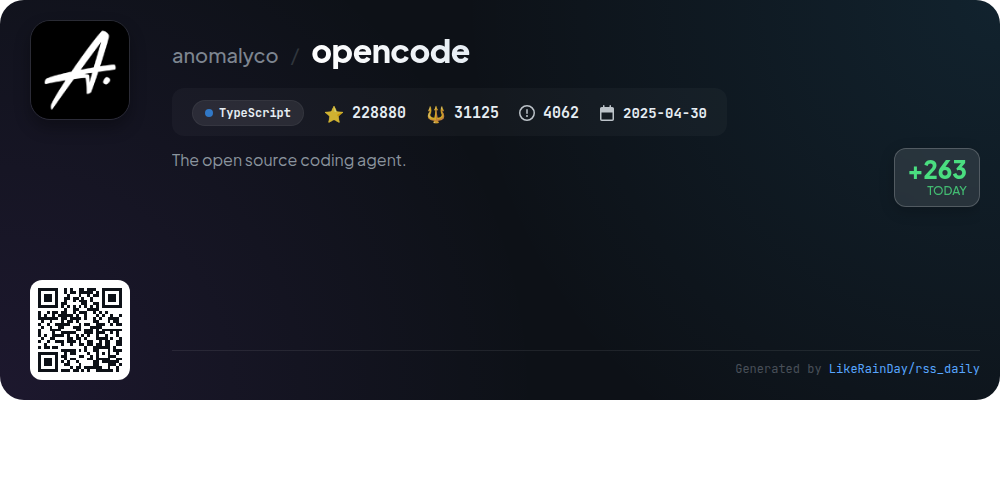
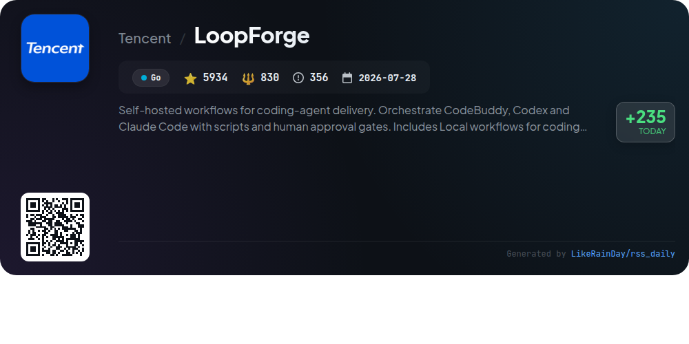

# 📊 🌟 GitHub Trending Daily - 2026-11-24

> > 📅 每日精选 GitHub 热门仓库 | 基于智能算法推荐

## 📋 Overview

**10** 个项目 | **1178449** ⭐ | **122343** 🍴

**热门语言:** `TypeScript` (5) · `Go` (2) · `JavaScript` (2)

**更新时间:** 2026-11-24 09:27 UTC

**分类分布:**

- 🌟 每日 Top 10 精选 (10 项)

---

## 🌟 每日 Top 10 精选

### 1. [firecrawl](https://github.com/firecrawl/firecrawl)

> 🤖 **推荐理由**  
> *Firecrawl is a powerful knowledge infrastructure that enhances AI agents by providing access to 550+ data providers through a single API. Key features include Firecrawl Local for local scraping, Firecrawl Cloud for scalable web access, and self-hosting options. It supports data scraping in various formats, web searching, and autonomous data gathering via its Agent feature. With tools for crawling websites, batch scraping, and interactive capabilities, Firecrawl is designed for real-time AI applications, making it a versatile solution for data extraction and integration.*

- ⭐ 208296 stars
- 💻 TypeScript
- 📅 Updated: 2026-11-24

### 2. [AnyPS5](https://github.com/boykopovar/AnyPS5)

> 🤖 **推荐理由**  
> *AnyPS5 is a powerful tool for automatically porting PS5 executables to Linux and Windows. It features a relinker that converts executables to native formats without emulation, alongside implementations of system PRX libraries for dynamic linking. The project includes a web converter, supports SDL-mapped controllers, and offers extensive input mapping configurations. With over 61,000 stars on GitHub, AnyPS5 emphasizes interoperability, research, and preservation, while ensuring compliance with legal standards. It is independently developed and not affiliated with Sony.*

- ⭐ 61127 stars
- 💻 C++
- 📅 Updated: 2026-11-24

### 3. [ECC](https://github.com/affaan-m/ECC)

> 🤖 **推荐理由**  
> *ECC is a powerful agent harness performance optimization system designed to enhance coding workflows. With 72 specialized agents and 328 reusable skills, ECC enables efficient planning, testing, and code review. Key features include automated security scanning via AgentShield, continuous learning, and seamless integration with tools like Claude Code, Codex, and GitHub Copilot. Its structured approach allows agents to plan, implement, and verify code while maintaining security and memory management. ECC is open-source, optimized for various environments, and supports multiple programming languages.*

- ⭐ 309798 stars
- 💻 JavaScript
- 📅 Updated: 2026-11-24

### 4. [ponytail](https://github.com/DietrichGebert/ponytail)

> 🤖 **推荐理由**  
> *Ponytail is a JavaScript project that empowers AI agents to write efficient code with minimal effort, emulating the expertise of a seasoned developer. Key features include reduced code length, improved execution speed, and enhanced cost efficiency, achieving a 53% reduction in code, 41% faster execution, and 26% lower costs compared to previous versions. The project offers commands for code review and auditing, ensuring security and optimization while maintaining rigorous testing standards. With robust integration options, Ponytail streamlines development without compromising quality.*

- ⭐ 197742 stars
- 💻 JavaScript
- 📅 Updated: 2026-11-24

### 5. [AFFiNE](https://github.com/toeverything/AFFiNE)

> 🤖 **推荐理由**  
> *AFFiNE is an open-source, privacy-focused knowledge base and collaboration platform, designed as a versatile alternative to Notion and Miro. Key features include a seamless canvas for various content types (docs, drawings, databases), real-time collaboration, and a multimodal AI partner for enhanced productivity. Users can self-host and customize their experience, with community-driven plugins and templates available. With a strong emphasis on data ownership and local-first functionality, AFFiNE empowers creative minds to organize and plan efficiently.*

- ⭐ 77609 stars
- 💻 TypeScript
- 📅 Updated: 2026-11-24

### 6. [stitch-skills](https://github.com/google-labs-code/stitch-skills)

> 🤖 **推荐理由**  
> *Stitch Skills is a TypeScript library offering a suite of agent skills and plugins for the Stitch MCP server, adhering to the Agent Skills open standard. With 12,463 stars, it supports coding agents like Codex, Antigravity, and Claude Code. Key features include the ability to convert code to designs, generate and manage design systems, and facilitate build processes for React and React Native. The repository provides plugins for design, build, and utilities, enabling seamless integration and enhanced project workflows.*

- ⭐ 12463 stars
- 💻 TypeScript
- 📅 Updated: 2026-11-24

### 7. [multica](https://github.com/multica-ai/multica)

> 🤖 **推荐理由**  
> *Multica is an open-source, self-hostable workspace designed to seamlessly integrate human and AI coding agents. With 57,652 stars on GitHub, it allows users to assign tasks to multiple agents—like Claude Code and Codex—who autonomously manage issues, report progress, and request reviews. Key features include shared agent pools, execution logs, scheduled tasks, and customizable roles. Multica supports various agent CLIs and can run on personal infrastructure, ensuring data control and flexibility. Efficiently streamline collaborative workflows with Multica's unified platform.*

- ⭐ 57652 stars
- 💻 Go
- 📅 Updated: 2026-11-24

### 8. [plugins](https://github.com/cursor/plugins)

> 🤖 **推荐理由**  
> *The "plugins" GitHub project offers a collection of official Cursor plugins tailored for popular developer tools, frameworks, and SaaS products. Each plugin features its own directory with a manifest for easy integration. Key plugins include utilities for teaching, continual learning, CI workflows, and productivity tools for Gmail, Google Drive, and more. Comprehensive integrations cover platforms like Salesforce, Zoom, and Shopify, enabling seamless management of tasks, communications, and data. With 18,948 stars, this TypeScript-based repository provides developers with essential tools for enhanced productivity and automation.*

- ⭐ 18948 stars
- 💻 TypeScript
- 📅 Updated: 2026-11-24

### 9. [opencode](https://github.com/anomalyco/opencode)

> 🤖 **推荐理由**  
> *OpenCode is an open-source AI coding agent built in TypeScript, boasting over 228,000 stars on GitHub. Key features include two built-in agents: "build" for full development access and "plan" for read-only code exploration. It offers a CLI for easy installation across various platforms, including a desktop application in beta for macOS, Windows, and Linux. Users can access comprehensive documentation and contribute to the project via GitHub. Join the community on Discord for support and collaboration. Explore more at opencode.ai.*

- ⭐ 228880 stars
- 💻 TypeScript
- 📅 Updated: 2026-11-24

### 10. [LoopForge](https://github.com/Tencent/LoopForge)

> 🤖 **推荐理由**  
> *LoopForge is a self-hosted platform designed for orchestrating software delivery with coding agents like CodeBuddy, Codex, and Claude Code. Key features include a chat workbench for real-time interactions, a visual SOP designer for repeatable workflows, and Docker sandbox environments for secure execution. The platform facilitates human approval gates, allowing teams to maintain control and oversight throughout the development process. With built-in metrics and support for multiple coding agents, LoopForge streamlines collaboration and enhances software delivery efficiency.*

- ⭐ 5934 stars
- 💻 Go
- 📅 Updated: 2026-11-24

---

## 📡 RSS订阅

通过 RSS 订阅，第一时间获取每日精选项目：

- 🔔 [RSS 订阅源] (../../daily-top.xml)
- 🔔 [每日简报] (../../GITHUB_TODAY_CN.md)
- 🔔 [每日 Top 10 精选](../../daily-top.xml)

---

*⚡ Powered by Smart Trending Algorithm | Generated at 2026-11-24 09:27:58 UTC
