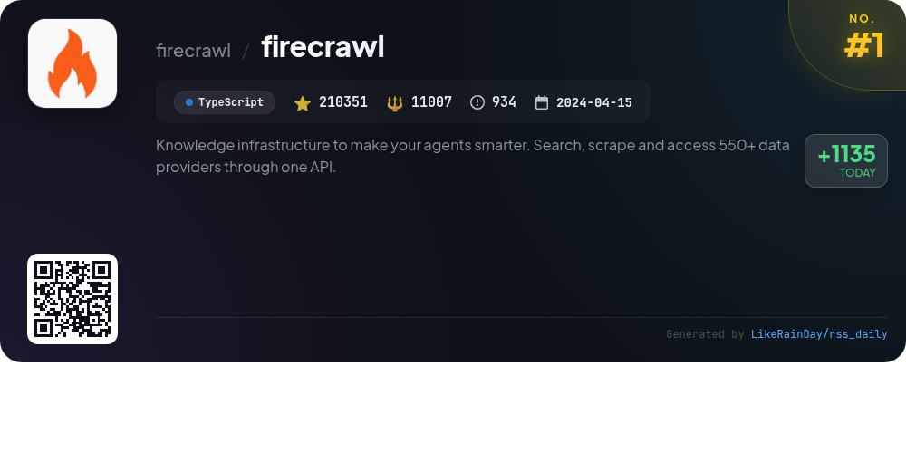
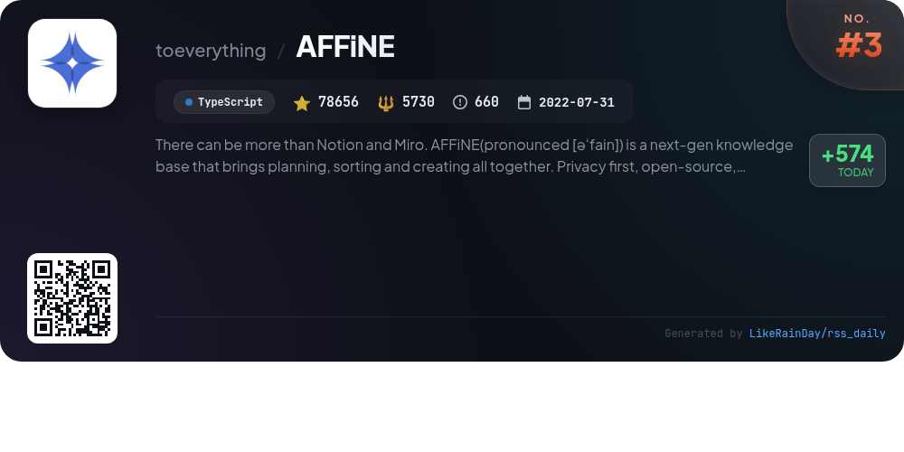
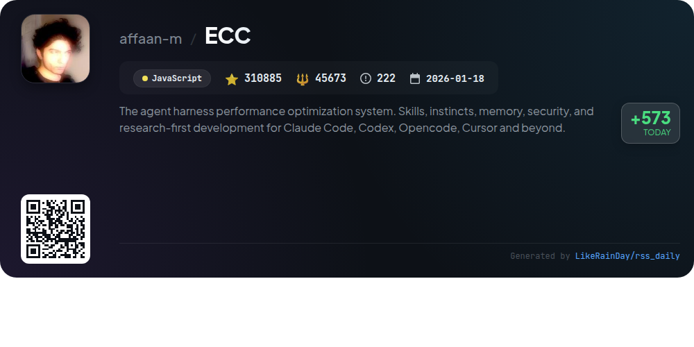
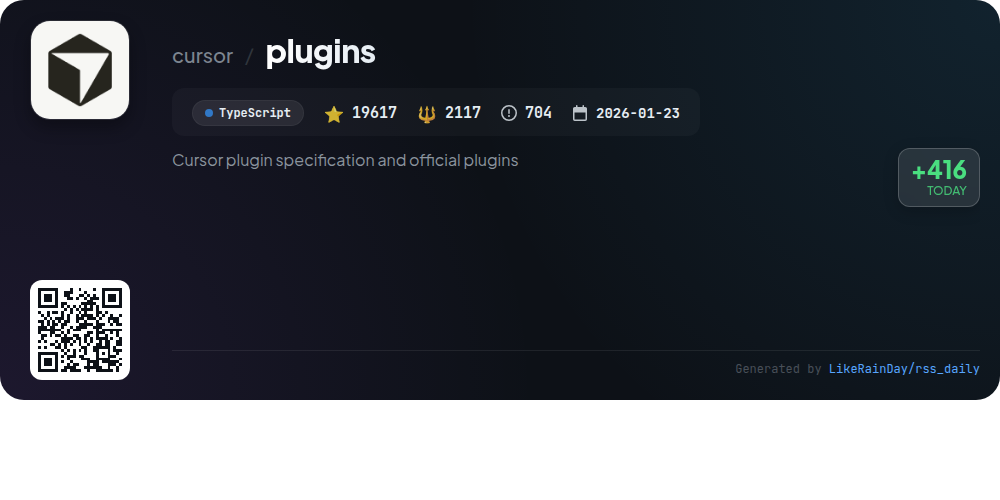
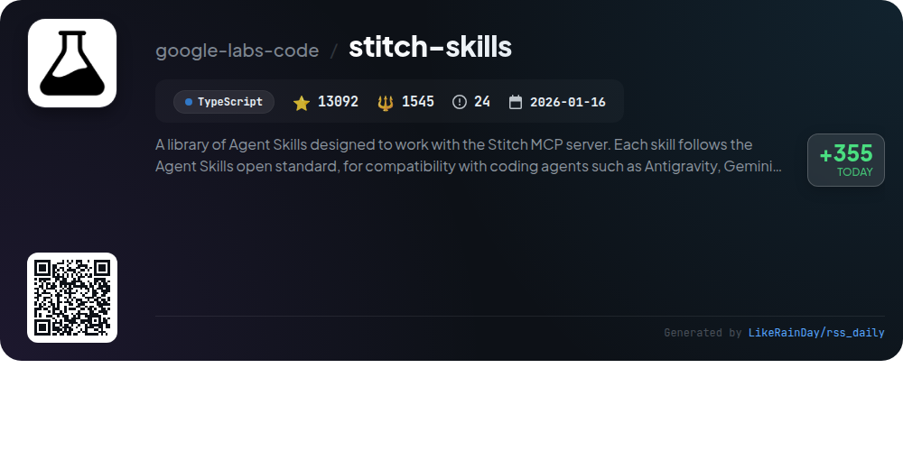
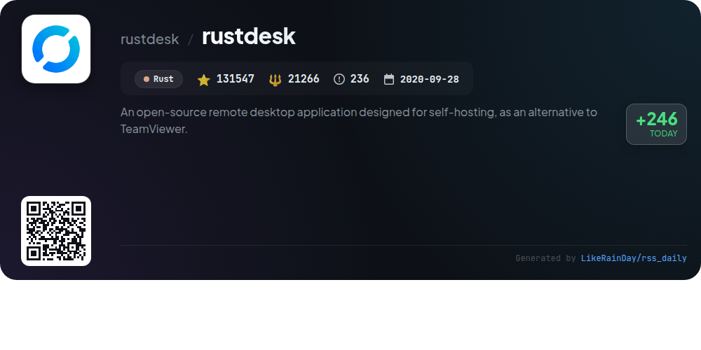
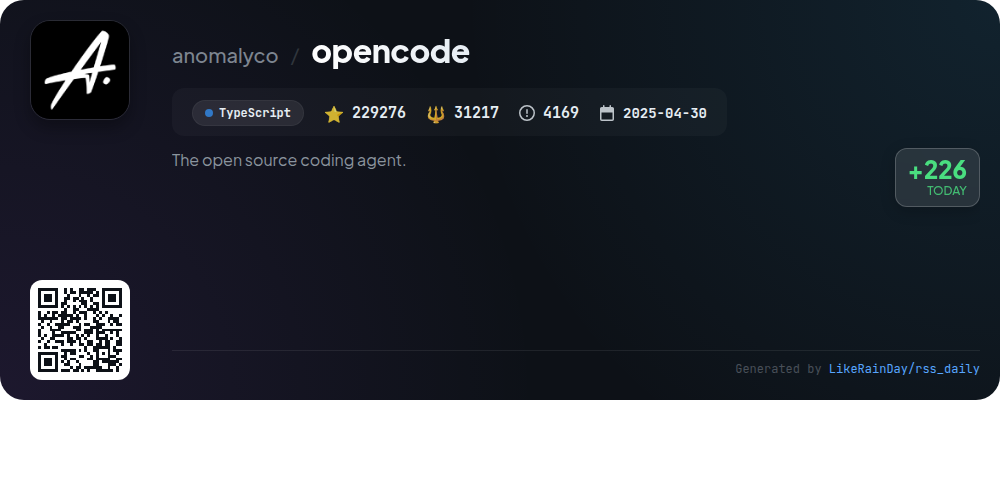
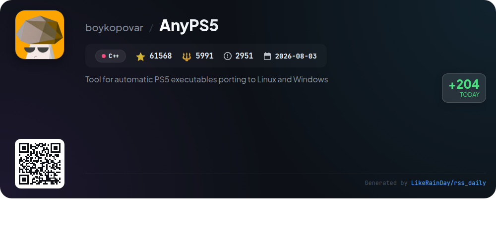
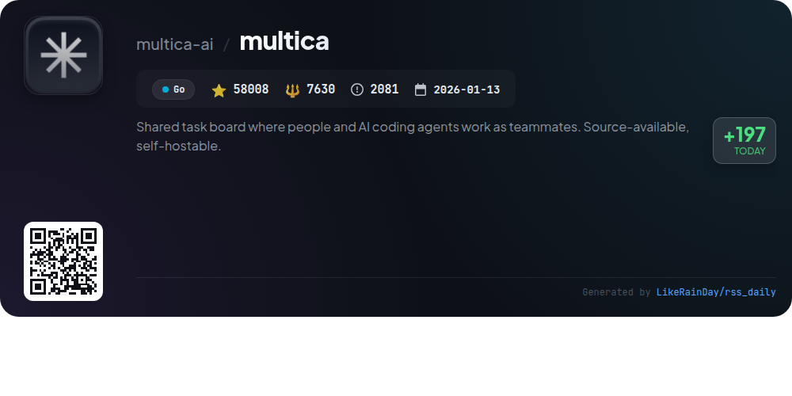

# 📊 🌟 GitHub Trending Daily - 2026-11-26

> > 📅 每日精选 GitHub 热门仓库 | 基于智能算法推荐

## 📋 Overview

**10** 个项目 | **1311917** ⭐ | **143462** 🍴

**热门语言:** `TypeScript` (5) · `JavaScript` (2) · `Go` (1)

**更新时间:** 2026-11-26 07:51 UTC

**分类分布:**

- 🌟 每日 Top 10 精选 (10 项)

---

## 🌟 每日 Top 10 精选

### 1. [firecrawl](https://github.com/firecrawl/firecrawl)

> 🤖 **推荐理由**  
> *Firecrawl is a robust knowledge infrastructure designed to enhance AI agents by enabling seamless access to over 550 data providers through a unified API. Key features include scraping and crawling websites for clean markdown, structured JSON, and screenshots. Users can deploy Firecrawl Locally on their machines or utilize Firecrawl Cloud for scalable solutions with advanced functionalities like search, interaction, and autonomous data gathering through an AI agent. With a focus on real-time performance and comprehensive web coverage, Firecrawl empowers intelligent data retrieval and interaction.*

- ⭐ 210351 stars
- 💻 TypeScript
- 📅 Updated: 2026-11-26

### 2. [ponytail](https://github.com/DietrichGebert/ponytail)

> 🤖 **推荐理由**  
> *Ponytail is a JavaScript project designed to optimize AI agent coding efficiency by emulating a "lazy senior developer." With over 198,000 stars, it emphasizes writing minimal, effective code, reducing lines by 53%, time by 41%, and costs by 26%. Key features include `/ponytail-review` for code audits, `/ponytail-audit` for repository-wide checks, and a new "band" feature that tracks task costs and resources. Ponytail prioritizes security, validation, and error handling while ensuring high-quality output, making it a valuable tool for developers seeking efficiency and performance in coding.*

- ⭐ 198917 stars
- 💻 JavaScript
- 📅 Updated: 2026-11-26

### 3. [AFFiNE](https://github.com/toeverything/AFFiNE)

> 🤖 **推荐理由**  
> *AFFiNE is an open-source, privacy-focused knowledge base that seamlessly integrates planning, creating, and organizing on a single platform. With features like a versatile canvas for various content types, multimodal AI assistance for tasks, and local-first data ownership, AFFiNE stands out as a compelling alternative to Notion and Miro. Users can collaborate in real-time and self-host their version, while a growing library of pre-built templates enhances usability. Join the community to explore endless creative possibilities.*

- ⭐ 78656 stars
- 💻 TypeScript
- 📅 Updated: 2026-11-26

### 4. [ECC](https://github.com/affaan-m/ECC)

> 🤖 **推荐理由**  
> *ECC (Agent Harness Performance Optimization System) is a robust tool designed for optimizing AI coding agents like Claude Code and Codex. With 72 specialized agents, 328 reusable skills, and 99 command shims, ECC streamlines development workflows through structured planning, testing, implementation, and review processes. Key features include continuous learning, context memory management, and security auditing via AgentShield. It supports multiple coding environments and promotes efficient collaboration with GitHub integration, making it essential for modern software development.*

- ⭐ 310885 stars
- 💻 JavaScript
- 📅 Updated: 2026-11-26

### 5. [plugins](https://github.com/cursor/plugins)

> 🤖 **推荐理由**  
> *The "plugins" GitHub project offers a collection of official Cursor plugins for popular developer tools and SaaS products, featuring over 100 integrations ranging from productivity (e.g., Google Workspace, Zoom) to finance (e.g., QuickBooks, PayPal). Each plugin is organized into its own directory with a manifest file, allowing for easy management and customization. Key highlights include tools for code reviews, CI workflows, and AI-driven learning enhancements. This TypeScript-based project, with over 19,600 stars, supports developers in automating tasks and improving workflows.*

- ⭐ 19617 stars
- 💻 TypeScript
- 📅 Updated: 2026-11-26

### 6. [stitch-skills](https://github.com/google-labs-code/stitch-skills)

> 🤖 **推荐理由**  
> *The stitch-skills project is a TypeScript library of Agent Skills for the Stitch MCP server, adhering to the Agent Skills open standard. It offers a suite of plugins, including `stitch-design` for managing design workflows, `stitch-build` for code generation and framework integration, and `stitch-utilities` for enhancing prompts and enforcing design standards. Key features include converting code to design, generating React components, and creating comprehensive design documentation. With over 13,000 stars, it supports various coding agents like Codex and Claude Code, streamlining the development process.*

- ⭐ 13092 stars
- 💻 TypeScript
- 📅 Updated: 2026-11-26

### 7. [rustdesk](https://github.com/rustdesk/rustdesk)

> 🤖 **推荐理由**  
> *RustDesk is an open-source remote desktop application written in Rust, designed for self-hosting as an alternative to TeamViewer. With over 131,000 stars, it prioritizes user control over data and security. Key features include out-of-the-box functionality, customizable rendezvous/relay server options, and support for file transfer and audio/video services. The application is designed for ease of use and collaboration, with multi-language support and active community engagement. RustDesk offers Docker support for streamlined building and deployment, making it a versatile choice for remote access needs.*

- ⭐ 131547 stars
- 💻 Rust
- 📅 Updated: 2026-11-26

### 8. [opencode](https://github.com/anomalyco/opencode)

> 🤖 **推荐理由**  
> *OpenCode is an open-source AI coding agent built in TypeScript, boasting over 229,000 stars on GitHub. It features two primary agents: a full-access "build" agent for development and a "plan" agent for code exploration, enhancing user versatility. The platform offers a desktop application for multiple operating systems and supports installation via various package managers. OpenCode also provides extensive documentation and a dedicated community on Discord, encouraging contributions and collaboration. Explore more at opencode.ai.*

- ⭐ 229276 stars
- 💻 TypeScript
- 📅 Updated: 2026-11-26

### 9. [AnyPS5](https://github.com/boykopovar/AnyPS5)

> 🤖 **推荐理由**  
> *AnyPS5 is a powerful tool for automatically porting PS5 executables to Linux and Windows, boasting over 61,568 stars on GitHub. It features a relinker that converts executables to the native format without the need for emulation. The project includes system PRX libraries for dynamic linking and supports SDL-mapped game controllers, along with customizable keyboard and mouse controls. A web converter allows local file processing, and compatibility reports for individual games are available. AnyPS5 is dedicated to interoperability, research, and preservation, and is licensed under the GPLv2.*

- ⭐ 61568 stars
- 💻 C++
- 📅 Updated: 2026-11-26

### 10. [multica](https://github.com/multica-ai/multica)

> 🤖 **推荐理由**  
> *Multica is a self-hostable task board where teams collaborate with AI coding agents, enhancing productivity by allowing agents to autonomously manage tasks, report progress, and escalate issues. Key features include support for multiple AI agents (e.g., Claude Code, Codex), a unified workspace for diverse agent CLIs, and robust logging for task execution. It enables shared agent pools, project management, and integration with various Git hosts and chat tools. With a focus on control and security, Multica empowers teams to leverage AI in their workflows effectively.*

- ⭐ 58008 stars
- 💻 Go
- 📅 Updated: 2026-11-26

---

## 📡 RSS订阅

通过 RSS 订阅，第一时间获取每日精选项目：

- 🔔 [RSS 订阅源] (../../daily-top.xml)
- 🔔 [每日简报] (../../GITHUB_TODAY_CN.md)
- 🔔 [每日 Top 10 精选](../../daily-top.xml)

---

*⚡ Powered by Smart Trending Algorithm | Generated at 2026-11-26 07:51:44 UTC
