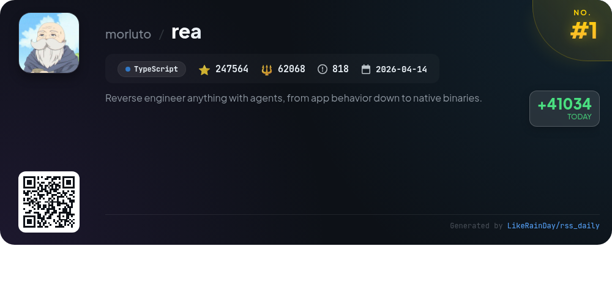
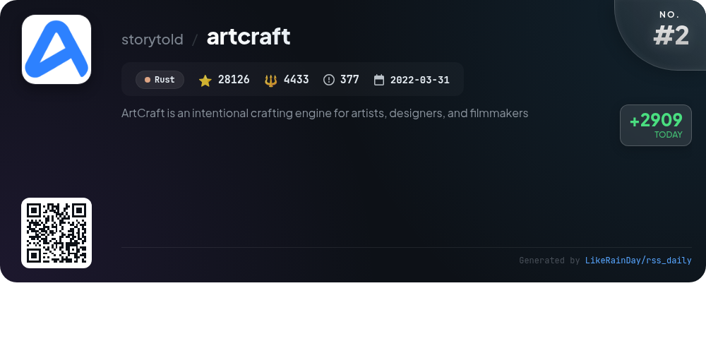
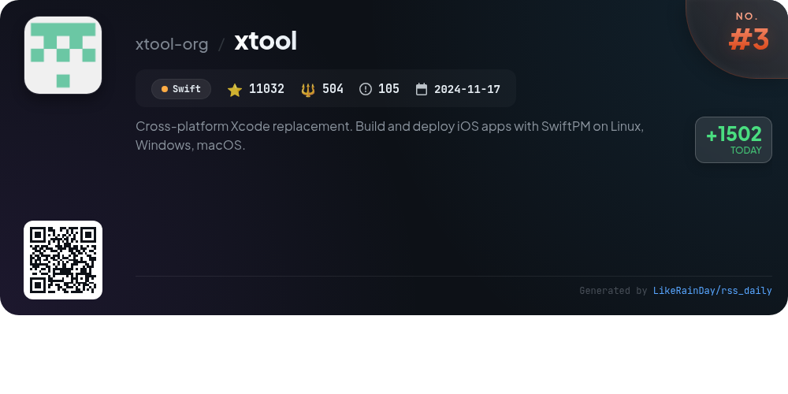
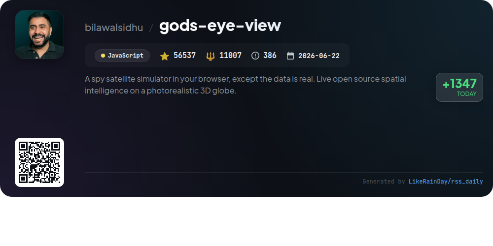
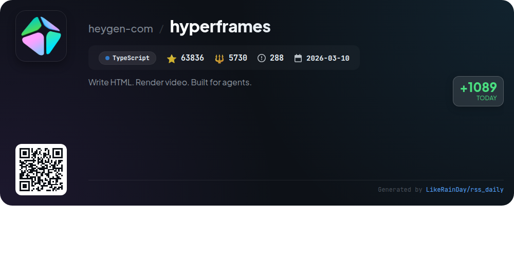
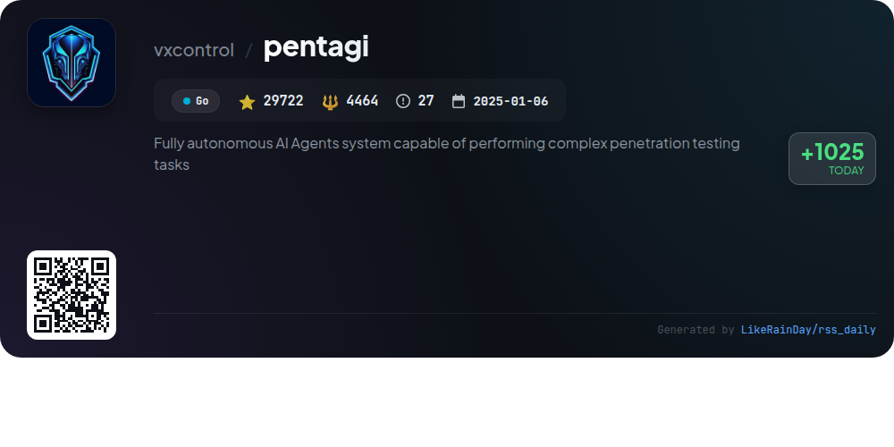
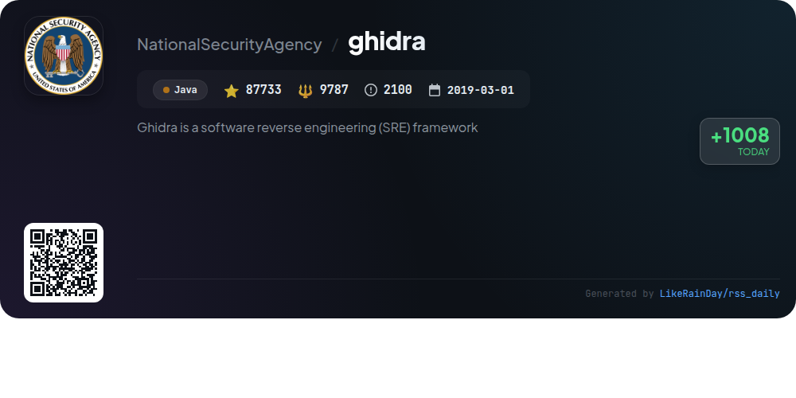
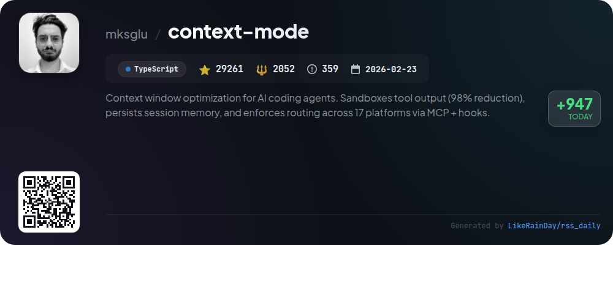
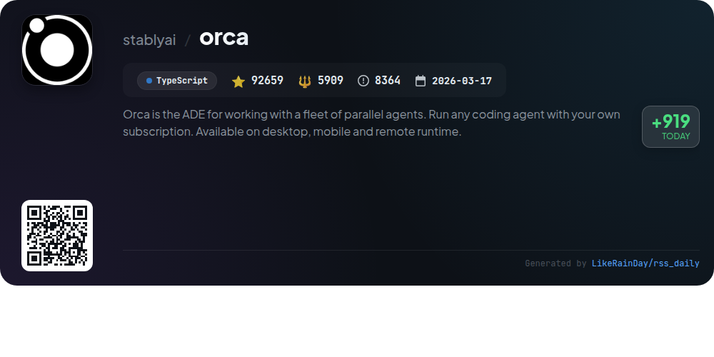
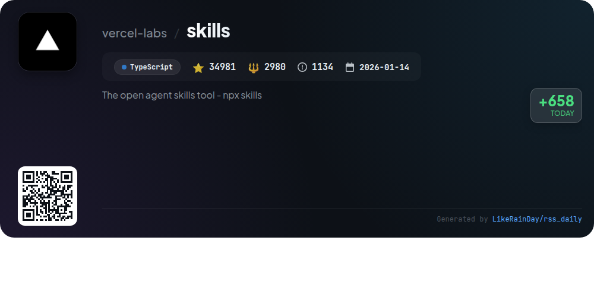

# 📊 🌟 GitHub Trending Daily - 2026-10-15

> > 📅 Daily Picks of GitHub Trending Repositories | Powered by Smart Algorithms

## 📋 Overview

**10** Projects | **681451** ⭐ | **108934** 🍴

**Top Languages:** `TypeScript` (5) · `Java` (1) · `Go` (1)

**Updated:** 2026-10-15 04:11 UTC

**Categories:**

- 🌟 Daily Top 10 (10 items)

---

## 🌟 Daily Top 10

### 1. [rea](https://github.com/morluto/rea)

> 🤖 **Why Recommend**  
> *REA is a powerful TypeScript-based reverse engineering tool designed to analyze and understand application behavior and native binaries. With over 247,000 stars on GitHub, it enables users to inspect JavaScript, Electron apps, .NET assemblies, and more without requiring source code. Key features include local analysis, integration with tools like Hopper and Ghidra, and a flexible agent setup. Users can request insights into app functionality and receive detailed findings, including pseudocode and evidence. REA supports a wide range of formats and environments, making it a versatile choice for software analysis and development.*

- ⭐ 247564 stars
- 💻 TypeScript
- 📅 Updated: 2026-10-15

### 2. [artcraft](https://github.com/storytold/artcraft)

> 🤖 **Why Recommend**  
> *ArtCraft is a powerful crafting engine designed for artists, designers, and filmmakers, enabling interactive AI image and video creation. Key features include 2D and 3D compositing, character posing, and scene blocking, allowing users to build compositions with depth and precision. The platform supports diverse models for image, video, and sound generation, including providers like Midjourney and Grok. With a user-friendly interface for crafting and refining ideas, ArtCraft streamlines the creative process, making it an essential tool for visual storytelling.*

- ⭐ 28126 stars
- 💻 Rust
- 📅 Updated: 2026-10-15

### 3. [xtool](https://github.com/xtool-org/xtool)

> 🤖 **Why Recommend**  
> *xtool is a cross-platform alternative to Xcode, enabling the building and deployment of iOS apps using SwiftPM on Linux, Windows, and macOS. With over 11,000 stars, it offers essential features such as building SwiftPM packages into iOS apps, signing and installing applications, and programmatic interaction with Apple Developer Services. The command-line interface allows for project setup, device management, and development tasks. Additionally, xtool provides a library, XKit, for seamless integration with Apple services and devices in custom applications.*

- ⭐ 11032 stars
- 💻 Swift
- 📅 Updated: 2026-10-15

### 4. [gods-eye-view](https://github.com/bilawalsidhu/gods-eye-view)

> 🤖 **Why Recommend**  
> *God's Eye View is an open-source spy satellite simulator that offers real-time spatial intelligence on a photorealistic 3D globe. Key features include live tracking of aircraft, ships, satellites, and earthquakes, along with hands-free voice control powered by AI. Users can explore real-world data, annotate maps, and visualize weather patterns without API keys. The project boasts over 56,000 stars on GitHub, reached #1 on GitHub Trending, and provides various layers for exploration, including traffic, public cameras, and space missions, making it a robust tool for geospatial intelligence.*

- ⭐ 56537 stars
- 💻 JavaScript
- 📅 Updated: 2026-10-15

### 5. [hyperframes](https://github.com/heygen-com/hyperframes)

> 🤖 **Why Recommend**  
> *HyperFrames is an open-source framework that transforms HTML, CSS, and media into deterministic MP4 videos, designed for use with coding agents. Key features include a user-friendly CLI, a router for video creation workflows, and 21 skills for various video types like product launches, explainer videos, and slideshows. It supports seamless integration with AI agents, ensuring automated rendering and editing. HyperFrames also offers a community-driven catalog for reusable components, making video production accessible and efficient. Its HTML-native approach eliminates the need for proprietary formats, enhancing collaboration and creativity.*

- ⭐ 63836 stars
- 💻 TypeScript
- 📅 Updated: 2026-10-15

### 6. [pentagi](https://github.com/vxcontrol/pentagi)

> 🤖 **Why Recommend**  
> *PentAGI is a fully autonomous AI agent system for advanced penetration testing, allowing users to define targets and goals in plain language. Key features include a suite of over 20 professional tools, a smart memory system for storing results, and integration with multiple LLM providers like OpenAI and Anthropic. It operates in a secure Docker environment, offering REST and GraphQL APIs for automation. Additional capabilities include knowledge graph integration, comprehensive monitoring, and detailed reporting, making it an essential tool for security engineers and ethical hackers.*

- ⭐ 29722 stars
- 💻 Go
- 📅 Updated: 2026-10-15

### 7. [ghidra](https://github.com/NationalSecurityAgency/ghidra)

> 🤖 **Why Recommend**  
> *Ghidra is a powerful open-source software reverse engineering (SRE) framework developed by the NSA, designed for analyzing compiled code across various platforms, including Windows, macOS, and Linux. Key features include disassembly, decompilation, graphing, and scripting capabilities, supporting numerous processor instruction sets and executable formats. Ghidra operates in both interactive and automated modes, allowing users to create custom scripts and extensions in Java or Python. Its robust tools enable in-depth analysis of malicious code, aiding cybersecurity efforts.*

- ⭐ 87733 stars
- 💻 Java
- 📅 Updated: 2026-10-15

### 8. [context-mode](https://github.com/mksglu/context-mode)

> 🤖 **Why Recommend**  
> *Context Mode is a TypeScript-based tool designed to optimize context windows for AI coding agents. It achieves a 98% reduction in data size by sandboxing outputs, ensuring session continuity through SQLite memory persistence, and enforcing routing across 17 platforms via its MCP server. Key features include context-saving, session tracking, and effective command execution across multiple programming languages. The tool also enhances user experience by minimizing unnecessary context usage and allowing intelligent search capabilities, making it invaluable for efficient AI-assisted coding.*

- ⭐ 29261 stars
- 💻 TypeScript
- 📅 Updated: 2026-10-15

### 9. [orca](https://github.com/stablyai/orca)

> 🤖 **Why Recommend**  
> *Orca is an advanced development environment (ADE) designed for managing a fleet of parallel coding agents, available on desktop and mobile. Key features include parallel worktrees for comparing results across agents, a mobile companion app for remote monitoring, and rich terminal splits for enhanced productivity. Users can integrate with GitHub and Linear for seamless task management, utilize design mode for direct UI interactions, and script workflows via the Orca CLI. With support for various agents like Codex and ClaudeCode, Orca streamlines coding processes and boosts efficiency.*

- ⭐ 92659 stars
- 💻 TypeScript
- 📅 Updated: 2026-10-15

### 10. [skills](https://github.com/vercel-labs/skills)

> 🤖 **Why Recommend**  
> *The "skills" CLI tool facilitates the integration of reusable instruction sets, known as agent skills, into various coding agents like OpenCode, Claude Code, and Codex. With over 34,000 stars, it enables users to add skills from GitHub or other repositories easily, either globally or per project. Key features include skill installation, interactive usage, and comprehensive support for private repositories. The tool also allows for skill discovery, listing, and management, streamlining workflows for developers by enhancing coding agents' capabilities.*

- ⭐ 34981 stars
- 💻 TypeScript
- 📅 Updated: 2026-10-15

---

## 📡 RSS Subscription

Subscribe via RSS to get daily trending updates:

- 🔔 [RSS XML] (../../daily-top.xml)
- 🔔 [Daily Report] (../../GITHUB_TODAY.md)
- 🔔 [Daily Top 10](../../daily-top.xml)

---

*⚡ Powered by Smart Trending Algorithm | Generated at 2026-10-15 04:11:11 UTC
