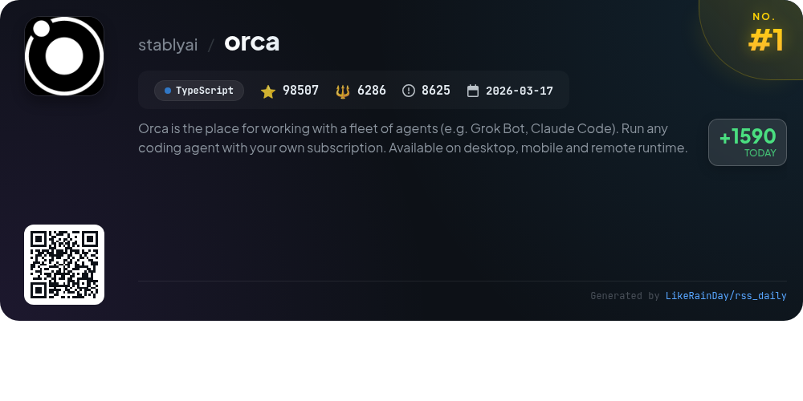
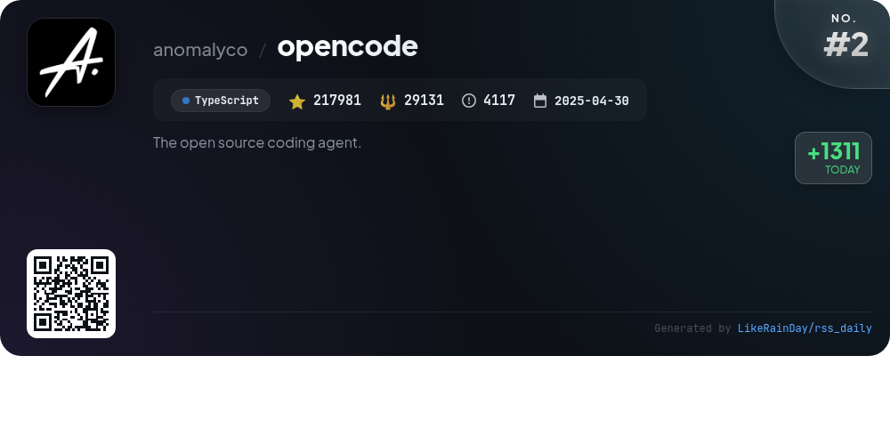
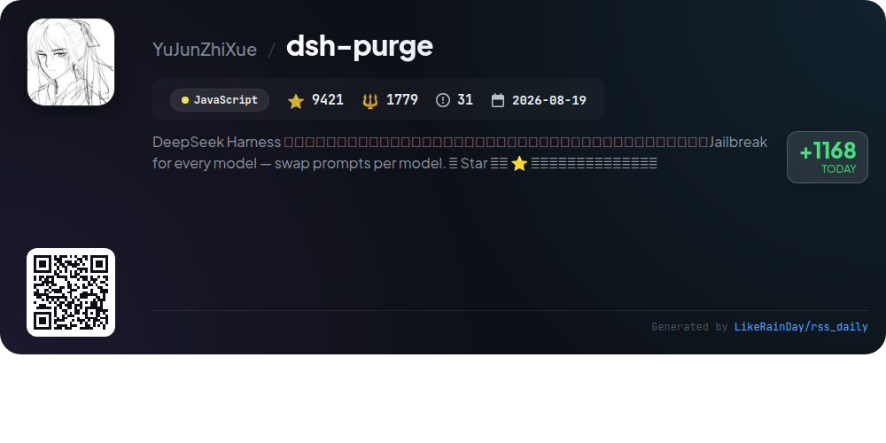
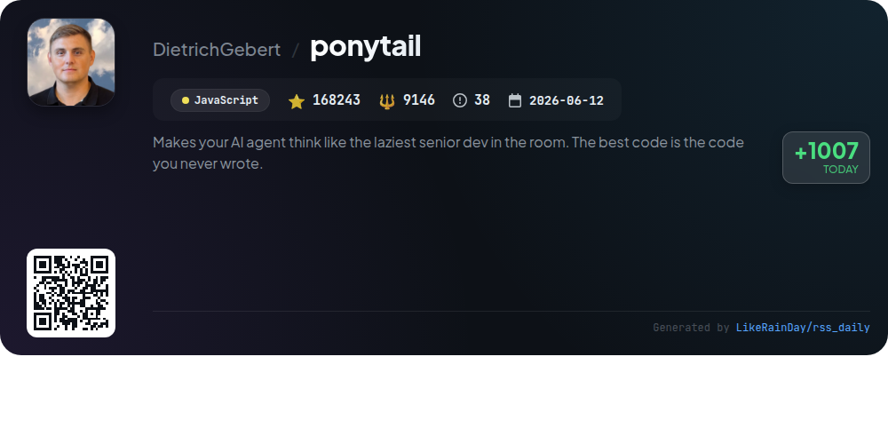
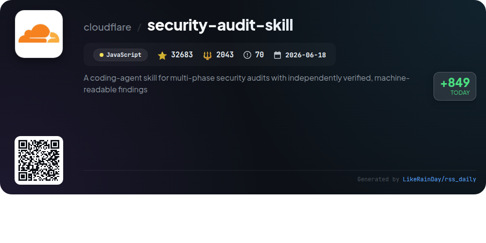
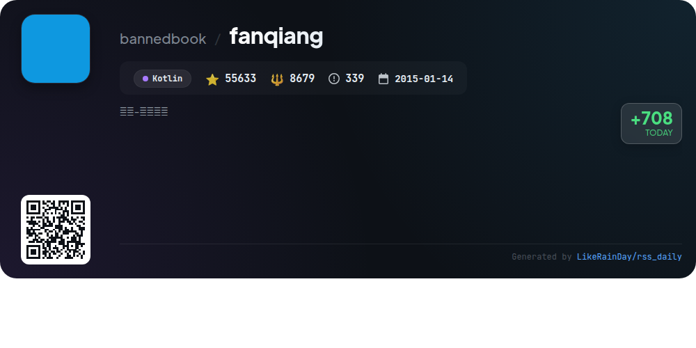
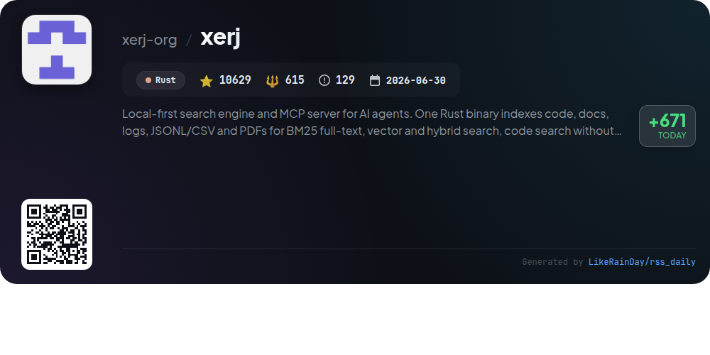
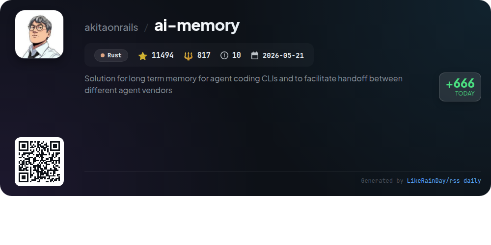
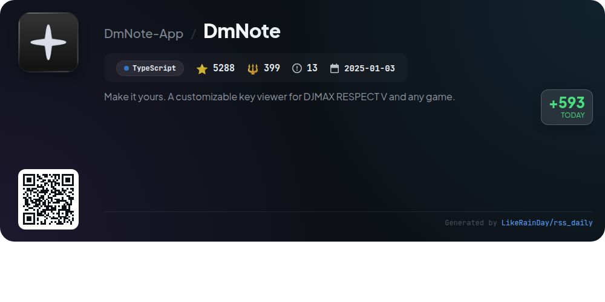

# 📊 🌟 GitHub Trending Daily - 2026-10-20

> > 📅 Daily Picks of GitHub Trending Repositories | Powered by Smart Algorithms

## 📋 Overview

**10** Projects | **636063** ⭐ | **60607** 🍴

**Top Languages:** `JavaScript` (4) · `TypeScript` (3) · `Rust` (2)

**Updated:** 2026-10-20 04:25 UTC

**Categories:**

- 🌟 Daily Top 10 (10 items)

---

## 🌟 Daily Top 10

### 1. [orca](https://github.com/stablyai/orca)

> 🤖 **Why Recommend**  
> *Orca is a powerful platform for managing a fleet of coding agents like Claude Code and Codex, supporting parallel workflows across desktop and mobile devices. Key features include mobile monitoring, parallel worktrees for comparing agent outputs, and advanced terminal splits. Users can seamlessly integrate with GitHub and Linear for task management, utilize a CLI for scripting workflows, and enjoy real-time notifications. With support for any CLI agent, Orca enhances productivity for developers by orchestrating AI-driven coding processes efficiently.*

- ⭐ 98507 stars
- 💻 TypeScript
- 📅 Updated: 2026-10-20

### 2. [opencode](https://github.com/anomalyco/opencode)

> 🤖 **Why Recommend**  
> *OpenCode is an open-source AI coding agent built with TypeScript, boasting over 217,000 stars on GitHub. It features two main agents: a full-access "build" agent for development and a read-only "plan" agent for code exploration and analysis. Users can install OpenCode via various package managers, including npm and Homebrew, or download a desktop app for macOS, Windows, and Linux. The project emphasizes community engagement through Discord and extensive documentation to facilitate contributions and usage. For more information, visit opencode.ai.*

- ⭐ 217981 stars
- 💻 TypeScript
- 📅 Updated: 2026-10-20

### 3. [LinkSwift](https://github.com/hmjz100/LinkSwift)

> 🤖 **Why Recommend**  
> *LinkSwift is a powerful JavaScript tool designed for retrieving direct download links from popular cloud storage services, including Baidu Netdisk, Aliyun Drive, and more. With over 26,000 stars on GitHub, it enhances user experience by providing features like UI beautification, multi-downloader support, and improved functionality compared to its predecessor, the "Netdisk Direct Link Downloader." Users can easily install from various sources and benefit from regular updates, ensuring compatibility and enhanced performance across multiple platforms.*

- ⭐ 26184 stars
- 💻 JavaScript
- 📅 Updated: 2026-10-20

### 4. [dsh-purge](https://github.com/YuJunZhiXue/dsh-purge)

> 🤖 **Why Recommend**  
> *dsh-purge is a powerful plugin for DeepSeek Harness, facilitating controlled assessments in cybersecurity. It allows users to customize prompts for different models, enhancing the effectiveness of engagements. Key features include a dual interface for 'Cleaning' and 'Drilling', support for multiple rulesets, and the ability to manage permissions and default strategies. With over 9,421 stars, it caters to both web and desktop versions of DeepSeek. The project emphasizes compliance with legal standards and offers commercial licensing options, ensuring responsible usage in security evaluations.*

- ⭐ 9421 stars
- 💻 JavaScript
- 📅 Updated: 2026-10-20

### 5. [ponytail](https://github.com/DietrichGebert/ponytail)

> 🤖 **Why Recommend**  
> *Ponytail is a JavaScript project designed to optimize AI agents by emulating the approach of a seasoned developer who minimizes unnecessary code. With over 168k stars, it focuses on reducing code complexity, cutting development time by 41% and costs by 26%, while maintaining high reliability—98% of risky logic is tested. Key features include commands for code review, auditing, and performance tracking. Ponytail integrates seamlessly with various AI platforms, making it a valuable tool for efficient coding practices and enhanced project management.*

- ⭐ 168243 stars
- 💻 JavaScript
- 📅 Updated: 2026-10-20

### 6. [security-audit-skill](https://github.com/cloudflare/security-audit-skill)

> 🤖 **Why Recommend**  
> *A coding-agent skill for multi-phase security audits with independently verified, machine-readable findings. popular project, actively maintained, recently updated*

- ⭐ 32683 stars
- 🍴 2043 forks
- 💻 JavaScript
- 📅 Updated: 2026-10-20

### 7. [fanqiang](https://github.com/bannedbook/fanqiang)

> 🤖 **Why Recommend**  
> *The "fanqiang" project is a comprehensive toolkit for circumventing internet censorship, featuring over 55,000 stars on GitHub. Developed in Kotlin, it offers various tools and tutorials for users on multiple platforms, including Android, iOS, Windows, macOS, and Linux. Key highlights include one-click VPN packages for Chrome and Firefox, detailed guides for setting up V2ray and Shadowsocks servers, and resources for gaming consoles. The project ensures users can access free and updated servers, catering to diverse network environments.*

- ⭐ 55633 stars
- 💻 Kotlin
- 📅 Updated: 2026-10-20

### 8. [xerj](https://github.com/xerj-org/xerj)

> 🤖 **Why Recommend**  
> *XERJ is a local-first search engine and MCP server for AI agents, built in Rust. It automatically indexes various data formats, including code, documents, and logs, enabling efficient BM25 full-text, vector, and hybrid search. Key features include agent memory, reference coding, and Elasticsearch-compatible APIs. Users benefit from reduced token usage by retrieving relevant code snippets instead of reading entire files, achieving up to 5x token savings in practice. XERJ supports seamless integration with AI agents and offers a community-driven approach to development.*

- ⭐ 10629 stars
- 💻 Rust
- 📅 Updated: 2026-10-20

### 9. [ai-memory](https://github.com/akitaonrails/ai-memory)

> 🤖 **Why Recommend**  
> *ai-memory is an innovative Rust-based solution designed for long-term memory in AI coding agents, enabling seamless project handoffs across various vendors like Claude Code and Codex. Key features include cross-agent memory sharing, project continuity, team collaboration, and a git-backed markdown wiki for memory storage. It captures workflows without LLM calls, ensuring privacy and ease of access. Built for both individual and team use, ai-memory allows users to resume tasks effortlessly and manage shared knowledge securely, enhancing productivity across projects and devices.*

- ⭐ 11494 stars
- 💻 Rust
- 📅 Updated: 2026-10-20

### 10. [DmNote](https://github.com/DmNote-App/DmNote)

> 🤖 **Why Recommend**  
> *DmNote is a customizable key viewer designed for DJMAX RESPECT V and other games, enabling real-time visualization of key inputs. Key features include key mapping, note effects, KPS statistics, and the ability to create custom overlays for streaming or video production. Users can personalize their experience with user-defined CSS, plugins, and presets. DmNote supports Windows, macOS, and has a community fork for Linux users. The application is easy to install and offers multi-language support, automatic updates, and shortcuts, making it an essential tool for gamers and streamers alike.*

- ⭐ 5288 stars
- 💻 TypeScript
- 📅 Updated: 2026-10-20

---

## 📡 RSS Subscription

Subscribe via RSS to get daily trending updates:

- 🔔 [RSS XML] (../../daily-top.xml)
- 🔔 [Daily Report] (../../GITHUB_TODAY.md)
- 🔔 [Daily Top 10](../../daily-top.xml)

---

*⚡ Powered by Smart Trending Algorithm | Generated at 2026-10-20 04:25:40 UTC
