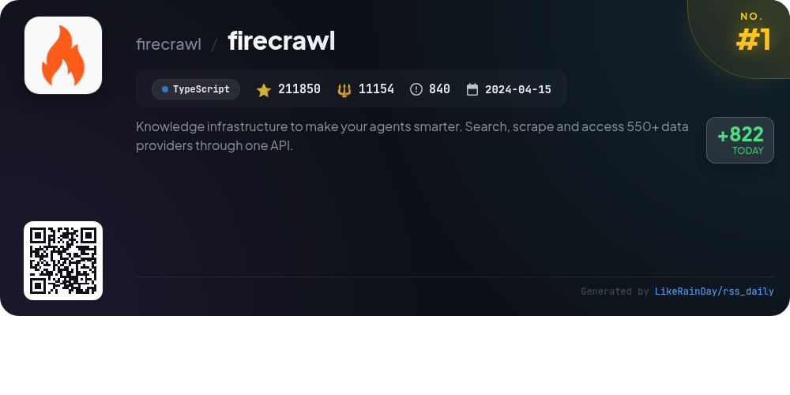
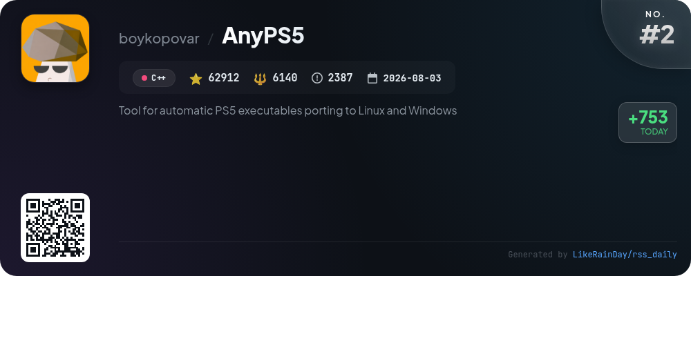
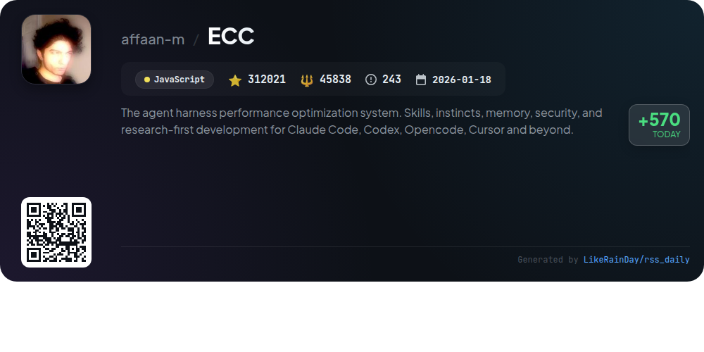
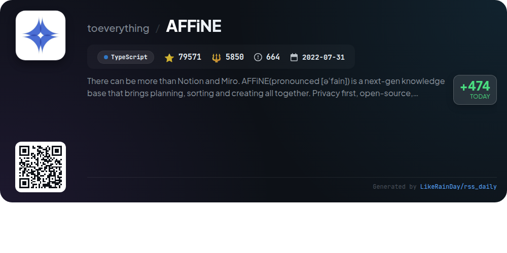
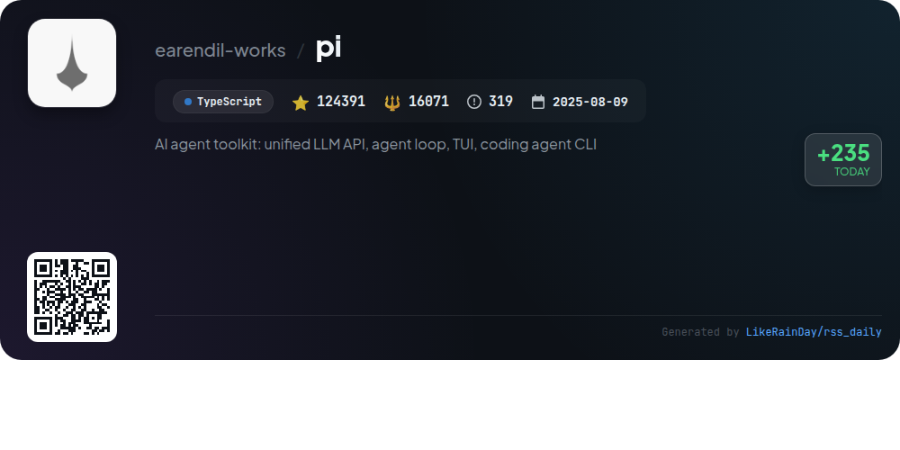
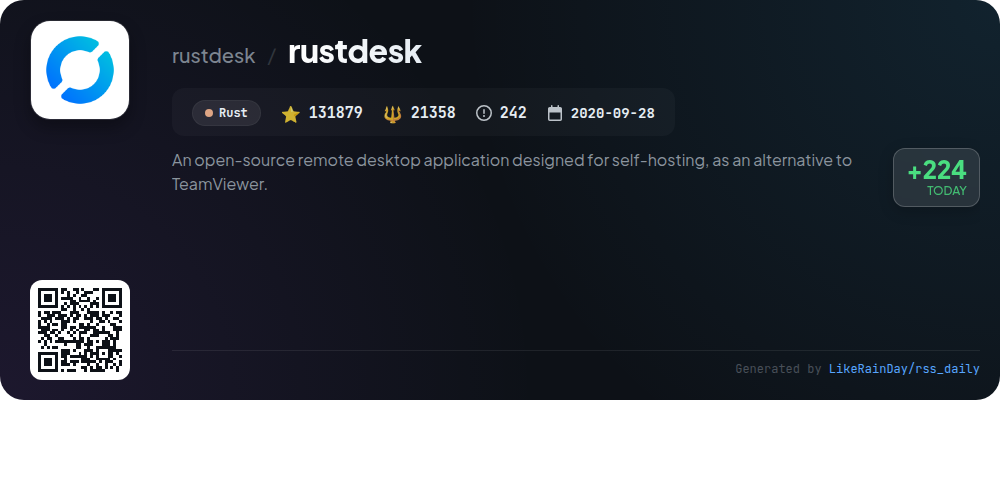

# 📊 🌟 GitHub Trending Daily - 2026-11-28

> > 📅 Daily Picks of GitHub Trending Repositories | Powered by Smart Algorithms

## 📋 Overview

**10** Projects | **1386309** ⭐ | **152961** 🍴

**Top Languages:** `TypeScript` (6) · `JavaScript` (2) · `C++` (1)

**Updated:** 2026-11-28 07:19 UTC

**Categories:**

- 🌟 Daily Top 10 (10 items)

---

## 🌟 Daily Top 10

### 1. [firecrawl](https://github.com/firecrawl/firecrawl)

> 🤖 **Why Recommend**  
> *Firecrawl is a TypeScript-based knowledge infrastructure that enhances AI agent capabilities by enabling seamless access to over 550 data providers through a unified API. Key features include Firecrawl Local for local data scraping and processing, Firecrawl Cloud for scalable, serverless operations with structured JSON outputs, and a self-hosting option. It supports web scraping, crawling, searching, and agent functionalities, providing LLM-ready outputs. Additionally, Firecrawl Alexandria offers extensive datasets for comprehensive knowledge retrieval, making it an essential tool for AI-driven data interactions.*

- ⭐ 211850 stars
- 💻 TypeScript
- 📅 Updated: 2026-11-28

### 2. [AnyPS5](https://github.com/boykopovar/AnyPS5)

> 🤖 **Why Recommend**  
> *AnyPS5 is a tool designed for the automatic porting of PS5 executables to Linux and Windows, boasting over 62,000 stars on GitHub. It features a built-in relinker that converts executables to the target system's native format without requiring emulation. The project supports SDL-mapped game controllers and allows customizable keyboard/mouse controls. It includes a web converter and provides extensive documentation on usage, architecture, and contribution guidelines. AnyPS5 emphasizes interoperability and preservation while ensuring compliance with copyright laws.*

- ⭐ 62912 stars
- 💻 C++
- 📅 Updated: 2026-11-28

### 3. [ponytail](https://github.com/DietrichGebert/ponytail)

> 🤖 **Why Recommend**  
> *Ponytail is an innovative tool designed to make AI agents emulate the efficiency of a seasoned developer, focusing on writing minimal yet effective code. With over 200,000 stars on GitHub, it emphasizes reducing code complexity—achieving up to 53% less code and 41% faster execution in its latest version. Key features include `/ponytail-review` for thorough code audits, `/ponytail-audit` for repository-wide checks, and a user-friendly command interface. Ponytail prioritizes safety and functionality while minimizing costs and token usage, making it ideal for developers seeking streamlined solutions.*

- ⭐ 200298 stars
- 💻 JavaScript
- 📅 Updated: 2026-11-28

### 4. [ECC](https://github.com/affaan-m/ECC)

> 🤖 **Why Recommend**  
> *ECC is an advanced performance optimization system for coding agents, integrating skills, memory, and security for tools like Claude Code and Codex. With 72 agents and 328 skills, it streamlines workflows through features like planning, testing, and reviewing code. ECC emphasizes continuous learning and includes security auditing via AgentShield. Its guided setup ensures compatibility across various environments, while a comprehensive dashboard and community support enhance usability. The project, licensed under MIT, thrives on contributions and sponsorship to sustain its open-source framework.*

- ⭐ 312021 stars
- 💻 JavaScript
- 📅 Updated: 2026-11-28

### 5. [AFFiNE](https://github.com/toeverything/AFFiNE)

> 🤖 **Why Recommend**  
> *AFFiNE is an open-source, privacy-first knowledge base designed as an all-in-one workspace that merges documentation, drawing, and planning. With over 79,000 stars, it offers a unique edgeless canvas for versatile content, including rich text, sticky notes, and embedded resources. Key features include multimodal AI assistance for creativity, local-first data ownership, real-time collaboration, and self-hosting capabilities. AFFiNE serves as a customizable alternative to Notion and Miro, suitable for diverse creative and organizational needs.*

- ⭐ 79571 stars
- 💻 TypeScript
- 📅 Updated: 2026-11-28

### 6. [stitch-skills](https://github.com/google-labs-code/stitch-skills)

> 🤖 **Why Recommend**  
> *Stitch Skills is a TypeScript library of agent skills designed for the Stitch MCP server, adhering to the Agent Skills open standard. It offers three main plugins: `stitch-design` for core design workflows, `stitch-build` for code generation and integration, and `stitch-utilities` for enhancing prompts and generating design specifications. Compatible with coding agents like Codex, Claude Code, and Cursor, it simplifies tasks such as converting frontend code to designs, generating React components, and creating comprehensive DESIGN.md files. With over 13,600 stars, it serves as a robust toolkit for developers.*

- ⭐ 13662 stars
- 💻 TypeScript
- 📅 Updated: 2026-11-28

### 7. [opencode](https://github.com/anomalyco/opencode)

> 🤖 **Why Recommend**  
> *OpenCode is an open-source AI coding agent designed to enhance software development. With over 229,000 stars on GitHub, it supports multiple languages and offers a CLI for easy installation across various platforms, including macOS, Windows, and Linux. Key features include two built-in agents—'build' for development and 'plan' for code exploration—allowing users to switch seamlessly. A desktop application is also available in beta. Comprehensive documentation and a vibrant community on Discord support users in maximizing the tool's capabilities.*

- ⭐ 229669 stars
- 💻 TypeScript
- 📅 Updated: 2026-11-28

### 8. [plugins](https://github.com/cursor/plugins)

> 🤖 **Why Recommend**  
> *The "plugins" project is a comprehensive repository of official Cursor plugins designed for various developer tools, frameworks, and SaaS products, featuring over 60 plugins. Each plugin includes a standalone manifest and serves a unique purpose, such as the "Teaching" plugin for skill mapping and the "Gmail" plugin for email management. Key highlights include plugins for CI workflows, documentation rendering, and integrations with platforms like Google Drive, Salesforce, and Zoom. The project is built in TypeScript and is open-source under the MIT license, with over 20,000 stars on GitHub.*

- ⭐ 20056 stars
- 💻 TypeScript
- 📅 Updated: 2026-11-28

### 9. [pi](https://github.com/earendil-works/pi)

> 🤖 **Why Recommend**  
> *Pi is an extensible AI agent toolkit designed for customizable workflows. It features a unified LLM API supporting multiple providers, an interactive coding agent CLI, and a terminal UI. Users can adapt Pi using extensions, skills, and prompt templates, facilitating tailored automation. Key services include RPC control, JSON mode automation, and a TypeScript SDK for app development. With robust defaults and a focus on user customization, Pi empowers developers to integrate AI seamlessly into their projects. Visit pi.dev for demos and documentation.*

- ⭐ 124391 stars
- 💻 TypeScript
- 📅 Updated: 2026-11-28

### 10. [rustdesk](https://github.com/rustdesk/rustdesk)

> 🤖 **Why Recommend**  
> *RustDesk is an open-source remote desktop application written in Rust, offering a self-hosted alternative to TeamViewer. With over 131,000 stars, it ensures users have full control of their data and security, allowing connectivity through its built-in rendezvous/relay server or custom setups. Key features include seamless file transfer, TCP tunneling, and a user-friendly interface with no configuration needed. RustDesk supports multiple languages and is actively seeking community contributions. For developers, it provides detailed building instructions using Docker or native setups.*

- ⭐ 131879 stars
- 💻 Rust
- 📅 Updated: 2026-11-28

---

## 📡 RSS Subscription

Subscribe via RSS to get daily trending updates:

- 🔔 [RSS XML] (../../daily-top.xml)
- 🔔 [Daily Report] (../../GITHUB_TODAY.md)
- 🔔 [Daily Top 10](../../daily-top.xml)

---

*⚡ Powered by Smart Trending Algorithm | Generated at 2026-11-28 07:19:37 UTC
