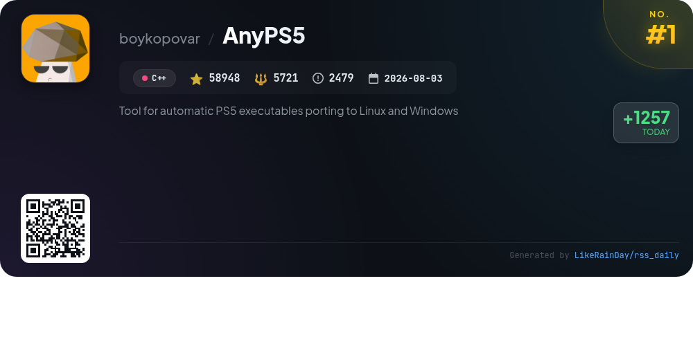
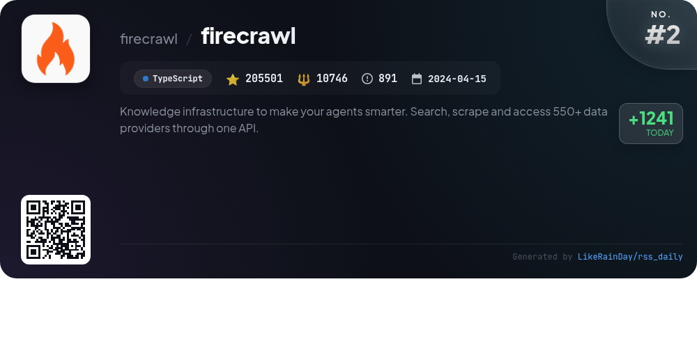
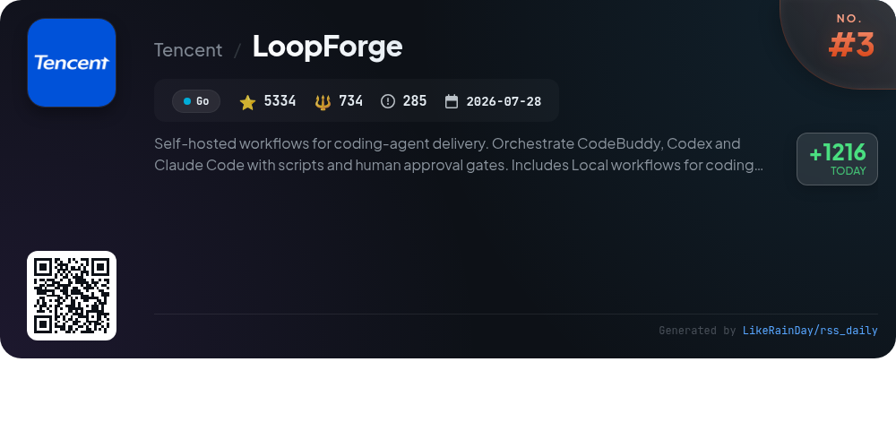
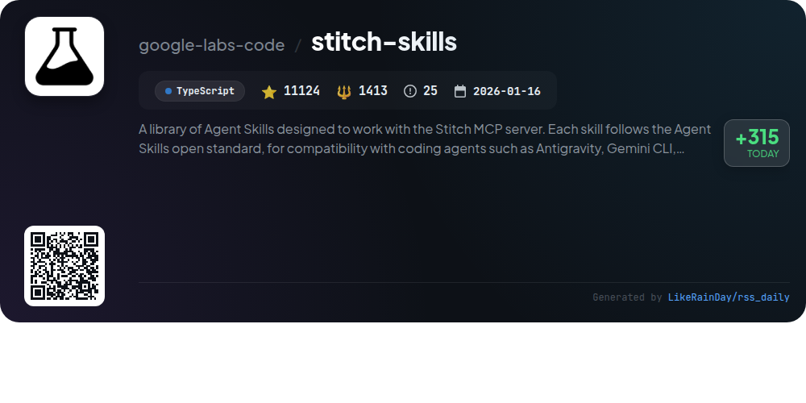
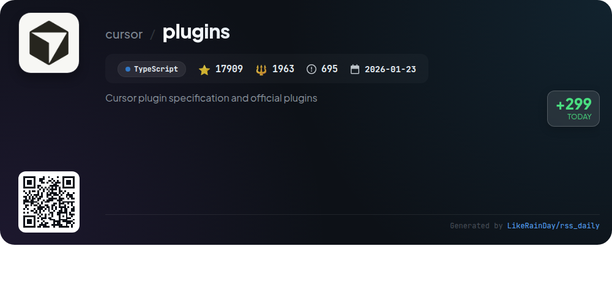
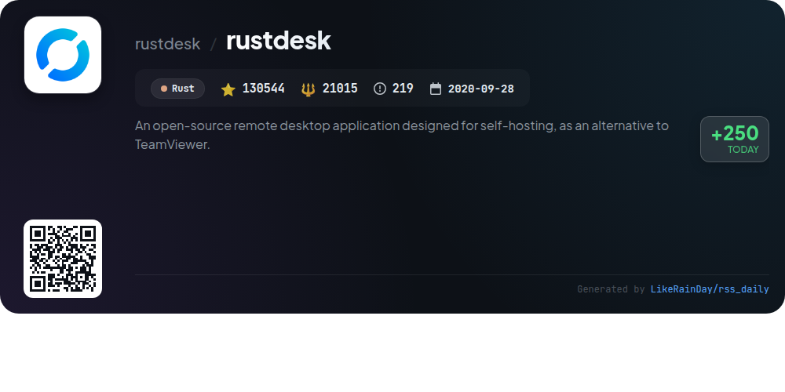
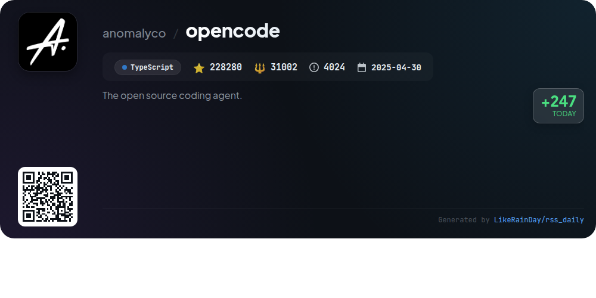

# 📊 🌟 GitHub Trending Daily - 2026-11-21

> > 📅 Daily Picks of GitHub Trending Repositories | Powered by Smart Algorithms

## 📋 Overview

**10** Projects | **1237306** ⭐ | **134521** 🍴

**Top Languages:** `TypeScript` (5) · `JavaScript` (2) · `Go` (1)

**Updated:** 2026-11-21 06:40 UTC

**Categories:**

- 🌟 Daily Top 10 (10 items)

---

## 🌟 Daily Top 10

### 1. [AnyPS5](https://github.com/boykopovar/AnyPS5)

> 🤖 **Why Recommend**  
> *AnyPS5 is a powerful tool for automatically porting PS5 executables to Linux and Windows, boasting over 58,000 stars on GitHub. Key features include a relinker that converts executables to native formats without emulation, support for SDL-mapped game controllers, and a shader recompiler that generates SPIR-V. The project also offers a web converter, extensive documentation in multiple languages, and a community Discord. Designed for research and preservation, AnyPS5 operates independently of Sony Interactive Entertainment, adhering to GPL v2 licensing.*

- ⭐ 58948 stars
- 💻 C++
- 📅 Updated: 2026-11-21

### 2. [firecrawl](https://github.com/firecrawl/firecrawl)

> 🤖 **Why Recommend**  
> *Firecrawl is an advanced knowledge infrastructure designed to enhance AI agents with seamless web interaction capabilities. It offers three primary services: Firecrawl Local for local scraping and mapping; Firecrawl Cloud for scalable, hosted access to over 550 data providers and advanced features like structured JSON and AI interactions; and self-hosting options for customizable deployments. Key features include web scraping, crawling, searching, and autonomous data gathering, all accessible through a single API, making it ideal for developers aiming to integrate comprehensive web data into their applications.*

- ⭐ 205501 stars
- 💻 TypeScript
- 📅 Updated: 2026-11-21

### 3. [LoopForge](https://github.com/Tencent/LoopForge)

> 🤖 **Why Recommend**  
> *LoopForge is a self-hosted platform for orchestrating software delivery using coding agents like CodeBuddy, Codex, and Claude Code. It enables teams to create repeatable workflows (SOPs) with human approval gates, ensuring quality and oversight. Key features include chat-based interaction with a Main Bot, on-demand Docker sandboxes, a visual SOP designer, and comprehensive tracking of requirements to delivery. LoopForge enhances team collaboration with role separation, live run monitoring, and metrics reporting, all on your infrastructure under an MIT license.*

- ⭐ 5334 stars
- 💻 Go
- 📅 Updated: 2026-11-21

### 4. [ponytail](https://github.com/DietrichGebert/ponytail)

> 🤖 **Why Recommend**  
> *Ponytail is a JavaScript project designed to optimize AI agents by emulating the efficiency of a seasoned developer, creating minimal yet effective code. With over 195,000 stars, it emphasizes writing only essential code while maintaining security and functionality. Key features include `/ponytail-review` for code evaluations, `/ponytail-audit` for comprehensive repository checks, and a new band display for tracking costs and efficiency. Ponytail 5 significantly reduces code length, time, and costs while ensuring high-quality outputs, making it an invaluable tool for modern development.*

- ⭐ 195776 stars
- 💻 JavaScript
- 📅 Updated: 2026-11-21

### 5. [AFFiNE](https://github.com/toeverything/AFFiNE)

> 🤖 **Why Recommend**  
> *AFFiNE is an open-source, privacy-focused knowledge base that merges planning, documentation, and creative tools into a single platform, serving as an alternative to Notion and Miro. Key features include a versatile canvas for various content types, real-time collaboration, and local-first data management. It integrates multimodal AI for enhanced productivity and allows customization through self-hosting. With over 75,000 stars on GitHub, AFFiNE supports diverse templates and a community-driven ecosystem, making it ideal for creative minds seeking a comprehensive workspace.*

- ⭐ 75923 stars
- 💻 TypeScript
- 📅 Updated: 2026-11-21

### 6. [ECC](https://github.com/affaan-m/ECC)

> 🤖 **Why Recommend**  
> *ECC is a performance optimization system designed for coding agents, providing a structured framework for planning, testing, implementing, reviewing, and improving code. Key features include 72 specialized agents, 328 reusable skills, and security scanning with AgentShield. It supports multiple harnesses such as Claude Code and Codex, offering seamless integration for workflow management. ECC enables continuous learning, memory persistence, and context optimization, making it ideal for enhancing coding efficiency and quality across various platforms.*

- ⭐ 307967 stars
- 💻 JavaScript
- 📅 Updated: 2026-11-21

### 7. [stitch-skills](https://github.com/google-labs-code/stitch-skills)

> 🤖 **Why Recommend**  
> *Stitch Skills is a TypeScript library of agent skills designed for the Stitch MCP server, adhering to the Agent Skills open standard. It offers a suite of plugins including design-focused (`stitch-design`), build and component skills (`stitch-build`), and utility tools (`stitch-utilities`). Key features include code-to-design conversions, design generation, React component creation, and automated website building. With over 11,000 stars, it supports various coding agents like Codex and Claude Code, providing a robust framework for enhancing development workflows.*

- ⭐ 11124 stars
- 💻 TypeScript
- 📅 Updated: 2026-11-21

### 8. [plugins](https://github.com/cursor/plugins)

> 🤖 **Why Recommend**  
> *The "plugins" project on GitHub hosts official Cursor plugins for popular developer tools, frameworks, and SaaS products, garnering 17,909 stars. Each plugin is self-contained with a manifest for easy integration. Key offerings include plugins for teaching, continual learning, CI workflows, and extensive productivity tools like Google Drive, Gmail, and Slack. The repository supports a multi-plugin marketplace structure, allowing developers to scaffold new plugins and enhance existing workflows, all built in TypeScript under the MIT license.*

- ⭐ 17909 stars
- 💻 TypeScript
- 📅 Updated: 2026-11-21

### 9. [rustdesk](https://github.com/rustdesk/rustdesk)

> 🤖 **Why Recommend**  
> *RustDesk is an open-source remote desktop application written in Rust, designed for self-hosting as an alternative to TeamViewer. It boasts over 130,000 stars on GitHub and emphasizes user data control and security, allowing users to connect without configuration. Key features include built-in file transfer, audio services, and a customizable rendezvous/relay server. The project supports various languages and encourages community contributions. RustDesk can be easily built using Docker or standard development environments, making it accessible for developers.*

- ⭐ 130544 stars
- 💻 Rust
- 📅 Updated: 2026-11-21

### 10. [opencode](https://github.com/anomalyco/opencode)

> 🤖 **Why Recommend**  
> *OpenCode is an open-source AI coding agent developed in TypeScript, boasting over 228,000 stars on GitHub. It features a dual-agent system: a full-access "build" agent for development and a read-only "plan" agent for analysis and exploration. Users can easily install OpenCode via package managers or download a desktop app for macOS, Windows, and Linux. The platform supports multiple languages and offers extensive documentation for configuration and use. Join the community on Discord for support and collaboration.*

- ⭐ 228280 stars
- 💻 TypeScript
- 📅 Updated: 2026-11-21

---

## 📡 RSS Subscription

Subscribe via RSS to get daily trending updates:

- 🔔 [RSS XML] (../../daily-top.xml)
- 🔔 [Daily Report] (../../GITHUB_TODAY.md)
- 🔔 [Daily Top 10](../../daily-top.xml)

---

*⚡ Powered by Smart Trending Algorithm | Generated at 2026-11-21 06:40:46 UTC
