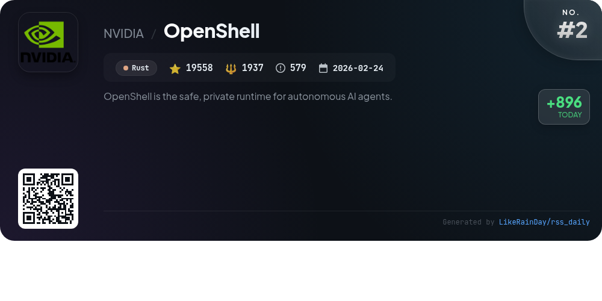
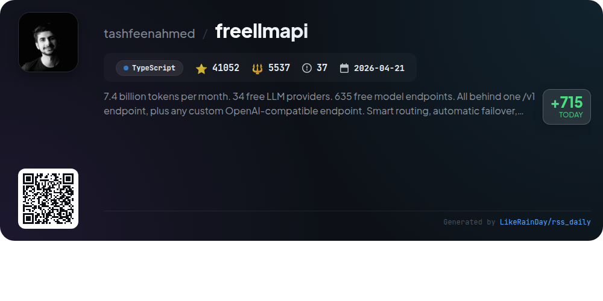
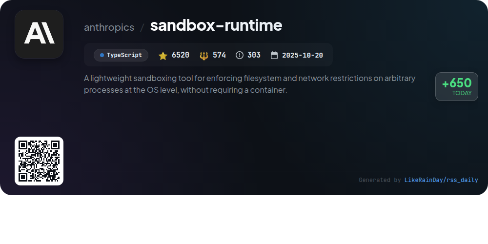
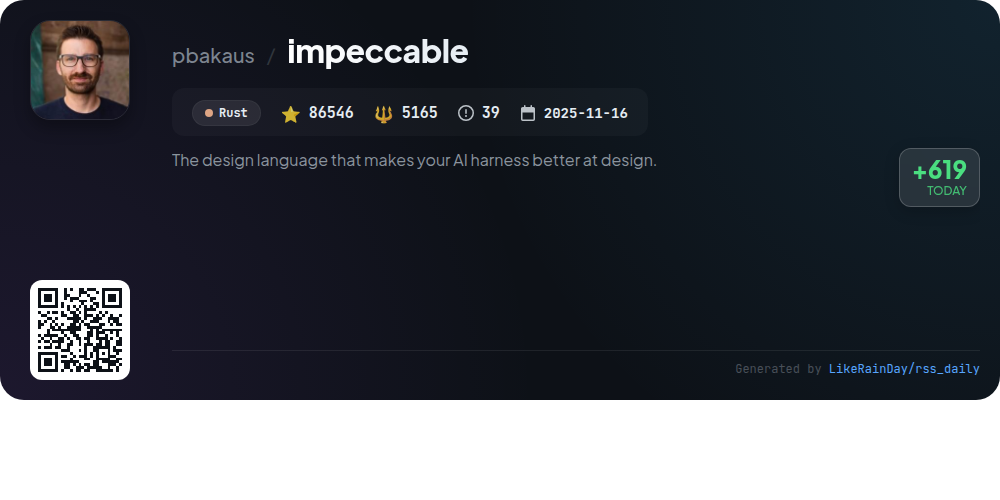
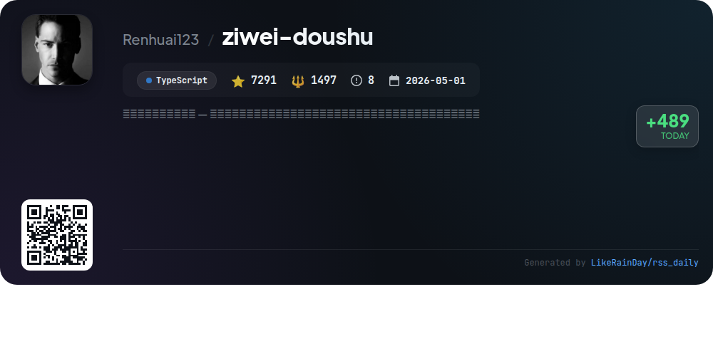
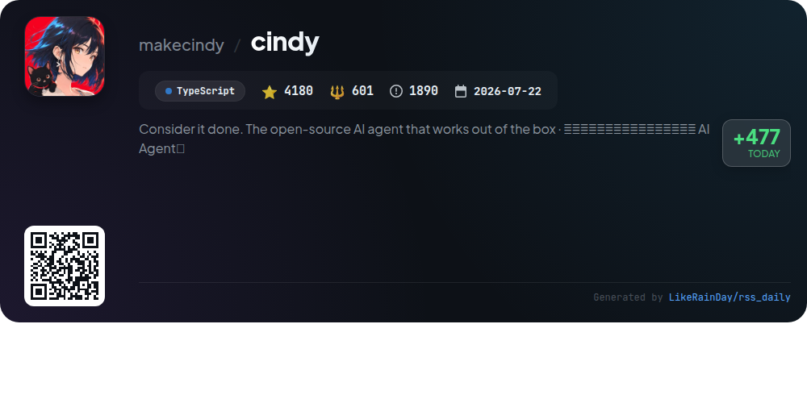
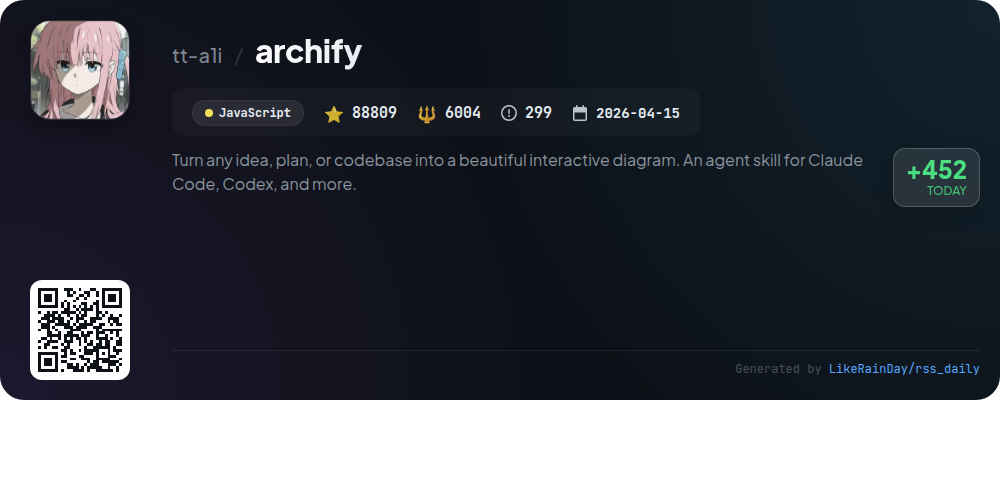

# 📊 🌟 GitHub Trending Daily - 2026-10-25

> > 📅 Daily Picks of GitHub Trending Repositories | Powered by Smart Algorithms

## 📋 Overview

**10** Projects | **546024** ⭐ | **40143** 🍴

**Top Languages:** `TypeScript` (5) · `JavaScript` (3) · `Rust` (2)

**Updated:** 2026-10-25 04:13 UTC

**Categories:**

- 🌟 Daily Top 10 (10 items)

---

## 🌟 Daily Top 10

### 1. [security-audit-skill](https://github.com/cloudflare/security-audit-skill)

> 🤖 **Why Recommend**  
> *A coding-agent skill for multi-phase security audits with independently verified, machine-readable findings. popular project, actively maintained, recently updated*

- ⭐ 44907 stars
- 🍴 2786 forks
- 💻 JavaScript
- 📅 Updated: 2026-10-25

### 2. [OpenShell](https://github.com/NVIDIA/OpenShell)

> 🤖 **Why Recommend**  
> *OpenShell is a secure runtime for autonomous AI agents, enabling them to access files, APIs, and credentials with enforced policies to ensure data privacy. Key features include kernel-level enforcement for sandbox isolation, formal verification of policy changes, and support for multiple platforms (Linux, macOS, Windows WSL). Users can create sandboxes, manage policies, and utilize SDKs in various languages like Python and Rust. OpenShell prioritizes security and extensibility, making it ideal for developing and managing AI workflows safely.*

- ⭐ 19558 stars
- 💻 Rust
- 📅 Updated: 2026-10-25

### 3. [ponytail](https://github.com/DietrichGebert/ponytail)

> 🤖 **Why Recommend**  
> *Ponytail is a JavaScript project designed to optimize AI development by emulating the approach of an experienced yet lazy senior developer. With over 175,600 stars, it emphasizes code efficiency, significantly reducing lines of code, time, cost, and tokens while maintaining high testing standards. Key features include `/ponytail-review` for detailed code audits, `/ponytail-audit` for comprehensive repository checks, and a new band feature that tracks task costs and performance metrics. Ponytail prioritizes writing minimal yet effective code, ensuring security and validation aren't compromised.*

- ⭐ 175600 stars
- 💻 JavaScript
- 📅 Updated: 2026-10-25

### 4. [hyperframes](https://github.com/heygen-com/hyperframes)

> 🤖 **Why Recommend**  
> *HyperFrames is an open-source framework designed for creating deterministic MP4 videos from HTML, CSS, and animations. It features a CLI for local rendering, compatibility with AI coding agents, and a library of reusable components for transitions and overlays. HyperFrames supports a variety of animation libraries and offers a unique design system that translates web designs into video-ready formats. Key services include a collaborative studio, AWS Lambda rendering, and a comprehensive catalog for easy integration. With over 71,000 stars, it empowers users to produce videos efficiently and effectively.*

- ⭐ 71561 stars
- 💻 TypeScript
- 📅 Updated: 2026-10-25

### 5. [freellmapi](https://github.com/tashfeenahmed/freellmapi)

> 🤖 **Why Recommend**  
> *FreeLLMAPI aggregates free tiers from 34 LLM providers, offering 635 model endpoints through a single OpenAI-compatible API. Key features include smart routing, automatic failover, and encrypted API keys, allowing for up to 7.4 billion tokens per month for personal experimentation. The service tracks usage to stay within free-tier limits while enabling diverse models for chat, embeddings, and multimedia tasks. With a user-friendly dashboard and support for multiple languages, FreeLLMAPI simplifies access to powerful AI tools without the hassle of managing multiple providers.*

- ⭐ 41052 stars
- 💻 TypeScript
- 📅 Updated: 2026-10-25

### 6. [sandbox-runtime](https://github.com/anthropics/sandbox-runtime)

> 🤖 **Why Recommend**  
> *A lightweight sandboxing tool for enforcing filesystem and network restrictions on arbitrary processes at the OS level, without requiring a container.. popular project, actively maintained, recently updated*

- ⭐ 6520 stars
- 🍴 574 forks
- 💻 TypeScript
- 📅 Updated: 2026-10-25

### 7. [impeccable](https://github.com/pbakaus/impeccable)

> 🤖 **Why Recommend**  
> *Impeccable is a Rust-based design language tool for AI coding agents, boasting 86,546 stars on GitHub. It provides design guidance with 24 commands like `polish`, `audit`, and `critique`, along with 62 deterministic rules for evaluating AI-generated frontend designs. Key features include a streamlined setup (`/impeccable init`), live browser iteration, and a shared design vocabulary for effective collaboration. Impeccable enhances design quality by addressing common anti-patterns, promoting best practices, and enabling seamless integration with platforms like GitHub Copilot and Claude Code. For detailed documentation, visit [impeccable.style](https://impeccable.style).*

- ⭐ 86546 stars
- 💻 Rust
- 📅 Updated: 2026-10-25

### 8. [ziwei-doushu](https://github.com/Renhuai123/ziwei-doushu)

> 🤖 **Why Recommend**  
> *ziwei-doushu is an open-source Zi Wei Dou Shu (Purple Star Astrology) charting engine based on Ni Hai Xia's "Tian Ji" system. It features a comprehensive charting algorithm, a four-transformation system, and a knowledge base of astrological patterns, along with ancient texts. The latest update includes a v4.0 dataset with 674,976 charts and 8.77 million interpretative segments, totaling 56.6 GB. The project promotes open access to traditional wisdom, enabling users to explore and learn about Zi Wei Dou Shu through its online platform [metisziwei.com](https://metisziwei.com).*

- ⭐ 7291 stars
- 💻 TypeScript
- 📅 Updated: 2026-10-25

### 9. [cindy](https://github.com/makecindy/cindy)

> 🤖 **Why Recommend**  
> *Cindy is an open-source AI agent that operates seamlessly on your local machine, integrating multiple models and tools to efficiently complete tasks in your projects. With support for Claude Code and Codex harnesses, Cindy allows for flexible task execution, memory retention, and skill sharing across projects. The client, organized as a pnpm monorepo, includes desktop and mobile apps and encourages customization through plugins and automation. Users can connect existing services without additional costs, ensuring a versatile and powerful AI experience. Visit cindy.app for more details.*

- ⭐ 4180 stars
- 💻 TypeScript
- 📅 Updated: 2026-10-25

### 10. [archify](https://github.com/tt-a1i/archify)

> 🤖 **Why Recommend**  
> *Archify is an open-source project that transforms ideas, plans, or codebases into interactive diagrams. With over 88,000 stars on GitHub, it supports integration with AI agents like Claude Code and Codex. Users can create detailed architecture diagrams from descriptions or repositories, refine them through chat, and export them as self-contained HTML files. Key features include various diagram types (architecture, workflows, ERDs), easy sharing options, and community extensions. Archify enhances collaboration and understanding across diverse applications, from technical designs to travel itineraries.*

- ⭐ 88809 stars
- 💻 JavaScript
- 📅 Updated: 2026-10-25

---

## 📡 RSS Subscription

Subscribe via RSS to get daily trending updates:

- 🔔 [RSS XML] (../../daily-top.xml)
- 🔔 [Daily Report] (../../GITHUB_TODAY.md)
- 🔔 [Daily Top 10](../../daily-top.xml)

---

*⚡ Powered by Smart Trending Algorithm | Generated at 2026-10-25 04:13:27 UTC
