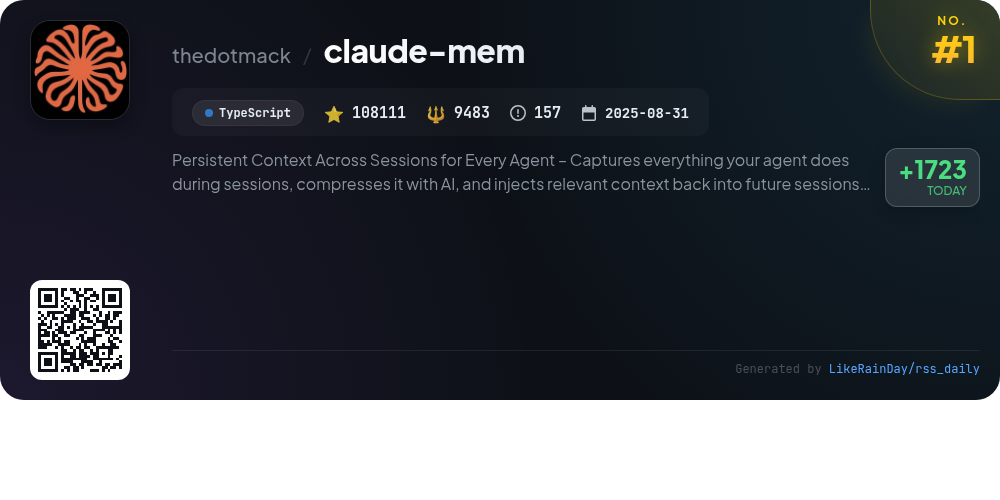
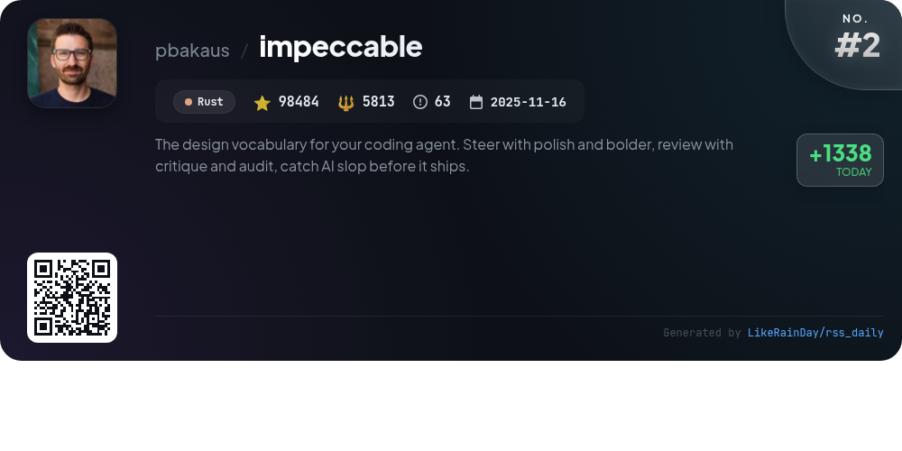
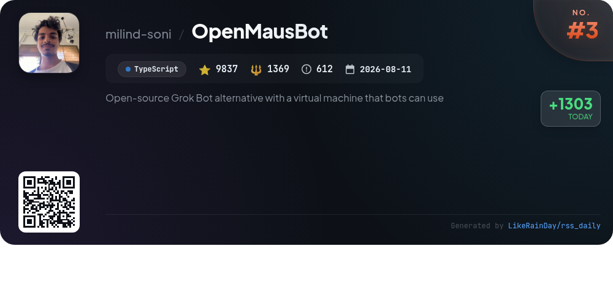
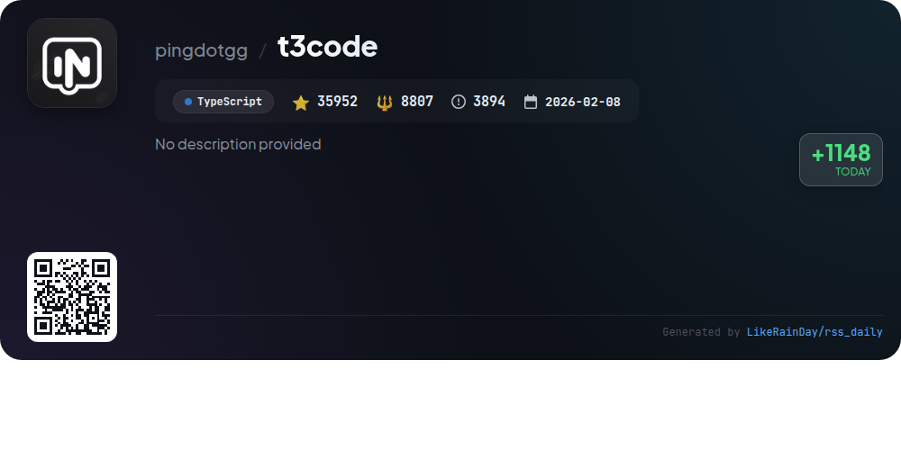
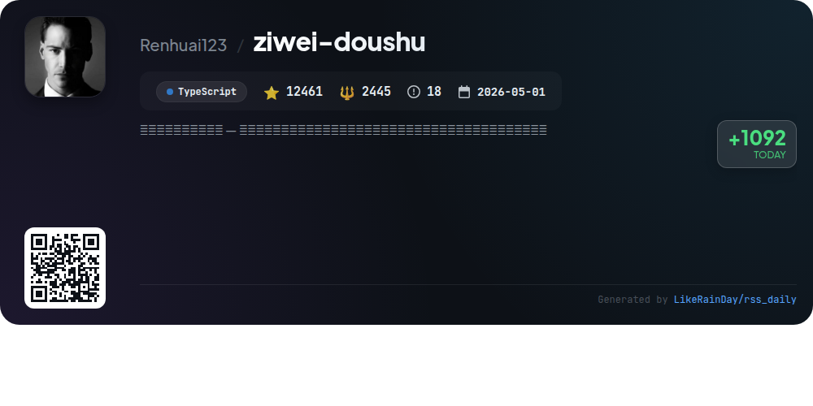
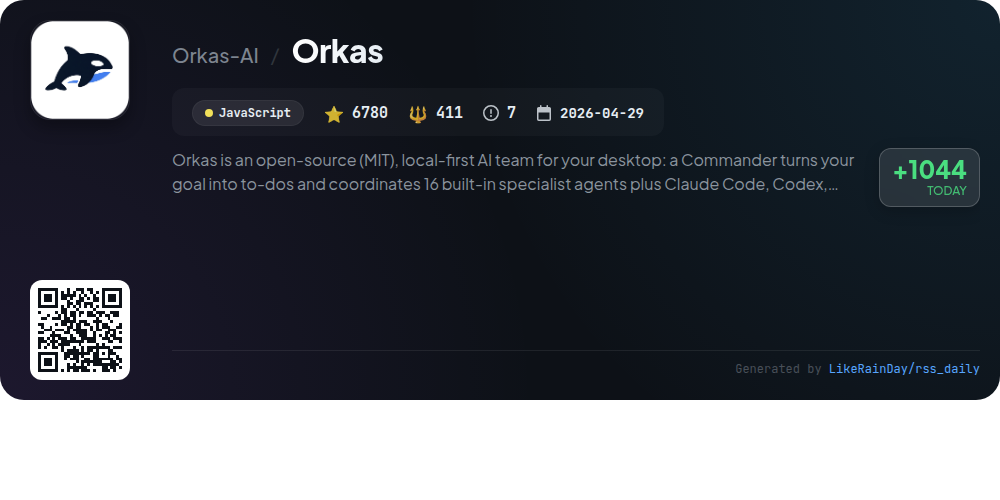
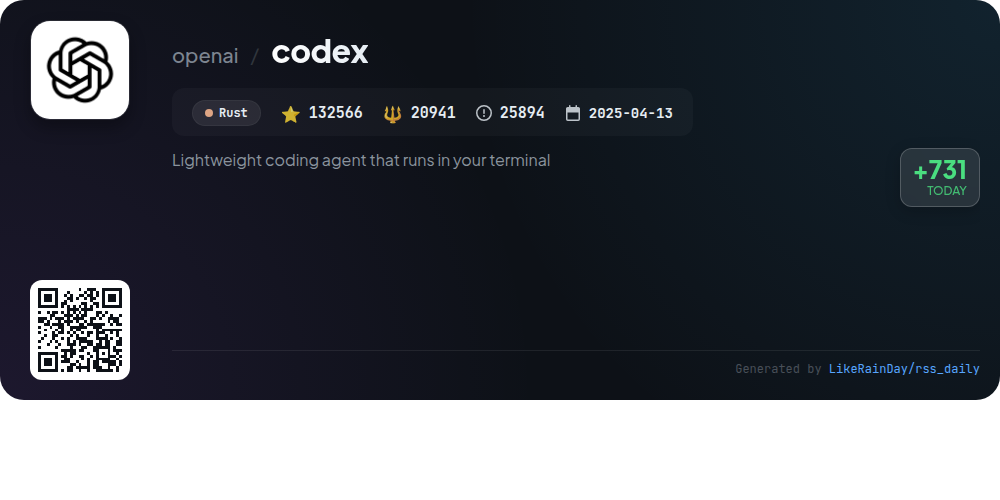
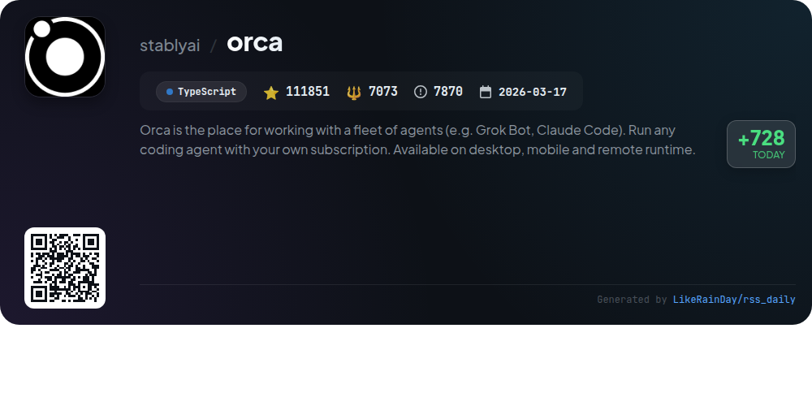
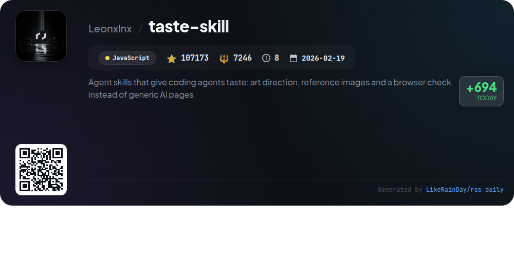
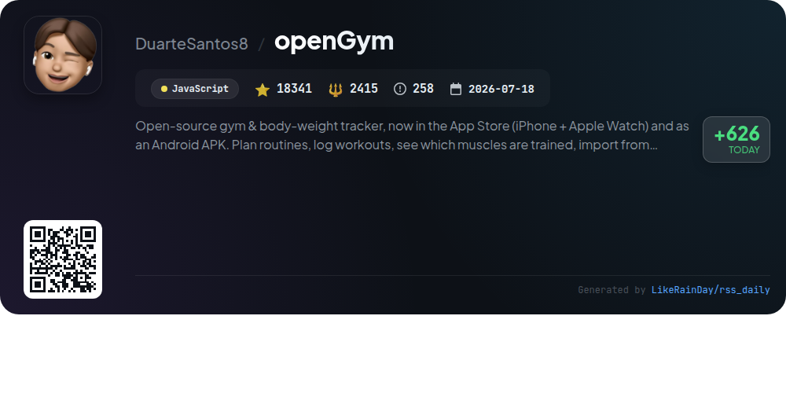

# 📊 🌟 GitHub Trending Daily - 2026-11-01

> > 📅 Daily Picks of GitHub Trending Repositories | Powered by Smart Algorithms

## 📋 Overview

**10** Projects | **641556** ⭐ | **66003** 🍴

**Top Languages:** `TypeScript` (5) · `JavaScript` (3) · `Rust` (2)

**Updated:** 2026-11-01 05:33 UTC

**Categories:**

- 🌟 Daily Top 10 (10 items)

---

## 🌟 Daily Top 10

### 1. [claude-mem](https://github.com/thedotmack/claude-mem)

> 🤖 **Why Recommend**  
> *Claude-Mem is a TypeScript-based project designed to provide persistent context across sessions for AI agents, such as Claude Code, OpenClaw, Codex, and more. With over 108,000 stars, it captures and compresses user interactions, ensuring relevant context is available in future sessions. Key features include smart search capabilities, progressive memory retrieval, and privacy controls. It supports multiple integrations and offers an intuitive installation process. Claude-Mem enhances productivity by maintaining continuity in project knowledge, making it a valuable tool for developers and AI users.*

- ⭐ 108111 stars
- 💻 TypeScript
- 📅 Updated: 2026-11-01

### 2. [impeccable](https://github.com/pbakaus/impeccable)

> 🤖 **Why Recommend**  
> *Impeccable is a Rust-based design tool for coding agents, boasting 98,484 stars on GitHub. It enhances UI development with commands like `polish`, `bolder`, `critique`, and `audit`, enabling users to refine designs, ensure usability, and catch issues pre-release. Compatible with various coding platforms such as Codex, GitHub Copilot, and more, Impeccable facilitates both iterative design and comprehensive reviews. Key features include a slop detector with 62 rules, live editing capabilities, and project context management via `PRODUCT.md` and `DESIGN.md`. Comprehensive documentation is available at impeccable.style/docs.*

- ⭐ 98484 stars
- 💻 Rust
- 📅 Updated: 2026-11-01

### 3. [OpenMausBot](https://github.com/milind-soni/OpenMausBot)

> 🤖 **Why Recommend**  
> *OpenMausBot is an open-source alternative to Grok Bot, enabling users to manage multiple AI agents, like Claude and Codex, within a chat app interface. Key features include local-first operation, allowing bots to run on personal machines, a model picker for agent selection, and a permission broker that requires user approval for actions. It integrates with over 500 apps via Composio, supports voice interactions, and provides dedicated cloud computing for each bot. Designed for privacy and flexibility, OpenMausBot empowers users to customize their AI interactions without relying on external servers.*

- ⭐ 9837 stars
- 💻 TypeScript
- 📅 Updated: 2026-11-01

### 4. [t3code](https://github.com/pingdotgg/t3code)

> 🤖 **Why Recommend**  
> *T3 Code is a powerful agent harness control surface designed for seamless management of AI agents on your machine. It offers a robust mobile app (iOS and Android), a web app, and an Electron-based desktop app, allowing remote control of various services like Claude Code, Codex, Cursor, and more. Built with performance and openness in mind, T3 Code emphasizes a superior development experience. Users can install and authenticate multiple providers, manage background services, and access comprehensive documentation for setup and features. With over 35,900 stars, it is a promising tool for developers.*

- ⭐ 35952 stars
- 💻 TypeScript
- 📅 Updated: 2026-11-01

### 5. [ziwei-doushu](https://github.com/Renhuai123/ziwei-doushu)

> 🤖 **Why Recommend**  
> *The "ziwei-doushu" project is an open-source Zi Wei Dou Shu (Purple Star Astrology) charting engine based on the teachings of Ni Hai Xia, featuring a complete charting algorithm, a four-transform system, a pattern knowledge base, and an extensive dataset of ancient texts. Key features include a 13-dimensional interpretation dataset covering 674,976 charts, online charting and AI interpretation via the platform [ouranic.cn](https://ouranic.cn). The project emphasizes accessibility to traditional wisdom and is licensed under MIT for code and CC BY 4.0 for data, promoting free commercial use with attribution.*

- ⭐ 12461 stars
- 💻 TypeScript
- 📅 Updated: 2026-11-01

### 6. [Orkas](https://github.com/Orkas-AI/Orkas)

> 🤖 **Why Recommend**  
> *Orkas is an open-source, local-first AI desktop app that transforms goals into actionable to-dos through a Commander that coordinates 16 built-in specialist agents, including Claude Code and Codex. It supports project management with persistent memory, scheduled automations, and seamless integration with tools like Gmail and Slack. Users can run multiple agents simultaneously for complex tasks, ensuring continuous productivity. Available for macOS and Windows, Orkas offers 500 free credits for its built-in model and allows integration with custom API keys, keeping data secure on local machines.*

- ⭐ 6780 stars
- 💻 JavaScript
- 📅 Updated: 2026-11-01

### 7. [codex](https://github.com/openai/codex)

> 🤖 **Why Recommend**  
> *Codex is a lightweight coding agent from OpenAI that runs locally in your terminal, offering seamless integration with popular IDEs like VS Code. With over 132,000 stars, this Rust-based CLI tool allows users to install and operate Codex easily across platforms (Mac, Linux, Windows) using straightforward commands or package managers. Users can sign in with their ChatGPT accounts to access features based on their subscription plans. For those preferring a desktop experience, Codex also offers a dedicated app. Comprehensive documentation and contribution guidelines are available.*

- ⭐ 132566 stars
- 💻 Rust
- 📅 Updated: 2026-11-01

### 8. [orca](https://github.com/stablyai/orca)

> 🤖 **Why Recommend**  
> *Orca is a powerful platform for managing a fleet of coding agents like Grok Bot and Claude Code, available on desktop, mobile, and as a remote runtime. Key features include parallel worktrees for side-by-side agent operation, a mobile companion app for monitoring, and advanced terminal capabilities. Users can seamlessly integrate GitHub and Linear for task management, annotate AI-generated diffs, and utilize an intuitive CLI for scripting workflows. With robust support for any CLI agent, Orca streamlines code development and collaboration in a unified workspace.*

- ⭐ 111851 stars
- 💻 TypeScript
- 📅 Updated: 2026-11-01

### 9. [taste-skill](https://github.com/Leonxlnx/taste-skill)

> 🤖 **Why Recommend**  
> *Taste Skill is an innovative agent skill designed to enhance coding agents' design capabilities, allowing them to create visually appealing websites and app screens. Key features include art direction, the use of real reference images from open archives, and a browser check to ensure quality. The skill functions without the need for API keys and operates on Node 22+ with a compatible browser. It excels in generating tailored designs based on client briefs, providing a seamless experience for developers seeking high-quality, aesthetically pleasing outputs. With over 107,000 stars on GitHub, it stands out as a valuable tool in the coding community.*

- ⭐ 107173 stars
- 💻 JavaScript
- 📅 Updated: 2026-11-01

### 10. [openGym](https://github.com/DuarteSantos8/openGym)

> 🤖 **Why Recommend**  
> *openGym is an open-source gym and body-weight tracker available on iPhone, Apple Watch, and Android. It allows users to plan routines, log workouts, and track muscle engagement with over 5,600 exercises. Key features include guided sessions, detailed progress tracking, and the ability to import data from other fitness apps. Users can self-host the app or use it locally without an account, ensuring data privacy. Additional functionalities include passkey sign-in, an AI coach for personalized routines, and seamless syncing across devices.*

- ⭐ 18341 stars
- 💻 JavaScript
- 📅 Updated: 2026-11-01

---

## 📡 RSS Subscription

Subscribe via RSS to get daily trending updates:

- 🔔 [RSS XML] (../../daily-top.xml)
- 🔔 [Daily Report] (../../GITHUB_TODAY.md)
- 🔔 [Daily Top 10](../../daily-top.xml)

---

*⚡ Powered by Smart Trending Algorithm | Generated at 2026-11-01 05:33:56 UTC
