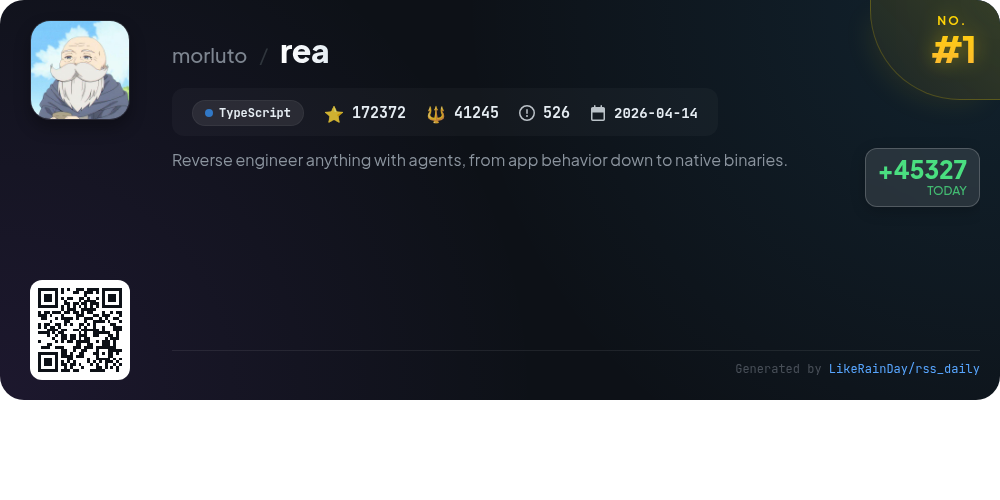
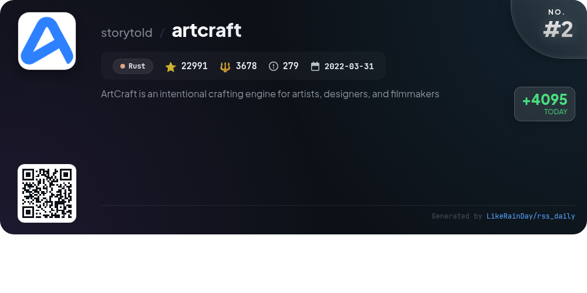
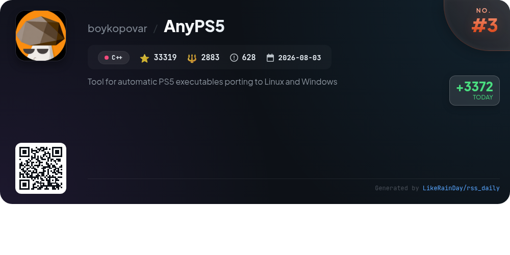
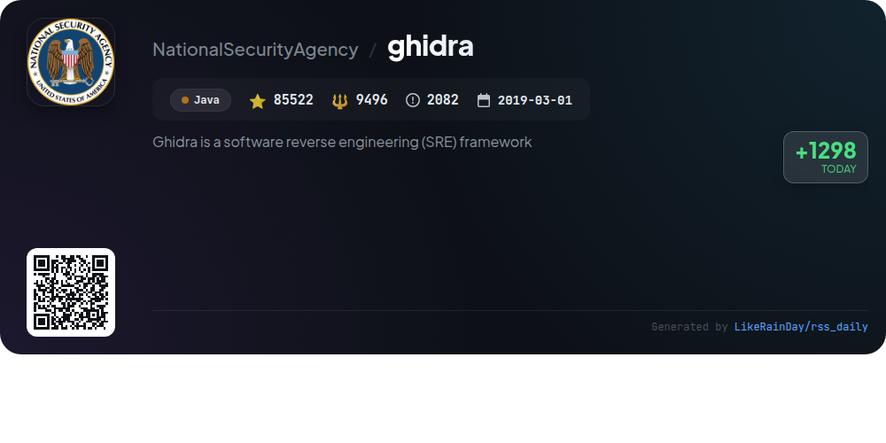
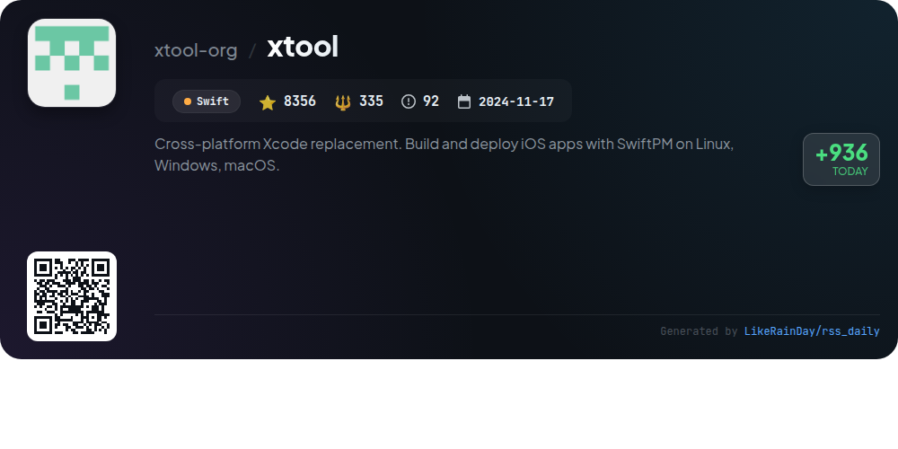
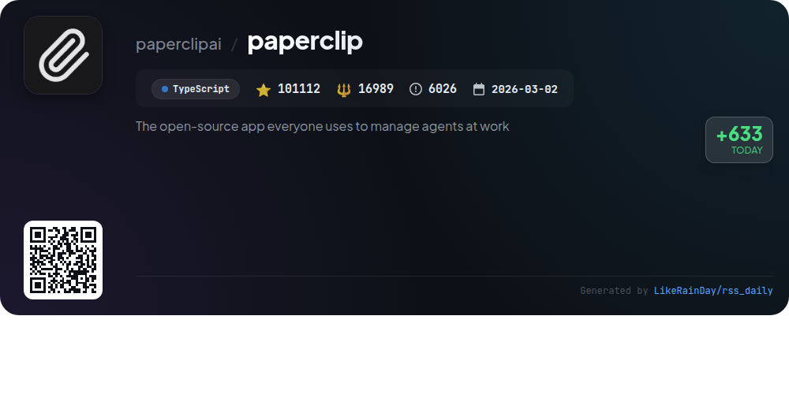
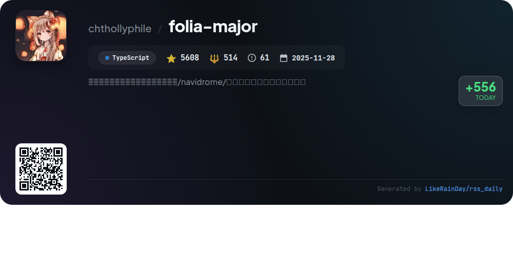
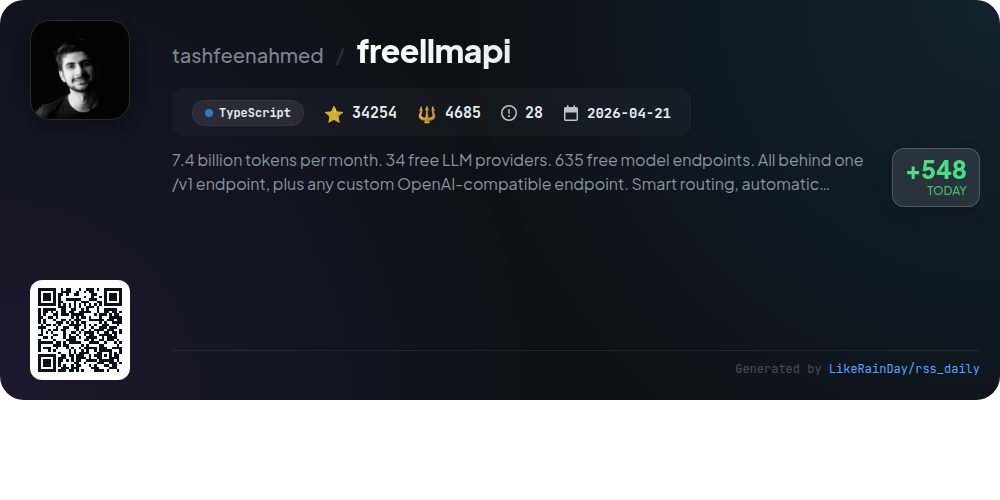

# 📊 🌟 GitHub Trending Daily - 2026-10-13

> > 📅 每日精选 GitHub 热门仓库 | 基于智能算法推荐

## 📋 Overview

**10** 个项目 | **795715** ⭐ | **131923** 🍴

**热门语言:** `TypeScript` (4) · `JavaScript` (2) · `C++` (1)

**更新时间:** 2026-10-13 06:27 UTC

**分类分布:**

- 🌟 每日 Top 10 精选 (10 项)

---

## 🌟 每日 Top 10 精选

### 1. [rea](https://github.com/morluto/rea)

> 🤖 **推荐理由**  
> *REA is a powerful TypeScript-based tool designed for reverse engineering applications, binaries, and runtime behaviors. With over 172,000 stars on GitHub, it enables users to investigate app features, analyze native binaries, and understand code without needing source files. Key features include support for JavaScript, Electron, .NET, and native formats, along with seamless integration with tools like Hopper and Ghidra. REA runs analyses locally, providing detailed findings and evidence, making it a comprehensive solution for software analysis, research, and feature reconstruction.*

- ⭐ 172372 stars
- 💻 TypeScript
- 📅 Updated: 2026-10-13

### 2. [artcraft](https://github.com/storytold/artcraft)

> 🤖 **推荐理由**  
> *ArtCraft is a Rust-based IDE designed for artists, designers, and filmmakers, boasting 22,991 stars on GitHub. It facilitates interactive AI image and video creation, offering advanced features like 3D image compositing, character posing, and mixed asset crafting. Users can explore ideas quickly with tools for text-to-image, prompted image editing, and animation. ArtCraft supports multiple models and providers, including Grok and Midjourney, and allows for precise scene building and editing. Downloadable for Windows and macOS, with development options available.*

- ⭐ 22991 stars
- 💻 Rust
- 📅 Updated: 2026-10-13

### 3. [AnyPS5](https://github.com/boykopovar/AnyPS5)

> 🤖 **推荐理由**  
> *AnyPS5 is a powerful tool designed for the automatic porting of PS5 executables to Linux and Windows, featuring a relinker for native format conversion and implementations of system PRX libraries for dynamic linking—without the need for emulation. Key highlights include support for SDL-mapped controllers, customizable input mapping, and a shader recompiler that generates validated SPIR-V. The project emphasizes interoperability and preservation, tracking per-game compatibility progress through a community-driven roadmap. Licensed under GPL v2.*

- ⭐ 33319 stars
- 💻 C++
- 📅 Updated: 2026-10-13

### 4. [gods-eye-view](https://github.com/bilawalsidhu/gods-eye-view)

> 🤖 **推荐理由**  
> *God's Eye View is a web-based spy satellite simulator offering real-time spatial intelligence on a photorealistic 3D globe. With over 54,000 stars on GitHub, it integrates live data from aircraft, ships, satellites, earthquakes, and public cameras, all accessible without API keys. Key features include a cockpit view for tracking flights, hands-free voice control powered by AI, customizable overlays, and interactive tools for real-time data analysis. The platform is open-source, enabling users to inspect and extend its capabilities, fostering community-driven exploration.*

- ⭐ 54111 stars
- 💻 JavaScript
- 📅 Updated: 2026-10-13

### 5. [ghidra](https://github.com/NationalSecurityAgency/ghidra)

> 🤖 **推荐理由**  
> *Ghidra is a powerful software reverse engineering (SRE) framework developed by the NSA, featuring high-end tools for analyzing compiled code across platforms like Windows, macOS, and Linux. Key functionalities include disassembly, decompilation, graphing, and scripting, supporting various processor instruction sets and executable formats. Users can create custom extensions and scripts in Java or Python. Ghidra aims to enhance cybersecurity by providing a scalable, customizable platform for analyzing malicious code and identifying system vulnerabilities.*

- ⭐ 85522 stars
- 💻 Java
- 📅 Updated: 2026-10-13

### 6. [xtool](https://github.com/xtool-org/xtool)

> 🤖 **推荐理由**  
> *xtool is a cross-platform replacement for Xcode, enabling the building and deployment of iOS apps with Swift Package Manager on Linux, Windows, and macOS. Key features include the ability to build SwiftPM packages into iOS apps, sign and install apps, and programmatically interact with Apple Developer Services. The tool offers a command-line interface for setup, project creation, device management, and more. With over 8,300 stars on GitHub, xtool provides a robust library for developers to integrate Apple services into their applications seamlessly.*

- ⭐ 8356 stars
- 💻 Swift
- 📅 Updated: 2026-10-13

### 7. [ECC](https://github.com/affaan-m/ECC)

> 🤖 **推荐理由**  
> *ECC is a performance optimization system for code generation agents like Claude Code and Codex, boasting 71 specialized agents, 311 skills, and 97 command shims. It streamlines workflows with features such as planning, testing, implementation, security scanning via AgentShield, and continuous learning. ECC allows for seamless integration across platforms, including Claude Code, Codex, and Qoder, enhancing code quality and productivity. Key highlights include guided setup, memory persistence, and a collaborative community for ongoing support. The project is open-source and MIT-licensed.*

- ⭐ 278070 stars
- 💻 JavaScript
- 📅 Updated: 2026-10-13

### 8. [paperclip](https://github.com/paperclipai/paperclip)

> 🤖 **推荐理由**  
> *Paperclip is an open-source app designed to manage AI agents in the workplace, boasting over 101,000 stars on GitHub. It orchestrates teams of AI agents, enabling users to define goals, assign tasks, and track progress from a single dashboard. Key features include customizable org charts, cost control, governance, and task threads. Users can connect various agents, automate workflows, and monitor their organization’s performance in real-time. Ideal for teams seeking to build autonomous AI organizations, Paperclip simplifies complex agent management with tools resembling traditional task managers.*

- ⭐ 101112 stars
- 💻 TypeScript
- 📅 Updated: 2026-10-13

### 9. [folia-major](https://github.com/chthollyphile/folia-major)

> 🤖 **推荐理由**  
> *Folia-major is an immersive online music player focused on dynamic lyric animations. It supports platforms like NetEase Cloud, KuGou, and Navidrome, along with local music libraries. Key features include intelligent lyric matching, AI-generated themes, and customizable fullscreen lyric animations. Users can deploy a desktop version via Electron or a web version using Node.js, with options for Vercel or Cloudflare deployment. The experimental module system allows users to enhance lyric visuals and functionality. Folia also offers a sync server for cross-device settings synchronization.*

- ⭐ 5608 stars
- 💻 TypeScript
- 📅 Updated: 2026-10-13

### 10. [freellmapi](https://github.com/tashfeenahmed/freellmapi)

> 🤖 **推荐理由**  
> *FreeLLMAPI is a robust API aggregator enabling access to 34 free LLM providers and 635 model endpoints through a single OpenAI-compatible `/v1` endpoint. It supports various tasks including chat, embeddings, and media generation, utilizing smart routing and automatic failover to optimize performance and stay within token limits. Key features include encrypted API keys, per-key usage tracking, a self-updating model catalog, and compatibility with multiple coding agents. Ideal for personal experimentation, it leverages 7.4 billion tokens per month across diverse models.*

- ⭐ 34254 stars
- 💻 TypeScript
- 📅 Updated: 2026-10-13

---

## 📡 RSS订阅

通过 RSS 订阅，第一时间获取每日精选项目：

- 🔔 [RSS 订阅源] (../../daily-top.xml)
- 🔔 [每日简报] (../../GITHUB_TODAY_CN.md)
- 🔔 [每日 Top 10 精选](../../daily-top.xml)

---

*⚡ Powered by Smart Trending Algorithm | Generated at 2026-10-13 06:27:46 UTC
