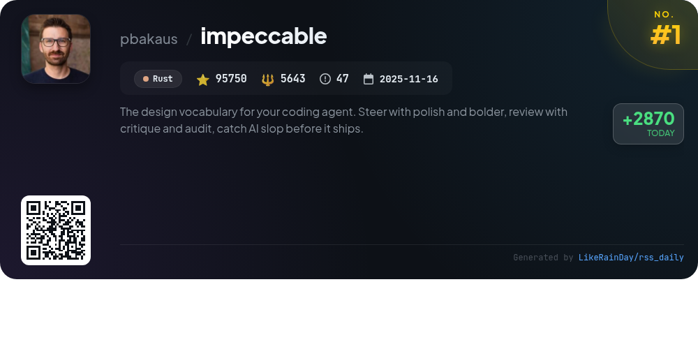
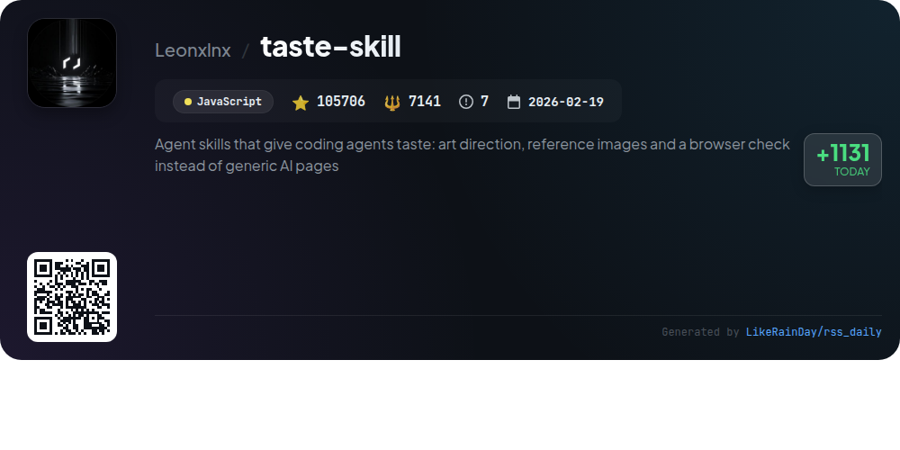
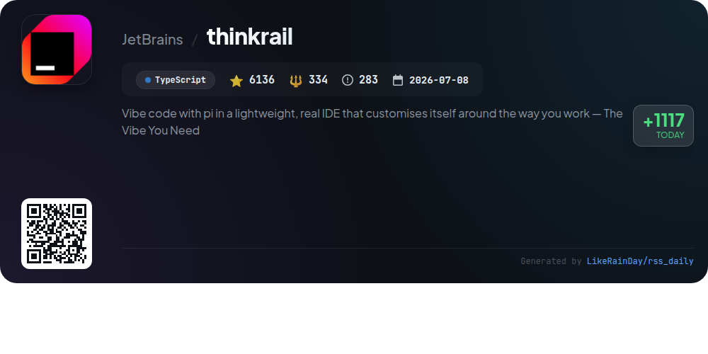
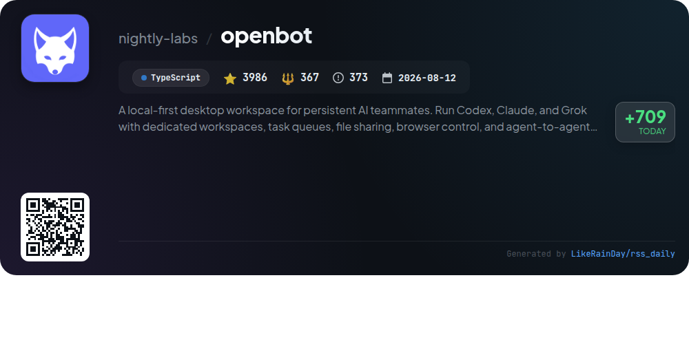

# 📊 🌟 GitHub Trending Daily - 2026-10-30

> > 📅 每日精选 GitHub 热门仓库 | 基于智能算法推荐

## 📋 Overview

**10** 个项目 | **759198** ⭐ | **87526** 🍴

**热门语言:** `JavaScript` (4) · `TypeScript` (3) · `Rust` (2)

**更新时间:** 2026-10-30 05:20 UTC

**分类分布:**

- 🌟 每日 Top 10 精选 (10 项)

---

## 🌟 每日 Top 10 精选

### 1. [impeccable](https://github.com/pbakaus/impeccable)

> 🤖 **推荐理由**  
> *Impeccable is a Rust-based design vocabulary tool for coding agents, enabling developers to enhance UI design and catch issues before deployment. Key features include commands for design steering (`polish`, `bolder`), review (`critique`, `audit`), and slop detection with 62 deterministic rules. It supports multiple coding environments, including Codex, GitHub Copilot, and more. Users can initialize projects, document design systems, and iterate live in the browser. Comprehensive documentation is available at impeccable.style/docs. The project has gained significant popularity, with over 95,750 stars on GitHub.*

- ⭐ 95750 stars
- 💻 Rust
- 📅 Updated: 2026-10-30

### 2. [LinkSwift](https://github.com/hmjz100/LinkSwift)

> 🤖 **推荐理由**  
> *LinkSwift is a JavaScript-based tool designed for retrieving direct download links from various cloud storage services, including Baidu Cloud, Alibaba Cloud, and more. With over 36,000 stars on GitHub, it enhances user experience by offering a refined UI, multi-downloader support, and improved functionality over its predecessor. Key features include link caching, theme customization, and compatibility with popular download managers like IDM and Aria2. The project emphasizes compliance and does not promise to bypass download speed limits, ensuring users can legally access their files efficiently.*

- ⭐ 36358 stars
- 💻 JavaScript
- 📅 Updated: 2026-10-30

### 3. [OpenMausBot](https://github.com/milind-soni/OpenMausBot)

> 🤖 **推荐理由**  
> *OpenMausBot is an open-source alternative to Grok Bot, enabling users to run AI bots like Claude and Codex locally in a chat app format. Key features include the ability to bring your own agents, local-first data management, and a marketplace for connected apps like Gmail and Slack. Each bot operates on its own virtual machine and can request user approval for actions. With a customizable model picker, separate channels for organization, and the ability to share bot configurations, OpenMausBot emphasizes user control and privacy.*

- ⭐ 7632 stars
- 💻 TypeScript
- 📅 Updated: 2026-10-30

### 4. [taste-skill](https://github.com/Leonxlnx/taste-skill)

> 🤖 **推荐理由**  
> *Taste Skill is a powerful JavaScript-based agent skill that enhances coding agents by providing art direction, real reference images, and browser verification for website and app screen design. It generates high-quality layouts from a brief, utilizing curated images from open archives, ensuring design integrity through real-time checks. Key features include support for dashboards and app screens, with a focus on user experience and design principles. The skill operates without API keys and integrates seamlessly with platforms like Claude Code and Codex. Visit [tasteskill.dev](https://tasteskill.dev) for more information.*

- ⭐ 105706 stars
- 💻 JavaScript
- 📅 Updated: 2026-10-30

### 5. [thinkrail](https://github.com/JetBrains/thinkrail)

> 🤖 **推荐理由**  
> *ThinkRail is an innovative IDE that adapts to your workflow, powered by the `pi` coding agent. Key features include isolated git workspaces for parallel development, an intuitive interface with Monaco editor tabs, and real-time project specifications with `SPEC.md` integration. It supports multiple concurrent `pi` sessions, allowing task delegation and interactive planning. With extension support, customizable themes, and multilingual options, ThinkRail enhances coding efficiency and collaboration. Available as a desktop app or CLI, it prioritizes user privacy and integrates seamlessly with existing git workflows.*

- ⭐ 6136 stars
- 💻 TypeScript
- 📅 Updated: 2026-10-30

### 6. [ECC](https://github.com/affaan-m/ECC)

> 🤖 **推荐理由**  
> *ECC is an advanced performance optimization system for coding agents, providing 71 specialized agents, 314 reusable skills, and 98 command shims. It integrates with Claude Code, Codex, Cursor, and other platforms, emphasizing a structured engineering process through planning, testing, implementation, review, and continuous learning. Key features include AgentShield security scanning, memory management, and customizable workflows. ECC promotes efficiency and quality in software development, making it an essential toolkit for developers seeking to enhance their coding practices.*

- ⭐ 292831 stars
- 💻 JavaScript
- 📅 Updated: 2026-10-30

### 7. [dsh-purge](https://github.com/YuJunZhiXue/dsh-purge)

> 🤖 **推荐理由**  
> *dsh-purge is a cybersecurity red-team tool designed for the DeepSeek Harness, enabling users to jailbreak various models by swapping prompts. Key features include a user-friendly interface with a Clean and Drill dock for managing patches and rules, a focus on local lab environments, and strict adherence to cybersecurity laws. The plugin ensures controlled evaluations without public internet access, emphasizes proper attribution for forks, and does not support resale. With over 13,200 stars, it is a valuable resource for enhancing model capabilities in secure settings.*

- ⭐ 13238 stars
- 💻 JavaScript
- 📅 Updated: 2026-10-30

### 8. [RuView](https://github.com/ruvnet/RuView)

> 🤖 **推荐理由**  
> *RuView transforms commodity WiFi signals into advanced spatial intelligence, enabling real-time vital sign monitoring, presence detection, and activity recognition without cameras. Key features include through-wall sensing, contactless breathing and heart rate detection, and occupancy tracking using low-cost ESP32 sensors. It integrates seamlessly with major smart home ecosystems like Home Assistant, Apple Home, Google Home, and Alexa. RuView leverages a self-learning AI model for adaptability, ensuring privacy by not relying on visual data. With over 101,000 stars on GitHub, it represents cutting-edge edge computing in smart environments.*

- ⭐ 101627 stars
- 💻 Rust
- 📅 Updated: 2026-10-30

### 9. [openbot](https://github.com/nightly-labs/openbot)

> 🤖 **推荐理由**  
> *OpenBot is a local-first desktop workspace for persistent AI teammates, enabling seamless collaboration with models like Codex, Claude, and Grok. Key features include dedicated workspaces, task queues, file sharing, and an embedded browser. Users can create and manage agents with customizable settings, monitor contexts, and facilitate agent-to-agent communication. OpenBot supports various platforms (macOS, Windows, Linux) and prioritizes user privacy with local data handling. This innovative tool fosters efficient AI interactions in a secure environment, making it ideal for developers and teams.*

- ⭐ 3986 stars
- 💻 TypeScript
- 📅 Updated: 2026-10-30

### 10. [ghidra](https://github.com/NationalSecurityAgency/ghidra)

> 🤖 **推荐理由**  
> *Ghidra is a powerful, open-source software reverse engineering (SRE) framework developed by the NSA. It offers a comprehensive suite of tools for analyzing compiled code across various platforms, including Windows, macOS, and Linux. Key features include disassembly, decompilation, graphing, and scripting support in Java and Python. Ghidra supports multiple processor instruction sets and executable formats, enabling automated and interactive analysis. Users can also create custom extensions and scripts, making it a versatile platform for cybersecurity research and analysis.*

- ⭐ 95934 stars
- 💻 Java
- 📅 Updated: 2026-10-30

---

## 📡 RSS订阅

通过 RSS 订阅，第一时间获取每日精选项目：

- 🔔 [RSS 订阅源] (../../daily-top.xml)
- 🔔 [每日简报] (../../GITHUB_TODAY_CN.md)
- 🔔 [每日 Top 10 精选](../../daily-top.xml)

---

*⚡ Powered by Smart Trending Algorithm | Generated at 2026-10-30 05:20:34 UTC
