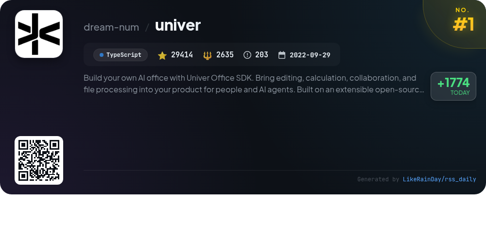
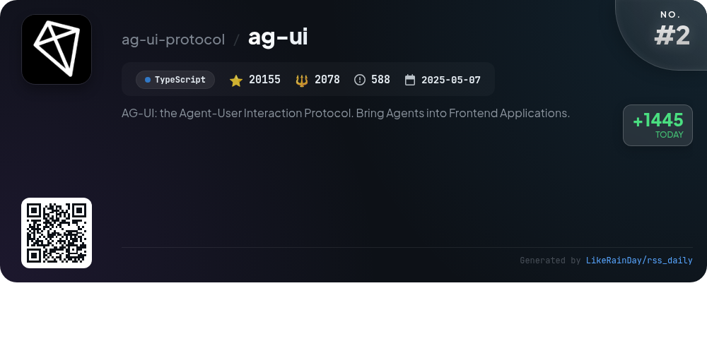
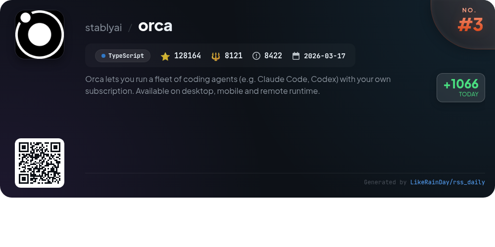
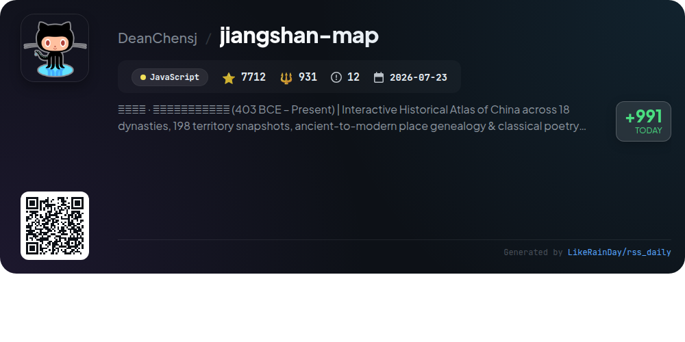
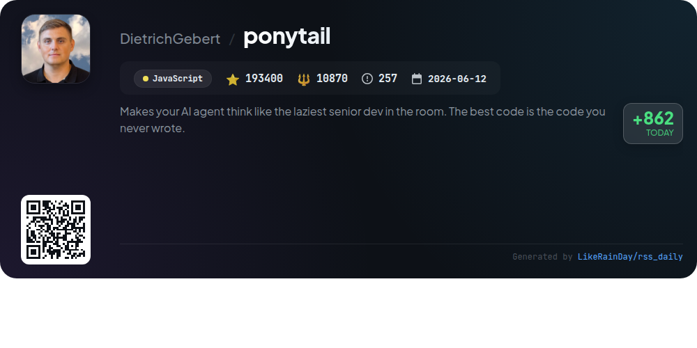
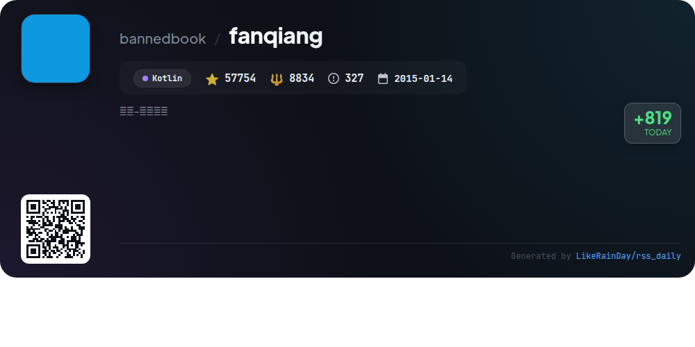
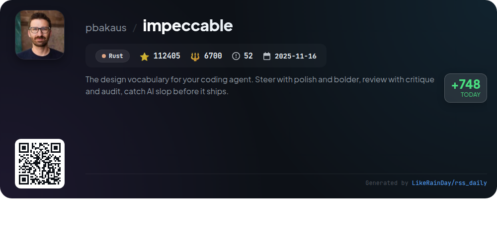
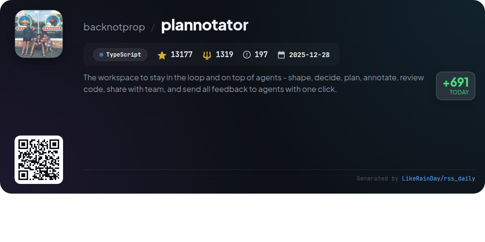

# 📊 🌟 GitHub Trending Daily - 2026-11-18

> > 📅 每日精选 GitHub 热门仓库 | 基于智能算法推荐

## 📋 Overview

**10** 个项目 | **921930** ⭐ | **90943** 🍴

**热门语言:** `TypeScript` (4) · `JavaScript` (3) · `Go` (1)

**更新时间:** 2026-11-18 06:57 UTC

**分类分布:**

- 🌟 每日 Top 10 精选 (10 项)

---

## 🌟 每日 Top 10 精选

### 1. [univer](https://github.com/dream-num/univer)

> 🤖 **推荐理由**  
> *Univer is an open-source Office SDK designed to build AI-enhanced office applications, incorporating editing, calculation, collaboration, and file processing capabilities. Key features include a Web SDK for content management, a Server SDK for real-time collaboration, and an AI SDK for integrating with existing workflows. Users can create customizable editors for spreadsheets and documents, leverage plugins for advanced functionalities, and utilize Facade APIs for seamless integration. With 29,414 stars on GitHub, Univer supports diverse applications and fosters a collaborative development community.*

- ⭐ 29414 stars
- 💻 TypeScript
- 📅 Updated: 2026-11-18

### 2. [ag-ui](https://github.com/ag-ui-protocol/ag-ui)

> 🤖 **推荐理由**  
> *AG-UI is an open, lightweight protocol designed to connect AI agents with user-facing applications, enabling seamless interaction across various platforms including web, mobile, and terminal clients. Key features include bi-directional event streaming, support for streaming chat, generative UI, shared state management, and integration with multiple agent frameworks like LangChain and Microsoft Agent Framework. The stable 1.0 version boasts backward compatibility and extensive SDKs in TypeScript, Python, and .NET, making it a versatile solution for building interactive AI experiences.*

- ⭐ 20155 stars
- 💻 TypeScript
- 📅 Updated: 2026-11-18

### 3. [orca](https://github.com/stablyai/orca)

> 🤖 **推荐理由**  
> *Orca is a powerful AI orchestrator that enables users to manage a fleet of coding agents, such as Claude Code and Codex, using their own subscriptions. Available on desktop and mobile, Orca allows for seamless collaboration in chat or terminal modes, orchestration of tasks across multiple agents, and continuous operation via remote servers. Key features include parallel workspaces, Git integration, mobile notifications, and plugin support, making it ideal for developers looking to enhance productivity with AI tools. Ideal for macOS, Windows, and Linux users.*

- ⭐ 128164 stars
- 💻 TypeScript
- 📅 Updated: 2026-11-18

### 4. [jiangshan-map](https://github.com/DeanChensj/jiangshan-map)

> 🤖 **推荐理由**  
> *The "jiangshan-map" project offers an interactive historical atlas of China, spanning 403 BCE to the present across 18 dynasties. Users can explore over 2,400 years of history through features like a dynamic timeline to visualize territorial changes, ancient city genealogies, and significant historical events. The platform allows for tracking historical figures' journeys, and features a quiz to test geographical knowledge. With multi-language support and a user-friendly interface, this tool enriches the understanding of China's historical geography.*

- ⭐ 7712 stars
- 💻 JavaScript
- 📅 Updated: 2026-11-18

### 5. [ECC](https://github.com/affaan-m/ECC)

> 🤖 **推荐理由**  
> *ECC is an advanced performance optimization system designed to enhance agent capabilities in coding environments like Claude Code, Codex, and others. It features 72 specialized agents, 327 reusable skills, and 98 command shims for tasks like planning, testing, and code review. ECC emphasizes a structured workflow that includes planning, implementation, and security checks, supported by tools like AgentShield for vulnerability scanning. The system integrates seamlessly with multiple platforms, allowing for a comprehensive coding experience while maintaining high security and performance standards.*

- ⭐ 305808 stars
- 💻 JavaScript
- 📅 Updated: 2026-11-18

### 6. [ponytail](https://github.com/DietrichGebert/ponytail)

> 🤖 **推荐理由**  
> *Ponytail is an innovative JavaScript project designed to enhance AI agents by enabling them to adopt the approach of a seasoned developer, minimizing unnecessary code. With 193,400 stars, it emphasizes writing efficient, minimal code while maintaining rigorous testing and security standards. Key features include the `/ponytail-review` and `/ponytail-audit` commands for code reviews and audits, as well as performance metrics tracking. Ponytail 5 showcases significant reductions in code, time, cost, and tokens while ensuring high-quality output, making it a valuable tool for developers seeking efficiency and reliability.*

- ⭐ 193400 stars
- 💻 JavaScript
- 📅 Updated: 2026-11-18

### 7. [fanqiang](https://github.com/bannedbook/fanqiang)

> 🤖 **推荐理由**  
> *The "fanqiang" project, a popular tool for circumventing internet censorship, boasts over 57,000 stars on GitHub. Built in Kotlin, it provides extensive resources including tutorials for Android, iOS, Windows, macOS, and Linux users on setting up various VPN solutions like V2ray, Shadowsocks, and Tor. Key features include one-click installation packages for Chrome, Firefox, and Edge, as well as guides for configuring gaming consoles and routers. Users can access free VPN accounts and a comprehensive FAQ to enhance their online experience.*

- ⭐ 57754 stars
- 💻 Kotlin
- 📅 Updated: 2026-11-18

### 8. [open-code-review](https://github.com/alibaba/open-code-review)

> 🤖 **推荐理由**  
> *Open Code Review is a hybrid AI-powered code review tool developed by Alibaba, designed for high precision and efficiency. It features deterministic pipelines combined with an LLM agent to generate precise line-level comments, supporting multiple programming languages and built-in rules for vulnerabilities like NPE and SQL injection. The tool excels in identifying code defects while ensuring minimal false positives. With options for Git integration and various review modes, it streamlines the code review process, making it ideal for teams aiming to enhance code quality at scale. Visit the official site for more details.*

- ⭐ 53941 stars
- 💻 Go
- 📅 Updated: 2026-11-18

### 9. [impeccable](https://github.com/pbakaus/impeccable)

> 🤖 **推荐理由**  
> *Impeccable is a Rust-based design tool that enhances coding agents by providing a structured design vocabulary. It enables users to refine their projects with commands like `polish`, `bolder`, `critique`, and `audit`, ensuring high-quality outputs before deployment. Key features include a slop detector that identifies design flaws, a UX reviewer that scores usability, and live mode for real-time iteration directly in the browser. It integrates seamlessly with various coding tools, making it ideal for enhancing existing interfaces or creating new designs efficiently. Comprehensive documentation is available at impeccable.style/docs.*

- ⭐ 112405 stars
- 💻 Rust
- 📅 Updated: 2026-11-18

### 10. [plannotator](https://github.com/backnotprop/plannotator)

> 🤖 **推荐理由**  
> *Plannotator is a TypeScript-based workspace designed to streamline collaboration with AI coding agents. It features a comprehensive inbox for managing agent communications, allowing users to annotate plans, specs, and HTML documents, and provide feedback directly. The platform supports code reviews for both local changes and remote PRs, integrating with GitHub, GitLab, and more. Key services include guided reviews and terminal annotations through Herdr. With over 13,000 stars, Plannotator enhances team workflows, enabling seamless interaction with multiple agents in real-time.*

- ⭐ 13177 stars
- 💻 TypeScript
- 📅 Updated: 2026-11-18

---

## 📡 RSS订阅

通过 RSS 订阅，第一时间获取每日精选项目：

- 🔔 [RSS 订阅源] (../../daily-top.xml)
- 🔔 [每日简报] (../../GITHUB_TODAY_CN.md)
- 🔔 [每日 Top 10 精选](../../daily-top.xml)

---

*⚡ Powered by Smart Trending Algorithm | Generated at 2026-11-18 06:57:32 UTC
