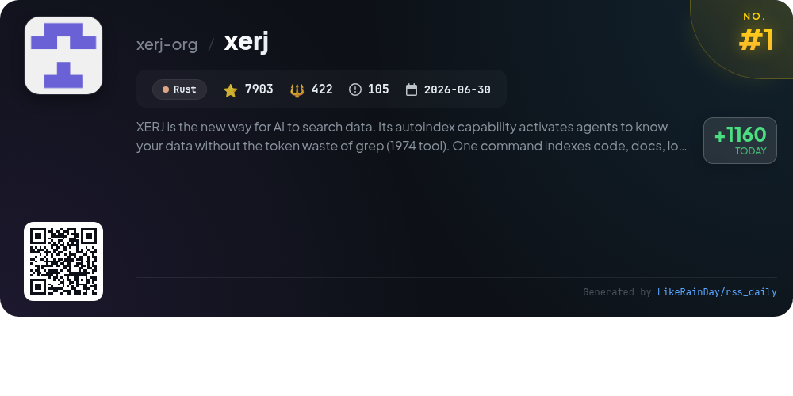
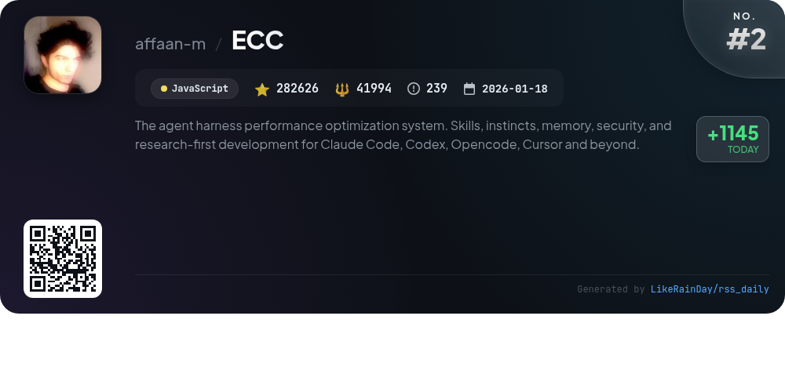
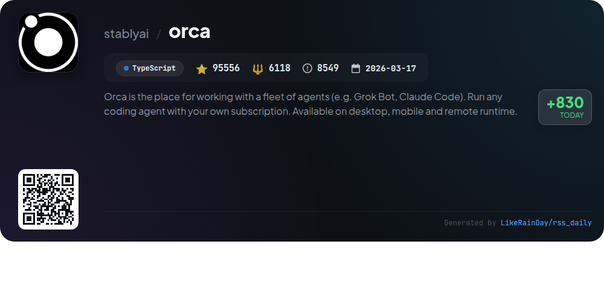
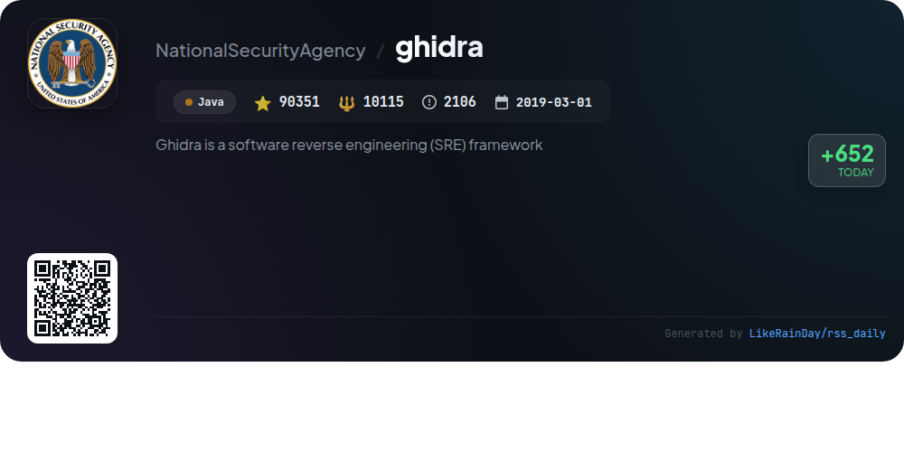
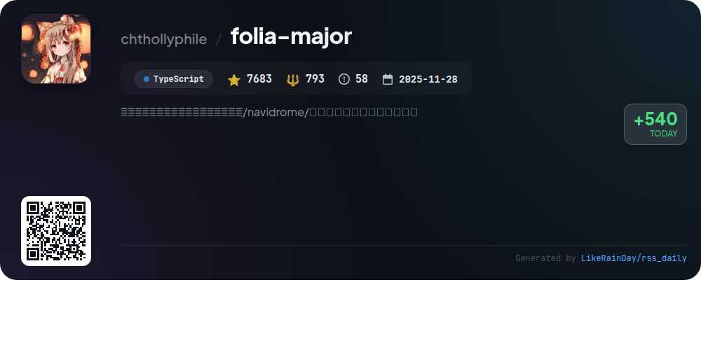
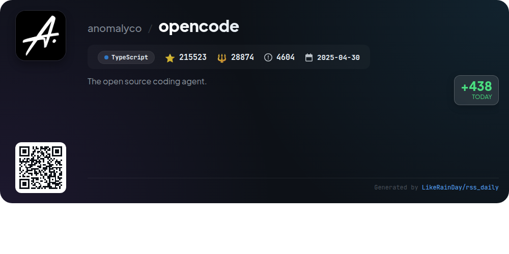
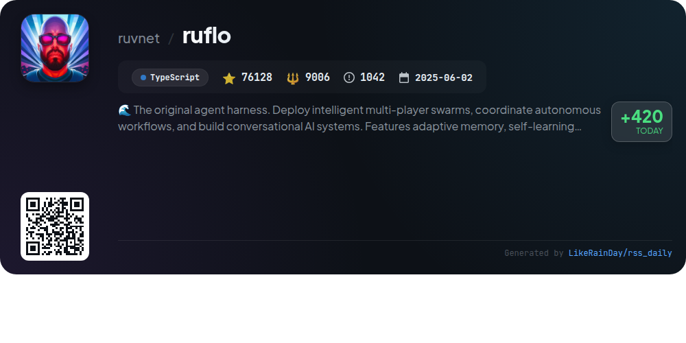
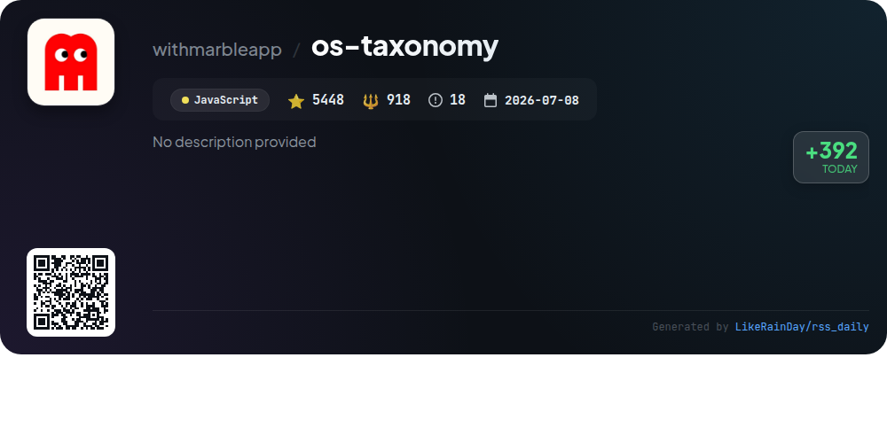

# 📊 🌟 GitHub Trending Daily - 2026-10-18

> > 📅 每日精选 GitHub 热门仓库 | 基于智能算法推荐

## 📋 Overview

**10** 个项目 | **971964** ⭐ | **108739** 🍴

**热门语言:** `JavaScript` (4) · `TypeScript` (4) · `Rust` (1)

**更新时间:** 2026-10-18 04:03 UTC

**分类分布:**

- 🌟 每日 Top 10 精选 (10 项)

---

## 🌟 每日 Top 10 精选

### 1. [xerj](https://github.com/xerj-org/xerj)

> 🤖 **推荐理由**  
> *XERJ is a revolutionary AI-driven data search tool that autoindexes code, documents, logs, and PDFs with 40x fewer tokens than traditional grep. Its features include reference coding, seamless integration with existing tools, and support for various file types, making it a cost-effective alternative to ElasticSearch. Users report up to 5x token savings in real development. With capabilities for security audits, agent memory, and hybrid search, XERJ enhances efficiency in coding tasks while significantly reducing infrastructure costs.*

- ⭐ 7903 stars
- 💻 Rust
- 📅 Updated: 2026-10-18

### 2. [ECC](https://github.com/affaan-m/ECC)

> 🤖 **推荐理由**  
> *ECC is an advanced agent harness performance optimization system designed to enhance code development processes. It provides 71 specialized agents, 311 skills, and 97 command shims, enabling seamless workflows for planning, testing, implementation, and review. Key features include memory persistence, security scanning via AgentShield, continuous learning, and a comprehensive rule set for various programming languages. ECC supports integration with Claude Code, Codex, Cursor, and other platforms, making it a versatile tool for developers seeking to streamline their coding practices.*

- ⭐ 282626 stars
- 💻 JavaScript
- 📅 Updated: 2026-10-18

### 3. [LinkSwift](https://github.com/hmjz100/LinkSwift)

> 🤖 **推荐理由**  
> *LinkSwift is a JavaScript-based tool that simplifies obtaining direct download links for files from various cloud storage services, including Baidu Cloud, Aliyun Pan, and more. With over 24,000 stars on GitHub, it offers features such as link beautification and compatibility with multiple download managers. Key highlights include enhanced support for new cloud services, a user-friendly interface, and regular updates to improve functionality. LinkSwift focuses on providing a legal means for users to download files efficiently without infringing on cloud service policies.*

- ⭐ 24423 stars
- 💻 JavaScript
- 📅 Updated: 2026-10-18

### 4. [ponytail](https://github.com/DietrichGebert/ponytail)

> 🤖 **推荐理由**  
> *Ponytail is a JavaScript library designed to optimize AI agent coding efficiency by mimicking a seasoned developer's lazy yet effective approach. With over 166,000 stars, it emphasizes writing minimal code while maintaining high functionality, achieving a 53% reduction in code and a 41% decrease in time. Key features include `/ponytail-review` for diff analysis, `/ponytail-audit` for comprehensive repo checks, and a band monitoring tool for task metrics. Ponytail ensures robust validation and security, making it an essential tool for streamlined, cost-effective development.*

- ⭐ 166323 stars
- 💻 JavaScript
- 📅 Updated: 2026-10-18

### 5. [orca](https://github.com/stablyai/orca)

> 🤖 **推荐理由**  
> *Orca is a powerful platform for managing a fleet of coding agents like Claude Code and Codex, accessible on desktop and mobile. Key features include parallel worktrees for comparing agent outputs, a mobile companion for remote monitoring, and advanced terminal splits. Users can leverage design mode to extract UI elements, handle GitHub issues natively, and utilize SSH for remote work. With an intuitive CLI and support for various agents, Orca enhances productivity for developers, making it a versatile tool for AI-driven coding workflows.*

- ⭐ 95556 stars
- 💻 TypeScript
- 📅 Updated: 2026-10-18

### 6. [ghidra](https://github.com/NationalSecurityAgency/ghidra)

> 🤖 **推荐理由**  
> *Ghidra is a powerful open-source software reverse engineering (SRE) framework developed by the NSA, featuring advanced tools for disassembly, decompilation, and analysis of compiled code across multiple platforms (Windows, macOS, Linux). With extensive support for various processor instruction sets and executable formats, Ghidra offers both interactive and automated analysis modes. Users can create custom extensions and scripts in Java or Python. It aims to enhance cybersecurity efforts by enabling deep insights into vulnerabilities, making it invaluable for security analysts.*

- ⭐ 90351 stars
- 💻 Java
- 📅 Updated: 2026-10-18

### 7. [folia-major](https://github.com/chthollyphile/folia-major)

> 🤖 **推荐理由**  
> *Folia-major is an immersive online music player focusing on stunning lyric animations. It supports multiple platforms, including local music libraries and services like Navidrome, Netease Cloud, KuGou, and QQ Music. Key features include intelligent lyric matching, AI-generated themes based on song emotions, and customizable full-screen lyric displays. Folia offers both a desktop version (Windows, macOS, Linux) and a web version deployable via Vercel. It also features an experimental mod system for enhanced user experience and a sync server for cross-device settings.*

- ⭐ 7683 stars
- 💻 TypeScript
- 📅 Updated: 2026-10-18

### 8. [opencode](https://github.com/anomalyco/opencode)

> 🤖 **推荐理由**  
> *OpenCode is an open-source AI coding agent built with TypeScript, boasting over 215,000 stars on GitHub. It features two built-in agents, "build" for full development access and "plan" for read-only analysis, facilitating code exploration and planning. Users can switch between agents seamlessly. OpenCode offers installation through various package managers, a desktop app for macOS, Windows, and Linux, and comprehensive documentation. Community engagement is encouraged via Discord, making OpenCode a valuable resource for developers seeking AI assistance in coding tasks.*

- ⭐ 215523 stars
- 💻 TypeScript
- 📅 Updated: 2026-10-18

### 9. [ruflo](https://github.com/ruvnet/ruflo)

> 🤖 **推荐理由**  
> *Ruflo is an advanced agent harness designed for deploying intelligent multi-player swarms and coordinating autonomous workflows. Key features include adaptive memory, self-learning intelligence, and secure agent federation across machines. Ruflo integrates with Claude Code, Codex, and other AI models, offering over 100 specialized agents and a robust plugin marketplace. Its architecture supports swarm coordination, background workers, and zero-trust federation, enabling seamless collaboration and data security. Ideal for building complex conversational AI systems, Ruflo significantly enhances productivity and task automation.*

- ⭐ 76128 stars
- 💻 TypeScript
- 📅 Updated: 2026-10-18

### 10. [os-taxonomy](https://github.com/withmarbleapp/os-taxonomy)

> 🤖 **推荐理由**  
> *The os-taxonomy project by Marble is an open, structured learning taxonomy for primary education, comprising 1,590 micro-topics aligned with various national curriculum standards. It features a prerequisite graph with 3,221 dependencies, enabling educators to trace concepts and required knowledge hierarchies. The dataset is accessible as JSON, facilitating easy integration into applications. Core subjects include Science, Mathematics, and English. Users can explore the interactive 3D visualization at withmarble.com/curriculum. The project is multi-licensed, promoting both research and commercial use while ensuring attribution.*

- ⭐ 5448 stars
- 💻 JavaScript
- 📅 Updated: 2026-10-18

---

## 📡 RSS订阅

通过 RSS 订阅，第一时间获取每日精选项目：

- 🔔 [RSS 订阅源] (../../daily-top.xml)
- 🔔 [每日简报] (../../GITHUB_TODAY_CN.md)
- 🔔 [每日 Top 10 精选](../../daily-top.xml)

---

*⚡ Powered by Smart Trending Algorithm | Generated at 2026-10-18 04:03:55 UTC
