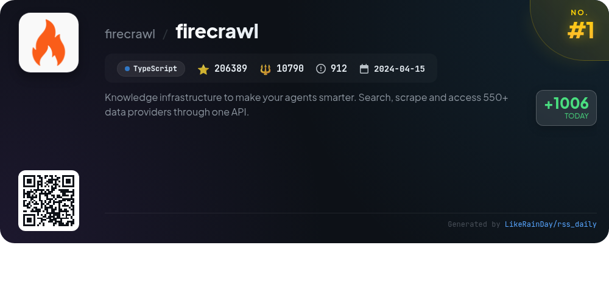
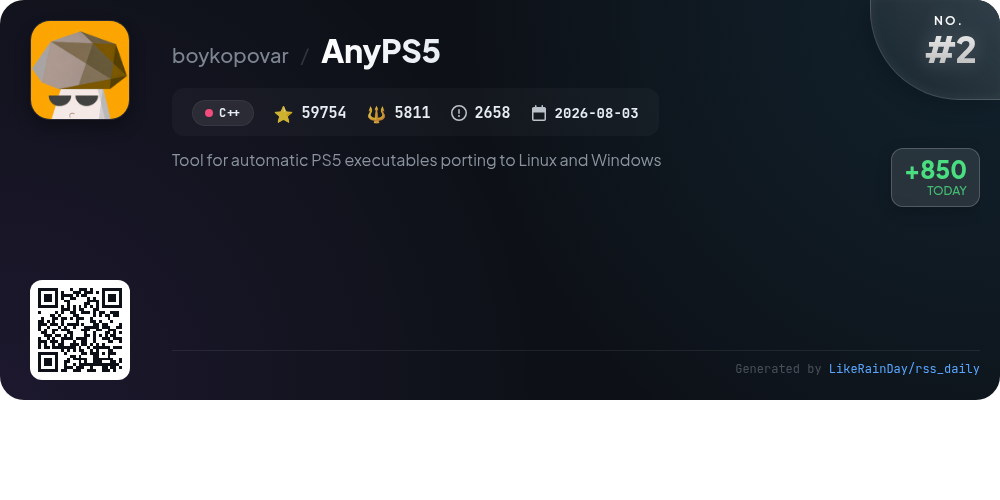
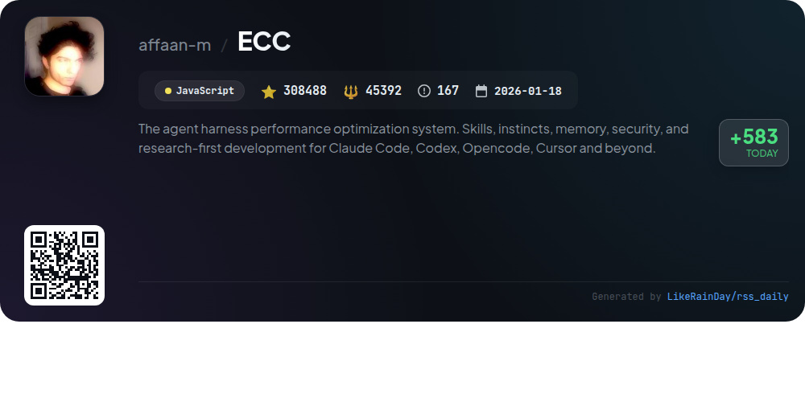
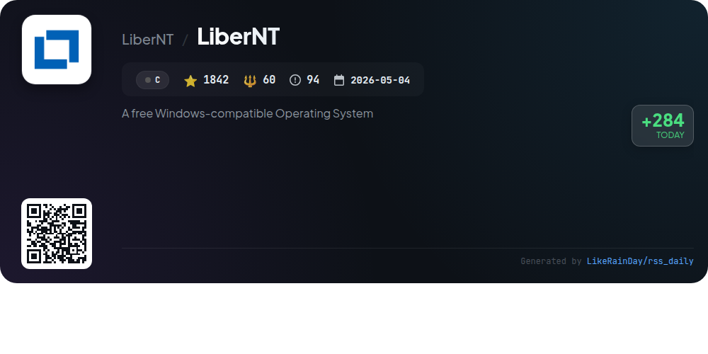
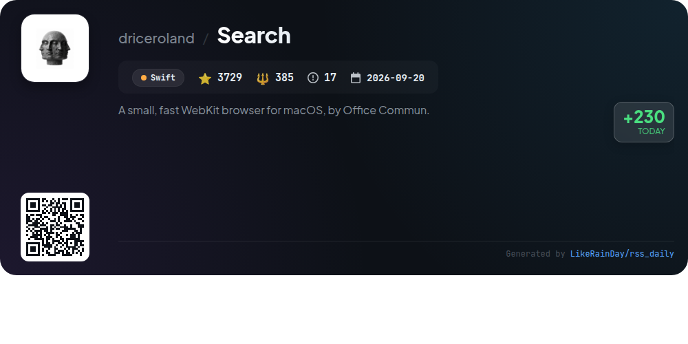
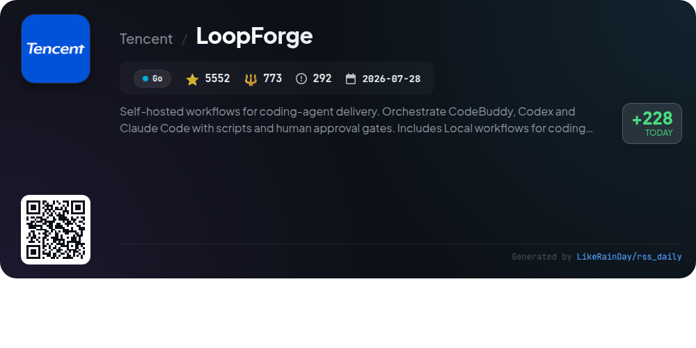

# 📊 🌟 GitHub Trending Daily - 2026-11-22

> > 📅 每日精选 GitHub 热门仓库 | 基于智能算法推荐

## 📋 Overview

**10** 个项目 | **888383** ⭐ | **83317** 🍴

**热门语言:** `TypeScript` (4) · `JavaScript` (2) · `C` (1)

**更新时间:** 2026-11-22 06:08 UTC

**分类分布:**

- 🌟 每日 Top 10 精选 (10 项)

---

## 🌟 每日 Top 10 精选

### 1. [firecrawl](https://github.com/firecrawl/firecrawl)

> 🤖 **推荐理由**  
> *Firecrawl is a powerful knowledge infrastructure designed to enhance AI agents by providing seamless access to over 550 data providers through a single API. Key features include Firecrawl Local for local scraping and crawling, Firecrawl Cloud for scalable web data access, and self-hosting options for full server deployment. Users can perform searches, scrape content as clean markdown or JSON, interact with web pages, and utilize an autonomous agent for data retrieval. With fast performance and LLM-ready outputs, Firecrawl is ideal for real-time AI applications.*

- ⭐ 206389 stars
- 💻 TypeScript
- 📅 Updated: 2026-11-22

### 2. [AnyPS5](https://github.com/boykopovar/AnyPS5)

> 🤖 **推荐理由**  
> *AnyPS5 is a powerful tool for automatically porting PS5 executables to Linux and Windows, featuring a relinker that converts executables to native formats without emulation. Key highlights include a web converter, support for SDL-mapped game controllers, and an advanced shader recompiler that produces validated SPIR-V. The project is designed for interoperability and research, with a dedicated Discord community and extensive documentation. AnyPS5 is open-source under the GPL v2 license and operates independently of Sony Interactive Entertainment.*

- ⭐ 59754 stars
- 💻 C++
- 📅 Updated: 2026-11-22

### 3. [ponytail](https://github.com/DietrichGebert/ponytail)

> 🤖 **推荐理由**  
> *Ponytail is a JavaScript project designed to enhance AI agents' coding efficiency by emulating the approach of a seasoned developer who prioritizes simplicity. With over 196,000 stars, it reduces code complexity by up to 53% while maintaining robust testing and security. Key features include `/ponytail-review` for detailed code audits, `/ponytail-audit` for whole-repo assessments, and a comprehensive task management system. Ponytail emphasizes writing only necessary code, optimizing costs and performance, making it a valuable tool for developers seeking streamlined solutions.*

- ⭐ 196487 stars
- 💻 JavaScript
- 📅 Updated: 2026-11-22

### 4. [ECC](https://github.com/affaan-m/ECC)

> 🤖 **推荐理由**  
> *ECC is a performance optimization system designed for coding agents, integrating skills, instincts, memory, and security. Key features include 72 specialized agents, 328 reusable skills, and 99 command shims, all aimed at enhancing code quality through structured workflows like Test-Driven Development (TDD) and security reviews. It supports multiple models, including Claude Code and Codex, and offers a guided setup for easy installation. ECC emphasizes continuous learning and incorporates AgentShield for security scanning, making it a comprehensive tool for efficient code management and development.*

- ⭐ 308488 stars
- 💻 JavaScript
- 📅 Updated: 2026-11-22

### 5. [AFFiNE](https://github.com/toeverything/AFFiNE)

> 🤖 **推荐理由**  
> *AFFiNE is a next-gen, open-source knowledge base designed as an alternative to Notion and Miro. It combines writing, drawing, and planning into a single platform, emphasizing privacy and local-first data ownership. Key features include a versatile canvas for various content types, multimodal AI assistance for enhanced creativity, real-time collaboration, and self-hosting capabilities. With 76,415 stars on GitHub, AFFiNE offers a customizable workspace for knowledge management, presentations, and digital assets, making it ideal for creative minds.*

- ⭐ 76415 stars
- 💻 TypeScript
- 📅 Updated: 2026-11-22

### 6. [stitch-skills](https://github.com/google-labs-code/stitch-skills)

> 🤖 **推荐理由**  
> *Stitch Skills is a TypeScript library of Agent Skills designed for use with the Stitch MCP server, adhering to the Agent Skills open standard. It offers three core plugins: `stitch-design` for design management, `stitch-build` for code generation and integration, and `stitch-utilities` for enhancing design prompts and enforcing standards. Key features include converting frontend code to Stitch designs, generating responsive components, and automating multi-page website creation. With over 11,500 stars, it supports popular coding agents like Codex, Claude Code, and Cursor, streamlining design workflows and enhancing productivity.*

- ⭐ 11558 stars
- 💻 TypeScript
- 📅 Updated: 2026-11-22

### 7. [LiberNT](https://github.com/LiberNT/LiberNT)

> 🤖 **推荐理由**  
> *LiberNT is a free, Windows-compatible operating system actively developed in C, designed for amd64, arm64, and riscv64 architectures. Key features include UEFI boot support, a Windows 11-compatible driver model, and extensive hardware support, including Raspberry Pi. It focuses on stability, efficiency, and modern hardware integration, offering tools for users to customize their builds. Users can download prebuilt images or build from source. With over 1,800 stars on GitHub, LiberNT fosters community contributions and aims to provide a reliable, maintainable OS experience.*

- ⭐ 1842 stars
- 💻 C
- 📅 Updated: 2026-11-22

### 8. [plugins](https://github.com/cursor/plugins)

> 🤖 **推荐理由**  
> *The plugins project provides official Cursor plugins for various developer tools, frameworks, and SaaS products, enhancing productivity and automation. Each plugin features a unique directory with a manifest for seamless integration. Key offerings include tools for teaching, continual learning, CI workflows, and extensive integrations with platforms like Google, Salesforce, and Zoom. The repository supports a multi-plugin marketplace structure, facilitating easy access to a wide array of functionalities. With over 18,000 stars, it showcases a robust community and active development.*

- ⭐ 18169 stars
- 💻 TypeScript
- 📅 Updated: 2026-11-22

### 9. [Search](https://github.com/driceroland/Search)

> 🤖 **推荐理由**  
> *Search is a lightweight, fast web browser for macOS, developed by Office Commun. Utilizing WebKit, it features a minimalistic interface with a single address/search field and unobtrusive tab management. Key highlights include a built-in ad blocker, reading mode, split view for side-by-side browsing, and a focus on privacy, with no account or telemetry requirements. Users can also manage passwords securely through macOS Keychain and utilize Chrome extensions. Search prioritizes speed, simplicity, and user control, making it an efficient tool for browsing.*

- ⭐ 3729 stars
- 💻 Swift
- 📅 Updated: 2026-11-22

### 10. [LoopForge](https://github.com/Tencent/LoopForge)

> 🤖 **推荐理由**  
> *LoopForge is a self-hosted workflow platform designed for efficient software delivery using coding agents like CodeBuddy, Codex, and Claude Code. Key features include a chat-driven interface for real-time collaboration, Standard Operating Procedures (SOPs) for repeatable processes, and Docker sandbox environments for secure execution. Users can manage project roles, implement approval gates, and track requirements end-to-end. With over 5,500 stars, LoopForge offers a robust solution for teams seeking structured, automated coding workflows on their own infrastructure.*

- ⭐ 5552 stars
- 💻 Go
- 📅 Updated: 2026-11-22

---

## 📡 RSS订阅

通过 RSS 订阅，第一时间获取每日精选项目：

- 🔔 [RSS 订阅源] (../../daily-top.xml)
- 🔔 [每日简报] (../../GITHUB_TODAY_CN.md)
- 🔔 [每日 Top 10 精选](../../daily-top.xml)

---

*⚡ Powered by Smart Trending Algorithm | Generated at 2026-11-22 06:08:53 UTC
