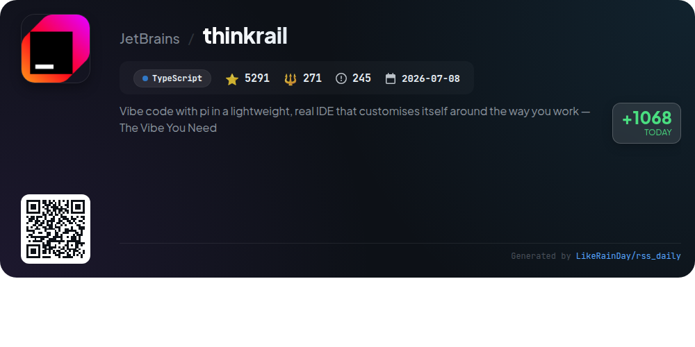
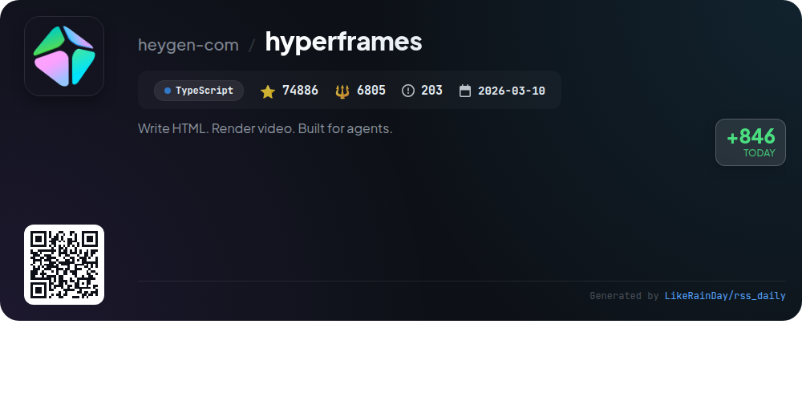
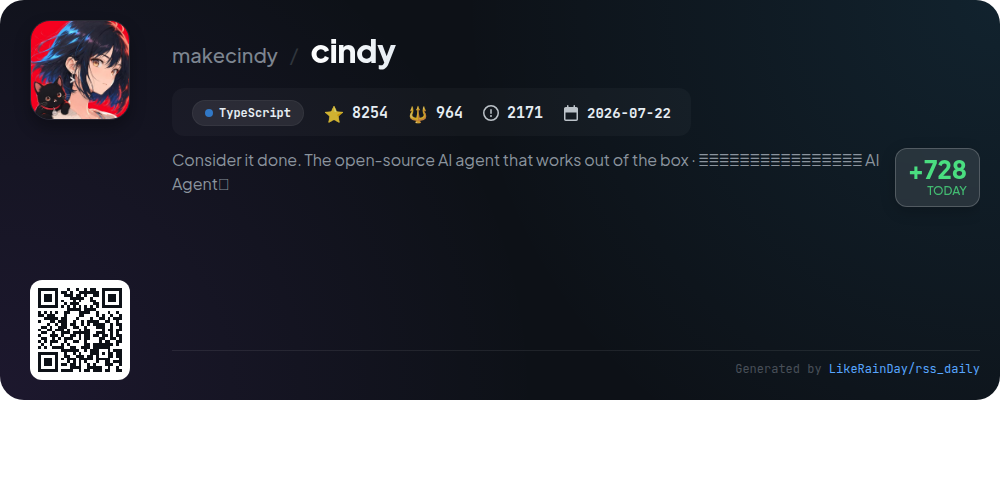

# 📊 🌟 GitHub Trending Daily - 2026-10-29

> > 📅 每日精选 GitHub 热门仓库 | 基于智能算法推荐

## 📋 Overview

**10** 个项目 | **669479** ⭐ | **76990** 🍴

**热门语言:** `TypeScript` (5) · `JavaScript` (4) · `Rust` (1)

**更新时间:** 2026-10-29 05:21 UTC

**分类分布:**

- 🌟 每日 Top 10 精选 (10 项)

---

## 🌟 每日 Top 10 精选

### 1. [LinkSwift](https://github.com/hmjz100/LinkSwift)

> 🤖 **推荐理由**  
> *LinkSwift is a JavaScript-based tool designed to retrieve direct download links from various cloud storage services, including Baidu Cloud, Aliyun Disk, China Mobile Cloud, and more. It enhances the original "网盘直链下载助手" by adding features like UI beautification and support for multiple download managers. With over 35,000 stars on GitHub, LinkSwift emphasizes compliance and does not promise to bypass any speed limits imposed by service providers. Users can easily install it from GitHub, OpenUserJS, or other trusted sources for a seamless downloading experience.*

- ⭐ 35344 stars
- 💻 JavaScript
- 📅 Updated: 2026-10-29

### 2. [impeccable](https://github.com/pbakaus/impeccable)

> 🤖 **推荐理由**  
> *Impeccable is a Rust-based design vocabulary tool for coding agents that enhances UI development by providing commands to refine, review, and validate designs. Key features include `polish` and `bolder` for steering design, `critique` and `audit` for usability and technical reviews, and a slop detector that flags design issues. Compatible with various coding environments like GitHub Copilot and Codex, it enables live iteration and comprehensive documentation. Impeccable streamlines design processes, ensuring polished, accessible, and high-quality outputs before deployment.*

- ⭐ 93263 stars
- 💻 Rust
- 📅 Updated: 2026-10-29

### 3. [dsh-purge](https://github.com/YuJunZhiXue/dsh-purge)

> 🤖 **推荐理由**  
> *dsh-purge is a cybersecurity red-team tool designed for the DeepSeek Harness, enabling jailbreak functionality across various models with customizable prompts. Key features include a user-friendly interface with "Clean" and "Drill" pages, allowing users to manage patch statuses, apply rules, and conduct controlled evaluations in a local lab environment. The plugin enhances prompt management and maintains strict security policies, ensuring operations are confined to local networks. With over 12,000 stars on GitHub, it supports both web and desktop applications while adhering to open-source principles.*

- ⭐ 12394 stars
- 💻 JavaScript
- 📅 Updated: 2026-10-29

### 4. [thinkrail](https://github.com/JetBrains/thinkrail)

> 🤖 **推荐理由**  
> *ThinkRail is an innovative, lightweight IDE designed to enhance coding productivity through agentic features. It offers isolated workspaces for Git projects, allowing parallel work with durable project knowledge via living specs. Core features include multitasking with concurrent `pi` sessions, a rich UI with Monaco editor integration, and real-time collaboration tools. Users benefit from built-in agent skills, customizable themes, and language support, alongside a native desktop app or browser CLI. Join the community on Discord for support and collaboration.*

- ⭐ 5291 stars
- 💻 TypeScript
- 📅 Updated: 2026-10-29

### 5. [openbot](https://github.com/nightly-labs/openbot)

> 🤖 **推荐理由**  
> *OpenBot is a local-first desktop workspace designed for persistent AI teammates, enabling users to run Codex, Claude, Grok, and more in dedicated environments. Key features include customizable agent workspaces, task queues, local file sharing, and an embedded browser for seamless interaction. Users can create and edit agents, facilitate agent-to-agent collaboration, and manage shared tasks with comprehensive controls. OpenBot prioritizes data privacy and supports macOS, Windows, and Linux, making it a versatile tool for AI-driven workflows.*

- ⭐ 3401 stars
- 💻 TypeScript
- 📅 Updated: 2026-10-29

### 6. [ECC](https://github.com/affaan-m/ECC)

> 🤖 **推荐理由**  
> *ECC is a powerful performance optimization system for coding agents, facilitating improved workflows through its 71 specialized agents and 311 reusable skills. Key features include memory persistence, automated security scanning via AgentShield, and a guided setup for harnesses like Claude Code, Codex, and Kimi Code. Designed for efficiency, ECC enhances task management with features like planning, implementation, and review processes, while supporting various programming environments. Its open-source nature allows for continuous community-driven improvements, making it an essential tool for developers.*

- ⭐ 291923 stars
- 💻 JavaScript
- 📅 Updated: 2026-10-29

### 7. [postiz-app](https://github.com/gitroomhq/postiz-app)

> 🤖 **推荐理由**  
> *Postiz is an advanced social media scheduling tool designed for content automation, analytics, and team collaboration. With over 40,000 stars on GitHub, it allows users to schedule posts across various platforms, including Instagram, YouTube, and TikTok. Key features include AI-assisted content creation, extensive analytics, and seamless integrations with APIs like N8N and Make.com. Users can choose between a fully managed Postiz Cloud or self-host the open-source edition. Postiz ensures compliance with social media regulations, prioritizing user privacy and data security.*

- ⭐ 40004 stars
- 💻 TypeScript
- 📅 Updated: 2026-10-29

### 8. [hyperframes](https://github.com/heygen-com/hyperframes)

> 🤖 **推荐理由**  
> *HyperFrames is an open-source framework designed for creating deterministic MP4 videos from HTML, CSS, and media. Key features include a CLI for local rendering, a suite of 7 coding agent skills for automated video production, and a vast catalog of reusable components. It supports seamless integration with AI coding agents like Claude Code and Codex, enabling users to generate videos with simple HTML prompts. HyperFrames emphasizes a no-build step approach, allowing instant previews and deterministic output, making it ideal for CI and automated workflows.*

- ⭐ 74886 stars
- 💻 TypeScript
- 📅 Updated: 2026-10-29

### 9. [cindy](https://github.com/makecindy/cindy)

> 🤖 **推荐理由**  
> *Cindy is an open-source AI agent designed for seamless multi-device integration, allowing users to work effortlessly across their computers and mobile devices. With features like remote desktop access, conversation continuity, and support for various AI models (including Claude Code and Codex), Cindy enhances productivity through a shared interface and automations. Users can create custom companions, utilize plugins, and access tools directly within their applications. The client is free, requiring only existing subscriptions for model access. Available on macOS, Windows, Linux, iOS, and Android.*

- ⭐ 8254 stars
- 💻 TypeScript
- 📅 Updated: 2026-10-29

### 10. [taste-skill](https://github.com/Leonxlnx/taste-skill)

> 🤖 **推荐理由**  
> *Taste Skill is an innovative GitHub project designed to enhance coding agents' design capabilities by integrating art direction, reference images, and real browser checks. With over 104,000 stars, it enables agents to create visually appealing websites and app screens, moving beyond generic templates. Key features include the use of curated real images from open archives, a structured six-step building process, and compatibility with various frameworks. The skill is easy to install via the npx command and requires only Node 22+ and a browser, making it accessible for developers aiming for high-quality design outputs.*

- ⭐ 104719 stars
- 💻 JavaScript
- 📅 Updated: 2026-10-29

---

## 📡 RSS订阅

通过 RSS 订阅，第一时间获取每日精选项目：

- 🔔 [RSS 订阅源] (../../daily-top.xml)
- 🔔 [每日简报] (../../GITHUB_TODAY_CN.md)
- 🔔 [每日 Top 10 精选](../../daily-top.xml)

---

*⚡ Powered by Smart Trending Algorithm | Generated at 2026-10-29 05:21:32 UTC
