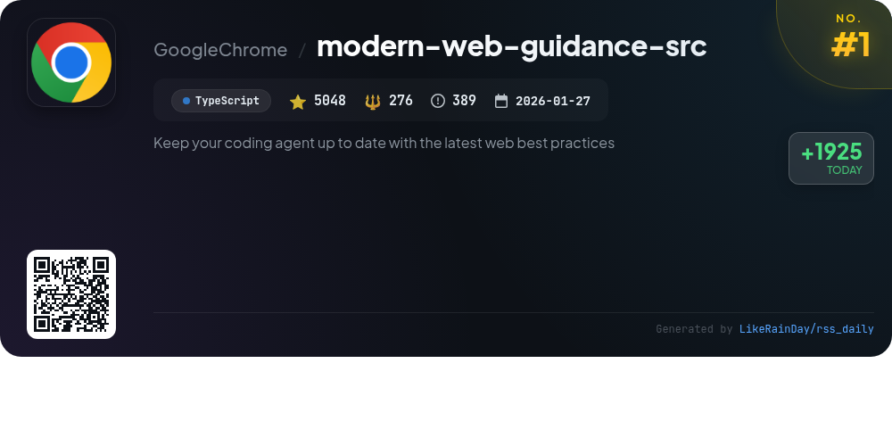
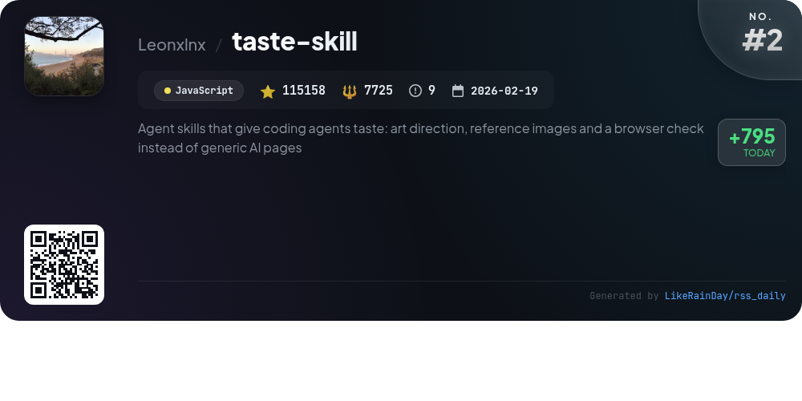
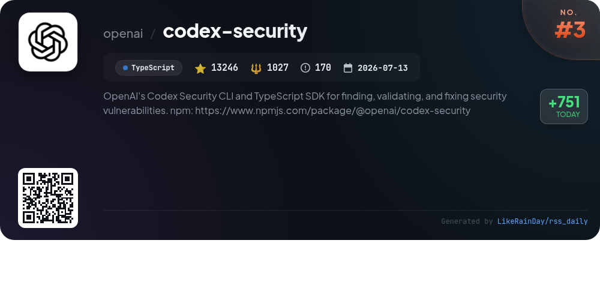
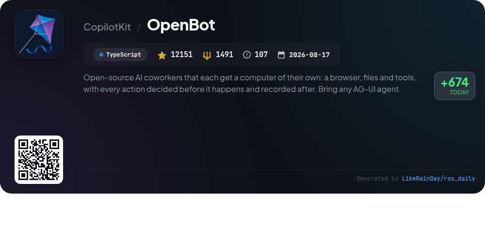
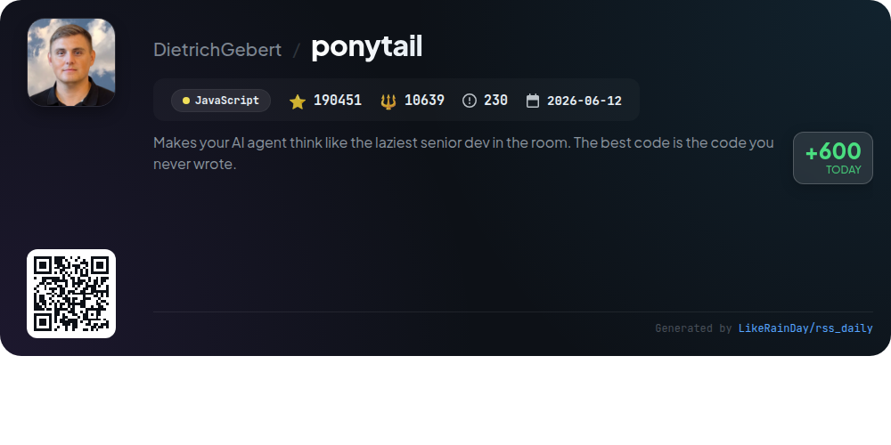
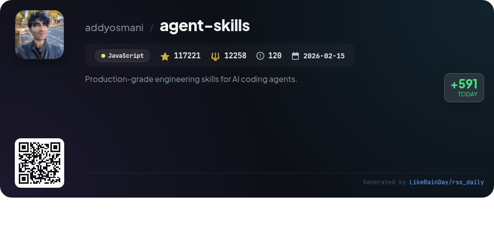
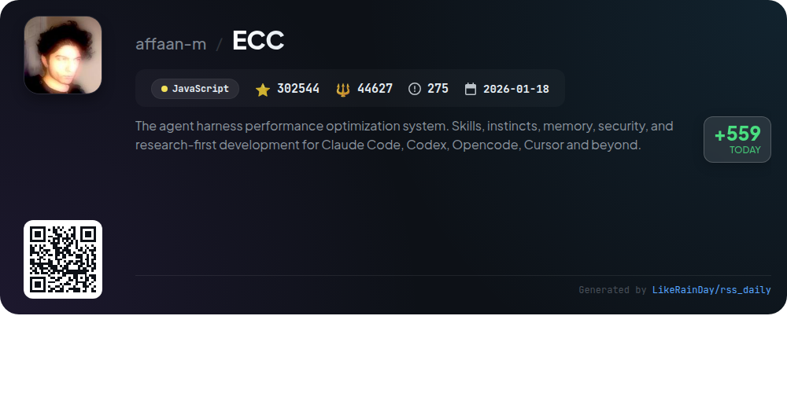
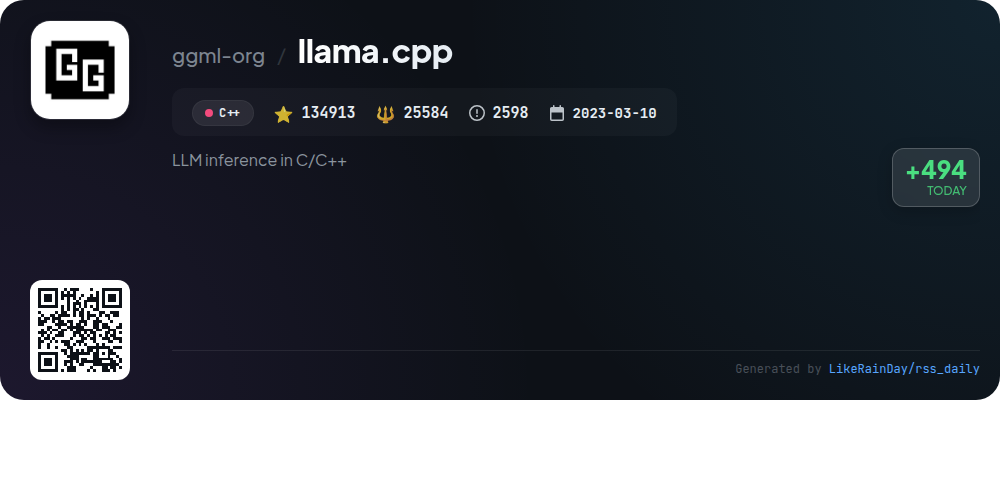
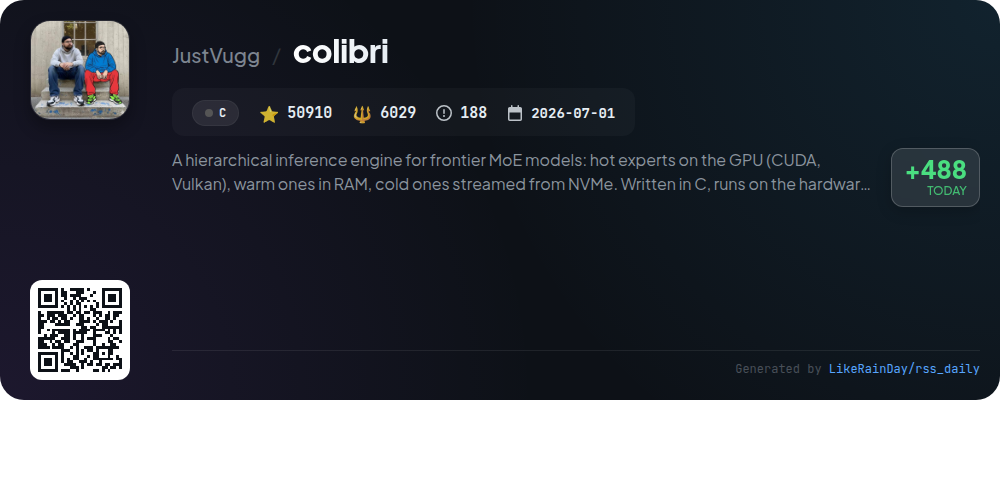
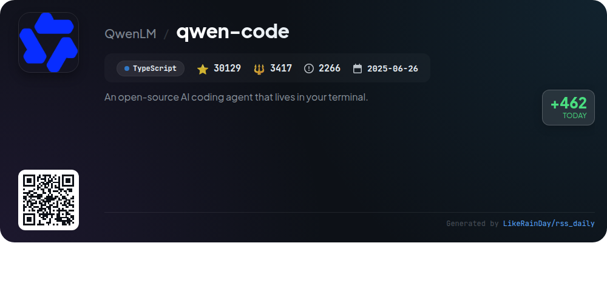

# 📊 🌟 GitHub Trending Daily - 2026-11-14

> > 📅 每日精选 GitHub 热门仓库 | 基于智能算法推荐

## 📋 Overview

**10** 个项目 | **971771** ⭐ | **113073** 🍴

**热门语言:** `TypeScript` (4) · `JavaScript` (4) · `C++` (1)

**更新时间:** 2026-11-14 05:55 UTC

**分类分布:**

- 🌟 每日 Top 10 精选 (10 项)

---

## 🌟 每日 Top 10 精选

### 1. [modern-web-guidance-src](https://github.com/GoogleChrome/modern-web-guidance-src)

> 🤖 **推荐理由**  
> *Modern Web Guidance is a TypeScript-based project designed to enhance coding agents by embedding web platform expertise and best practices. It provides curated guidelines on modern browser APIs, performance, accessibility, and user experience, steering developers away from legacy patterns. Key features include an interactive CLI for searching guides, scanning codebases for legacy patterns, and integrating expert advice directly into development workflows. Stewarded by major browser teams, it ensures up-to-date practices and responsible fallback strategies for web development.*

- ⭐ 5048 stars
- 💻 TypeScript
- 📅 Updated: 2026-11-14

### 2. [taste-skill](https://github.com/Leonxlnx/taste-skill)

> 🤖 **推荐理由**  
> *Taste Skill is an innovative agent skill designed to enhance coding agents' capabilities in creating professional websites with a focus on aesthetic quality. Key features include art direction, the use of real photographs and brand icons, and browser checks to ensure high standards. The skill builds tailored web pages for various industries, utilizing a consistent design system and enforcing layout rules. It requires Node 22+ and a browser, operates offline with bundled assets, and is open-source. Visit [tasteskill.dev](https://tasteskill.dev) for more information.*

- ⭐ 115158 stars
- 💻 JavaScript
- 📅 Updated: 2026-11-14

### 3. [codex-security](https://github.com/openai/codex-security)

> 🤖 **推荐理由**  
> *OpenAI's Codex Security CLI and TypeScript SDK for finding, validating, and fixing security vulnerabilities. npm: https://www.npmjs.com/package/@opena. popular project, actively maintained, recently updated*

- ⭐ 13246 stars
- 🍴 1027 forks
- 💻 TypeScript
- 📅 Updated: 2026-11-14

### 4. [OpenBot](https://github.com/CopilotKit/OpenBot)

> 🤖 **推荐理由**  
> *OpenBot is an open-source platform that provides modular AI coworkers with individual computing environments, including a browser and tools. It allows users to integrate various AI models (like OpenAI and Claude) and existing agents through the AG-UI protocol. Key features include customizable workspaces, team collaboration with governance, and robust auditing. OpenBot supports deployment on personal machines or Kubernetes, facilitating enterprise use. It emphasizes security, with encrypted credentials and strict action policies. Explore more at [open.bot](https://open.bot).*

- ⭐ 12151 stars
- 💻 TypeScript
- 📅 Updated: 2026-11-14

### 5. [ponytail](https://github.com/DietrichGebert/ponytail)

> 🤖 **推荐理由**  
> *Ponytail is an innovative AI tool designed to optimize code generation by mimicking the efficiency of a senior developer. With over 190,000 stars on GitHub, it emphasizes writing minimal yet effective code, significantly reducing lines, cost, and time while maintaining high testing coverage. Key features include intelligent code reviews, comprehensive audits, and a unique "band" interface to track project metrics. Ponytail integrates seamlessly with various AI agents, ensuring a streamlined coding experience that prioritizes validation and security.*

- ⭐ 190451 stars
- 💻 JavaScript
- 📅 Updated: 2026-11-14

### 6. [agent-skills](https://github.com/addyosmani/agent-skills)

> 🤖 **推荐理由**  
> *Agent Skills is a JavaScript project designed to enhance AI coding agents with production-grade engineering skills. It offers 25 structured workflows that encapsulate best practices in software development, covering the full lifecycle from planning to deployment. Key features include nine slash commands that automate tasks, integration with popular AI agents, and a focus on quality assurance through verification gates. Skills promote discipline by enforcing standards in specification, testing, and code review, ensuring reliable software production. With over 117,000 stars, it embodies engineering principles from Google's practices.*

- ⭐ 117221 stars
- 💻 JavaScript
- 📅 Updated: 2026-11-14

### 7. [ECC](https://github.com/affaan-m/ECC)

> 🤖 **推荐理由**  
> *ECC is a performance optimization system for coding agents, featuring 71 specialized agents, 314 skills, and 98 command shims. It streamlines workflows with capabilities for planning, testing, and reviewing code, while ensuring security through AgentShield. Users benefit from a guided setup for Claude Code, Codex, and Kimi Code, with support for multiple programming languages. Key features include memory persistence, continuous learning, and a robust hook system. ECC is open-source and MIT-licensed, fostering community contributions and offering a hosted GitHub App for private repositories.*

- ⭐ 302544 stars
- 💻 JavaScript
- 📅 Updated: 2026-11-14

### 8. [llama.cpp](https://github.com/ggml-org/llama.cpp)

> 🤖 **推荐理由**  
> *`llama.cpp` is a high-performance library for LLM inference in C/C++. With over 134,000 stars, it offers minimal setup and supports various hardware configurations, including Apple Silicon and x86 architectures with optimized features like AVX and CUDA for GPUs. Key functionalities include integer quantization for faster inference, a built-in web UI, and a command-line interface for model interaction. Users can easily install via scripts, Docker, or pre-built binaries, and leverage hybrid CPU+GPU inference for large models. The project is built on the ggml library and supports multiple backends for extensive compatibility.*

- ⭐ 134913 stars
- 💻 C++
- 📅 Updated: 2026-11-14

### 9. [colibri](https://github.com/JustVugg/colibri)

> 🤖 **推荐理由**  
> *Colibri is a hierarchical inference engine for large mixture-of-experts (MoE) models, optimizing usage of local resources by leveraging GPU (CUDA, Vulkan), RAM, and NVMe storage. Written in C, it supports diverse models, including GLM, Qwen, and DeepSeek, allowing users to run extensive AI models on modest hardware. Key features include real-time expert caching, a user-friendly dashboard, and compatibility with multiple API standards (OpenAI, Anthropic). Colibri's unique architecture enables efficient processing and scalability for various applications, making it a valuable open-source tool for AI researchers and developers.*

- ⭐ 50910 stars
- 💻 C
- 📅 Updated: 2026-11-14

### 10. [qwen-code](https://github.com/QwenLM/qwen-code)

> 🤖 **推荐理由**  
> *Qwen Code is an open-source AI coding agent designed to enhance your workflow directly from the terminal, desktop, or IDEs. With over 30,000 stars on GitHub, it features auto-memory, dynamic workflows, and multi-protocol support for APIs like OpenAI and Anthropic. Key highlights include IDE plugins, desktop applications, and chat integrations (Telegram, WeChat). Qwen Code operates seamlessly in various environments, allowing automation through SDKs and a daemon mode for shared sessions, making it a versatile tool for developers seeking efficient coding solutions.*

- ⭐ 30129 stars
- 💻 TypeScript
- 📅 Updated: 2026-11-14

---

## 📡 RSS订阅

通过 RSS 订阅，第一时间获取每日精选项目：

- 🔔 [RSS 订阅源] (../../daily-top.xml)
- 🔔 [每日简报] (../../GITHUB_TODAY_CN.md)
- 🔔 [每日 Top 10 精选](../../daily-top.xml)

---

*⚡ Powered by Smart Trending Algorithm | Generated at 2026-11-14 05:55:05 UTC
