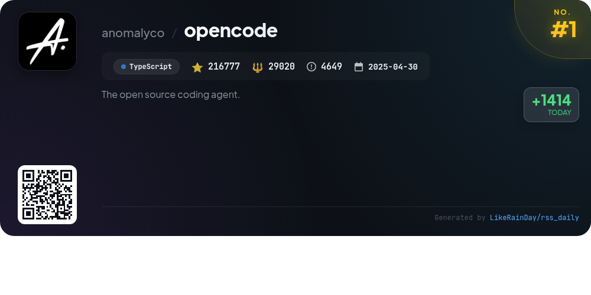
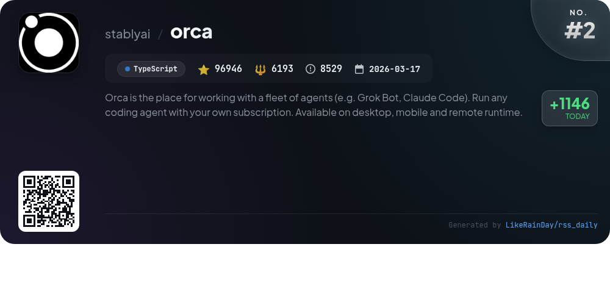
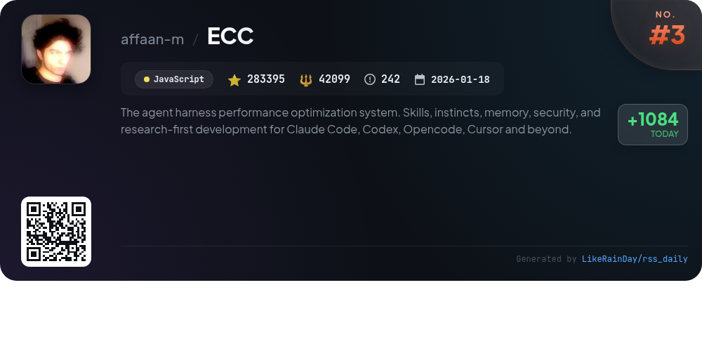
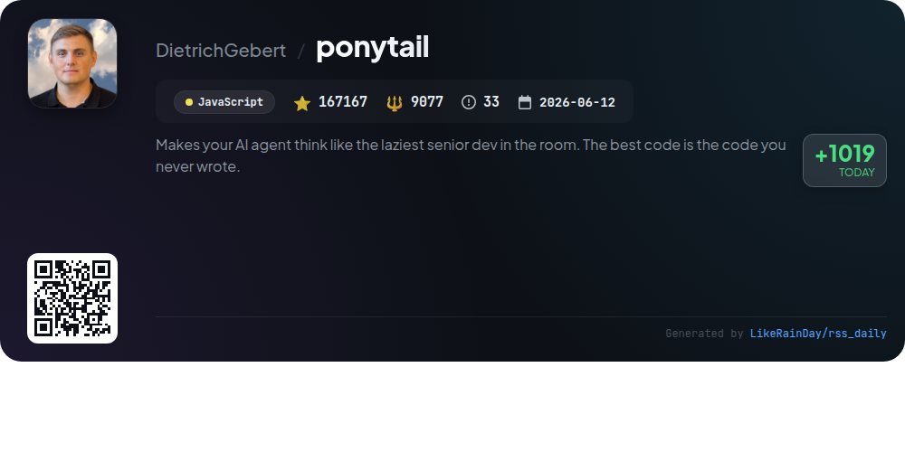
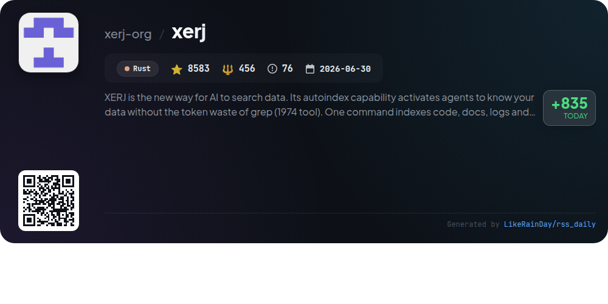
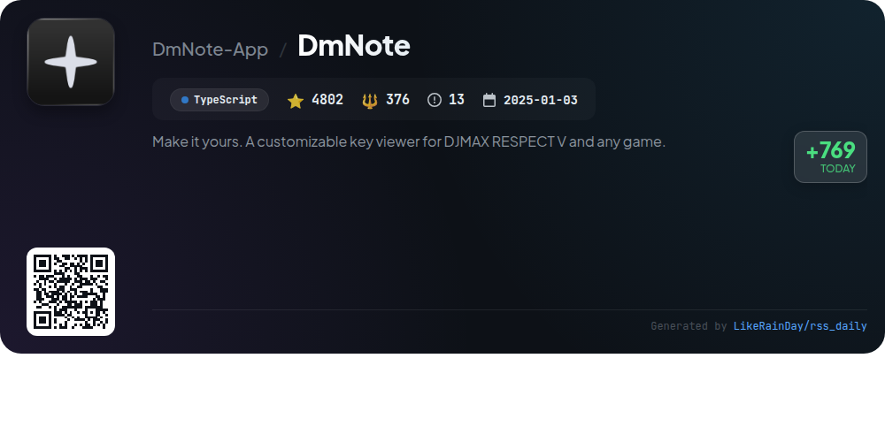
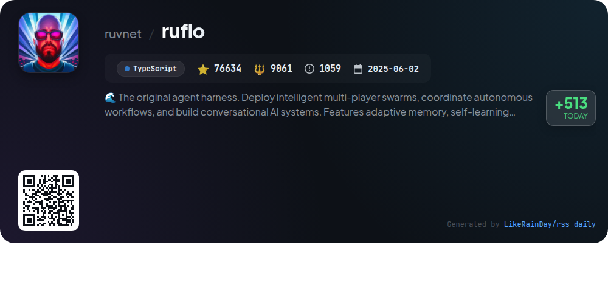
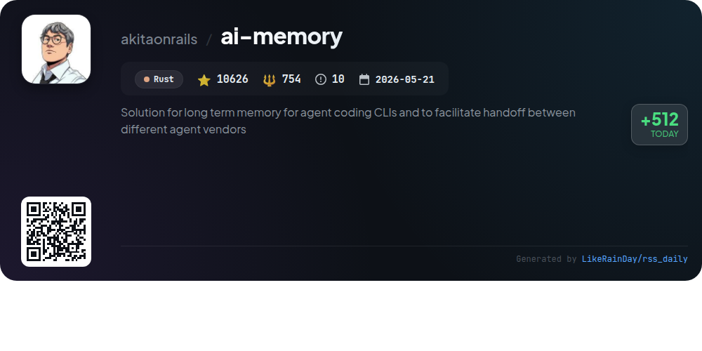
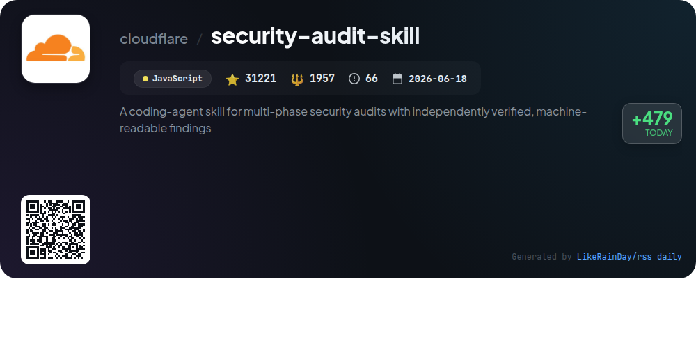
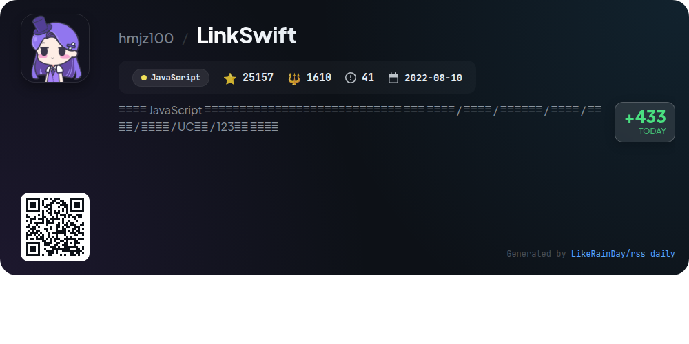

# 📊 🌟 GitHub Trending Daily - 2026-10-19

> > 📅 每日精选 GitHub 热门仓库 | 基于智能算法推荐

## 📋 Overview

**10** 个项目 | **921308** ⭐ | **100603** 🍴

**热门语言:** `JavaScript` (4) · `TypeScript` (4) · `Rust` (2)

**更新时间:** 2026-10-19 04:13 UTC

**分类分布:**

- 🌟 每日 Top 10 精选 (10 项)

---

## 🌟 每日 Top 10 精选

### 1. [opencode](https://github.com/anomalyco/opencode)

> 🤖 **推荐理由**  
> *OpenCode is an open-source AI coding agent designed to enhance development workflows. Written in TypeScript, it has gained over 216,000 stars on GitHub. Key features include two built-in agents: a full-access "build" agent for development tasks and a "plan" agent for code analysis, ensuring safe exploration of codebases. OpenCode offers a desktop application for multiple platforms and supports installation via various package managers. Comprehensive documentation is available, along with a vibrant community on Discord. Contribute or learn more at opencode.ai.*

- ⭐ 216777 stars
- 💻 TypeScript
- 📅 Updated: 2026-10-19

### 2. [orca](https://github.com/stablyai/orca)

> 🤖 **推荐理由**  
> *Orca is a versatile AI orchestration tool designed for managing multiple coding agents like Codex and Claude Code simultaneously. It features parallel worktrees for testing prompts across agents, a mobile companion app for remote monitoring, and advanced terminal splits with WebGL rendering. Users can easily integrate GitHub and Linear for task management, utilize Design Mode for UI interactions, and automate workflows via the Orca CLI. Compatible with desktop (macOS, Windows, Linux) and mobile (iOS, Android), Orca enhances productivity for developers by streamlining agent collaboration and task execution.*

- ⭐ 96946 stars
- 💻 TypeScript
- 📅 Updated: 2026-10-19

### 3. [ECC](https://github.com/affaan-m/ECC)

> 🤖 **推荐理由**  
> *ECC is an advanced performance optimization system designed for coding agents like Claude Code, Codex, and Kimi. It offers 71 specialized agents, 311 skills, and 97 command shims, enabling efficient workflows through a structured approach: plan, test, implement, review, verify, remember, and improve. Key features include memory persistence, security scanning with AgentShield, and continuous learning capabilities. ECC supports multiple platforms and is built to enhance code quality and streamline development processes. Its open-source nature, along with community support, fosters collaborative improvements.*

- ⭐ 283395 stars
- 💻 JavaScript
- 📅 Updated: 2026-10-19

### 4. [ponytail](https://github.com/DietrichGebert/ponytail)

> 🤖 **推荐理由**  
> *Ponytail is a JavaScript project designed to streamline AI agent coding by mimicking the efficiency of a seasoned developer. With 167,167 stars, it emphasizes writing minimal, functional code while maintaining robust testing and security. Key features include the `/ponytail-review` for diff assessment, `/ponytail-audit` for comprehensive repo checks, and a new "band" feature that tracks agent performance metrics. Ponytail 5 boasts reduced code, time, and costs, achieving 98% test coverage for critical logic. It is integrated with various AI platforms and encourages code reuse for optimal efficiency.*

- ⭐ 167167 stars
- 💻 JavaScript
- 📅 Updated: 2026-10-19

### 5. [xerj](https://github.com/xerj-org/xerj)

> 🤖 **推荐理由**  
> *XERJ is an innovative AI-powered local search tool designed to index code, documents, logs, and PDFs efficiently. Its autoindex feature allows for quick, zero-config indexing, reducing token usage by up to 40x compared to traditional grep methods. Key functionalities include reference coding, security audits, and agent memory management. XERJ serves as a cost-effective alternative to ElasticSearch, boasting a smaller infrastructure footprint. With seamless integration for developers, it supports diverse file types and offers Elasticsearch compatibility, making it a versatile solution for AI-driven data retrieval.*

- ⭐ 8583 stars
- 💻 Rust
- 📅 Updated: 2026-10-19

### 6. [DmNote](https://github.com/DmNote-App/DmNote)

> 🤖 **推荐理由**  
> *DmNote is a customizable key viewer designed for DJMAX RESPECT V and other games, boasting over 4800 stars on GitHub. Key features include real-time input visualization, key mapping, note effects, and KPS statistics. Users can personalize their experience with custom CSS, plugins, and presets, while the overlay feature ensures it remains visible during gameplay. DmNote supports multiple platforms (Windows, macOS, Linux) and offers multilingual support. Ideal for streamers and content creators, it simplifies displaying key inputs during live sessions.*

- ⭐ 4802 stars
- 💻 TypeScript
- 📅 Updated: 2026-10-19

### 7. [ruflo](https://github.com/ruvnet/ruflo)

> 🤖 **推荐理由**  
> *Ruflo is an advanced agent harness designed for deploying intelligent multi-player swarms, coordinating autonomous workflows, and developing conversational AI systems. Key features include adaptive memory, self-learning intelligence, and secure federation across machines. It integrates seamlessly with Claude Code and Codex, offering over 100 specialized agents, background workers for task automation, and a plugin marketplace for extended capabilities. Ruflo enhances collaboration, learning, and security in AI projects, making it ideal for complex, production-level applications.*

- ⭐ 76634 stars
- 💻 TypeScript
- 📅 Updated: 2026-10-19

### 8. [ai-memory](https://github.com/akitaonrails/ai-memory)

> 🤖 **推荐理由**  
> *ai-memory is a long-term memory solution for AI coding agents, enabling seamless task continuity across various platforms like Claude Code and Codex. It allows users to switch agents without losing context, sharing a single memory across machines and projects. Key features include automatic memory capture in markdown, team collaboration with shared knowledge, and a server-based architecture for accessibility. It operates with zero LLM calls by default, while providing optional features for enhanced memory management. Easily installable on multiple platforms, it supports various agent integrations for a versatile coding experience.*

- ⭐ 10626 stars
- 💻 Rust
- 📅 Updated: 2026-10-19

### 9. [security-audit-skill](https://github.com/cloudflare/security-audit-skill)

> 🤖 **推荐理由**  
> *A coding-agent skill for multi-phase security audits with independently verified, machine-readable findings. popular project, actively maintained, recently updated*

- ⭐ 31221 stars
- 🍴 1957 forks
- 💻 JavaScript
- 📅 Updated: 2026-10-19

### 10. [LinkSwift](https://github.com/hmjz100/LinkSwift)

> 🤖 **推荐理由**  
> *LinkSwift is a JavaScript-based tool designed to retrieve direct download links from various cloud storage services, including Baidu Cloud, Alibaba Cloud, China Mobile Cloud, and others. With over 25,000 stars on GitHub, it offers features like UI enhancements, support for multiple download managers, and improved download processes. Key highlights include compatibility with numerous cloud platforms, user-friendly interface, and continuous updates to optimize functionality. It adheres to compliance standards, ensuring a legitimate approach to file downloading.*

- ⭐ 25157 stars
- 💻 JavaScript
- 📅 Updated: 2026-10-19

---

## 📡 RSS订阅

通过 RSS 订阅，第一时间获取每日精选项目：

- 🔔 [RSS 订阅源] (../../daily-top.xml)
- 🔔 [每日简报] (../../GITHUB_TODAY_CN.md)
- 🔔 [每日 Top 10 精选](../../daily-top.xml)

---

*⚡ Powered by Smart Trending Algorithm | Generated at 2026-10-19 04:13:05 UTC
