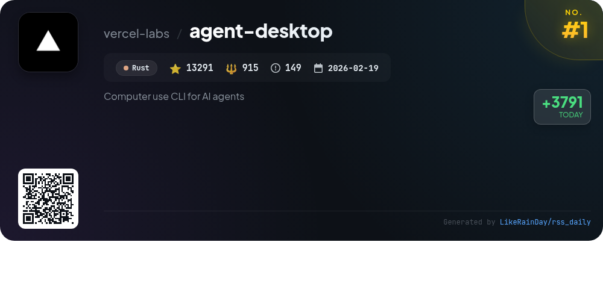
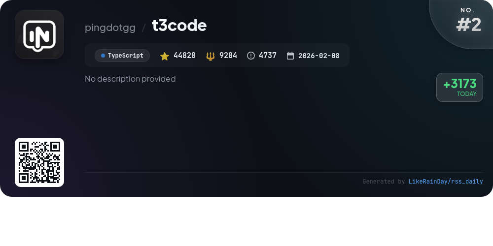
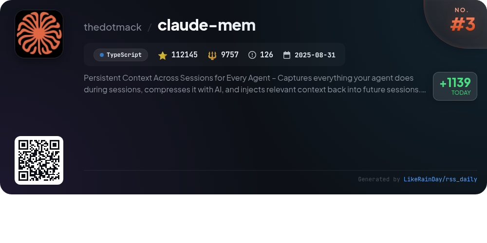
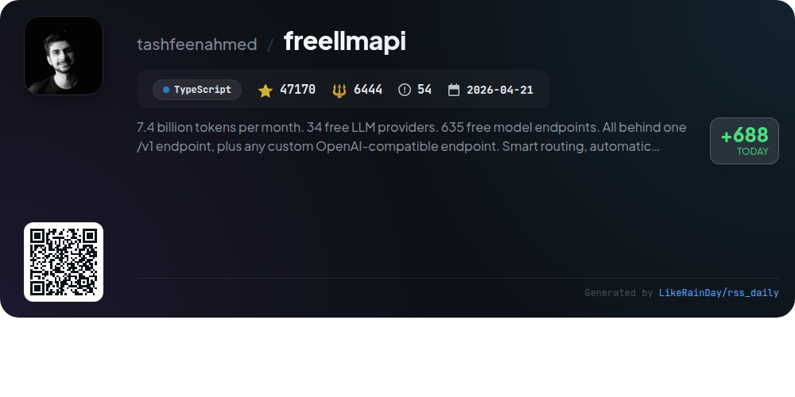
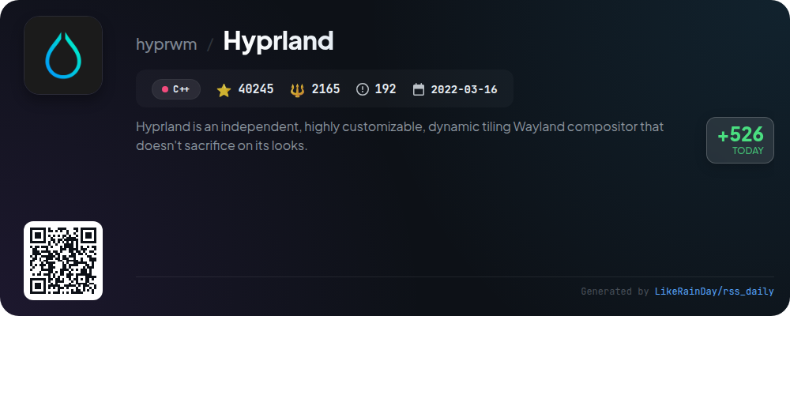
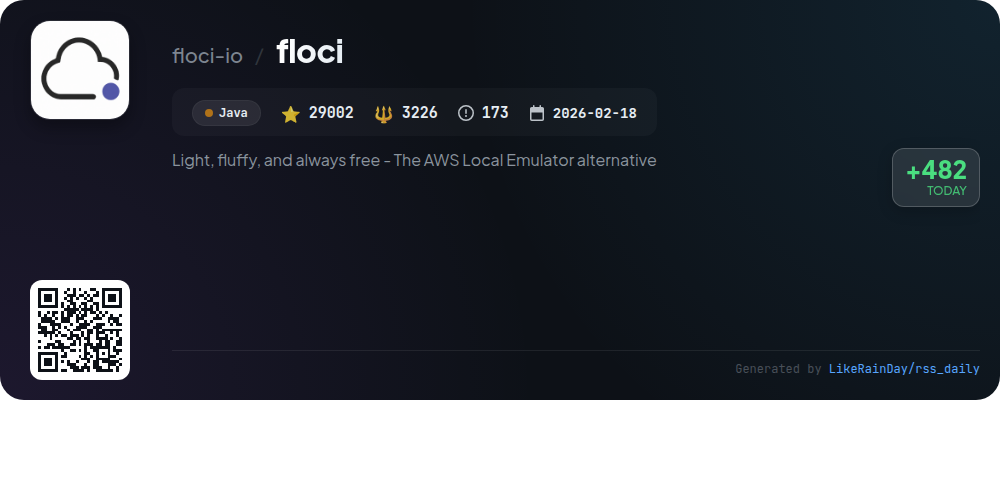
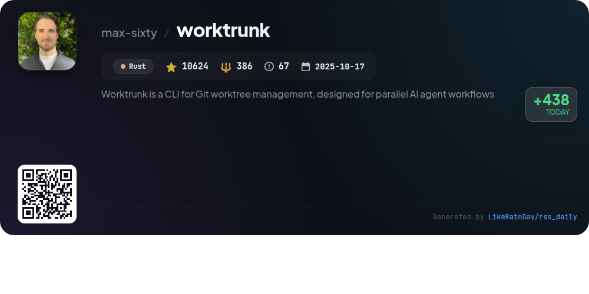
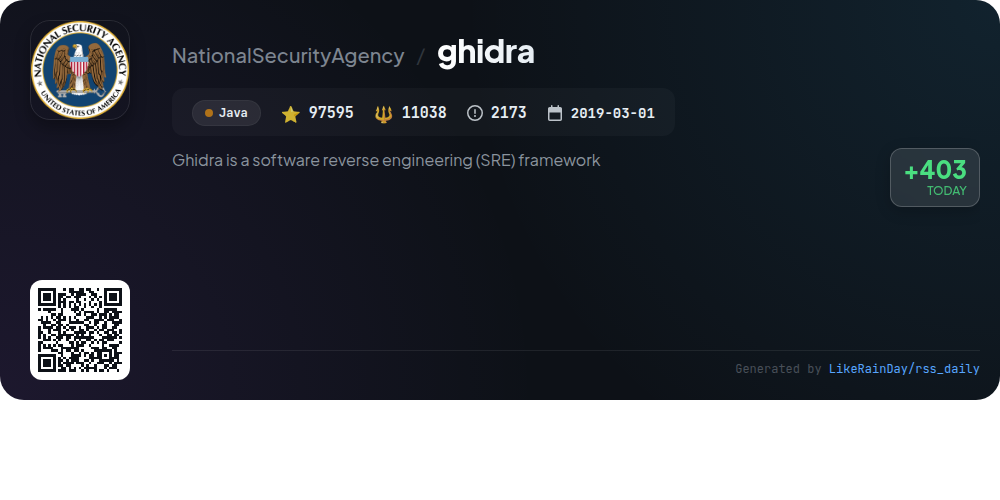

# 📊 🌟 GitHub Trending Daily - 2026-11-04

> > 📅 每日精选 GitHub 热门仓库 | 基于智能算法推荐

## 📋 Overview

**10** 个项目 | **446988** ⭐ | **48950** 🍴

**热门语言:** `TypeScript` (3) · `Rust` (3) · `Java` (2)

**更新时间:** 2026-11-04 05:50 UTC

**分类分布:**

- 🌟 每日 Top 10 精选 (10 项)

---

## 🌟 每日 Top 10 精选

### 1. [agent-desktop](https://github.com/vercel-labs/agent-desktop)

> 🤖 **推荐理由**  
> *agent-desktop is a cross-platform CLI tool designed for AI agents to interact with desktop applications on macOS, Windows, and Linux using the OS accessibility tree, without relying on screenshots or pixel matching. With 60 commands, it allows agents to observe UI elements, perform actions like clicks and typing, and handle sessions and notifications. The tool also includes a C library for in-process usage and supports headless operation. Its robust architecture leverages platform-specific accessibility APIs, ensuring seamless integration and enhanced automation capabilities.*

- ⭐ 13291 stars
- 💻 Rust
- 📅 Updated: 2026-11-04

### 2. [t3code](https://github.com/pingdotgg/t3code)

> 🤖 **推荐理由**  
> *T3 Code is an advanced agent harness control surface, enabling seamless management of development agents via a mobile app (iOS, Android), web app, or Electron-based desktop application. It supports popular services such as Claude Code, Codex, Cursor, Grok Build, OpenCode, and Google Antigravity. Designed for optimal performance and remote accessibility, T3 Code is open-source, encouraging user customization. Installation is straightforward, with options for various platforms, and comprehensive documentation is available for setup and usage. Join the community for support and contributions.*

- ⭐ 44820 stars
- 💻 TypeScript
- 📅 Updated: 2026-11-04

### 3. [claude-mem](https://github.com/thedotmack/claude-mem)

> 🤖 **推荐理由**  
> *Claude-Mem is a TypeScript-based project designed to enhance AI agents with persistent memory across sessions. It automatically captures agent interactions, compresses them using AI, and reintegrates relevant context into future sessions. Key features include smart search capabilities, team collaboration tools, and privacy controls. It supports various platforms, including Claude Code, OpenClaw, and Codex, allowing seamless integration. With over 112,000 stars, Claude-Mem empowers users to maintain continuity in projects and enables intelligent memory retrieval, optimizing agent efficiency.*

- ⭐ 112145 stars
- 💻 TypeScript
- 📅 Updated: 2026-11-04

### 4. [colibri](https://github.com/JustVugg/colibri)

> 🤖 **推荐理由**  
> *colibri is a hierarchical inference engine designed for large mixture-of-expert (MoE) models, optimizing the use of GPU (CUDA, Vulkan), RAM, and NVMe storage. Written in C, it enables users to run massive models, like GLM-5.2 with 744 billion parameters, efficiently on standard hardware. Key features include dynamic expert loading to minimize memory usage, a user-friendly setup, and support for various models (language, vision, decision-making). The project also offers a web-based dashboard and API compatibility with OpenAI and Anthropic, enhancing accessibility for developers.*

- ⭐ 47372 stars
- 💻 C
- 📅 Updated: 2026-11-04

### 5. [freellmapi](https://github.com/tashfeenahmed/freellmapi)

> 🤖 **推荐理由**  
> *FreeLLMAPI is a TypeScript-based API aggregator providing access to 34 free LLM providers and 635 model endpoints, with a monthly capacity of 7.4 billion tokens. It offers a unified OpenAI-compatible endpoint, smart routing for optimal model selection, automatic failover, and encrypted key storage. Key features include multi-model synthesis, support for various response formats, and an admin dashboard for managing keys and monitoring analytics. Designed for personal experimentation, it simplifies access to diverse AI models while ensuring compliance with providers’ terms of service.*

- ⭐ 47170 stars
- 💻 TypeScript
- 📅 Updated: 2026-11-04

### 6. [Hyprland](https://github.com/hyprwm/Hyprland)

> 🤖 **推荐理由**  
> *Hyprland is an independent, highly customizable dynamic tiling Wayland compositor, boasting 40,245 stars on GitHub. It combines aesthetic appeal with powerful functionality, featuring advanced animations, gradient borders, and extensive plugin support. Core highlights include instant config reloading, socket-based IPC, and various layouts (e.g., Dwindle, Monocle). Hyprland supports tearing for enhanced gaming, dynamic workspaces, and per-workspace layouts, making it adaptable for diverse user needs. With an easy-to-read codebase and active development, Hyprland delivers a modern Wayland experience.*

- ⭐ 40245 stars
- 💻 C++
- 📅 Updated: 2026-11-04

### 7. [floci](https://github.com/floci-io/floci)

> 🤖 **推荐理由**  
> *Floci is a free, open-source local AWS emulator designed for development, testing, and CI, offering AWS-compatible services without the need for cloud accounts or auth tokens. It supports a wide range of services, including S3, DynamoDB, Lambda, and more, all accessible at `http://localhost:4566`. Floci emphasizes real Docker integration for high fidelity and speed, making it suitable for CI pipelines. It provides a web console for resource inspection and is a drop-in replacement for LocalStack, ensuring seamless migration. With features like configurable storage modes and multi-account isolation, Floci is a robust solution for local AWS emulation.*

- ⭐ 29002 stars
- 💻 Java
- 📅 Updated: 2026-11-04

### 8. [worktrunk](https://github.com/max-sixty/worktrunk)

> 🤖 **推荐理由**  
> *Worktrunk is a Rust-based CLI tool for efficient Git worktree management, optimized for parallel AI agent workflows. With over 10,600 stars, it simplifies the creation and management of worktrees, making them as easy as branches. Key features include automation hooks, LLM-generated commit messages, a merge workflow, and the ability to share build caches. Users can quickly switch between worktrees, list their statuses, and integrate commands seamlessly. Worktrunk enhances productivity by enabling multiple agents to work in parallel without conflicts. For full documentation, visit worktrunk.dev.*

- ⭐ 10624 stars
- 💻 Rust
- 📅 Updated: 2026-11-04

### 9. [hex](https://github.com/anomalyco/hex)

> 🤖 **推荐理由**  
> *Hex is a local voice dictation tool for Mac, Windows, and Linux, enabling users to transcribe speech directly into applications by holding a shortcut key. It operates entirely offline after the initial speech model download, ensuring privacy and security. Hex offers experimental features in its Labs section and supports various installation methods, including Homebrew and AUR. With over 4,700 stars on GitHub, it is built in Rust and prioritizes user-friendly dictation across multiple platforms. Contributing is streamlined through issue reporting rather than pull requests.*

- ⭐ 4724 stars
- 💻 Rust
- 📅 Updated: 2026-11-04

### 10. [ghidra](https://github.com/NationalSecurityAgency/ghidra)

> 🤖 **推荐理由**  
> *Ghidra is a powerful open-source software reverse engineering (SRE) framework developed by the NSA. It offers a comprehensive suite of tools for analyzing compiled code across various platforms (Windows, macOS, Linux), featuring capabilities like disassembly, decompilation, graphing, and scripting in Java and Python. Ghidra supports numerous processor architectures and executable formats, enabling both interactive and automated analysis. The framework is designed for extensibility, allowing users to create custom scripts and extensions, making it invaluable for cybersecurity research and vulnerability assessment.*

- ⭐ 97595 stars
- 💻 Java
- 📅 Updated: 2026-11-04

---

## 📡 RSS订阅

通过 RSS 订阅，第一时间获取每日精选项目：

- 🔔 [RSS 订阅源] (../../daily-top.xml)
- 🔔 [每日简报] (../../GITHUB_TODAY_CN.md)
- 🔔 [每日 Top 10 精选](../../daily-top.xml)

---

*⚡ Powered by Smart Trending Algorithm | Generated at 2026-11-04 05:50:04 UTC
