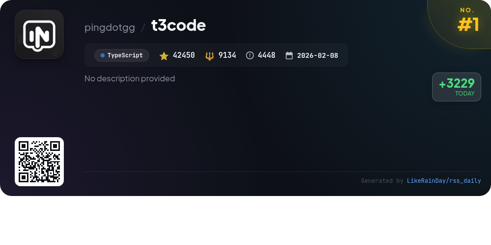
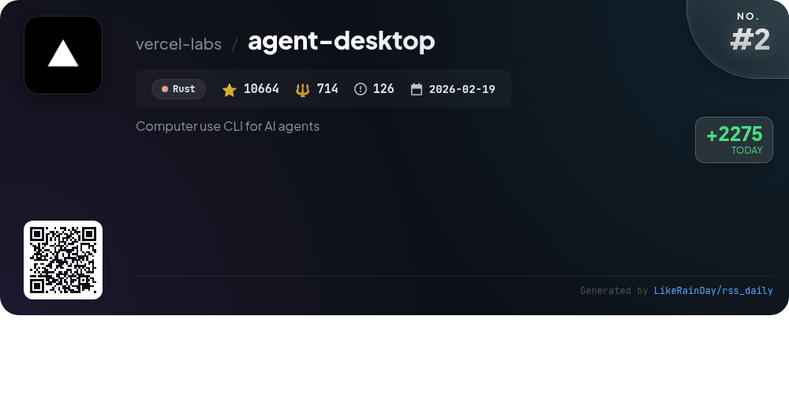
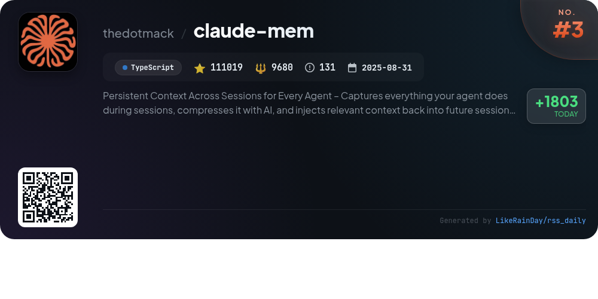
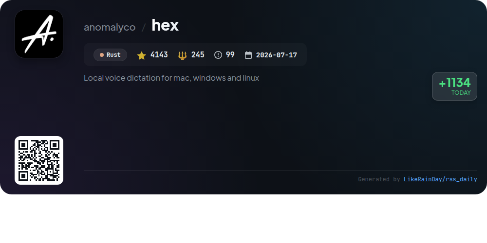
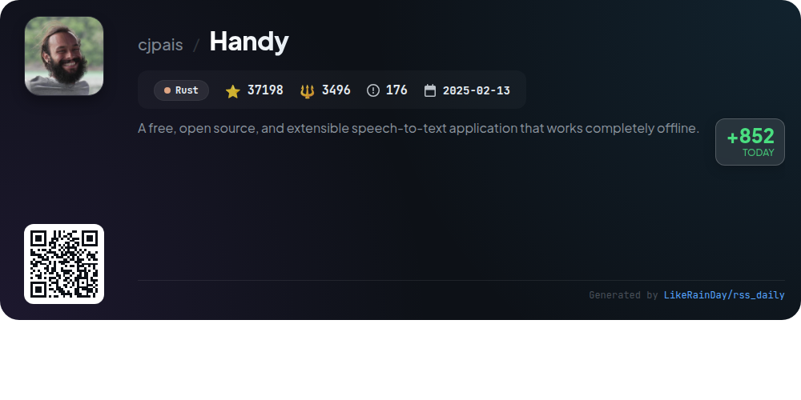
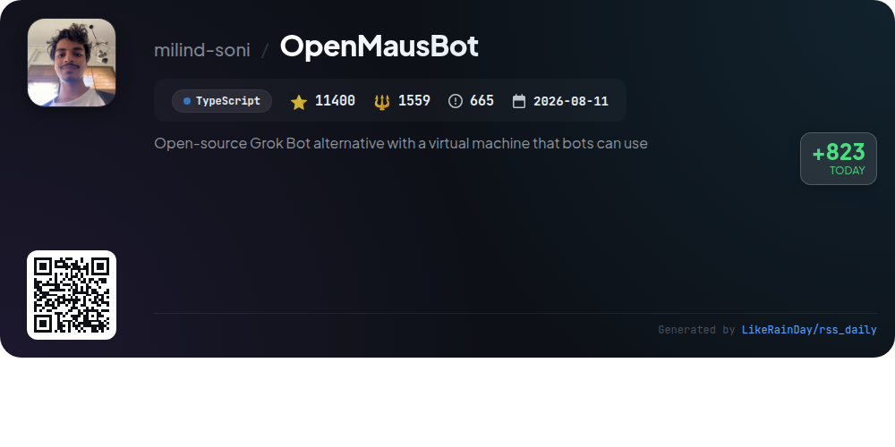
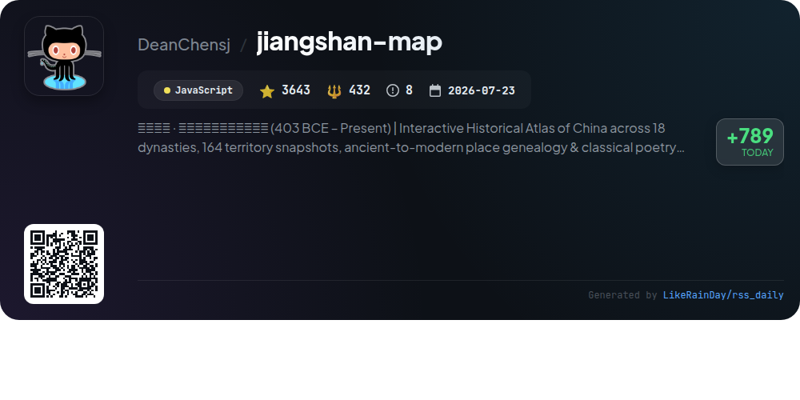
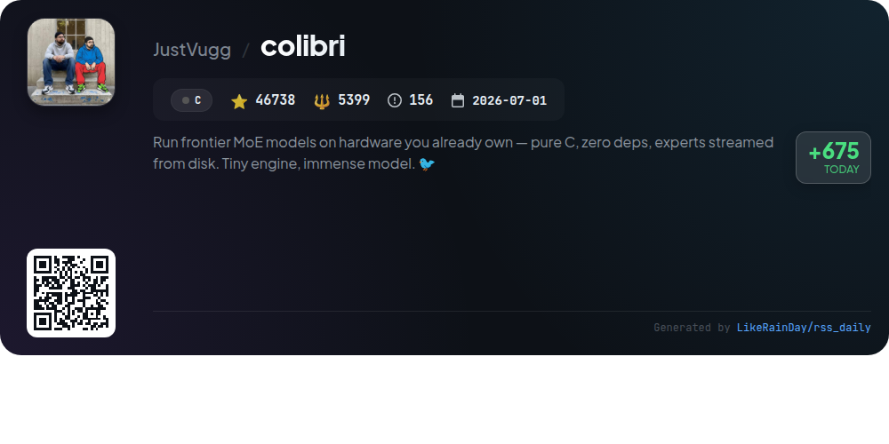
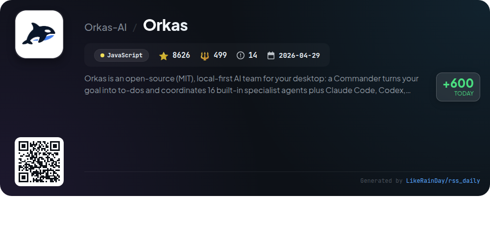

# 📊 🌟 GitHub Trending Daily - 2026-11-03

> > 📅 每日精选 GitHub 热门仓库 | 基于智能算法推荐

## 📋 Overview

**10** 个项目 | **571722** ⭐ | **74935** 🍴

**热门语言:** `TypeScript` (3) · `Rust` (3) · `JavaScript` (3)

**更新时间:** 2026-11-03 06:10 UTC

**分类分布:**

- 🌟 每日 Top 10 精选 (10 项)

---

## 🌟 每日 Top 10 精选

### 1. [t3code](https://github.com/pingdotgg/t3code)

> 🤖 **推荐理由**  
> *T3 Code is a powerful agent harness control surface built in TypeScript, enabling seamless control of various AI agents on your machine via mobile ([iOS](https://apps.apple.com/us/app/t3-code-remote-claude-more/id6787819824), [Android](https://play.google.com/store/apps/details?id=com.t3tools.t3code)), web, and desktop apps. It supports integrations with Claude Code, Codex, Cursor, Grok Build, OpenCode, Google Antigravity, and fx. T3 Code prioritizes performance and openness, allowing users to fork and customize their development experience as needed. With easy installation and robust documentation, it’s designed for optimal agent management.*

- ⭐ 42450 stars
- 💻 TypeScript
- 📅 Updated: 2026-11-03

### 2. [agent-desktop](https://github.com/vercel-labs/agent-desktop)

> 🤖 **推荐理由**  
> *Computer use CLI for AI agents. popular project, actively maintained, recently updated*

- ⭐ 10664 stars
- 🍴 714 forks
- 💻 Rust
- 📅 Updated: 2026-11-03

### 3. [claude-mem](https://github.com/thedotmack/claude-mem)

> 🤖 **推荐理由**  
> *Claude-Mem is a TypeScript-based project designed for persistent context management across sessions with AI agents like Claude Code and OpenClaw. Key features include automatic memory capture, semantic summarization, and context injection for seamless continuity. It offers smart search capabilities, privacy controls, and team collaboration through TeamBrain. The installation is straightforward, with support for various IDEs and plugins. Claude-Mem enhances agent performance, enabling rich, context-aware interactions while maintaining user privacy and operational efficiency.*

- ⭐ 111019 stars
- 💻 TypeScript
- 📅 Updated: 2026-11-03

### 4. [hex](https://github.com/anomalyco/hex)

> 🤖 **推荐理由**  
> *Hex is a local voice dictation tool for Mac, Windows, and Linux, featuring seamless transcription directly on your device. Users can hold a shortcut key to speak, and Hex automatically pastes the transcribed text into any application. The first use downloads a speech model, ensuring privacy by keeping all processing local. Hex offers stable and development builds across multiple platforms, with additional experimental features available in the Labs section. The project has garnered 4,143 stars on GitHub, reflecting its popularity and community support.*

- ⭐ 4143 stars
- 💻 Rust
- 📅 Updated: 2026-11-03

### 5. [Handy](https://github.com/cjpais/Handy)

> 🤖 **推荐理由**  
> *Handy is a free, open-source, offline speech-to-text application, built in Rust, with over 37,000 stars on GitHub. It offers a privacy-focused transcription experience by processing speech locally without cloud interaction. Users can easily record their speech using customizable keyboard shortcuts, with support for Whisper and Parakeet models for accurate transcription. Handy is cross-platform, compatible with Windows, macOS, and Linux, and allows extensibility through community contributions. It prioritizes accessibility, simplicity, and user privacy, making it a valuable tool for anyone needing speech recognition.*

- ⭐ 37198 stars
- 💻 Rust
- 📅 Updated: 2026-11-03

### 6. [ECC](https://github.com/affaan-m/ECC)

> 🤖 **推荐理由**  
> *ECC is an advanced performance optimization system designed for agents, focusing on enhancing skills, instincts, memory, and security. It facilitates research-first development for various platforms, including Claude Code, Codex, Opencode, and Cursor. With a strong emphasis on performance and efficiency, ECC empowers developers to create robust applications while harnessing cutting-edge optimization techniques. The project boasts a significant community support with 295,841 stars, making it a valuable resource for JavaScript developers looking to enhance their projects.*

- ⭐ 295841 stars
- 💻 JavaScript
- 📅 Updated: 2026-11-03

### 7. [OpenMausBot](https://github.com/milind-soni/OpenMausBot)

> 🤖 **推荐理由**  
> *OpenMausBot is an open-source alternative to Grok Bot, enabling users to create and manage AI bots in a chat app. It supports local execution of models like Claude and Codex, ensuring data privacy with a local-first architecture. Key features include personalized bots with distinct personalities, cloud desktop access, real-time approval workflows, and integration with over 500 apps via Composio. Users can manage bots like contacts, create channels for different contexts, and automate tasks with triggers. OpenMausBot is available for macOS, Windows, and Ubuntu, and thrives on community contributions.*

- ⭐ 11400 stars
- 💻 TypeScript
- 📅 Updated: 2026-11-03

### 8. [jiangshan-map](https://github.com/DeanChensj/jiangshan-map)

> 🤖 **推荐理由**  
> *Jiangshan-map is an interactive historical atlas of China, covering 2,400 years from 403 BCE to the present. It features 18 dynasties and 164 territorial snapshots, allowing users to scrub through time, explore ancient cities, and trace significant historical events and figures. Key features include dynamic territorial evolution, bilingual city genealogy cards, and a person chronicle tool to visualize historical journeys. Users can quiz their knowledge of historical geography and access rich multimedia content, all without heavy print resources.*

- ⭐ 3643 stars
- 💻 JavaScript
- 📅 Updated: 2026-11-03

### 9. [colibri](https://github.com/JustVugg/colibri)

> 🤖 **推荐理由**  
> *Colibri is a lightweight C-based engine designed to run large mixture-of-experts (MoE) models on existing hardware without dependencies. It streams model experts from disk, enabling the execution of models with hundreds of billions of parameters on machines with limited RAM. Key features include support for multiple language models (e.g., GLM-5.2, Qwen3.8), image generation (Qwen-Image), and decision-making models (Laya, GLiNER2.5). It offers a user-friendly setup and a dashboard for monitoring performance, making it suitable for research and practical applications alike.*

- ⭐ 46738 stars
- 💻 C
- 📅 Updated: 2026-11-03

### 10. [Orkas](https://github.com/Orkas-AI/Orkas)

> 🤖 **推荐理由**  
> *Orkas is an open-source, local-first AI desktop app designed to transform goals into actionable to-dos through a Commander that coordinates 16 built-in specialist agents and external coding tools like Claude Code and Codex. Key features include project management, automated task scheduling, and connectors for various services. It enables users to create videos, reports, and e-commerce solutions while maintaining data privacy on local storage. Available for macOS and Windows, Orkas offers 500 free credits for built-in models, making it accessible for users to start without an API key.*

- ⭐ 8626 stars
- 💻 JavaScript
- 📅 Updated: 2026-11-03

---

## 📡 RSS订阅

通过 RSS 订阅，第一时间获取每日精选项目：

- 🔔 [RSS 订阅源] (../../daily-top.xml)
- 🔔 [每日简报] (../../GITHUB_TODAY_CN.md)
- 🔔 [每日 Top 10 精选](../../daily-top.xml)

---

*⚡ Powered by Smart Trending Algorithm | Generated at 2026-11-03 06:10:55 UTC
