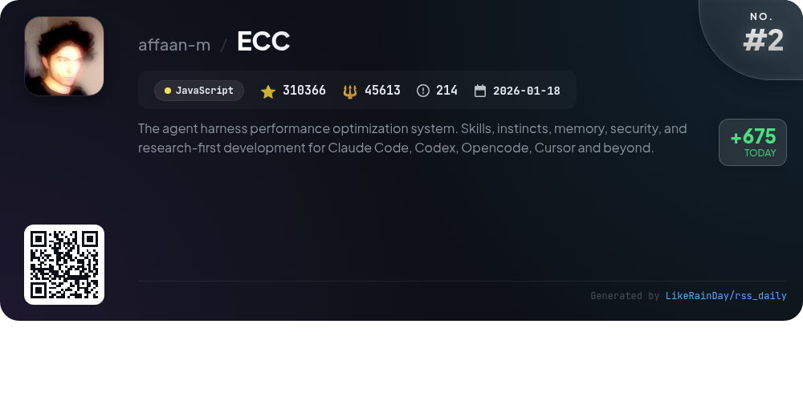
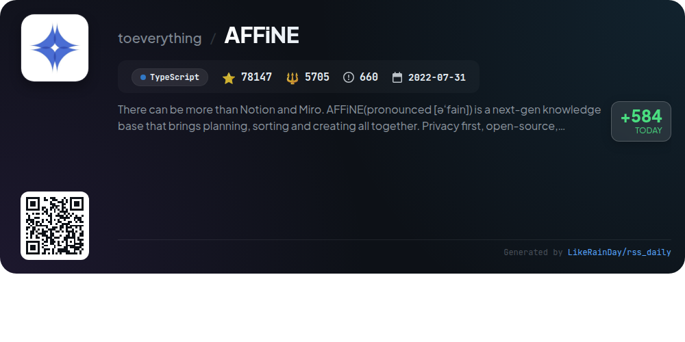
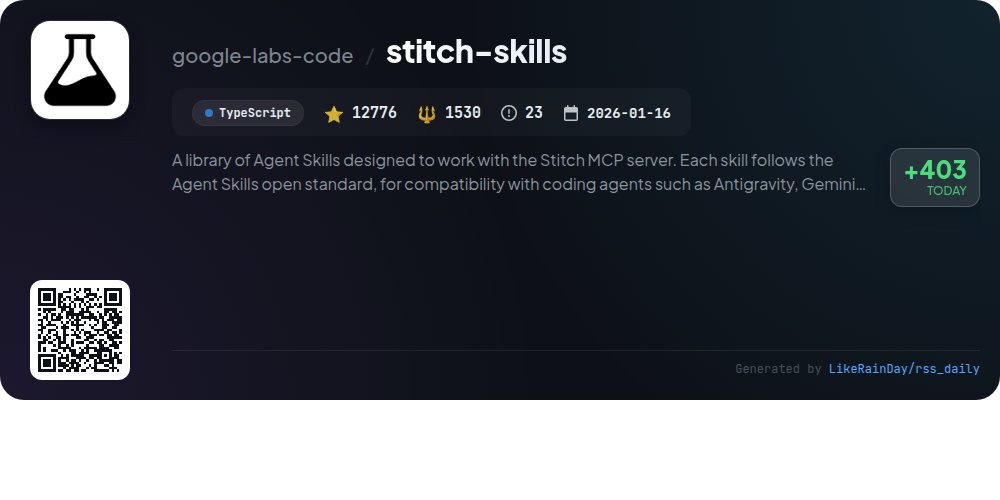
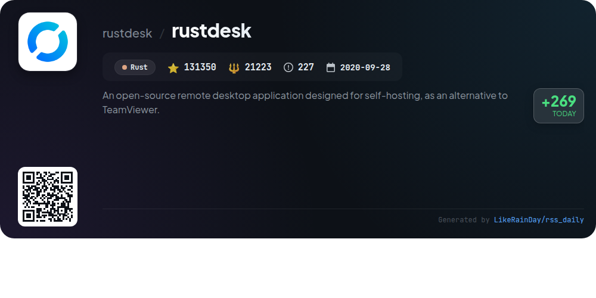
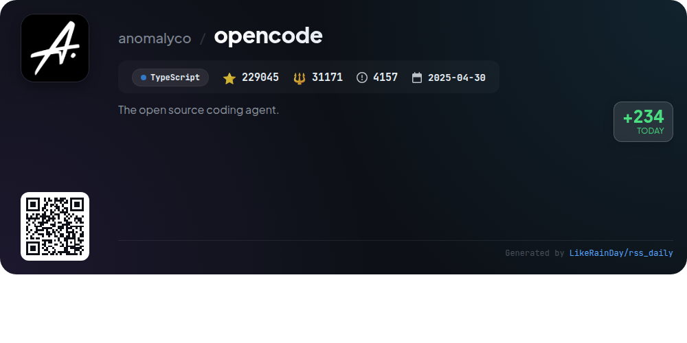
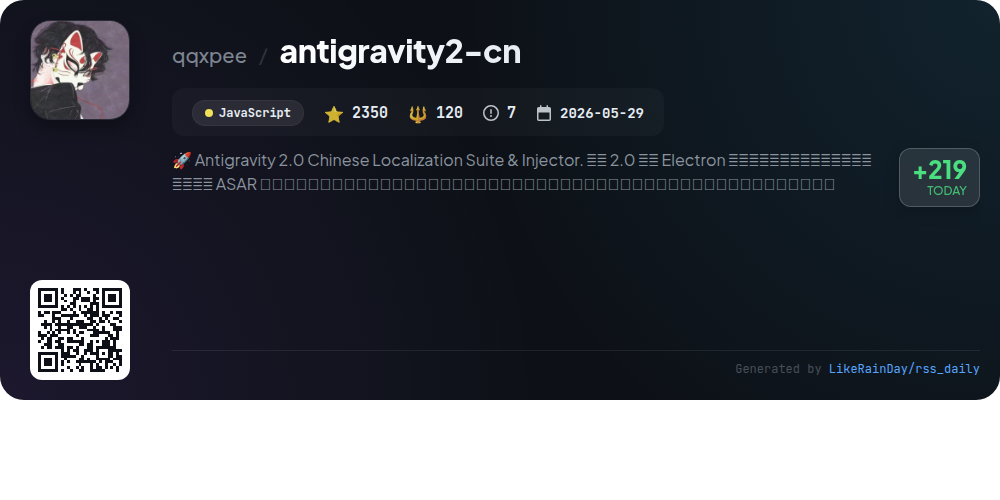

# 📊 🌟 GitHub Trending Daily - 2026-11-25

> > 📅 每日精选 GitHub 热门仓库 | 基于智能算法推荐

## 📋 Overview

**10** 个项目 | **1252297** ⭐ | **135575** 🍴

**热门语言:** `TypeScript` (5) · `JavaScript` (3) · `Rust` (1)

**更新时间:** 2026-11-25 08:00 UTC

**分类分布:**

- 🌟 每日 Top 10 精选 (10 项)

---

## 🌟 每日 Top 10 精选

### 1. [firecrawl](https://github.com/firecrawl/firecrawl)

> 🤖 **推荐理由**  
> *Firecrawl is a powerful knowledge infrastructure designed to enhance AI agents by providing seamless access to over 550 data providers through a single API. It offers three deployment options: Firecrawl Local for local scraping, Firecrawl Cloud for scalable services without infrastructure management, and self-hosting for complete control. Core features include web scraping, site crawling, search capabilities, and an autonomous agent for data retrieval. Firecrawl delivers clean markdown, structured JSON, and supports integration with various AI tools, making it an invaluable resource for data-driven applications.*

- ⭐ 209258 stars
- 💻 TypeScript
- 📅 Updated: 2026-11-25

### 2. [ECC](https://github.com/affaan-m/ECC)

> 🤖 **推荐理由**  
> *ECC is an advanced agent harness performance optimization system designed to enhance coding workflows through specialized tools. Key features include 72 agents, 328 skills, and 99 command shims for tasks like planning, testing, and security reviews. ECC promotes a structured approach to coding with continuous learning, memory persistence, and security scanning via AgentShield. It supports multiple platforms including Claude Code, Codex, and Kimi, offering both guided and manual installation options. Visit the ECC website for more details and access to tools.*

- ⭐ 310366 stars
- 💻 JavaScript
- 📅 Updated: 2026-11-25

### 3. [ponytail](https://github.com/DietrichGebert/ponytail)

> 🤖 **推荐理由**  
> *Ponytail is a JavaScript project designed to optimize AI agent performance by mimicking the efficiency of the laziest senior developer. With over 198,000 stars, it focuses on reducing code complexity while maintaining high-quality outputs, achieving significant reductions in code, time, and costs. Key features include advanced review and audit processes, which analyze code for bugs and security vulnerabilities, and an intuitive command interface for seamless integration. Ideal for enhancing productivity, Ponytail prioritizes minimalism and effectiveness, ensuring safe, efficient coding practices.*

- ⭐ 198298 stars
- 💻 JavaScript
- 📅 Updated: 2026-11-25

### 4. [AFFiNE](https://github.com/toeverything/AFFiNE)

> 🤖 **推荐理由**  
> *AFFiNE is a next-gen, open-source knowledge base that seamlessly integrates planning, creation, and organization, making it a robust alternative to Notion and Miro. Key features include a versatile canvas for rich text, sticky notes, and multimedia; a multimodal AI partner for enhanced creativity; and strong privacy with local-first data management. AFFiNE supports real-time collaboration, self-hosting, and customization through a plugin system. With over 78,000 stars on GitHub, it is designed for creative minds seeking a comprehensive workspace solution.*

- ⭐ 78147 stars
- 💻 TypeScript
- 📅 Updated: 2026-11-25

### 5. [AnyPS5](https://github.com/boykopovar/AnyPS5)

> 🤖 **推荐理由**  
> *AnyPS5 is a powerful tool for automatically porting PS5 executables to Linux and Windows, boasting over 61,000 stars on GitHub. Key features include a relinker that adapts executables to native formats, support for dynamic linking via system PRX libraries, and a web converter that keeps files on the user's device. The project supports SDL-mapped game controllers and offers customizable input mapping. With a focus on interoperability and research, AnyPS5 is independent of Sony and does not distribute copyrighted materials. It is licensed under the GNU General Public License v2.*

- ⭐ 61357 stars
- 💻 C++
- 📅 Updated: 2026-11-25

### 6. [stitch-skills](https://github.com/google-labs-code/stitch-skills)

> 🤖 **推荐理由**  
> *Stitch Skills is a TypeScript library of Agent Skills tailored for the Stitch MCP server, adhering to the Agent Skills open standard. It offers a suite of plugins, including `stitch-design`, `stitch-build`, and `stitch-utilities`, enabling seamless integration with coding agents like Codex, Antigravity, and Claude Code. Key features include design management, code generation for React components, and utility skills for enhancing prompts and generating design specifications. With 12,776 stars, it provides powerful tools for streamlining design workflows and application development.*

- ⭐ 12776 stars
- 💻 TypeScript
- 📅 Updated: 2026-11-25

### 7. [plugins](https://github.com/cursor/plugins)

> 🤖 **推荐理由**  
> *The "plugins" project offers a comprehensive repository of official Cursor plugins designed for popular developer tools, frameworks, and SaaS products. With over 19,350 stars, it showcases a variety of plugins categorized into utilities, developer tools, and integrations. Key features include skill mapping, incremental learning updates, and internal team workflows, alongside extensive integrations with services like Google Suite, Salesforce, and Zoom. Each plugin is self-contained with its own manifest, facilitating easy customization and deployment for developers. The project is structured for scalability and collaboration.*

- ⭐ 19350 stars
- 💻 TypeScript
- 📅 Updated: 2026-11-25

### 8. [rustdesk](https://github.com/rustdesk/rustdesk)

> 🤖 **推荐理由**  
> *RustDesk is an open-source remote desktop application written in Rust, offering a self-hosted alternative to TeamViewer. With over 131,350 stars on GitHub, it ensures user data security and privacy, allowing for easy connection without configuration. Key features include screen sharing, file transfer, and support for both rendezvous and relay servers. Users can build the application via Docker or traditional methods, and it supports multiple languages. RustDesk encourages contributions and community engagement through platforms like Discord and Reddit.*

- ⭐ 131350 stars
- 💻 Rust
- 📅 Updated: 2026-11-25

### 9. [opencode](https://github.com/anomalyco/opencode)

> 🤖 **推荐理由**  
> *OpenCode is an open-source AI coding agent designed to enhance programming efficiency. With over 229,000 stars on GitHub, it offers a versatile command-line interface (CLI) and a desktop application for macOS, Windows, and Linux. Key features include two built-in agents—'build' for development and 'plan' for code exploration—allowing users to switch seamlessly. Installation options include package managers and scripts. OpenCode supports multiple languages, fostering a diverse community. Documentation and contribution guidelines are readily available for developers.*

- ⭐ 229045 stars
- 💻 TypeScript
- 📅 Updated: 2026-11-25

### 10. [antigravity2-cn](https://github.com/qqxpee/antigravity2-cn)

> 🤖 **推荐理由**  
> *Antigravity2-cn is a Chinese localization suite for Antigravity 2.0, providing a zero-dependency package that seamlessly integrates into the Electron framework. Key features include one-click installation and restoration, dynamic injection of Chinese translations for the interface, menu, taskbar, and settings, all without altering core binaries. The suite supports both Windows and macOS, and utilizes Node.js for efficient operation. Advanced functionalities include optional proxy injection for network restrictions and automated dictionary updates through an AI assistant, enhancing user experience and community engagement.*

- ⭐ 2350 stars
- 💻 JavaScript
- 📅 Updated: 2026-11-25

---

## 📡 RSS订阅

通过 RSS 订阅，第一时间获取每日精选项目：

- 🔔 [RSS 订阅源] (../../daily-top.xml)
- 🔔 [每日简报] (../../GITHUB_TODAY_CN.md)
- 🔔 [每日 Top 10 精选](../../daily-top.xml)

---

*⚡ Powered by Smart Trending Algorithm | Generated at 2026-11-25 08:00:45 UTC
