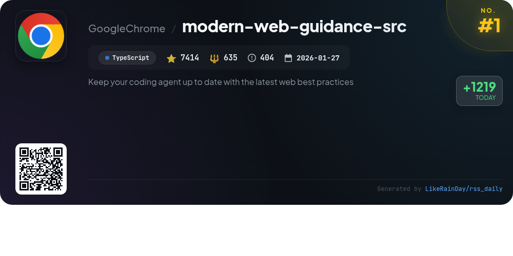
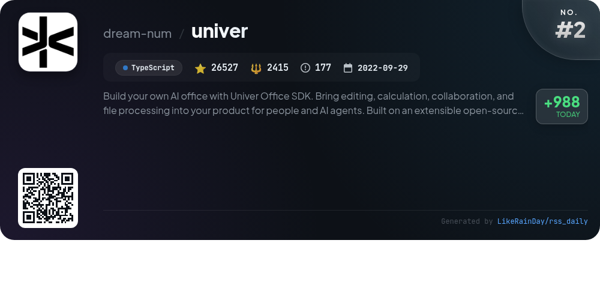
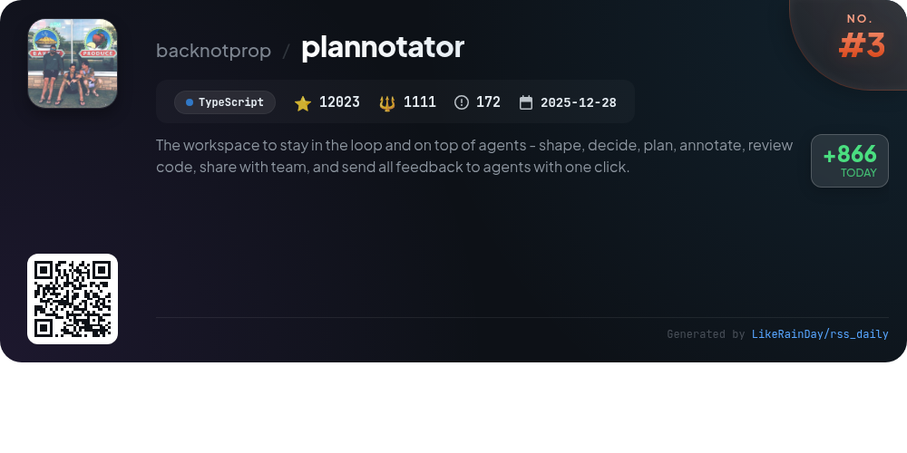
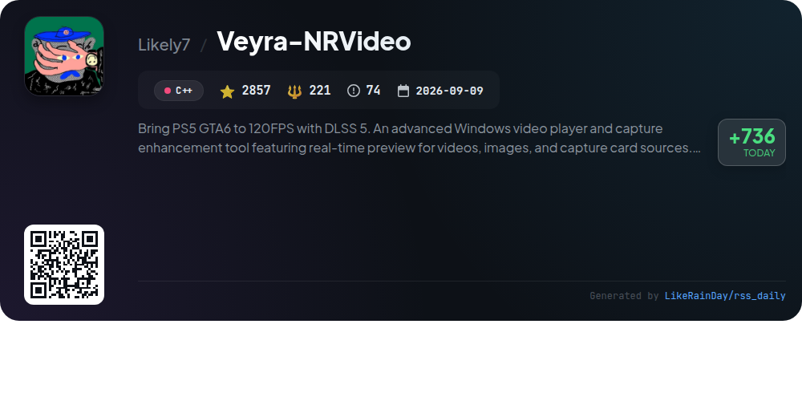
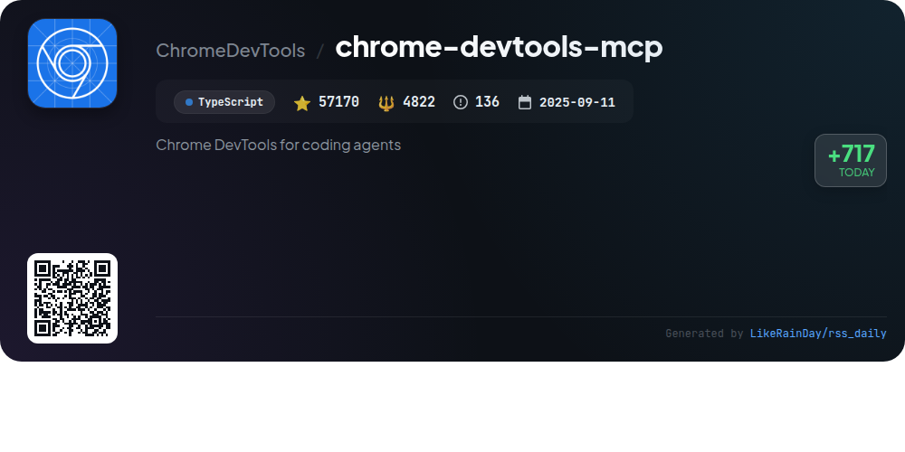
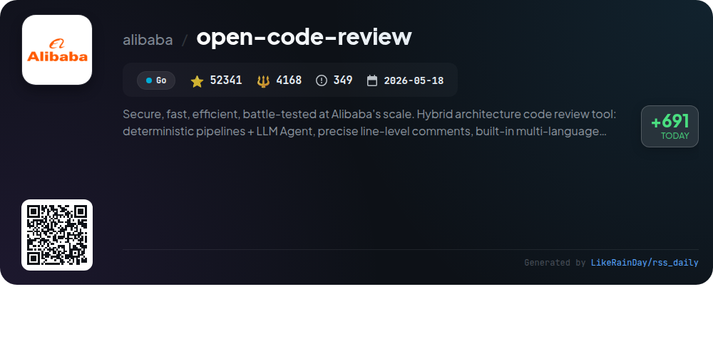
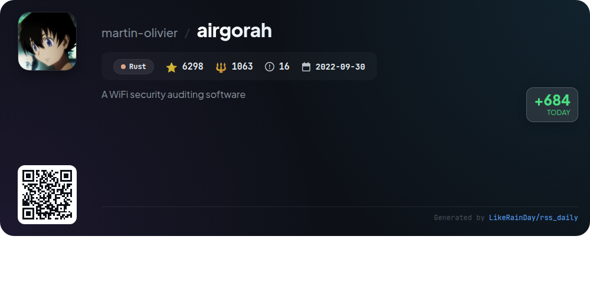
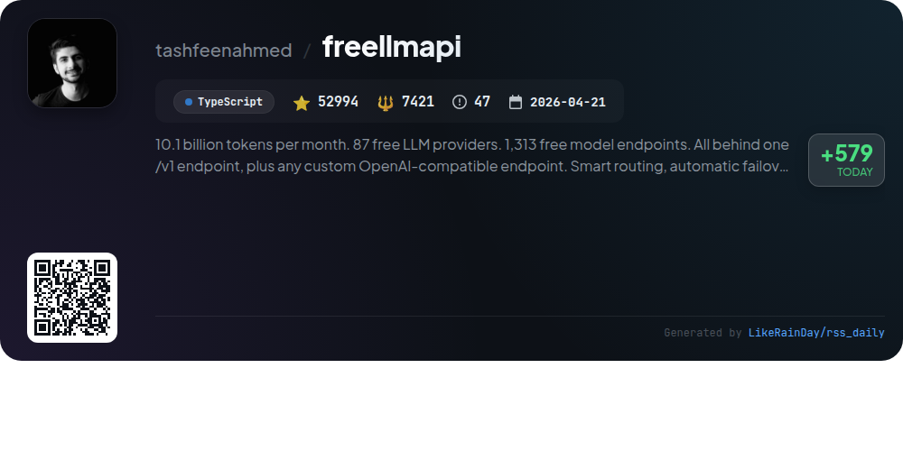
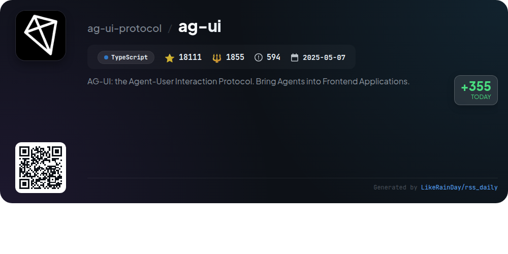

# 📊 🌟 GitHub Trending Daily - 2026-11-16

> > 📅 每日精选 GitHub 热门仓库 | 基于智能算法推荐

## 📋 Overview

**10** 个项目 | **237517** ⭐ | **24012** 🍴

**热门语言:** `TypeScript` (6) · `Go` (2) · `C++` (1)

**更新时间:** 2026-11-16 05:56 UTC

**分类分布:**

- 🌟 每日 Top 10 精选 (10 项)

---

## 🌟 每日 Top 10 精选

### 1. [modern-web-guidance-src](https://github.com/GoogleChrome/modern-web-guidance-src)

> 🤖 **推荐理由**  
> *The Modern Web Guidance project provides a comprehensive set of best practices, skills, and browser compatibility data to enhance coding agents' web development capabilities. Key features include seamless integration with coding agents through a CLI, interactive guides for modern browser APIs, performance optimization, and accessibility enhancements. The tool helps developers avoid legacy patterns by offering expert-curated guidelines, facilitating modern web practices, and ensuring adaptive solutions for various web technologies. It is collaboratively maintained by teams from Google Chrome, Microsoft Edge, Mozilla Firefox, and the web development community.*

- ⭐ 7414 stars
- 💻 TypeScript
- 📅 Updated: 2026-11-16

### 2. [univer](https://github.com/dream-num/univer)

> 🤖 **推荐理由**  
> *Univer is an open-source Office SDK designed for building AI-driven office applications. It offers a robust foundation for editing, calculation, collaboration, and file processing across various document types, including spreadsheets, documents, and presentations. Key features include real-time collaboration, plugin extensibility, and a rich API for seamless integration with applications. The SDK comprises three parts: Web SDK, Server SDK, and AI SDK, enabling versatile use cases from embedded editors to headless processing. With over 26,500 stars on GitHub, Univer fosters a collaborative development environment.*

- ⭐ 26527 stars
- 💻 TypeScript
- 📅 Updated: 2026-11-16

### 3. [plannotator](https://github.com/backnotprop/plannotator)

> 🤖 **推荐理由**  
> *Plannotator is a TypeScript-based workspace designed for seamless interaction with AI coding agents, allowing users to annotate, plan, review code, and share feedback effortlessly. Key features include the Plannotator Inbox, which consolidates agent communications for efficient review and response, and robust code review tools compatible with Git, GitHub, and GitLab. Users can annotate various artifacts, including HTML and Markdown, and utilize integrations with popular tools like VS Code and Notion. With over 12,000 stars, Plannotator enhances collaboration and productivity in AI-assisted development.*

- ⭐ 12023 stars
- 💻 TypeScript
- 📅 Updated: 2026-11-16

### 4. [Veyra-NRVideo](https://github.com/Likely7/Veyra-NRVideo)

> 🤖 **推荐理由**  
> *Veyra-NRVideo is an advanced Windows video player and capture enhancement tool that leverages DLSS 5 technology to deliver a next-gen visual experience at up to 120FPS for PS5 and Xbox. Key features include real-time video enhancement with AI-powered Super Resolution, Denoising, HDR, and Frame Generation. The user-friendly interface supports multiple input sources, including capture cards and game streaming. With over 2857 stars on GitHub, Veyra offers extensive customization options, layered noise reduction, and a robust export workflow, making it a versatile choice for gamers and content creators.*

- ⭐ 2857 stars
- 💻 C++
- 📅 Updated: 2026-11-16

### 5. [chrome-devtools-mcp](https://github.com/ChromeDevTools/chrome-devtools-mcp)

> 🤖 **推荐理由**  
> *chrome-devtools-mcp is a powerful TypeScript package enabling coding agents like Antigravity and Copilot to control and inspect live Chrome browsers. With over 57k stars, it offers features such as advanced browser debugging, performance insights through Chrome DevTools, and reliable automation using Puppeteer. The project supports a Model-Context-Protocol (MCP) server and CLI for versatile integration. Key skills include debugging, performance optimization, and accessibility auditing. Ideal for developers seeking robust automation and debugging tools in Chrome.*

- ⭐ 57170 stars
- 💻 TypeScript
- 📅 Updated: 2026-11-16

### 6. [open-code-review](https://github.com/alibaba/open-code-review)

> 🤖 **推荐理由**  
> *Open-Code Review is a powerful AI-driven code review tool developed by Alibaba, designed for secure and efficient code analysis at scale. It features deterministic pipelines combined with an LLM Agent, providing precise line-level comments and a built-in multi-language ruleset addressing key issues like NPE, thread-safety, XSS, and SQL injection. The tool reads Git diffs, performs comprehensive reviews, and supports entire file audits. With compatibility for OpenAI and Anthropic models, it enhances review precision while minimizing false alarms, making it a robust choice for developers.*

- ⭐ 52341 stars
- 💻 Go
- 📅 Updated: 2026-11-16

### 7. [airgorah](https://github.com/martin-olivier/airgorah)

> 🤖 **推荐理由**  
> *Airgorah is a Rust-based WiFi security auditing software designed for Linux environments. It enables users to capture nearby WiFi traffic, discover connected clients, perform deauthentication attacks, capture handshakes and PMKIDs, and crack access point passwords. The software features a user-friendly graphical interface built with GTK4 and operates with elevated privileges when necessary through a polkit-based agent. Airgorah is intended for testing and identifying vulnerabilities in networks owned by the user. It has garnered over 6,298 stars on GitHub.*

- ⭐ 6298 stars
- 💻 Rust
- 📅 Updated: 2026-11-16

### 8. [freellmapi](https://github.com/tashfeenahmed/freellmapi)

> 🤖 **推荐理由**  
> *FreeLLMAPI is an innovative API aggregator providing access to 10.1 billion tokens monthly from 87 free LLM providers, offering 1,313 model endpoints through a unified OpenAI-compatible endpoint. Key features include smart routing with automatic failover, encrypted keys, real-time model catalog updates, and per-key usage tracking to stay within free-tier limits. It supports various models, including chat, embedding, image, and audio, making it ideal for personal experimentation. With a user-friendly dashboard and extensive compatibility with OpenAI clients, FreeLLMAPI streamlines LLM utilization for developers.*

- ⭐ 52994 stars
- 💻 TypeScript
- 📅 Updated: 2026-11-16

### 9. [LoopForge](https://github.com/Tencent/LoopForge)

> 🤖 **推荐理由**  
> *LoopForge is a self-hosted platform designed to streamline software delivery using coding agents like CodeBuddy, Codex, and Claude Code. Key features include chat-based interactions with a Main Bot, repeatable Standard Operating Procedures (SOPs) for consistent workflows, and integrated human approval gates for quality control. It allows for on-demand Docker sandboxes, end-to-end requirement tracking, and supports a variety of coding-agent CLIs. LoopForge Local offers built-in workflows directly in coding assistants. The project is MIT licensed and has garnered 1782 stars on GitHub.*

- ⭐ 1782 stars
- 💻 Go
- 📅 Updated: 2026-11-16

### 10. [ag-ui](https://github.com/ag-ui-protocol/ag-ui)

> 🤖 **推荐理由**  
> *AG-UI is an open, event-based protocol designed to facilitate seamless integration between AI agents and user-facing applications. With over 18,000 stars, it offers core features such as real-time agentic chat, bi-directional state synchronization, and a flexible middleware layer compatible with various event transports. Key highlights include extensive documentation, community support via Discord, and partnerships with platforms like LangChain. It supports numerous frameworks and SDKs, enabling rapid application development and integration for enhanced user experiences.*

- ⭐ 18111 stars
- 💻 TypeScript
- 📅 Updated: 2026-11-16

---

## 📡 RSS订阅

通过 RSS 订阅，第一时间获取每日精选项目：

- 🔔 [RSS 订阅源] (../../daily-top.xml)
- 🔔 [每日简报] (../../GITHUB_TODAY_CN.md)
- 🔔 [每日 Top 10 精选](../../daily-top.xml)

---

*⚡ Powered by Smart Trending Algorithm | Generated at 2026-11-16 05:56:05 UTC
