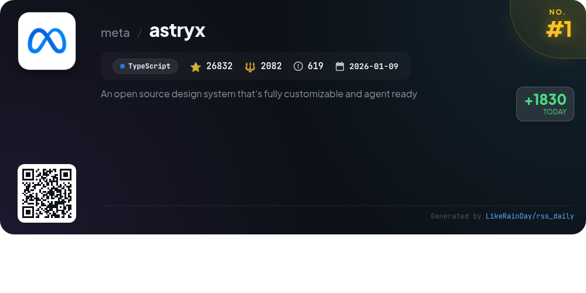
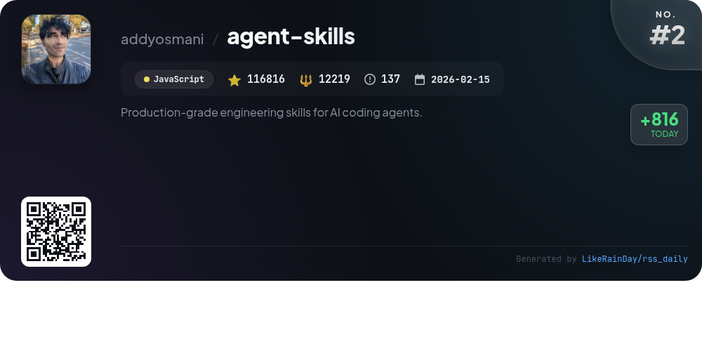
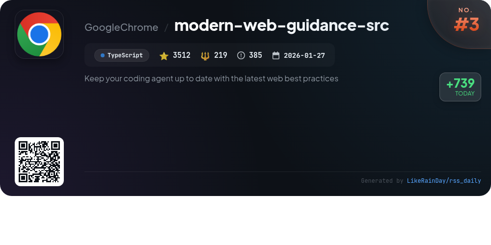
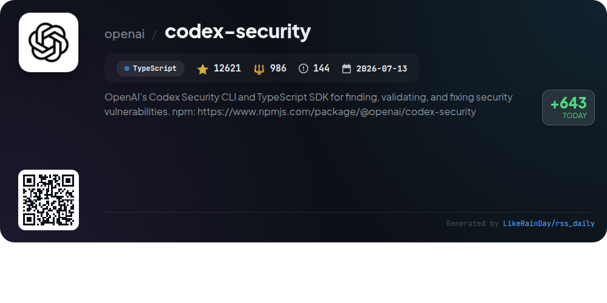
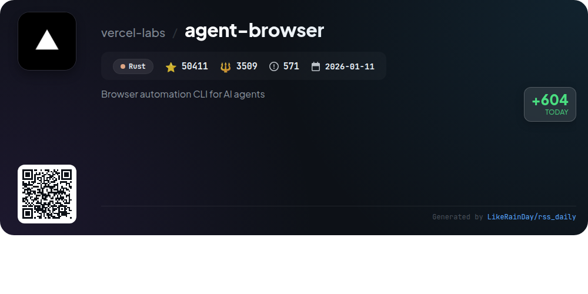
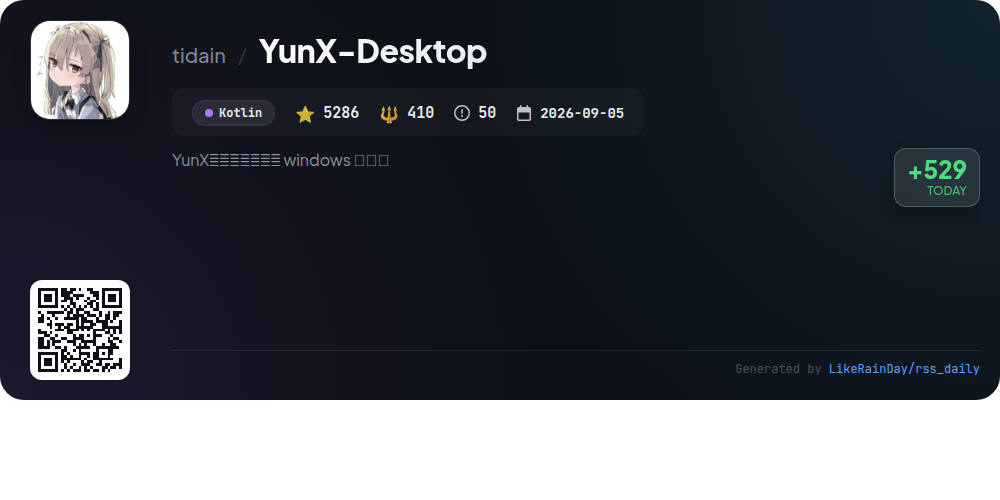
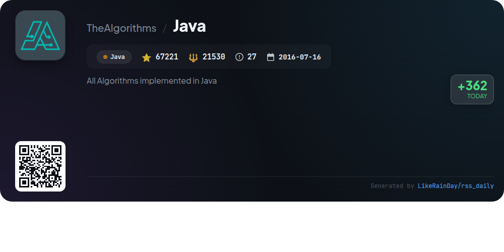
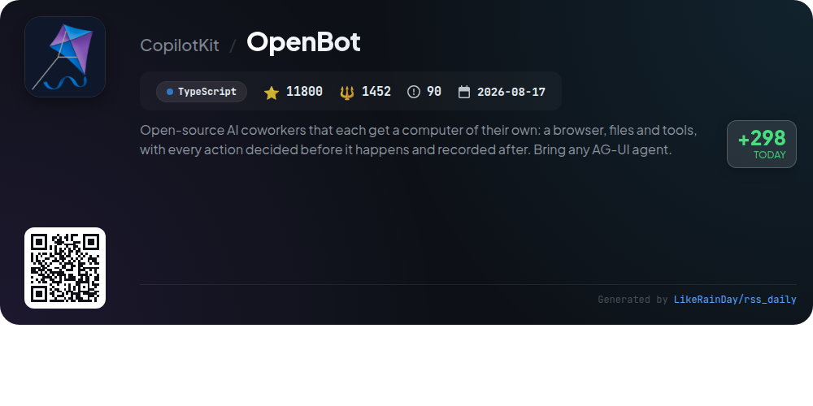
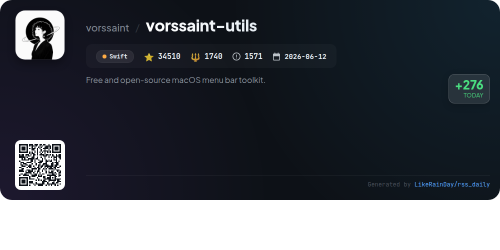

# 📊 🌟 GitHub Trending Daily - 2026-11-13

> > 📅 每日精选 GitHub 热门仓库 | 基于智能算法推荐

## 📋 Overview

**10** 个项目 | **336627** ⭐ | **44549** 🍴

**热门语言:** `TypeScript` (4) · `Kotlin` (2) · `JavaScript` (1)

**更新时间:** 2026-11-13 06:06 UTC

**分类分布:**

- 🌟 每日 Top 10 精选 (10 项)

---

## 🌟 每日 Top 10 精选

### 1. [astryx](https://github.com/meta/astryx)

> 🤖 **推荐理由**  
> *Astryx is an open-source, customizable design system developed by Meta, currently in beta. Built on React 19+ and StyleX, it offers over 150 accessible UI components, brand-level theming, dark mode, and ready-to-ship templates. Key features include open internals for component customization, no styling lock-in, and a unified API for both developers and AI assistants. The system supports seamless integration with existing projects, providing a robust CLI for component documentation and scaffolding. With extensive documentation and a community-driven approach, Astryx enhances design consistency across applications.*

- ⭐ 26832 stars
- 💻 TypeScript
- 📅 Updated: 2026-11-13

### 2. [agent-skills](https://github.com/addyosmani/agent-skills)

> 🤖 **推荐理由**  
> *Agent Skills provides production-grade engineering workflows for AI coding agents, ensuring adherence to best practices throughout the software development lifecycle. With 25 structured skills, including commands for defining, planning, building, testing, reviewing, and shipping, it enables agents to follow senior engineering standards consistently. Key features include automated skill activation based on tasks, a quick-start CLI for easy integration across 70+ agents, and pre-configured specialist personas for targeted reviews. This project enhances code quality and reliability by embedding engineering judgment directly into workflows.*

- ⭐ 116816 stars
- 💻 JavaScript
- 📅 Updated: 2026-11-13

### 3. [modern-web-guidance-src](https://github.com/GoogleChrome/modern-web-guidance-src)

> 🤖 **推荐理由**  
> *The Modern Web Guidance project provides developers with a comprehensive toolkit to adopt the latest web best practices, ensuring coding agents produce efficient, modern code. It includes interactive CLI commands for installing, searching, and retrieving expert-curated guidelines on topics like modern browser APIs, performance optimization, and accessibility. Key features include real-world use cases, a focus on responsible fallbacks, and ongoing evaluations to enhance agent performance. Stewarded by major browser teams, it aims to eliminate legacy coding patterns and streamline web development.*

- ⭐ 3512 stars
- 💻 TypeScript
- 📅 Updated: 2026-11-13

### 4. [codex-security](https://github.com/openai/codex-security)

> 🤖 **推荐理由**  
> *OpenAI's Codex Security CLI and TypeScript SDK for finding, validating, and fixing security vulnerabilities. npm: https://www.npmjs.com/package/@opena. popular project, actively maintained, recently updated*

- ⭐ 12621 stars
- 🍴 986 forks
- 💻 TypeScript
- 📅 Updated: 2026-11-13

### 5. [agent-browser](https://github.com/vercel-labs/agent-browser)

> 🤖 **推荐理由**  
> *Browser automation CLI for AI agents. popular project, actively maintained, recently updated*

- ⭐ 50411 stars
- 🍴 3509 forks
- 💻 Rust
- 📅 Updated: 2026-11-13

### 6. [YunX-Desktop](https://github.com/tidain/YunX-Desktop)

> 🤖 **推荐理由**  
> *YunX-Desktop is the official Windows desktop client for the YunX file-sharing service, allowing users to paste links for high-speed downloads from various cloud storage and video platforms, including Baidu, Bilibili, and more. Key features include multi-account support, concurrent downloads with breakpoint resume, and P2P link compatibility. The application offers both portable and installable versions, a built-in browser extension for enhanced functionality, and integrates seamlessly with Windows notification systems. It’s open-source under AGPL-3.0.*

- ⭐ 5286 stars
- 💻 Kotlin
- 📅 Updated: 2026-11-13

### 7. [Java](https://github.com/TheAlgorithms/Java)

> 🤖 **推荐理由**  
> *The Algorithms - Java project offers a comprehensive collection of algorithms implemented in Java, designed primarily for educational use. With over 67,000 stars, it provides a platform for users to run, edit, and contribute to algorithms through Gitpod, a convenient online development environment. The repository includes a full directory of algorithms and encourages community contributions, adhering to established guidelines. Key features include build status, code coverage tracking, and a dedicated Discord channel for support and collaboration.*

- ⭐ 67221 stars
- 💻 Java
- 📅 Updated: 2026-11-13

### 8. [OpenBot](https://github.com/CopilotKit/OpenBot)

> 🤖 **推荐理由**  
> *OpenBot is an open-source platform enabling AI coworkers with dedicated environments, each equipped with a browser and tools. It offers a modular, self-hostable workspace where users can select models, integrate existing agents via AG-UI, and manage infrastructure. Key features include company governance with sign-in, permissions, and audit trails, as well as customizable bots. OpenBot supports deployment on Kubernetes and offers a personal edition for individual use. With a robust architecture, it facilitates seamless collaboration and automation for enterprises.*

- ⭐ 11800 stars
- 💻 TypeScript
- 📅 Updated: 2026-11-13

### 9. [vorssaint-utils](https://github.com/vorssaint/vorssaint-utils)

> 🤖 **推荐理由**  
> *Vorssaint-utils is a free, open-source macOS menu bar toolkit, boasting over 34,510 stars on GitHub. This versatile app consolidates numerous utilities, including a per-app volume mixer, system monitor, app switcher, clipboard manager, and more, all accessible from a single menu bar icon. Users can customize feature installations, ensuring a tailored experience without unnecessary bloat. With a strong focus on privacy, Vorssaint operates locally without tracking or accounts. Ideal for Mac users seeking an efficient, all-in-one solution for everyday tasks.*

- ⭐ 34510 stars
- 💻 Swift
- 📅 Updated: 2026-11-13

### 10. [YunX](https://github.com/CYQawa/YunX)

> 🤖 **推荐理由**  
> *YunX is a powerful open-source Android app for high-speed downloading and parsing of cloud storage and video sharing links. It supports various platforms, including Quark, UC, Baidu, and video sites like Douyin and Bilibili, automatically extracting passwords and providing direct download links. Key features include multi-threaded downloads, online previews, and a user-friendly interface with clipboard recognition. YunX is built with Kotlin and Jetpack Compose, ensuring modern design and functionality. It upholds the AGPL-3.0 license, emphasizing its free and open-source nature.*

- ⭐ 7618 stars
- 💻 Kotlin
- 📅 Updated: 2026-11-13

---

## 📡 RSS订阅

通过 RSS 订阅，第一时间获取每日精选项目：

- 🔔 [RSS 订阅源] (../../daily-top.xml)
- 🔔 [每日简报] (../../GITHUB_TODAY_CN.md)
- 🔔 [每日 Top 10 精选](../../daily-top.xml)

---

*⚡ Powered by Smart Trending Algorithm | Generated at 2026-11-13 06:06:13 UTC
