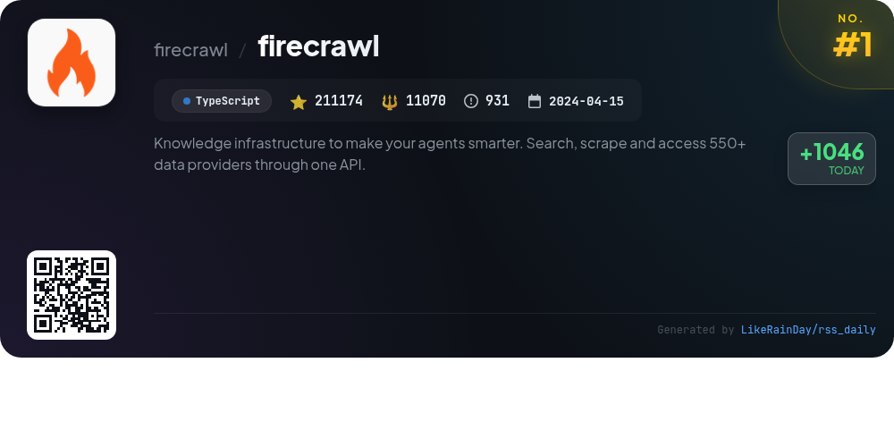
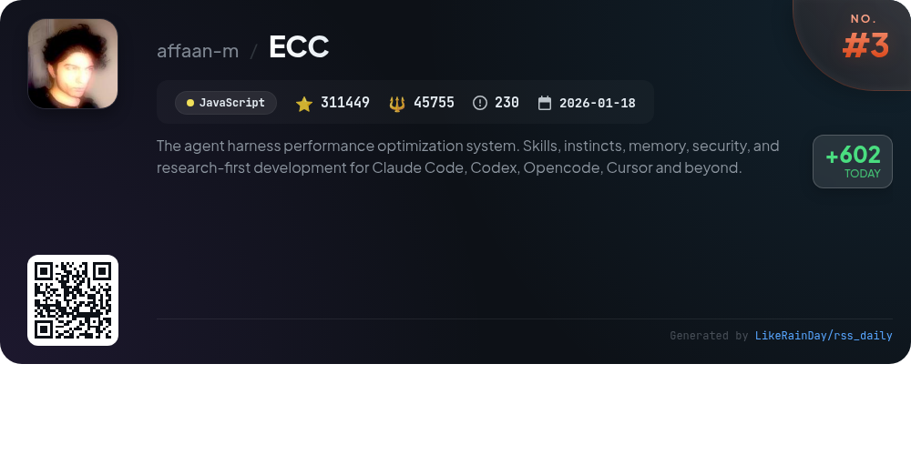
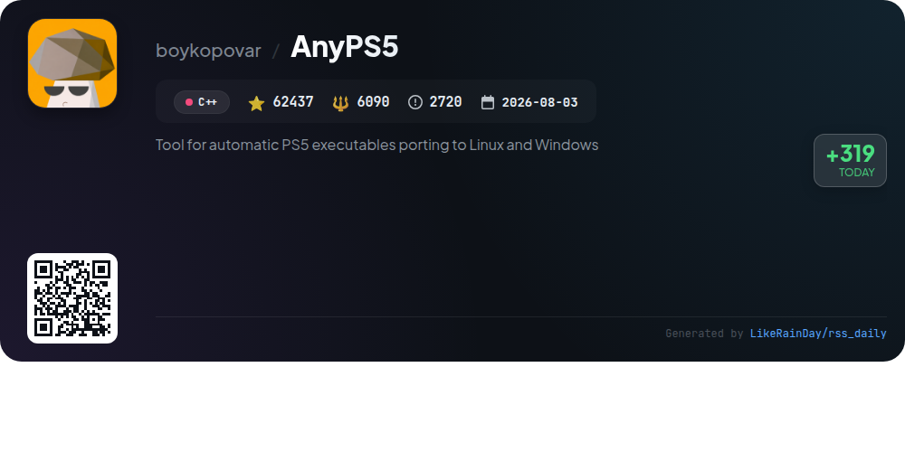
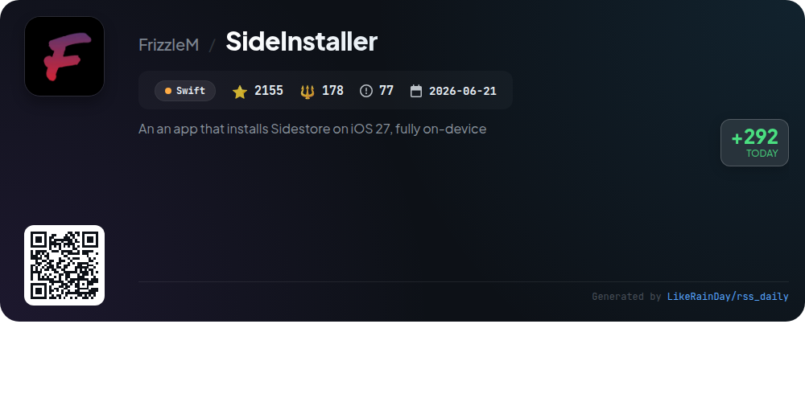
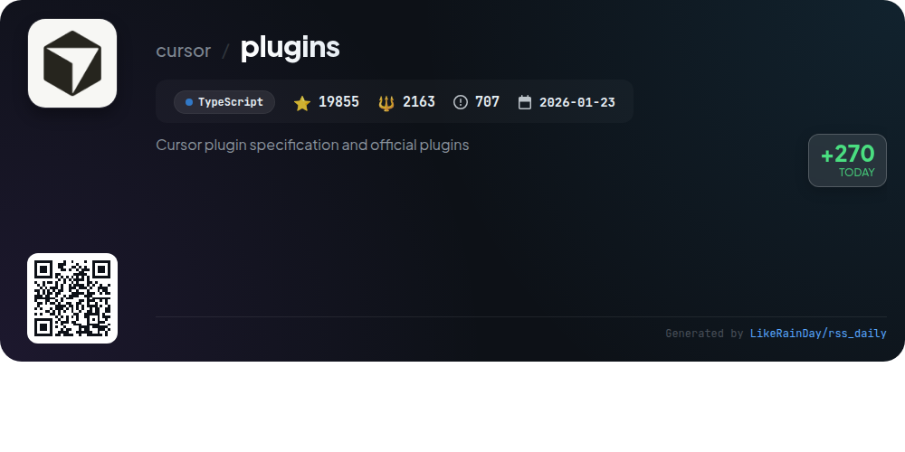
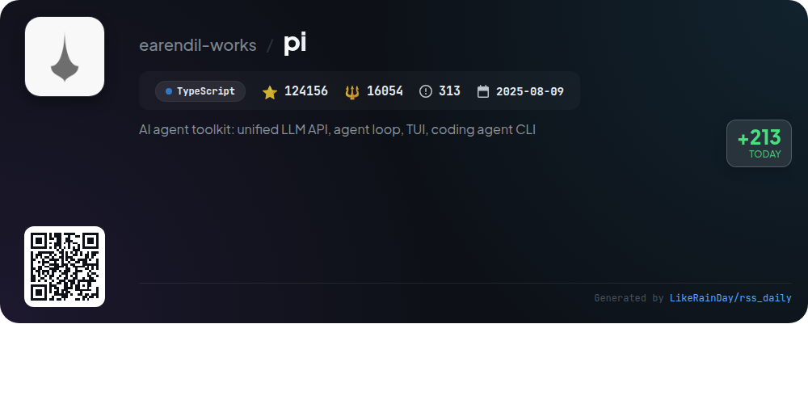

# 📊 🌟 GitHub Trending Daily - 2026-11-27

> > 📅 每日精选 GitHub 热门仓库 | 基于智能算法推荐

## 📋 Overview

**10** 个项目 | **1252762** ⭐ | **131252** 🍴

**热门语言:** `TypeScript` (6) · `JavaScript` (2) · `C++` (1)

**更新时间:** 2026-11-27 07:51 UTC

**分类分布:**

- 🌟 每日 Top 10 精选 (10 项)

---

## 🌟 每日 Top 10 精选

### 1. [firecrawl](https://github.com/firecrawl/firecrawl)

> 🤖 **推荐理由**  
> *Firecrawl is a powerful knowledge infrastructure designed to enhance AI agents by enabling them to search, scrape, and access over 550 data providers through a single API. Key features include Firecrawl Local for on-device scraping, Firecrawl Cloud for scalable, hosted solutions, and self-hosting options. Users can scrape and interact with web content, perform searches, and utilize an agent for autonomous data gathering. Firecrawl also offers structured outputs and supports various integrations, making it a versatile tool for developers and businesses seeking efficient data access.*

- ⭐ 211174 stars
- 💻 TypeScript
- 📅 Updated: 2026-11-27

### 2. [ponytail](https://github.com/DietrichGebert/ponytail)

> 🤖 **推荐理由**  
> *Ponytail is a JavaScript project that enhances AI agents, enabling them to generate efficient code with minimal input, akin to a seasoned developer's lazy approach. Key features include a streamlined code generation process, comprehensive auditing and review capabilities, and a unique "band" display tracking costs and performance. Ponytail 5 boasts significant reductions in code size, cost, and time while maintaining robust testing accuracy. With commands for reviewing and auditing code, it aims to optimize development workflows, making it a valuable tool for developers seeking efficiency.*

- ⭐ 199545 stars
- 💻 JavaScript
- 📅 Updated: 2026-11-27

### 3. [ECC](https://github.com/affaan-m/ECC)

> 🤖 **推荐理由**  
> *ECC is a performance optimization system for coding agents like Claude Code, Codex, and more. It enhances agent capabilities by providing 72 specialized agents, 328 reusable skills, and 99 command shims for efficient workflows. Key features include planning, testing, implementation, and review processes, along with security scanning through AgentShield. ECC supports multiple platforms, offers guided installation, and facilitates continuous learning and memory management. It is open-source, MIT-licensed, and actively maintained with a strong community.*

- ⭐ 311449 stars
- 💻 JavaScript
- 📅 Updated: 2026-11-27

### 4. [AFFiNE](https://github.com/toeverything/AFFiNE)

> 🤖 **推荐理由**  
> *AFFiNE is a next-gen, open-source knowledge base that combines planning, sorting, and creativity in a privacy-first environment. It supports rich multimodal content on an edgeless canvas, allowing users to integrate text, images, and multimedia seamlessly. With real-time collaboration, local-first data ownership, and a powerful multimodal AI assistant, AFFiNE enhances productivity and creativity. Users can self-host, customize, and contribute to its growing ecosystem, making it a versatile alternative to Notion and Miro. Explore more at [AFFiNE.Pro](https://affine.pro).*

- ⭐ 79116 stars
- 💻 TypeScript
- 📅 Updated: 2026-11-27

### 5. [AnyPS5](https://github.com/boykopovar/AnyPS5)

> 🤖 **推荐理由**  
> *AnyPS5 is a powerful tool for automatically porting PS5 executables to Linux and Windows, boasting over 62,000 stars on GitHub. Key features include a relinker that converts executables to native formats without emulation, and implementations of system prx libraries for dynamic linking. The project supports SDL-mapped game controllers, and users can configure input settings easily. A web converter is available, ensuring files remain on the user's device. Committed to interoperability and research, AnyPS5 does not distribute copyrighted materials. It operates under the GNU GPL v2 license.*

- ⭐ 62437 stars
- 💻 C++
- 📅 Updated: 2026-11-27

### 6. [stitch-skills](https://github.com/google-labs-code/stitch-skills)

> 🤖 **推荐理由**  
> *Stitch Skills is a TypeScript library of agent skills designed for compatibility with the Stitch MCP server and various coding agents like Codex and Claude Code. It offers a robust suite of plugins categorized into design, build, and utility skills. Key features include converting frontend code into Stitch designs, generating React components, and creating design documentation. With over 13,000 stars, this library streamlines workflows in design management, code generation, and project analysis, adhering to the Agent Skills open standard for enhanced compatibility and efficiency.*

- ⭐ 13390 stars
- 💻 TypeScript
- 📅 Updated: 2026-11-27

### 7. [SideInstaller](https://github.com/FrizzleM/SideInstaller)

> 🤖 **推荐理由**  
> *An an app that installs Sidestore on iOS 27, fully on-device . popular project, actively maintained, recently updated*

- ⭐ 2155 stars
- 🍴 178 forks
- 💻 Swift
- 📅 Updated: 2026-11-27

### 8. [plugins](https://github.com/cursor/plugins)

> 🤖 **推荐理由**  
> *Cursor Plugins is a robust repository of official plugins designed for various developer tools, frameworks, and SaaS products, built with TypeScript. It features standalone directories for each plugin, including a manifest for easy integration. Key offerings include plugins for teaching, continual learning, CI workflows, code review, and extensive productivity tools like Google Drive and Zoom. The repository supports seamless integration with numerous third-party services, making it a versatile solution for enhancing development workflows and productivity automation. With over 19,000 stars, it reflects a strong community endorsement.*

- ⭐ 19855 stars
- 💻 TypeScript
- 📅 Updated: 2026-11-27

### 9. [opencode](https://github.com/anomalyco/opencode)

> 🤖 **推荐理由**  
> *OpenCode is an open-source AI coding agent written in TypeScript, designed to enhance coding efficiency. It boasts two built-in agents: a full-access "build" agent for development and a read-only "plan" agent for code exploration. Users can easily install OpenCode via various package managers or as a desktop application across multiple platforms. With its focus on facilitating complex searches and multistep tasks, OpenCode is ideal for both coding and analysis. Join the community on Discord for support and collaboration.*

- ⭐ 229485 stars
- 💻 TypeScript
- 📅 Updated: 2026-11-27

### 10. [pi](https://github.com/earendil-works/pi)

> 🤖 **推荐理由**  
> *Pi is an AI agent toolkit designed for extensibility and customization, featuring a unified LLM API, an agent loop, and a command-line interface (CLI) for coding tasks. With 124,156 stars, it allows users to adapt workflows through extensions, skills, and prompt templates. Key services include interactive usage, automation in print or JSON mode, and RPC control. Pi supports multiple AI providers and offers a TypeScript SDK for app development. Install easily via a script or npm, and explore the documentation for comprehensive setup guidance.*

- ⭐ 124156 stars
- 💻 TypeScript
- 📅 Updated: 2026-11-27

---

## 📡 RSS订阅

通过 RSS 订阅，第一时间获取每日精选项目：

- 🔔 [RSS 订阅源] (../../daily-top.xml)
- 🔔 [每日简报] (../../GITHUB_TODAY_CN.md)
- 🔔 [每日 Top 10 精选](../../daily-top.xml)

---

*⚡ Powered by Smart Trending Algorithm | Generated at 2026-11-27 07:51:39 UTC
