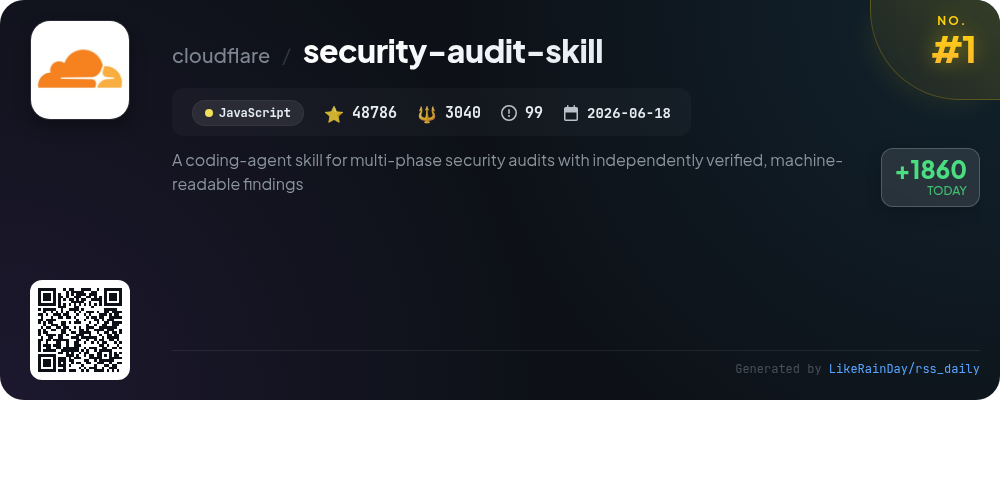
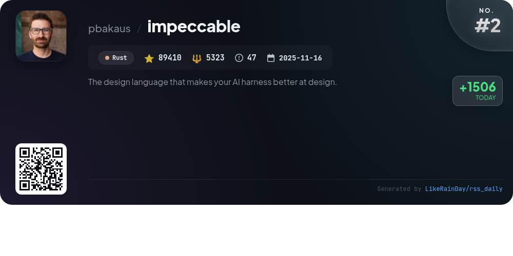
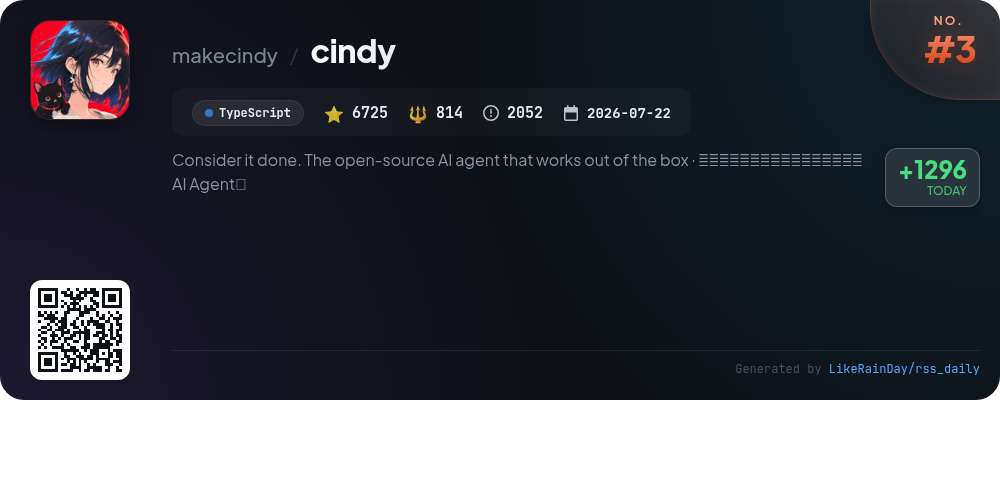
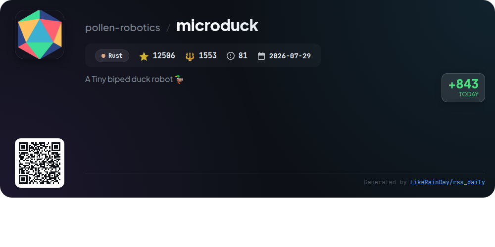
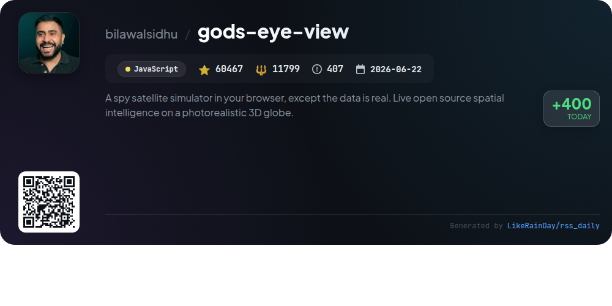
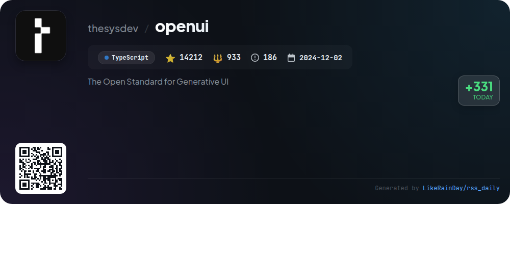
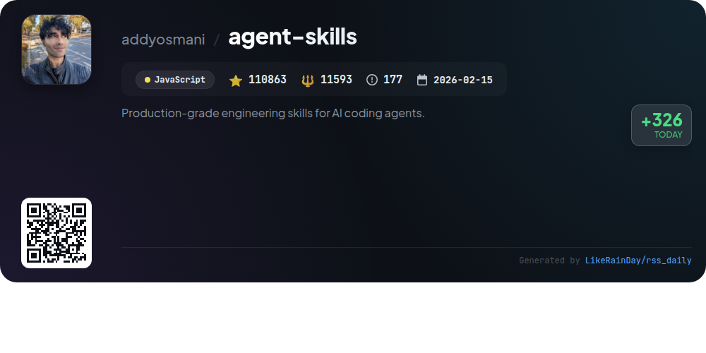
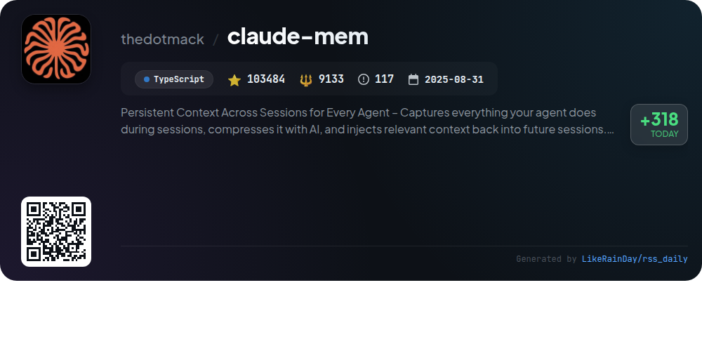

# 📊 🌟 GitHub Trending Daily - 2026-10-27

> > 📅 每日精选 GitHub 热门仓库 | 基于智能算法推荐

## 📋 Overview

**10** 个项目 | **739570** ⭐ | **87335** 🍴

**热门语言:** `JavaScript` (4) · `TypeScript` (4) · `Rust` (2)

**更新时间:** 2026-10-27 04:36 UTC

**分类分布:**

- 🌟 每日 Top 10 精选 (10 项)

---

## 🌟 每日 Top 10 精选

### 1. [security-audit-skill](https://github.com/cloudflare/security-audit-skill)

> 🤖 **推荐理由**  
> *A coding-agent skill for multi-phase security audits with independently verified, machine-readable findings. popular project, actively maintained, recently updated*

- ⭐ 48786 stars
- 🍴 3040 forks
- 💻 JavaScript
- 📅 Updated: 2026-10-27

### 2. [impeccable](https://github.com/pbakaus/impeccable)

> 🤖 **推荐理由**  
> *Impeccable is a Rust-based design language that enhances AI coding agents' capabilities in frontend design. With 24 commands, including `polish`, `audit`, and `critique`, it offers a shared design vocabulary and 62 deterministic rules to ensure high-quality output. Key features include a streamlined setup process with `/impeccable init`, live browser iteration, and comprehensive documentation. Impeccable integrates seamlessly with popular AI tools like Claude Code, GitHub Copilot, and Codex, making it a vital resource for teams aiming to elevate their design standards.*

- ⭐ 89410 stars
- 💻 Rust
- 📅 Updated: 2026-10-27

### 3. [cindy](https://github.com/makecindy/cindy)

> 🤖 **推荐理由**  
> *Cindy is an open-source AI agent that operates seamlessly on your local machine, utilizing real files and applications to complete tasks. With support for harnesses like Claude Code and Codex, Cindy can mix models mid-task, automate work, and drive your devices. Key features include customizable memory, skills, and automation, along with plugin support for enhanced functionality. The project is structured as a pnpm monorepo, offering desktop and mobile clients. Contributions are encouraged under the Apache-2.0 license, making Cindy a versatile tool for real-world applications.*

- ⭐ 6725 stars
- 💻 TypeScript
- 📅 Updated: 2026-10-27

### 4. [thinkrail](https://github.com/JetBrains/thinkrail)

> 🤖 **推荐理由**  
> *ThinkRail is an innovative IDE designed to enhance your coding experience by adapting to your workflow. It features isolated workspaces using `git worktrees`, allowing parallel agent work without disrupting your main project. Key highlights include a rich interface centered around the `pi` coding agent, real-time chat for project management, and living specs for maintaining project knowledge. ThinkRail supports extensions, integrates with GitHub for PR management, and offers both desktop and CLI versions. Its analytics respect user privacy while enhancing performance.*

- ⭐ 3121 stars
- 💻 TypeScript
- 📅 Updated: 2026-10-27

### 5. [ECC](https://github.com/affaan-m/ECC)

> 🤖 **推荐理由**  
> *ECC is an advanced performance optimization system designed for agents like Claude Code, Codex, and Cursor. It offers 71 specialized agents, 311 reusable skills, and 97 command shims to streamline workflows across coding, testing, and security review. Key features include memory persistence, continuous learning, and security auditing via AgentShield. ECC supports multiple platforms, providing seamless integration with GitHub Copilot and other tools, and features a guided installation for ease of use. The project is open-source and actively maintained.*

- ⭐ 289996 stars
- 💻 JavaScript
- 📅 Updated: 2026-10-27

### 6. [microduck](https://github.com/pollen-robotics/microduck)

> 🤖 **推荐理由**  
> *Microduck is a tiny biped duck robot (25 cm, 800 g) powered by Rust and reinforced learning policies, with over 12,500 stars on GitHub. It features a control loop driving fifteen servos, allowing it to walk, roll, pick up objects, and self-right after falling. Users can control the robot via a gamepad and manage it through a comprehensive command-line interface. The project includes resources for developers, such as training policies with MuJoCo and ONNX, a cheat sheet for users, and detailed documentation on its architecture and development. Get yours at pollen-robotics.com.*

- ⭐ 12506 stars
- 💻 Rust
- 📅 Updated: 2026-10-27

### 7. [gods-eye-view](https://github.com/bilawalsidhu/gods-eye-view)

> 🤖 **推荐理由**  
> *God's Eye View is a browser-based spy satellite simulator that merges real-time spatial intelligence with a photorealistic 3D globe. It offers live tracking of aircraft, ships, satellites, and earthquakes, enhanced by hands-free voice control through an AI agent. Key features include cockpit views, click-to-track capabilities, customizable visual styles, and integration with public camera feeds. Users can explore environmental data, real-time traffic simulations, and shared layers, all while maintaining full access to source code for customization.*

- ⭐ 60467 stars
- 💻 JavaScript
- 📅 Updated: 2026-10-27

### 8. [openui](https://github.com/thesysdev/openui)

> 🤖 **推荐理由**  
> *OpenUI is a full-stack, framework-agnostic Generative UI framework that utilizes OpenUI Lang, a compact language designed for structured and streaming UI generation. It supports first-party runtimes for React, Vue, Svelte, and Angular, offering built-in component libraries for charts, forms, and chat interfaces. Key features include efficient token usage, streaming output, and prompt generation from user-defined component libraries. OpenUI aims to simplify the development of interactive applications while enhancing performance and usability. Visit [openui.com](https://www.openui.com) for more details.*

- ⭐ 14212 stars
- 💻 TypeScript
- 📅 Updated: 2026-10-27

### 9. [agent-skills](https://github.com/addyosmani/agent-skills)

> 🤖 **推荐理由**  
> *Agent Skills provides production-grade engineering workflows for AI coding agents, promoting best practices in software development. With 25 structured skills spanning the entire development lifecycle—from defining and planning to building, verifying, reviewing, and shipping—agents follow senior engineering standards consistently. Key features include 9 slash commands for task automation, built-in quality gates, and specialized agent personas for targeted reviews. This project enhances AI capabilities by embedding proven engineering judgments and methodologies, ensuring reliable and efficient code production.*

- ⭐ 110863 stars
- 💻 JavaScript
- 📅 Updated: 2026-10-27

### 10. [claude-mem](https://github.com/thedotmack/claude-mem)

> 🤖 **推荐理由**  
> *Claude-Mem is a TypeScript-based project that provides persistent memory for AI agents, capturing interactions across sessions and reinjecting relevant context for continuity. Key features include smart search capabilities, automatic operation, and privacy controls for sensitive information. It integrates seamlessly with various platforms like Claude Code, OpenClaw, and Codex, offering a user-friendly installation process. With over 103,000 stars, it supports multiple languages and provides comprehensive documentation, making it a robust tool for enhancing AI agent performance and collaboration.*

- ⭐ 103484 stars
- 💻 TypeScript
- 📅 Updated: 2026-10-27

---

## 📡 RSS订阅

通过 RSS 订阅，第一时间获取每日精选项目：

- 🔔 [RSS 订阅源] (../../daily-top.xml)
- 🔔 [每日简报] (../../GITHUB_TODAY_CN.md)
- 🔔 [每日 Top 10 精选](../../daily-top.xml)

---

*⚡ Powered by Smart Trending Algorithm | Generated at 2026-10-27 04:36:05 UTC
