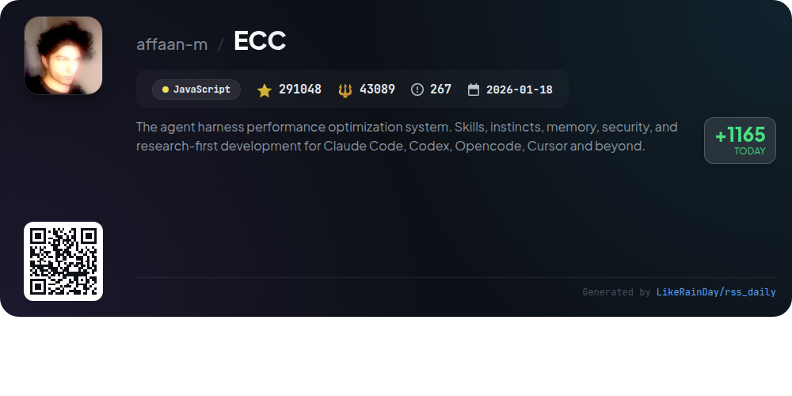

# 📊 🌟 GitHub Trending Daily - 2026-10-28

> > 📅 每日精选 GitHub 热门仓库 | 基于智能算法推荐

## 📋 Overview

**10** 个项目 | **645289** ⭐ | **75005** 🍴

**热门语言:** `TypeScript` (5) · `JavaScript` (4) · `Rust` (1)

**更新时间:** 2026-10-28 05:08 UTC

**分类分布:**

- 🌟 每日 Top 10 精选 (10 项)

---

## 🌟 每日 Top 10 精选

### 1. [LinkSwift](https://github.com/hmjz100/LinkSwift)

> 🤖 **推荐理由**  
> *LinkSwift is a JavaScript-based tool designed for obtaining direct download links from various cloud storage services, including Baidu Cloud, Alibaba Cloud, China Mobile Cloud, Tianyi Cloud, Xunlei Cloud, Quark Cloud, UC Cloud, and 123 Cloud. It enhances functionality over its predecessor by offering a user-friendly interface, support for multiple download managers, and regular updates for compatibility with changing service APIs. With over 33,000 stars on GitHub, LinkSwift prioritizes compliance and user needs, providing a reliable solution for efficient file downloads.*

- ⭐ 33358 stars
- 💻 JavaScript
- 📅 Updated: 2026-10-28

### 2. [cindy](https://github.com/makecindy/cindy)

> 🤖 **推荐理由**  
> *Cindy is an open-source AI agent designed for seamless multi-device integration, enabling users to collaborate across computers and mobile devices effortlessly. Key features include remote desktop access, shared workflows with models like Claude Code and Codex, and customizable companions for various tasks. Automations, plugins, and a rich interactive interface enhance productivity. With built-in tools and a focus on real work within users' existing applications, Cindy transforms the way tasks are managed, making it a versatile solution for individuals and teams alike.*

- ⭐ 7629 stars
- 💻 TypeScript
- 📅 Updated: 2026-10-28

### 3. [impeccable](https://github.com/pbakaus/impeccable)

> 🤖 **推荐理由**  
> *Impeccable is a Rust-based design vocabulary tool for AI coding agents, featuring 24 commands and 62 deterministic rules to enhance frontend design quality. Its core capabilities include setting up project context with `/impeccable init`, conducting audits and critiques, and ensuring visual consistency with commands like `polish` and `distill`. Impeccable integrates seamlessly with popular AI tools like GitHub Copilot and Claude Code, enabling live browser iteration and automatic design detection without API keys. For more information, visit [impeccable.style](https://impeccable.style).*

- ⭐ 90863 stars
- 💻 Rust
- 📅 Updated: 2026-10-28

### 4. [thinkrail](https://github.com/JetBrains/thinkrail)

> 🤖 **推荐理由**  
> *ThinkRail is an innovative IDE designed to enhance coding with its adaptive, agentic features. It offers isolated workspaces for seamless project management, real-time collaboration through concurrent `pi` sessions, and a rich interface that includes a Monaco editor, live git change marks, and integrated terminal. ThinkRail leverages living specs for project knowledge, supports extension customization, and connects securely to user credentials without managing accounts. Available as a desktop app or CLI, it prioritizes user privacy and offers multi-language support, making it a versatile tool for developers.*

- ⭐ 4230 stars
- 💻 TypeScript
- 📅 Updated: 2026-10-28

### 5. [dsh-purge](https://github.com/YuJunZhiXue/dsh-purge)

> 🤖 **推荐理由**  
> *dsh-purge is an open-source cybersecurity red-team plugin for DeepSeek Harness, enabling model-specific jailbreaks and prompt customization. Key features include a user-friendly interface with "Clean" and "Drill" tabs for managing patches, prompt editing, and rule sets. Designed for local lab environments, it ensures compliance by restricting operations to private networks only. With over 11,000 stars on GitHub, dsh-purge focuses on safe, controlled evaluations, making it a valuable tool for cybersecurity professionals. Attribution is required for forks, and reselling the original is prohibited.*

- ⭐ 11313 stars
- 💻 JavaScript
- 📅 Updated: 2026-10-28

### 6. [ECC](https://github.com/affaan-m/ECC)

> 🤖 **推荐理由**  
> *ECC is a powerful performance optimization system for coding agents, supporting tools like Claude Code, Codex, and Cursor. With 71 specialized agents and 311 skills, it streamlines workflows through TDD, security audits, and continuous learning. Key features include a guided installation process, memory management, and AgentShield for security scanning. ECC enhances coding efficiency by automating context management, rule enforcement, and agent collaboration. It is open-source and MIT-licensed, ensuring robust community support and ongoing development.*

- ⭐ 291048 stars
- 💻 JavaScript
- 📅 Updated: 2026-10-28

### 7. [postiz-app](https://github.com/gitroomhq/postiz-app)

> 🤖 **推荐理由**  
> *Postiz is a powerful social media scheduling tool designed for seamless content management. With over 39,000 stars, it enables users to schedule, automate, and analyze posts across platforms like Instagram, YouTube, and TikTok. Key features include team collaboration, robust analytics, and AI integrations for content enhancement. Users can choose between Postiz Cloud for a managed experience or self-host the open-source version. It supports automation via APIs and offers extensive integration capabilities with platforms like N8N and Zapier, ensuring flexibility and compliance with social media standards.*

- ⭐ 39564 stars
- 💻 TypeScript
- 📅 Updated: 2026-10-28

### 8. [hyperframes](https://github.com/heygen-com/hyperframes)

> 🤖 **推荐理由**  
> *HyperFrames is an open-source framework designed for creating deterministic MP4 videos from HTML, CSS, and animations, making it ideal for AI coding agents. With over 74,000 stars, it supports local CLI usage and integrates seamlessly with coding assistants like Claude Code and Codex. Key features include a user-friendly interface for video composition, a catalog of reusable components, and support for various animation libraries. HyperFrames emphasizes reproducibility, allowing consistent video outputs without build steps, and is licensed under Apache 2.0. Explore its capabilities at hyperframes.studio.*

- ⭐ 74081 stars
- 💻 TypeScript
- 📅 Updated: 2026-10-28

### 9. [openbot](https://github.com/nightly-labs/openbot)

> 🤖 **推荐理由**  
> *OpenBot is a local-first desktop workspace designed for persistent AI teammates, allowing users to run models like Codex, Claude, and Grok. Key features include dedicated workspaces for each agent, task queues, file sharing, and agent-to-agent collaboration. It supports customizable endpoints, context monitoring, and a persistent embedded browser. Users can easily create and manage agents with prompt-driven interfaces and enjoy seamless file transfers and shared chats. OpenBot prioritizes privacy and local data management, making it suitable for developers and teams.*

- ⭐ 2624 stars
- 💻 TypeScript
- 📅 Updated: 2026-10-28

### 10. [archify](https://github.com/tt-a1i/archify)

> 🤖 **推荐理由**  
> *Archify is an open-source tool designed to transform ideas, plans, or codebases into interactive diagrams. It integrates seamlessly with AI agents like Claude Code and Codex, allowing users to create visual representations from simple descriptions or source code. Key features include customizable HTML outputs, various diagram types (architecture, workflows, data flows), and easy sharing options. With over 90,579 stars on GitHub, Archify fosters community contributions and offers live demos, making it a valuable resource for visualizing complex systems.*

- ⭐ 90579 stars
- 💻 JavaScript
- 📅 Updated: 2026-10-28

---

## 📡 RSS订阅

通过 RSS 订阅，第一时间获取每日精选项目：

- 🔔 [RSS 订阅源] (../../daily-top.xml)
- 🔔 [每日简报] (../../GITHUB_TODAY_CN.md)
- 🔔 [每日 Top 10 精选](../../daily-top.xml)

---

*⚡ Powered by Smart Trending Algorithm | Generated at 2026-10-28 05:08:01 UTC
